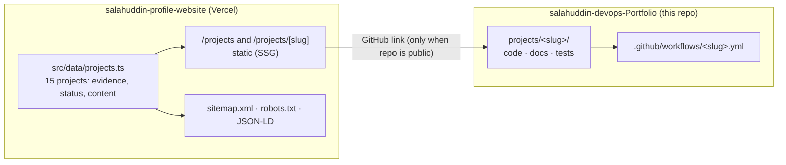

# Architecture overview

- **Website:** Next.js 16 App Router, fully static output. Content is typed data, not CMS. Client JS limited to the navbar and the gallery filter.
- **Examples repo:** independent projects, each runnable and testable locally with no cloud account. CI per project via path filters.
- **Contract between them:** the project slug and the `status` field. When a project's code passes validation here, flip its `status` to `implemented` in the website and update `docs/implementation-status.md`.
