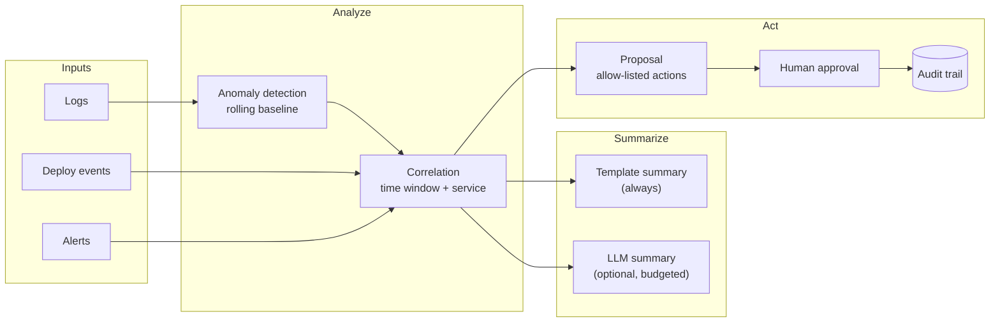

# AI-Powered Cloud Operations

> **Classification: Working portfolio implementation.** Synthetic data, no
> production incidents or figures claimed. Informed by CV work on AI-based
> log anomaly detection and AI/LLM-assisted operations; none of the numbers
> here come from that work. External AI calls are optional and off by
> default.

A Python pipeline (standard library only) that detects log anomalies
deterministically, correlates them with deploy events and alerts,
optionally drafts an incident summary with an LLM, and **proposes — never
executes — remediation** that requires explicit human approval before it is
recorded as approved.

## Problem

On-call engineers spend the first part of every incident assembling
context from three places that don't talk to each other: logs, deploy
history and alert history. By the time that context exists, minutes of
mean-time-to-resolution are already gone — and an "AI ops" tool that skips
straight to "here's what I think happened" or, worse, "here's what I did
about it" trades that time problem for a trust and safety problem.

## Solution

Do the deterministic work first — a rolling error-rate baseline, a z-score,
and a time-window correlation against deploys and alerts for the same
service. That alone answers "is this unusual, and did something change
recently?" without a model. An LLM is used, only if explicitly enabled,
to turn that already-computed evidence into readable prose, under a token
budget, after the log content it might see has been redacted. Whatever
mitigation the pipeline would suggest is always just a *proposal*: an
allow-listed action name, a rationale, and a requirement that a human
approve it before it is ever recorded as approved. Nothing in this
codebase is capable of executing an action against a real system.

## What it demonstrates

| Area | Implementation |
|---|---|
| Deterministic anomaly detection | Rolling-baseline z-score over per-service, per-time-bucket error rate; documented threshold and zero-variance floor ([architecture](docs/architecture.md)) |
| Correlation | Time-window (+/- 15 min, configurable) + exact service match against deploy events and alerts |
| Summarization | A template summary is always computed; an optional, budgeted LLM summary only describes already-computed findings |
| Guardrailed remediation | A 4-item allow-list of action *names*; anything else is reported, never proposed |
| Human approval | `Proposal.allowed` gates `AuditLog.approve()`; no code path executes an action |
| Audit trail | Append-only JSONL; every proposal and every approve/reject decision, with timestamp and actor |
| LLM isolation | `LLMProvider` interface with a no-op default: zero network calls and zero API keys out of the box |
| Redaction | Emails, IPv4s, credential-shaped `key=value` pairs and bare provider tokens masked before any text reaches the (optional) LLM step |
| Engineering hygiene | Frozen dataclasses, deterministic synthetic-data generator, 66 unit tests, CLI smoke tests via `subprocess`, CI with path filters |

## Architecture



Full module-by-module breakdown, the exact anomaly-detection method and the
remediation decision table: [docs/architecture.md](docs/architecture.md).

## Quickstart

Python 3.11+, nothing to install. From this directory:

```bash
python3 -m aiops generate --out sample-data        # deterministic synthetic data (seed 11)
python3 -m aiops run --out out                     # analyze -> correlate -> summarize -> propose
python3 -m aiops approve --out out --id <id> --actor you@example.com
python3 -m aiops audit --out out                   # print the append-only audit log
```

Every `run` writes `--format text|json|markdown`; see
[docs/operations.md](docs/operations.md) for every option, exit codes, and
exactly what `--use-llm` does and doesn't do.

## Sample output

Real output from the commands above, run locally on the committed sample
data (3 services, 4 hours, 5-minute buckets, one injected anomaly
correlated with a deploy and an alert; seed 11).

`python3 -m aiops run --out out`:

```text
1 anomaly/anomalies detected.

[checkout-api] 2026-10-01T02:30:00+00:00 z=38.00 observed=40.0% baseline=2.0%+/-1.0%
  summary (template): checkout-api: error_rate 40.0% in 2026-10-01T02:30:00+00:00Z-2026-10-01T02:35:00+00:00Z (baseline 2.0% +/- 1.0%, z=38.00, n=50). Correlated with deploy(s): v1.42.0 by ci-bot. Correlated with alert(s): HighErrorRate (critical).
  proposal c712802937ba147b: rollback-deploy (allowed=True) -- Anomaly window for checkout-api overlaps deploy(s) v1.42.0; rolling back is the highest-confidence mitigation.
```

`python3 -m aiops approve --out out --id c712802937ba147b --actor oncall@example.com`:

```text
approved c712802937ba147b (rollback-deploy) by oncall@example.com; appended to out/audit.jsonl
```

`python3 -m aiops audit --out out`:

```text
2026-10-19T17:21:49.457642+00:00 proposed  actor='aiops-pipeline' service='checkout-api' action='rollback-deploy' id=c712802937ba147b
2026-10-19T17:21:54.118645+00:00 approved  actor='oncall@example.com' service='checkout-api' action='rollback-deploy' id=c712802937ba147b
```

`out/audit.jsonl` (two JSON lines, append-only, the actual file content):

```json
{"action": "rollback-deploy", "actor": "aiops-pipeline", "details": {"allowed": true, "rationale": "Anomaly window for checkout-api overlaps deploy(s) v1.42.0; rolling back is the highest-confidence mitigation."}, "event": "proposed", "proposal_id": "c712802937ba147b", "service": "checkout-api", "timestamp": "2026-10-19T17:21:49.457642+00:00"}
{"action": "rollback-deploy", "actor": "oncall@example.com", "details": {}, "event": "approved", "proposal_id": "c712802937ba147b", "service": "checkout-api", "timestamp": "2026-10-19T17:21:54.118645+00:00"}
```

`python3 -m aiops run --use-llm --out out` (same result — the default
provider is a no-op, so the summary is still the template; this just
exercises the redaction + token-budget code path with zero network calls):

```text
1 anomaly/anomalies detected.

[checkout-api] 2026-10-01T02:30:00+00:00 z=38.00 observed=40.0% baseline=2.0%+/-1.0%
  summary (template): checkout-api: error_rate 40.0% in 2026-10-01T02:30:00+00:00Z-2026-10-01T02:35:00+00:00Z (baseline 2.0% +/- 1.0%, z=38.00, n=50). Correlated with deploy(s): v1.42.0 by ci-bot. Correlated with alert(s): HighErrorRate (critical).
  proposal c712802937ba147b: rollback-deploy (allowed=True) -- Anomaly window for checkout-api overlaps deploy(s) v1.42.0; rolling back is the highest-confidence mitigation.
```

## Tests

```bash
python3 -m unittest discover -s tests -v
# Ran 66 tests ... OK
```

Hand-built fixtures cover: the rolling z-score on a flat baseline, a
detected spike, the zero-variance floor, sparse buckets below `min_events`,
insufficient history, and multi-service independence; correlation matching
by time window and service in both directions; redaction of emails, IPs,
`key=value` secrets and bare provider tokens, individually and combined;
the template summary's content; that the default config and the no-op LLM
provider never produce an external call and that redaction still runs when
the LLM path is taken; that every chosen remediation action is on the
allow-list and that proposal ids are deterministic; that the audit log is
append-only across separate `AuditLog` instances and that `approve()`
refuses a disallowed proposal without writing anything; generator
determinism (same seed -> byte-identical files) and an end-to-end check
that the committed sample data produces exactly one anomaly, correlated
with both the deploy and the alert, proposing `rollback-deploy`; and CLI
smoke tests through `subprocess` for the full `generate -> run -> approve
-> audit` flow and for error paths (unknown proposal id, no anomalies).

## Security

The analysis process holds no credentials capable of executing anything —
`propose()` only ever returns a data object. The LLM provider interface
defaults to a no-op, so the pipeline runs with zero external calls and zero
API keys unless you explicitly supply a provider from your own code. Log
content is redacted before it would reach that provider. Full threat table:
[docs/security.md](docs/security.md).

## Reliability

The pipeline works fully offline end to end: detection, correlation,
summarization and proposal generation have no network dependency. The only
degradation path is the optional LLM step, which falls back to the
template summary on `None`/empty output from the provider rather than
raising — a provider outage degrades the summary's prose, never the
statistics or the proposal.

## Cost

Illustrative only. Each incident's optional LLM summary is bounded by
`--token-budget` (default 400 output tokens) and one call per correlated
anomaly; a real deployment would add a daily cap across all incidents.
With the default `NoOpLLMProvider`, cost is exactly $0 regardless of
traffic volume, which is also why it's the default.

## Results

Illustrative only — this is a portfolio implementation exercised against
synthetic data, not a production case study. The "Sample output" section
above is the full, unedited result of running the committed pipeline
against the committed sample data.

## Limitations

- **Synthetic data only.** `sample-data/` is generated by a seeded script
  (`aiops generate`); the services, timestamps and messages are invented.
- **Single metric.** Only error rate is monitored. Latency, throughput and
  saturation anomalies would need their own bucketed metric and the same
  z-score method, or a different one.
- **No seasonality.** The rolling baseline assumes error rate is otherwise
  stationary over the trailing window; a service with a strong daily or
  weekly cycle needs a baseline that accounts for it (e.g. same-hour-
  yesterday) or it will flag normal peaks.
- **Correlation is time + service only.** It doesn't inspect deploy diffs,
  alert payloads, or causal chains between services — it's a first filter
  for a human, not a root-cause engine.
- **Remediation selection is illustrative.** The four-branch decision in
  `remediation.py` is simple on purpose, to keep every proposal traceable
  to the same numbers in the summary; it is not a learned or tuned
  playbook.
- **No real LLM provider is implemented or tested against a network.** The
  interface and no-op default are tested; wiring in a real provider is
  documented but intentionally left undone here.
- **In-memory processing.** Fine for the sample data's thousands of events;
  a real log volume would need streaming ingestion and a persisted
  baseline rather than recomputing from the full event list each run.

## Lessons

- **Most of the value is in correlation, which does not need a model.**
  Knowing a deploy landed four minutes before an error spike turns a vague
  "something's wrong" into "check this rollout first" — that's a sorted
  comparison over three lists, not an LLM call.
- **The allow-list is the safety boundary, not the model.** Whether the
  summary comes from a template or an LLM, the only thing that can ever be
  "approved" is one of four pre-agreed action names; novel or unexpected
  actions are structurally unable to reach that state.
- **A no-op default is a feature, not a placeholder.** Shipping
  `NoOpLLMProvider` as the default — rather than a stub that raises or a
  `TODO` — means the whole pipeline, its tests and its CI run identically
  whether or not anyone ever plugs in a real model.
- **Redact at the boundary, not at the source.** Running redaction
  immediately before the prompt is built (rather than relying on upstream
  log hygiene) means the guardrail holds even when a log line slips through
  with something it shouldn't contain.
