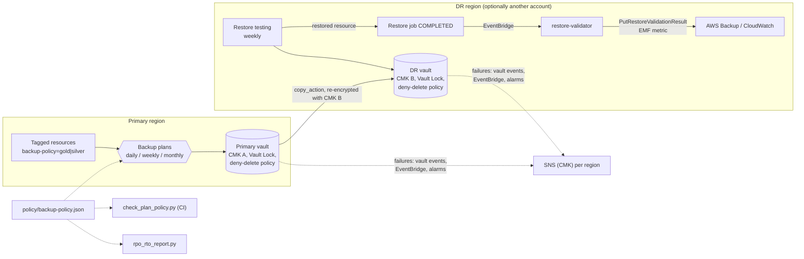

# AWS Backup: Cross-Region DR, Immutability and Restore Testing

> **Classification: Working portfolio implementation. Synthetic environment, no production results claimed.**
> Owner: Muhammad Salahuddin, Senior DevOps Engineer. The Terraform is validated, never applied;
> the job history is hand-built synthetic data; cost figures are illustrative, approximate list prices.

Backups that survive the bad day, and evidence that they restore. The project
covers four things: **AWS Backup plans** (daily, weekly and monthly, selected
by tag), a **copy of every gold recovery point to a second region** (and
optionally a second account), **immutability** that a compromised admin can't
undo (Vault Lock, a deny-delete vault policy, a separate key per region), and
**automated restore testing** with a validator that reports a real verdict.
A policy file drives Terraform, a CI gate and an RPO/RTO report, so the
retention you review is the retention you deploy and the retention you're
measured against.

## Problem

Most backup setups look fine until someone needs one:

- **Backups exist, but nobody has restored one.** The first restore attempt
  happens during an incident, from a snapshot nobody has tested, with a KMS
  key policy nobody has checked.
- **The "DR copy" lives in the same blast radius.** It's in the same
  region, or the same account, or encrypted with the same key. An attacker
  with admin rights deletes the recovery points and schedules the key for
  deletion before encrypting production.
- **Copies fail silently.** A key-policy change breaks cross-region copies.
  Primary backups keep succeeding, dashboards stay green, and the DR region
  slowly drifts days behind.
- **Retention rules are wrong in ways that only show up later.** A cold
  storage transition 30 days before deletion is billed for 90 days anyway.
  A retention outside the vault lock range makes every backup job fail.
- **RPO and RTO are numbers on a slide**, not measured from job history.

## What it demonstrates

| Area | Implementation |
|---|---|
| Backup plans | One plan per tier from `policy/backup-policy.json`: daily, weekly and monthly rules, start and completion windows, recovery-point tags, cold-storage lifecycle, continuous backup (PITR) per rule behind `enable_continuous_backup` |
| Cross-region copy | `copy_action` to a DR vault in the DR region with its **own lifecycle**. Copies are re-encrypted with the DR vault's CMK, which lives in the DR region. Every gold rule must copy (Terraform validation + BKP-001) |
| Optional cross-account | Point `aws.dr` at a recovery account. The module detects it and adds `CopyIntoBackupVault` and key-policy trust for the primary account, with restore roles in the recovery account |
| Selection | Tag conditions: `backup-policy = gold\|silver` AND NOT `backup-exclude = true` (conditions AND, `selection_tag` ORs) |
| Immutability | Vault Lock on both vaults, **governance by default**, compliance via one variable, documented as irreversible after the grace period ([ADR 0002](docs/decisions/0002-governance-vs-compliance-lock.md)). Min/max validated, every retention checked against the lock range. Vault policy denies `DeleteRecoveryPoint` and `UpdateRecoveryPointLifecycle` to all but a break-glass role |
| Keys | Four rotating CMKs: one per vault, one per notification topic. Key policies name the backup roles and the publishing services |
| Alerting | Per region: vault notifications (`BACKUP_JOB_FAILED`, `COPY_JOB_FAILED`, `RESTORE_JOB_COMPLETED`, `RECOVERY_POINT_MODIFIED`...), EventBridge rules for failed, expired and aborted jobs, and alarms on `NumberOfBackupJobsFailed` / `NumberOfCopyJobsFailed`. All of it goes to a CMK-encrypted SNS topic |
| Restore testing | AWS Backup native restore testing in the DR region against the **DR vault** (weekly, latest point in 7 days, per-type selections, isolated subnet override) ([ADR 0003](docs/decisions/0003-native-restore-testing.md)) |
| Restore validator | Standard-library Lambda: RDS reachable + row-count hook, DynamoDB item count, S3 object count + checksum sample, EBS available. `PutRestoreValidationResult`, a JSON log, and an EMF metric `RestoreValidationSucceeded` with a per-type alarm. Optional early cleanup refuses untagged resources, in code and in IAM |
| Audit | Optional Backup Audit Manager framework: min frequency and retention, encrypted recovery points, cross-region protection for gold |
| Policy as code | `check_plan_policy.py`: 7 checks on the policy file Terraform reads (copy for gold, tier minimums, cold + 90 ≤ delete, AWS cron, lock coherence, retention inside the lock, PITR limits) |
| RPO/RTO evidence | `rpo_rto_report.py`: per resource, last backup age vs RPO, DR copy age and copy lag, restore-test pass rate, worst restore vs RTO. Markdown output, exits 1 on a gold RPO breach |
| Infrastructure as code | Root module + regional submodule, `aws >= 6.0, < 7.0`, `configuration_aliases`, variable validations (single and cross-variable), validation harness + example, no credentials or real account IDs |

## Architecture



The backup and copy flow, the restore-testing loop and the alerting path are
detailed in [docs/architecture.md](docs/architecture.md).

## Layout

```text
terraform/    modules/backup-dr (root + modules/regional-vault + validation-harness), examples/basic
policy/       backup-policy.json (single source of truth), fixtures/backup-policy-noncompliant.json
src/          restore_validator/ (Lambda: handler, validators, adapters + fakes, telemetry)
scripts/      check_plan_policy.py, rpo_rto_report.py
sample-data/  jobs.json (synthetic list-backup/copy/restore-jobs output, placeholder account)
tests/        unittest suites
docs/         architecture, operations, security, cost, decisions/
```

## Quickstart

Python 3.12 (the CI version; also runs on newer 3.x), nothing to install.
From this directory:

```bash
python3 -m unittest discover -s tests -v                                   # all tests
python3 scripts/check_plan_policy.py policy/backup-policy.json             # exit 0
python3 scripts/check_plan_policy.py policy/fixtures/backup-policy-noncompliant.json   # exit 1
python3 scripts/rpo_rto_report.py sample-data/jobs.json                    # exit 1 (gold RPO breach)
python3 scripts/rpo_rto_report.py sample-data/jobs.json --now 2026-10-13T05:00:00Z     # exit 0
```

`check_plan_policy.py` exits 0 with no findings, 1 with findings, and 2 on
a malformed policy. `rpo_rto_report.py` exits 0 when no gold resource
breaches its RPO, 1 when one does, and 2 on bad input. It evaluates as of
`--now`, else the file's `as_of`, else the current time, and ignores jobs
created after that moment. `-o report.md` also writes the Markdown to a file.

Against real data (needs credentials; not done in this repo): export
`aws backup list-backup-jobs`, `list-copy-jobs` and `list-restore-jobs` from
both regions, add a `resources` inventory with each resource's tier, and
use the `sample-data/jobs.json` layout.

## Sample output

All excerpts below are real output from this machine, run on 2026-10-14.

The RPO/RTO report over the synthetic history (five resources: one healthy
gold database, a gold table whose last two backups failed on a KMS grant, a
gold bucket whose latest copy failed, and two silver resources, one with a
failed restore test):

```text
$ python3 scripts/rpo_rto_report.py sample-data/jobs.json
## RPO/RTO report (as of 2026-10-14T06:00:00Z)

| Resource | Type | Tier | Last backup age | RPO | DR copy age | Copy lag | Last copy | Restore tests | Worst restore | RTO | Status |
|---|---|---|---|---|---|---|---|---|---|---|---|
| orders-db | RDS | gold | 2h55m | 26h00m | 2h55m | 0h40m | COMPLETED | 2/2 (100%) | 0h52m | 4h00m | OK |
| sessions-table | DynamoDB | gold | 50h58m | 26h00m | 50h58m | 0h11m | COMPLETED | 1/1 (100%) | 0h18m | 4h00m | RPO BREACH |
| media-assets | S3 | gold | 2h50m | 26h00m | 26h50m | 1h03m | FAILED | 1/1 (100%) | 4h41m | 4h00m | COPY FAILED, RTO BREACH |
| build-cache | EBS | silver | 2h28m | 50h00m | 73h30m | 0h27m | COMPLETED | 1/2 (50%) | 0h13m | 24h00m | RESTORE TEST FAILED |
| reports-db | RDS | silver | 2h29m | 50h00m | 73h29m | 0h36m | COMPLETED | none | n/a | 24h00m | OK |

### Findings

- sessions-table: last successful backup 50h58m ago exceeds RPO 26h00m
- sessions-table: newest DR recovery point is 50h58m old, beyond RPO 26h00m for a regional loss
- media-assets: latest copy to DR FAILED: Insufficient privileges to perform this action on the destination vault key.
- media-assets: newest DR recovery point is 26h50m old, beyond RPO 26h00m for a regional loss
- media-assets: worst restore 4h41m exceeds RTO 4h00m
- build-cache: 1 of 2 restore tests failed
- reports-db: no restore test on record, RTO unproven

Result: FAIL (1 gold resource(s) breach RPO: sessions-table)
(exit 1)
```

Reading it: `sessions-table` is the page. Two days without a good backup,
and the message points at the table's KMS key policy. `media-assets` looks
fine on primary age (2h50m), but its DR point is past the RPO, so a regional
outage right now would lose more than a day. That's the "copies fail
silently" case, caught by the copy-age column rather than by backup success.
Its restore also takes longer than its RTO. `build-cache`'s DR copy age of
73h is expected: silver copies weekly, so it isn't flagged.

The policy gate on the shipped policy and on the deliberately broken fixture:

```text
$ python3 scripts/check_plan_policy.py policy/backup-policy.json
check_plan_policy: policy/backup-policy.json: 2 plans, 6 rules, 7 checks
PASS BKP-001  Every rule in a copy-required tier has a cross-region copy to the DR vault
PASS BKP-002  Retention meets the tier minimum (primary and DR copies)
PASS BKP-003  Cold storage transition is at least 90 days before deletion
PASS BKP-004  Schedule is a valid AWS cron expression, at most once per hour
PASS BKP-005  Vault lock: valid mode, 1 <= min <= max, compliance grace period >= 3 days
PASS BKP-006  Every retention is inside the vault lock [min, max] range
PASS BKP-007  Continuous backup rules keep <= 35 days and use no cold storage
Summary: 0 finding(s) in 0 check(s). Result: PASS
(exit 0)
```

```text
$ python3 scripts/check_plan_policy.py policy/fixtures/backup-policy-noncompliant.json
check_plan_policy: policy/fixtures/backup-policy-noncompliant.json: 2 plans, 4 rules, 7 checks
FAIL BKP-001  Every rule in a copy-required tier has a cross-region copy to the DR vault
       gold/daily: no cross-region copy to the DR vault (copy_to_dr is not true)
FAIL BKP-002  Retention meets the tier minimum (primary and DR copies)
       gold/weekly: DR copy retention 30d < minimum 90d for gold weekly
FAIL BKP-003  Cold storage transition is at least 90 days before deletion
       gold/monthly: primary: cold storage at 300d + 90d = 390d > delete at 365d
FAIL BKP-004  Schedule is a valid AWS cron expression, at most once per hour
       gold/weekly: 'cron(0 4 * * SUN *)': exactly one of day-of-month and day-of-week must be '?'
       silver/hourly: 'cron(*/15 * * * ? *)': minutes must be a single value: AWS Backup runs a rule at most once per hour
FAIL BKP-005  Vault lock: valid mode, 1 <= min <= max, compliance grace period >= 3 days
       vault_lock: compliance mode needs changeable_for_days >= 3, got 1
FAIL BKP-006  Every retention is inside the vault lock [min, max] range
       gold/monthly: primary retention 365d outside vault lock range 7-100d: backup jobs would fail
       gold/monthly: DR copy retention 365d outside vault lock range 7-100d: backup jobs would fail
FAIL BKP-007  Continuous backup rules keep <= 35 days and use no cold storage
       gold/daily: continuous backup retention 60d > 35d
Summary: 9 finding(s) in 7 check(s). Result: FAIL
(exit 1)
```

What the validator posts to AWS Backup and logs, for a restored DynamoDB
table (from the unit tests' fakes; the EMF line is what CloudWatch turns
into the metric):

```json
{"_aws":{"Timestamp":1791957600000,"CloudWatchMetrics":[{"Namespace":"BackupDR/RestoreTesting","Dimensions":[["ResourceType"]],"Metrics":[{"Name":"RestoreValidationSucceeded","Unit":"Count"}]}]},"ResourceType":"DynamoDB","RestoreValidationSucceeded":1,"restoreJobId":"rj-1","createdResourceArn":"arn:aws:dynamodb:us-west-2:123456789012:table/awsbackup-restore-test-sessions"}
```

## Tests

```bash
python3 -m unittest discover -s tests -v
# Ran 118 tests ... OK
```

They cover:

- **the restore validator**, for each resource type with success and
  failure: RDS available/unavailable/unreachable/no endpoint, row count
  above, below and stubbed; DynamoDB above, below and empty; S3 count,
  checksum match, mismatch and unverifiable samples; EBS available and
  error; a missing resource and a probe exception becoming FAILED; message
  truncation;
- **routing**: non-COMPLETED events, manual (non-test) restores, unsupported
  types (no verdict posted), events without a job ID, and an API failure
  propagating so Lambda retries;
- **telemetry**: the EMF line's shape (directive, namespace, dimension,
  metric, value 1/0, every named member present at top level) and the
  structured log record;
- **cleanup safety**: untagged resources refused, tagged ones deleted, S3
  never deleted, a custom tag key honoured, and cleanup running only when
  enabled;
- **the boto3 adapters** through stub clients (pagination, early stop,
  not-found mapping, checksum recomputation for SHA-256, MD5 ETag,
  multipart and SSE-KMS), with a check that boto3 is never imported;
- **the RPO/RTO math** pinned against the sample (ages, copy lag, DR age,
  pass rate, worst restore, targets from the policy), no successful backup,
  unvalidated and running restores, jobs after `--now` ignored, silver
  breaches not gating, table shape, and exit codes 0, 1 and 2;
- **the policy checker**: the shipped policy passing, the fixture tripping
  all seven checks, a targeted mutation per check (including the exact
  90-day boundary), 20 cron cases, and exit codes 0, 1 and 2;
- **CLI smoke tests** through `subprocess` for both scripts and the
  validator package importing without boto3;
- **Terraform invariants** that `validate` can't see: governance default and
  the irreversibility warning, lock and cold-storage validations, deny-delete
  statements, per-vault CMKs, the DR provider wiring, key-policy service
  principals, alarms and event patterns, tag selection, managed policies,
  tag-conditioned cleanup permissions, audit controls, the policy file read
  by both callers, lock files present, and no account IDs other than the
  documentation placeholder.

## Terraform validation

Module: [`terraform/modules/backup-dr`](terraform/modules/backup-dr) (with
the [`regional-vault`](terraform/modules/backup-dr/modules/regional-vault)
submodule called once per region). The module takes `aws.primary` and
`aws.dr` through `configuration_aliases`, so it validates through a minimal
[`validation-harness`](terraform/modules/backup-dr/validation-harness)
(two region-only providers) and through
[`examples/basic`](terraform/examples/basic). Never applied. Validation only:

```bash
cd terraform
terraform fmt -check -recursive
terraform -chdir=modules/backup-dr/validation-harness init -backend=false && terraform -chdir=modules/backup-dr/validation-harness validate
terraform -chdir=examples/basic init -backend=false && terraform -chdir=examples/basic validate
# Success! The configuration is valid.   (both)
```

Validated with Terraform 1.14.8, `hashicorp/aws` 6.68.0 and
`hashicorp/archive` 2.8.1.

Both callers read `policy/backup-policy.json` with `jsondecode(file())`, so
`validate` also runs the module's single-variable validations against the
real policy. The cross-variable ones (lock min ≤ max, every retention inside
the lock range) need Terraform 1.9+ and run at plan time. They were
exercised with `terraform console` against a scratch caller fed the
non-compliant fixture, which rejected it. `validate` itself caught one real
schema issue during development: a restore-testing selection can take tag
conditions or explicit ARNs, not both.

No account IDs or credentials: `aws_caller_identity`, `aws_region` and
`aws_partition` supply them at plan time. The break-glass role default uses
the documentation placeholder `123456789012`. See [cost](docs/cost.md).

## Limitations

- **Never deployed.** Nothing has run in AWS: not the plans, the copies, the
  lock, the key policies, the restore tests, the validator against real
  restored resources, or the event patterns against real events.
  `terraform validate` checks the schema, not the behaviour.
- **Synthetic job history.** `sample-data/jobs.json` follows the documented
  shapes of `list-backup-jobs`, `list-copy-jobs` and `list-restore-jobs`, but
  was hand-built (by a small generator), not exported. The `resources`
  inventory is an addition, because the job APIs don't return tags.
- **Unverified AWS details**, each isolated behind a variable or a re-read:
  - the tag AWS applies to restore-testing resources (`restore_test_tag_key`);
  - restore testing with tag conditions against cross-region copies;
  - the full `Restore Job State Change` event schema (the handler re-reads
    the job with `DescribeRestoreJob`);
  - the dimensions AWS publishes on the `AWS/Backup` job metrics (the alarms
    use the dimensionless, region-wide series);
  - the key-policy principals needed for cross-account copies with CMKs.
- **The RDS row count is a stub.** The standard library has no database
  driver. It turns on with a `row_counter` hook (pg8000 or PyMySQL in a
  layer, credentials from Secrets Manager). Until then the validator reports
  "row count skipped" instead of pretending. The TCP check needs the Lambda
  in the DR VPC.
- **The DR region's RPO is the last copied snapshot.** PITR stays in the
  source region. Tighter regional RPOs need replication as well, which is
  not a backup ([ADR 0001](docs/decisions/0001-aws-backup-vs-native-snapshots.md)).
- **No SCP or break-glass role in this module.** Governance-mode lock needs
  the SCP in [security](docs/security.md#immutability) to resist a
  compromised admin. The landing-zone project shows the SCP pattern.
- **No dead-letter queue** on the EventBridge targets. A validator that's
  down for over an hour misses the validation window silently. The alarms
  only see validations that ran.
- **The report gates on gold RPO only.** Copy failures, failed restore tests
  and RTO breaches are reported, not gating, on purpose. Change
  `GATED_TIER` or the exit rule if your process wants more.

## Interview talking points

- **A backup you haven't restored is a hope.** Native restore testing does
  the scheduling and the cleanup. The value I add is the verdict: is the
  table non-empty, does the database accept connections, do sampled S3
  objects match their checksums. `RESTORE_JOB_COMPLETED` alone means the API
  finished, not that the data is there.
- **Test the DR copy, not the primary.** Restoring from the DR vault
  exercises the copy job, the DR key policy and the DR vault in one go,
  which is everything a regional failover depends on.
- **Copies fail quietly.** Primary backups stay green while the DR region
  drifts. The report's "DR copy age" column and the `COPY_JOB_FAILED` paths
  exist for exactly that. In the sample, a bucket with a 2h50m primary age
  is 26h50m stale in DR.
- **Immutability has layers.** The vault policy decides who may try. The
  lock caps what anyone can do. Separate keys stop "schedule key deletion"
  from reaching both regions. Cross-account removes the primary admin from
  the picture. Governance mode plus an SCP is the default, because
  compliance mode is a one-way door that I'd only walk through with signed-off
  retention values.
- **Retention rules fail late.** Cold storage within 90 days of deletion is
  billed anyway. A retention outside the lock range fails every job. Both are
  caught twice before apply, by the CI checker with an explanation and by a
  Terraform validation.
- **One policy file, three consumers.** Terraform builds the plans from it,
  CI gates it, and the RPO/RTO report measures against its targets. There's
  no drift between "what we said" and "what we deployed".
- **Encrypted SNS breaks silently.** Every publishing service (Backup,
  EventBridge, CloudWatch) is named in the key policy and the topic policy.
  Otherwise the first failed backup alert is also the first failed alert.
