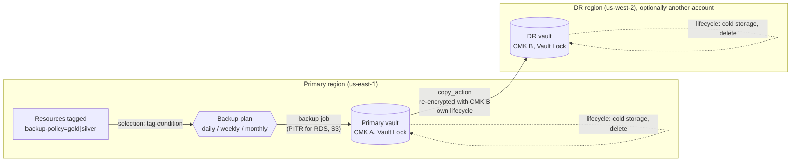
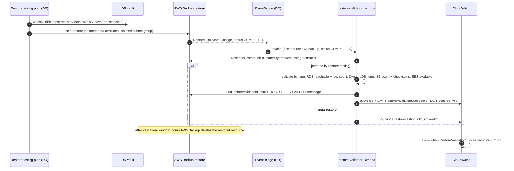
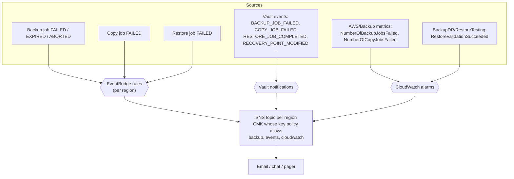
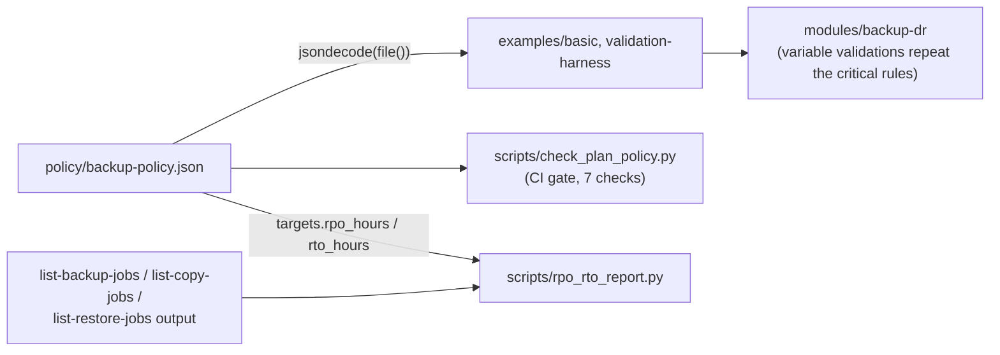

# Architecture

> Portfolio implementation. Validated with `terraform validate`, never
> applied. The flows below describe how the configuration is designed to
> behave; AWS-side behaviour that has not been observed is called out as
> such.

## Components

| Region | Component | Purpose |
|---|---|---|
| Primary | Backup plans `gold` and `silver` | Daily, weekly and monthly rules from `policy/backup-policy.json` |
| Primary | Selections by tag | `backup-policy = gold\|silver` AND NOT `backup-exclude = true` |
| Primary | Primary vault + CMK + Vault Lock + access policy | First copy of every recovery point |
| Both | Encrypted SNS topic, vault notifications, EventBridge failure rules, job alarms | Alerting per region |
| DR | DR vault + its own CMK + Vault Lock + access policy | Destination of `copy_action`; source of restore tests |
| DR | Restore testing plan and selections | Weekly restore of the latest DR copy per resource type |
| DR | `restore-validator` Lambda | Validates restored resources, reports the verdict, emits the metric |
| Primary | Backup Audit Manager framework (optional) | Continuous compliance evidence through AWS Config |

The module is one root (`terraform/modules/backup-dr`) that calls a
regional submodule twice (`modules/regional-vault`, once with `aws.primary`
and once with `aws.dr`). Everything a region needs to stand alone, its
vault, key, lock, policy and alerting, lives in the submodule, so the two
halves can't drift apart.

## Backup and copy flow

Points that matter:

- **Copies are re-encrypted.** AWS Backup decrypts with the source vault's
  key and encrypts with the destination vault's key. The DR key lives in the
  DR region and is never needed to read the primary copies, and the other
  way round. Both service roles are named in each key policy that they use.
- **Each copy has its own lifecycle.** Copy retention is set per rule
  (`dr_delete_after_days`, `dr_cold_storage_after_days`) and is validated
  separately against the 90-day cold-storage minimum and the vault lock range.
- **PITR is per rule.** The gold daily rule sets `continuous = true`. For
  RDS, Aurora, S3 and SAP HANA that becomes continuous backup with up to 35
  days of point-in-time recovery. Other types still get a daily snapshot.
- **Selection uses conditions, not `selection_tag`.** `selection_tag`
  entries are ORed, so they can't express "gold AND not excluded".
  `condition` blocks are ANDed.
- **Cross-account.** Point `aws.dr` at a recovery account and the module adds
  `backup:CopyIntoBackupVault` for the primary account to the DR vault policy
  and a matching key-policy statement. Cross-account backup must also be
  enabled in AWS Organizations (see [security](security.md#optional-cross-account-vault)).

## Restore-testing loop

- **The test runs against the DR copy**, the one a regional failover would
  use. A test of the primary copy says nothing about whether the copy job,
  the DR key policy or the DR vault work.
- **The validator never owns cleanup.** AWS Backup deletes the restored
  resource at the end of the validation window. The optional early cleanup
  only acts on resources carrying the restore-testing tag, and the IAM delete
  permissions carry the same tag condition.
- **Validation must finish inside the window.** The EventBridge target retries
  for at most an hour. A verdict posted after the window closes is rejected,
  and the job keeps no validation status.

## Failure-alerting path

Three independent paths reach the same topic on purpose:

- **Vault notifications** are per vault and include informational events
  (`RESTORE_JOB_COMPLETED`, `RECOVERY_POINT_MODIFIED`). That last one
  matters: a lifecycle change on a recovery point is what an attacker
  shortening retention looks like.
- **EventBridge rules** see account-wide job state changes, including jobs
  that failed before they reached a vault (an IAM or KMS error on the
  source resource).
- **Alarms** catch failures even when the event path is broken, and send OK
  when the next job succeeds.

The topic is encrypted with a CMK. If the key policy didn't allow
`backup.amazonaws.com`, `events.amazonaws.com` and `cloudwatch.amazonaws.com`
to generate data keys, every publish would fail silently. The key policy and
the topic policy both name their publishers, scoped by source account (and by
rule ARN for EventBridge).

## Where the numbers live

`policy/backup-policy.json` is the single source of truth:

The critical rules are enforced twice: by the CI checker, which explains
every finding, and by Terraform variable validations, so a caller that
bypasses the file still can't create an invalid plan. Single-variable
validations fire during `terraform validate`. The cross-variable ones
(lock min ≤ max, retention inside the lock range) are evaluated at plan
time. That was checked with `terraform console` against a bad scratch
caller, without planning.
