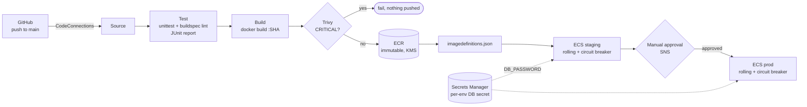

# AWS CodePipeline Container Delivery

> **Classification: Working portfolio implementation. Synthetic application, no production results claimed.**
> Owner: Muhammad Salahuddin, Senior DevOps Engineer. The Terraform is validated, never applied;
> cost figures are illustrative, approximate list prices.

An AWS-native delivery pipeline for a containerised service: GitHub through
an AWS CodeConnections connection, CodePipeline V2, CodeBuild for testing,
building, scanning and pushing to ECR, a manual approval, and rolling
deploys to ECS Fargate with the deployment circuit breaker. A tiny
standard-library Python service is the payload. The focus is the parts that
usually go wrong in container delivery: mutable tags, secrets leaking into
buildspecs and logs, unscanned images reaching the registry, and "how do we
roll back?" having no precise answer.

## Problem

Shipping a container to ECS looks like `docker build && docker push && update-service`.
Done that way, several things break quietly:

- **`latest` moves.** Restarted tasks can pull a different image from their
  siblings, and "roll back" has no defined target.
- **Secrets end up in plaintext.** They go in buildspec `env: variables`, in
  Terraform state through a secret version resource, or in the whole JSON
  blob injected because a reference lacks its `:json-key`.
- **The scan runs after the push**, so a vulnerable image is already in the
  registry, and maybe already deployed, by the time anyone sees the finding.
- **Prod gets a rebuild** rather than the image staging tested.
- **A failed deploy leaves the service broken** until someone notices.

## What it demonstrates

| Area | Implementation |
|---|---|
| Pipeline | CodePipeline V2 (`QUEUED` mode, push trigger with branch and path filters): Source (CodeConnections) → Test → Build → DeployStaging → ApproveProd (manual, SNS) → DeployProd |
| Build once, promote | One image per commit; both deploy stages read the same `imagedefinitions.json`, and prod is never rebuilt |
| Immutable SHA tags | Tag = `$CODEBUILD_RESOLVED_SOURCE_VERSION` (checked to be 40-hex), ECR `IMMUTABLE`, `latest` refused by the lint and by the imagedefinitions writer ([ADR 0002](docs/decisions/0002-immutable-sha-tags.md)) |
| Scan as a gate | Trivy `--exit-code 1 --severity CRITICAL` runs before `docker push`, in one phase with `on-failure: ABORT`; HIGH and CRITICAL findings published as a JUnit report group; ECR scan-on-push as a second signal |
| Rollback | ECS deployment circuit breaker with `rollback = true`, plus V2 stage `on_failure = ROLLBACK`; runbook for healthy-but-wrong releases (redeploy a previous SHA) ([ADR 0001](docs/decisions/0001-ecs-rolling-with-circuit-breaker.md)) |
| Secrets | Buildspec `env: secrets-manager` with `secret-id:json-key`; ECS `secrets` with `:password::`; secrets created without a version so no value is ever in state; the app never logs the value, proved by tests ([troubleshooting](docs/troubleshooting.md)) |
| Policy as code | `check_buildspec.py`, a stdlib lint with its own YAML-subset parser: 8 rules (BS000-BS007), run in the Test stage and in CI, with good and bad fixtures |
| Least privilege | Separate roles for test, build, pipeline, and execution and task per environment; ECR push scoped to the repo ARN; each secret readable by one role only; `PassRole` limited to the stack's task roles ([security](docs/security.md)) |
| Container hardening | Multi-stage Dockerfile, non-root UID 10001, `HEALTHCHECK`, read-only root filesystem in ECS, pinned slim base, SIGTERM handled for graceful stops |
| Infrastructure as code | Terraform module plus example, `aws >= 6.0, < 7.0`, variable validation, `default_tags`, KMS everywhere, no credentials, existing VPC as input |

## Architecture



The deploy and rollback sequence, the stage-by-stage IAM table and the
reasons for each choice are in [docs/architecture.md](docs/architecture.md).

## Layout

```text
app/          server.py (stdlib HTTP), healthcheck.py, Dockerfile, .dockerignore, VERSION
buildspec/    buildspec-test.yml, buildspec-build.yml
scripts/      check_buildspec.py, make_imagedefinitions.py, junit_runner.py
tests/        unittest suites + fixtures/ (good and bad buildspecs)
terraform/    modules/container-delivery, examples/basic
docs/         architecture, operations, security, cost, troubleshooting, decisions/
```

## Quickstart

Python 3.12 (the CodeBuild runtime and CI version; also runs on newer 3.x),
nothing to install. From this directory:

```bash
python3 -m unittest discover -s tests -v       # all tests
python3 scripts/check_buildspec.py             # lint the real buildspecs
python3 scripts/check_buildspec.py tests/fixtures/bad-*.yml   # see it fail

# run the service locally
APP_VERSION=0.1.0 GIT_SHA=$(git rev-parse HEAD) DB_PASSWORD=local-dev-only PORT=8081 \
  python3 app/server.py
curl -s localhost:8081/healthz
curl -s localhost:8081/version

# optional, needs Docker
docker build --build-arg APP_VERSION=0.1.0 --build-arg GIT_SHA=$(git rev-parse HEAD) \
  -t container-delivery-demo:local app
docker run --rm --read-only -p 8081:8080 -e DB_PASSWORD=local-dev-only container-delivery-demo:local
```

## Sample output

All excerpts below are real output from this machine. Timestamps and paths
are trimmed.

The service, run locally, then stopped with SIGTERM:

```text
$ curl -s localhost:8081/healthz
{"app_env": "local", "db_password_loaded": true, "status": "ok"}
$ curl -s localhost:8081/version
{"git_sha": "3f9c2b1e7a4d5c6b8e9f0a1b2c3d4e5f6a7b8c9d", "version": "0.1.0"}
```

```json
{"app_env": "local", "app_version": "0.1.0", "config": "Config(app_version='0.1.0', git_sha='3f9c2b1e7a4d5c6b8e9f0a1b2c3d4e5f6a7b8c9d', app_env='local', port=8081, require_db_password=False)", "db_password_loaded": true, "git_sha": "3f9c2b1e7a4d5c6b8e9f0a1b2c3d4e5f6a7b8c9d", "level": "INFO", "logger": "app", "message": "starting", "port": 8081, "timestamp": "..."}
{"address": "0.0.0.0:8081", "level": "INFO", "logger": "app", "message": "listening", "timestamp": "..."}
{"client": "127.0.0.1", "level": "INFO", "logger": "app", "message": "request", "method": "GET", "path": "/healthz", "status": 200, "timestamp": "..."}
{"client": "127.0.0.1", "level": "INFO", "logger": "app", "message": "request", "method": "GET", "path": "/version", "status": 200, "timestamp": "..."}
{"level": "INFO", "logger": "app", "message": "sigterm_received", "timestamp": "..."}
{"level": "INFO", "logger": "app", "message": "stopped", "timestamp": "..."}
```

`db_password_loaded` is `true`, and the config `repr` has no password field.
`grep -c local-dev-only` over that log returns `0`.

The buildspec lint against the real buildspecs, then against the bad fixtures:

```text
$ python3 scripts/check_buildspec.py
PASS buildspec/buildspec-build.yml
PASS buildspec/buildspec-test.yml
2/2 buildspec file(s) passed

$ python3 scripts/check_buildspec.py tests/fixtures/bad-*.yml
FAIL tests/fixtures/bad-build-number-tag.yml
  [BS005] image tag in '"$ECR_REPOSITORY_URI:$IMAGE_TAG"' is not derived from $CODEBUILD_RESOLVED_SOURCE_VERSION
FAIL tests/fixtures/bad-latest-tag.yml
  [BS005] image tag 'latest' is mutable: "$ECR_REPOSITORY_URI:latest"
  [BS005] pushes or tags 'latest': docker push "$ECR_REPOSITORY_URI:latest"
FAIL tests/fixtures/bad-no-reports.yml
  [BS001] version must be 0.2, got '0.1'
  [BS004] no reports declared (test or scan results must reach a report group)
FAIL tests/fixtures/bad-no-trivy.yml
  [BS006] no Trivy image scan with --exit-code 1 and --severity including CRITICAL
FAIL tests/fixtures/bad-plaintext-secret.yml
  [BS002] env.variables.DB_PASSWORD looks like a secret in plaintext; use env.secrets-manager with secret-id:json-key
  [BS002] env.variables.GITHUB_TOKEN looks like a secret in plaintext; use env.secrets-manager with secret-id:json-key
FAIL tests/fixtures/bad-push-before-scan.yml
  [BS007] docker push runs before the Trivy gate; an unscanned image reaches ECR
FAIL tests/fixtures/bad-secret-no-json-key.yml
  [BS003] env.secrets-manager.DB_PASSWORD = 'prod/app/db' has no :json-key; the variable would receive the whole JSON secret
  [BS003] env.secrets-manager.API_KEY = 'arn:aws:secretsmanager:us-east-1:111122223333:secret:prod/api-AbCdEf' has no :json-key; the variable would receive the whole JSON secret
FAIL tests/fixtures/bad-unparseable.yml
  [BS000] cannot parse: line 6: block scalars are not supported by this lint
0/8 buildspec file(s) passed
```

The deploy artifact writer, as the build stage calls it, and the same call
with a mutable tag:

```text
$ python3 scripts/make_imagedefinitions.py --require-commit-sha --container app \
    --image 123456789012.dkr.ecr.us-east-1.amazonaws.com/delivery-demo-app:3f9c2b1e7a4d5c6b8e9f0a1b2c3d4e5f6a7b8c9d
wrote imagedefinitions.json: [{"name": "app", "imageUri": "123456789012.dkr.ecr.us-east-1.amazonaws.com/delivery-demo-app:3f9c2b1e7a4d5c6b8e9f0a1b2c3d4e5f6a7b8c9d"}]

$ python3 scripts/make_imagedefinitions.py --container app \
    --image 123456789012.dkr.ecr.us-east-1.amazonaws.com/delivery-demo-app:latest
error: refusing mutable tag 'latest': deploy an immutable commit-SHA tag      (exit 1)
```

(`123456789012` is the AWS documentation placeholder account. The pipeline
gets the real registry from Terraform.)

The fail-fast check when a secret reference injects the whole JSON document:

```text
$ REQUIRE_DB_PASSWORD=true DB_PASSWORD='{"username":"app","password":"example-not-real"}' python3 app/server.py
{"level": "ERROR", "logger": "app", "message": "startup_refused", "reason": "DB_PASSWORD looks like a whole JSON document; the secret reference is probably missing its :json-key suffix", "timestamp": "..."}
(exit 2)
```

The JUnit report the Test stage publishes (`scripts/junit_runner.py`, stdlib):

```xml
<?xml version='1.0' encoding='utf-8'?>
<testsuites>
  <testsuite name="unit" tests="39" failures="0" errors="0" skipped="0" time="3.703">
    <testcase classname="test_app.HealthAndVersionTests" name="test_access_log_is_json_without_query_string" time="0.512" />
```

Docker (Docker Engine 29.8.1, local build): the image builds, runs as
`uid=10001(app)`, reports `healthy` through its `HEALTHCHECK` with
`--read-only`, and is about 212 MB uncompressed (about 45 MB as a gzipped
`docker save`). Without `DB_PASSWORD` and with `REQUIRE_DB_PASSWORD=true`, it
exits with code 2 and logs `startup_refused`.

## Tests

```bash
python3 -m unittest discover -s tests -v
# Ran 39 tests ... OK
```

They cover:

- `/healthz` and `/version` over real HTTP on an ephemeral port, `404` for
  unknown paths, query strings ignored, and port validation;
- **secret never logged**: a sentinel password is searched for in every log
  line and every response body. It's also checked in the config `repr`, in
  the full stdout and stderr of the entrypoint run as a subprocess, and in
  records that log it by accident, which the redaction filter turns into
  `***`. The access log never records query strings;
- fail-fast startup: a missing required secret exits 2, and a whole JSON
  blob is detected without logging any part of it;
- graceful SIGTERM shutdown (exit 0, `stopped` logged);
- `make_imagedefinitions.py`: container name rules, ECR URI formats (tag,
  digest, nested repository, China and GovCloud partitions), mutable tags
  refused, non-SHA tags refused with `--require-commit-sha`, atomic write,
  and nothing written on error;
- `check_buildspec.py`: the real buildspecs pass, every bad fixture fails
  with exactly the expected rule IDs, secret-reference parsing (name and
  ARN forms), and parser edge cases (comments, quotes, colons in commands,
  unsupported YAML rejected);
- `junit_runner.py`: pass, fail, error and skip counts, and exit codes.

## Terraform validation

The module is [`terraform/modules/container-delivery`](terraform/modules/container-delivery),
with an example in [`terraform/examples/basic`](terraform/examples/basic). It has
never been applied. Validation only:

```bash
cd terraform
terraform fmt -check -recursive
terraform -chdir=modules/container-delivery init -backend=false && terraform -chdir=modules/container-delivery validate
terraform -chdir=examples/basic init -backend=false && terraform -chdir=examples/basic validate
# Success! The configuration is valid.   (both)
```

Validated with Terraform 1.14.8 and `hashicorp/aws` 6.68.0. Resources:
a KMS key with rotation and a scoped Logs grant; an ECR repository
(immutable tags, scan on push, KMS, lifecycle policy); the artifact bucket
(SSE-KMS with Bucket Keys, public access block, `BucketOwnerEnforced`,
TLS-only policy, versioning, lifecycle); three Secrets Manager secrets with
no versions; two CodeBuild projects with their own roles and optional VPC
config; a CodeConnections connection; the V2 pipeline with trigger
filters, the approval SNS topic and stage rollback; and an ECS cluster with
one task definition and one service per environment (Fargate, `awsvpc`,
`secrets`, `awslogs` with retention, circuit breaker with rollback). It
takes `vpc_id` and `subnet_ids` as validated inputs and builds no VPC. There
are no account IDs or credentials: `aws_caller_identity` and `aws_region`
supply them at plan time. See [operations](docs/operations.md) for the
bootstrap order (the GitHub handshake is manual) and [cost](docs/cost.md).

## Limitations

- **Never deployed.** Nothing here has run in AWS: not the IAM sufficiency,
  the KMS grants, the CodeConnections source, the ECS deploy action or
  the circuit breaker timing. `terraform validate` checks the schema, not
  the behaviour.
- **The buildspecs have not run in CodeBuild.** The Trivy download URL and
  archive layout (`contrib/junit.tpl`), the `runtime-versions` value on
  `standard:7.0`, and `CODEBUILD_RESOLVED_SOURCE_VERSION` being the commit
  SHA for a CodeConnections source are taken from AWS and Trivy
  documentation, not observed. Trivy wasn't run locally either.
- **The lint parses a YAML subset.** It rejects block scalars, flow
  collections and anchors instead of guessing. That's enough for these
  buildspecs, but it's not a general YAML parser. The checks are heuristics
  (for example, secret detection by variable name).
- **No load balancer.** The service has no inbound path unless
  `ingress_cidr_blocks` is set. Health comes from the container health
  check only. Traffic shifting belongs to the blue/green sibling project
  (ADR 0001).
- **Single account**, with staging and prod as two services in one cluster.
  Production would split tooling, staging and prod accounts.
- **Approval separation of duties** depends on IAM grants outside this
  module.
- **No image signing** and no enforcement that only pipeline-built images
  run.
- **Healthy-but-wrong releases** are not rolled back automatically. Service
  `alarms` would add that.

## Interview talking points

- **The tag is the contract.** Every later step depends on it: deploy,
  rollback, audit, the approver's check. So it's the commit SHA, the
  registry makes it immutable, and two tools refuse anything else. "Roll
  back" then means one specific image, which a previous task definition
  revision already references.
- **Scan before you push, not after.** ECR scan-on-push is useful telemetry,
  but the image is already in the registry and can be deployed. The gate is
  Trivy on the local image, before `docker push`, in a phase with
  `on-failure: ABORT`. `post_build` runs even after a failed `build`, so
  nothing that pushes lives there. The lint enforces the ordering (BS007).
- **Secrets have three leak paths.** The buildspec (plaintext `variables`),
  Terraform state (a `secret_version` resource), and the app's own logs.
  The project closes each one differently: `secrets-manager` with
  `:json-key` plus a lint, versionless secrets set out of band, and a
  redaction filter with tests that search every output for a sentinel.
- **The `:json-key` pitfall is worth a lint rule.** A reference without the
  key injects the whole JSON document. It fails late and confusingly, as
  "wrong password". The lint catches it in the buildspec, and the app
  refuses to start when it sees the shape at runtime, which the circuit
  breaker turns into an automatic rollback.
- **Two rollback layers, and what neither catches.** The circuit breaker
  handles "doesn't start or isn't healthy". V2 stage rollback keeps the
  pipeline's record honest. A healthy-but-wrong release needs a human or
  an alarm, and the runbook says exactly which command to run.
- **Least privilege that's actually checkable.** The test stage runs
  untrusted code, so it has no ECR, secret or ECS access. The privileged
  build stage can push to one repository and read one secret. `PassRole`
  is limited to the stack's own task roles, because `RegisterTaskDefinition`
  on `*` is otherwise a privilege-escalation path.
- **Why AWS-native rather than GitHub Actions for the deploy?** The deploy
  identity never leaves the account, the approval is in CloudTrail, and
  there are no cloud credentials in GitHub. GitHub Actions still runs the
  repository's CI: tests, lint, Terraform validation and a Docker build.
