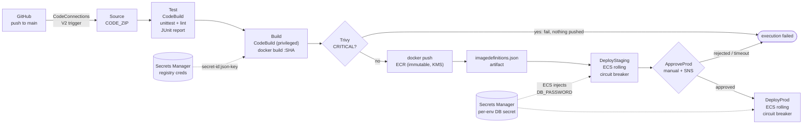
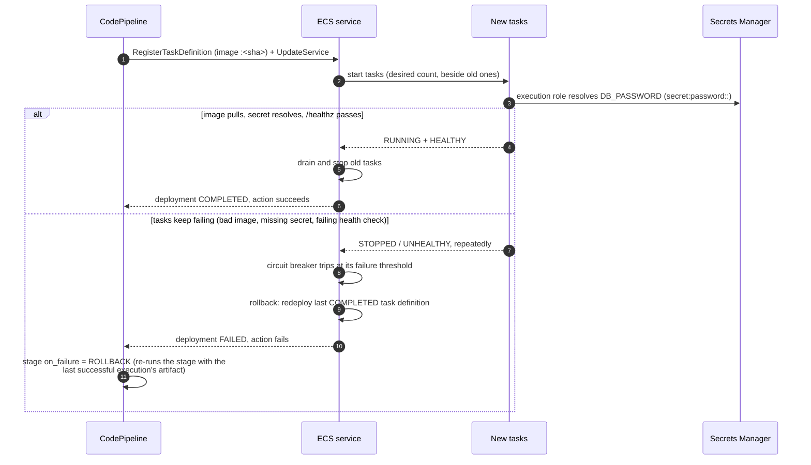

# Architecture

> Working portfolio implementation. The Terraform is validated, never applied.

## Pipeline flow

One CodePipeline V2 pipeline takes a commit from GitHub to two ECS Fargate
services in the same account. Each stage has its own IAM role, and the only
thing that moves between stages is an artifact in the KMS-encrypted bucket:
the source zip, then `imagedefinitions.json`.

| Stage | Runs as | Reads | Writes |
|---|---|---|---|
| Source | pipeline role | GitHub via the connection | source artifact |
| Test | `codebuild-test` role | source artifact | JUnit report group, logs |
| Build | `codebuild-build` role | source artifact, registry secret | ECR image `:<sha>`, `imagedefinitions.json`, Trivy report |
| DeployStaging / DeployProd | pipeline role | `imagedefinitions.json` | new task definition revision, `UpdateService` |
| ApproveProd | pipeline role | | SNS notification |

Design points:

- **Build once, deploy twice.** Prod runs the exact image digest that staging
  ran: both deploy actions read the same `imagedefinitions.json`, and the tag
  cannot be overwritten (ECR `IMMUTABLE`). Nothing is rebuilt for prod
  ([ADR 0002](decisions/0002-immutable-sha-tags.md)).
- **The scan gates the push.** Trivy runs against the local image before
  `docker push`, in the same phase, with `on-failure: ABORT`. An image with a
  CRITICAL finding never reaches ECR. ECR scan-on-push is a second, later
  signal, not the gate.
- **`QUEUED` execution mode.** In the default `SUPERSEDED` mode a newer
  execution can replace one waiting at the approval. `QUEUED` keeps releases
  in commit order, so the approver always approves what staging is running.
- **One account, two services.** Staging and prod share the cluster, the
  repository and the pipeline, but not the secrets, execution roles or log
  groups. A multi-account layout (a tooling account deploying cross-account)
  is the production pattern. See [Limitations](../README.md#limitations).

## Deploy and rollback flow

The ECS standard deploy action registers a new task definition revision
with the image from `imagedefinitions.json` and calls `UpdateService`. ECS
performs a rolling update (`minimumHealthyPercent = 100`,
`maximumPercent = 200`): new tasks start next to the old ones, and old tasks
stop only when new ones are healthy.

Two layers of rollback, on purpose:

1. **ECS deployment circuit breaker with `rollback = true`.** Handles tasks
   that never become healthy. The service returns to the previous
   revision without anyone touching it. The breaker's failure threshold is derived
   from the desired count, with a floor and a ceiling set by ECS, so even a
   one-task service needs several failed launches (minutes, not seconds)
   before it trips.
2. **CodePipeline V2 stage rollback (`on_failure { result = "ROLLBACK" }`).**
   Re-runs the failed deploy stage with the artifact of the last successful
   execution, so the pipeline's record agrees with what is running.

Neither layer catches a release that is healthy but wrong (a bad response,
a logic error, a slow memory leak). That needs a human or an alarm. The
operational answer is to redeploy a previous SHA
([operations](operations.md#rolling-back)). CloudWatch alarm-based
rollback (`alarms` on the service) and traffic shifting are the next
steps, covered by the blue/green sibling project
([ADR 0001](decisions/0001-ecs-rolling-with-circuit-breaker.md)).

## Why these pieces

| Choice | Instead of | Reason |
|---|---|---|
| CodePipeline + CodeBuild | GitHub Actions deploying to AWS | The deploy identity stays inside the account, with no long-lived or OIDC credentials in GitHub. The approval and audit trail live in CloudTrail. GitHub Actions still runs the portfolio's own CI (tests, lint, validate) |
| CodeConnections | Personal access token or webhook secret | AWS-managed GitHub App installation; no token to rotate or leak |
| ECS standard deploy action | CodeDeploy blue/green | Fewer moving parts, no load balancer listener choreography; see ADR 0001 |
| Fargate | EC2 capacity provider | No hosts to patch for a single small service |
| Trivy in CodeBuild | Only ECR basic scanning | A gate must run before the push and fail the build; ECR scan-on-push results arrive after the image is already in the registry |
| Per-environment secrets and roles | One shared secret | Staging can be compromised without exposing prod credentials |
