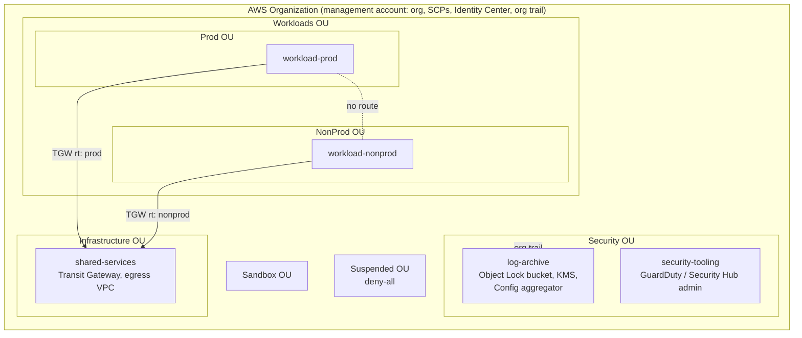

# AWS Landing Zone

> **Classification: Production case study.** Reference implementation of a pattern used in production work; all names, accounts and values are synthetic.
> Owner: Muhammad Salahuddin, Senior DevOps Engineer. The Terraform is validated, never applied.
> Account IDs are placeholders (111111111111, 123456789012), the domain is example.com,
> CIDRs are RFC 1918, and cost figures are illustrative, approximate list prices.

A multi-account AWS foundation in Terraform: an organization with OUs drawn
along **policy boundaries**, **service control policies** that are checked and
simulated offline before they are attached, an **organization CloudTrail**
into an Object Lock bucket in a dedicated log-archive account, **IAM Identity
Center** access by group, a **per-account baseline**, and a **Transit Gateway
hub** where prod and nonprod can't reach each other. It's built from the
primitives (no Control Tower), so every guardrail and route is visible.
[ADR 0002](docs/decisions/0002-terraform-vs-control-tower.md) explains when
Control Tower is the better choice.

## Problem

Landing zones rarely fail on day one. They fail later, quietly:

- **An SCP change locks people out or does nothing.** A region deny written
  with `Action` instead of `NotAction` breaks IAM, STS and CloudFront
  everywhere. A sixth SCP on an OU fails at apply time because FullAWSAccess
  already uses one of the five slots. Nobody can tell what a policy will do
  without attaching it to a real OU.
- **Logs that can be deleted aren't evidence.** A trail in the same account
  as the workload, a bucket without Object Lock, or a bucket policy that
  accepts writes from any account doesn't survive the incident it's
  supposed to record.
- **"Separate VPCs" isn't isolation.** With a default route to a shared
  egress VPC, prod traffic to a nonprod address follows `0.0.0.0/0` to the
  egress VPC and comes back through the shared route table. It hairpins
  straight into nonprod.
- **Address plans drift.** Two teams pick `10.16.0.0/16` and nobody notices
  until the attachment goes in.
- **Access is granted to people, not roles.** Long-lived IAM users,
  admin everywhere and no session limit.

## What it demonstrates

| Area | Implementation |
|---|---|
| Organization | `aws_organizations_organization` with all features, trusted access for CloudTrail, Config, GuardDuty, Security Hub, IAM Identity Center, RAM and Access Analyzer; SCP and tag-policy types enabled; `prevent_destroy` |
| OU design | Security, Infrastructure, Workloads (Prod, NonProd), Sandbox, Suspended, split by which guardrails apply ([ADR 0001](docs/decisions/0001-ou-by-policy-boundary.md)) |
| Account vending | `aws_organizations_account` from a map (name, email, OU) with validation; `close_on_deletion = false`, `prevent_destroy`, `ignore_changes` on create-only fields; GuardDuty, Security Hub and generic delegated administrators |
| Guardrails | 8 SCPs as JSON (one rendered with `templatefile`): deny leaving the org, protect CloudTrail/GuardDuty/Config/Security Hub, region allow-list with `NotAction` global exemptions, deny root, require IMDSv2, protect the account S3 public access block, require cost tags on create, Suspended deny-all. Plus a tag policy for `CostCenter`, `Owner` and `Environment` values |
| AWS limits | Minified size checked against 5,120 characters in Python **and** in a Terraform precondition; at most 5 SCPs per target with FullAWSAccess counted; the root keeps a free slot for an emergency SCP |
| Policy as code | `check_scps.py`: 8 rules over every SCP and the attachment map. `simulate_scp.py`: explains which SCP and statement denies a request on a given OU path. One attachment map (`policy/attachments.json`) feeds Terraform and both tools |
| Log archive | Org trail (multi-region, log file validation, KMS) into a bucket in the log-archive account: Object Lock in governance mode, versioning, Glacier lifecycle, TLS-only, writes scoped by `aws:SourceArn` (CloudTrail) and `aws:SourceOrgID` (Config), governance bypass denied except break-glass; org Config aggregator |
| Provider aliases | `aws.management` and `aws.log_archive` via `assume_role` with role ARNs as variables. No credentials anywhere |
| Identity | Identity Center permission sets (Admin 1 h, PowerUser with an explicit IAM/Organizations deny, ReadOnly, Billing) and assignments from a group → account → permission-set map. Groups come from the IdP |
| Account baseline | IAM password policy, EBS default encryption, account S3 public access block, Access Analyzer, monthly budget with actual and forecast alerts to a KMS-encrypted SNS topic; default VPC removal documented |
| Network hub | TGW shared to the org through RAM, no default route table, three route tables (prod, nonprod, shared) with an explicit propagation matrix, RFC 1918 blackholes against hairpinning, centralized egress VPC with NAT per AZ and appliance mode |
| Address plan | `policy/cidr-plan.json` read by Terraform and by `cidr_plan.py`. Overlap detection in HCL (a `check` block plus a precondition) and in Python with `ipaddress` |

## Architecture



The OU tree, the log flow, the hub's route tables and the access model are
detailed in [docs/architecture.md](docs/architecture.md).

## Layout

```text
terraform/modules/      organization, guardrails (policies/scp, policies/tag), log-archive
                        (+ validation-harness), identity-center, account-baseline, network-hub, spoke-vpc
terraform/environments/ management, shared-services, workload-baseline
policy/                 check_scps.py, simulate_scp.py, cidr_plan.py,
                        attachments.json, template-values.json, cidr-plan.json, fixtures/
tests/                  unittest suites
docs/                   architecture, operations, security, cost, decisions/
```

## Quickstart

Python 3.12 (the CI version; also runs on newer 3.x), nothing to install.
From this directory:

```bash
python3 -m unittest discover -s tests -v          # all tests
python3 policy/check_scps.py                      # shipped SCPs + attachment map: exit 0
python3 policy/check_scps.py --scp-dir policy/fixtures/scp-bad \
  --attachments policy/fixtures/scp-bad/attachments.json   # every rule fails: exit 1
python3 policy/check_scps.py --list-rules
python3 policy/simulate_scp.py --ou prod --action ec2:RunInstances --region ap-southeast-1
python3 policy/cidr_plan.py                       # address plan: exit 0
python3 policy/cidr_plan.py policy/fixtures/cidr-plan-bad.json   # exit 1
```

Exit codes for all three tools: 0 pass (for the simulator: not denied by
SCPs), 1 findings (denied), 2 bad input.

**`simulate_scp.py` is a teaching approximation, not the IAM policy
simulator.** It evaluates only SCPs, on the OU path from the root, with the
condition operators the shipped policies use (`StringEquals`,
`StringNotEquals`, `StringLike`, `ArnLike`, `ArnNotLike`, `Bool`, `Null`, with
`IfExists`). It ignores `Resource` unless `--resource` is given and doesn't
model identity policies, boundaries, session policies or service-linked
roles. It raises an error on any operator it doesn't model, rather than
guessing. Use it to explain and regression-test the guardrails, and use the
real simulator or a test account before trusting a change.

## Sample output

All excerpts below are real output from this machine, run on 2026-10-14.
`tests/test_readme.py` re-runs every `simulate_scp.py` and `cidr_plan.py`
example here and fails if the output changes.

The shipped policies and attachment map:

```text
$ python3 policy/check_scps.py
check_scps: 8 policies in terraform/modules/guardrails/policies/scp, attachments from policy/attachments.json
ok   deny-all                           116 / 5,120 chars  1 statement(s)
ok   deny-leave-organization            144 / 5,120 chars  1 statement(s)
ok   deny-root-user                     179 / 5,120 chars  1 statement(s)
ok   protect-s3-public-access-block     249 / 5,120 chars  1 statement(s)
ok   protect-security-services        1,681 / 5,120 chars  4 statement(s)
ok   region-allowlist                 1,563 / 5,120 chars  1 statement(s)
ok   require-imdsv2                     434 / 5,120 chars  2 statement(s)
ok   require-tags-on-create             861 / 5,120 chars  3 statement(s)
Attachments per target: root 4/5, security 3/5, infrastructure 4/5, workloads 4/5, prod 2/5, nonprod 2/5, sandbox 4/5, suspended 2/5
Summary: 0 finding(s). Result: PASS
(exit 0)
```

The bad fixtures, one per rule (the JSON error text comes from Python's
`json` module and varies between versions):

```text
$ python3 policy/check_scps.py --scp-dir policy/fixtures/scp-bad --attachments policy/fixtures/scp-bad/attachments.json
...
FAIL SCP-001  invalid-json.json: not valid JSON: Illegal trailing comma before end of object: line 4 column 82 (char 127)
FAIL SCP-005  allow-star.json: AllowEverythingInS3 allows wildcard action(s) ['s3:*']
FAIL SCP-004  missing-sid.json: Statement[0] has no Sid
FAIL SCP-002  oversized.json: minified size 7,697 > 5,120 characters
FAIL SCP-006  region-deny-missing-globals.json: DenyOutsideAllowedRegions does not exempt global service action(s): iam:CreateRole, organizations:DescribeOrganization, sts:AssumeRole, budgets:ViewBudget, health:DescribeEvents
FAIL SCP-003  wrong-version.json: Version is '2008-10-17', expected '2012-10-17'
FAIL SCP-007  attachments.json:workloads: 6 SCPs attached (limit 5, FullAWSAccess counts): ['FullAWSAccess', 'wrong-version', 'missing-sid', 'allow-star', 'region-deny-missing-globals', 'oversized']
Summary: 7 finding(s). Result: FAIL
(exit 1)
```

A launch in a region that isn't allowed, with no tags and no IMDSv2. Every
guardrail on the path that applies shows up, with the level it's attached
to:

```text
$ python3 policy/simulate_scp.py --ou prod --action ec2:RunInstances --region ap-southeast-1
request:   ec2:RunInstances in ap-southeast-1
principal: arn:aws:iam::123456789012:role/developer
OU path:   root > workloads > prod
  root       FullAWSAccess, deny-leave-organization, protect-security-services, region-allowlist
  workloads  FullAWSAccess, deny-root-user, protect-s3-public-access-block, require-tags-on-create
  prod       FullAWSAccess, require-imdsv2
DENY   region-allowlist/DenyOutsideAllowedRegions (attached to root)
DENY   require-tags-on-create/RequireCostCenterTagOnCreate (attached to workloads)
DENY   require-tags-on-create/RequireOwnerTagOnCreate (attached to workloads)
DENY   require-tags-on-create/RequireEnvironmentTagOnCreate (attached to workloads)
DENY   require-imdsv2/RequireImdsV2OnRunInstances (attached to prod)
Result: DENIED by SCPs (5 reason(s))
(exit 1)
```

The same region, but IAM. IAM is global, so the region deny's `NotAction`
exempts it:

```text
$ python3 policy/simulate_scp.py --ou prod --action iam:CreateRole --region ap-southeast-1
request:   iam:CreateRole in ap-southeast-1
principal: arn:aws:iam::123456789012:role/developer
OU path:   root > workloads > prod
  root       FullAWSAccess, deny-leave-organization, protect-security-services, region-allowlist
  workloads  FullAWSAccess, deny-root-user, protect-s3-public-access-block, require-tags-on-create
  prod       FullAWSAccess, require-imdsv2
Result: NOT DENIED by SCPs (identity and resource policies still decide)
(exit 0)
```

An allowed region with IMDSv2, but one required tag is missing:

```text
$ python3 policy/simulate_scp.py --ou nonprod --action ec2:RunInstances --region eu-west-1 --context ec2:MetadataHttpTokens=required --context aws:RequestTag/CostCenter=CC-1002 --context aws:RequestTag/Owner=data-team
request:   ec2:RunInstances in eu-west-1
principal: arn:aws:iam::123456789012:role/developer
context:   ec2:MetadataHttpTokens=required
context:   aws:RequestTag/CostCenter=CC-1002
context:   aws:RequestTag/Owner=data-team
OU path:   root > workloads > nonprod
  root       FullAWSAccess, deny-leave-organization, protect-security-services, region-allowlist
  workloads  FullAWSAccess, deny-root-user, protect-s3-public-access-block, require-tags-on-create
  nonprod    FullAWSAccess, require-imdsv2
DENY   require-tags-on-create/RequireEnvironmentTagOnCreate (attached to workloads)
Result: DENIED by SCPs (1 reason(s))
(exit 1)
```

Leaving the organization, from any OU:

```text
$ python3 policy/simulate_scp.py --ou sandbox --action organizations:LeaveOrganization --region us-east-1
request:   organizations:LeaveOrganization in us-east-1
principal: arn:aws:iam::123456789012:role/developer
OU path:   root > sandbox
  root     FullAWSAccess, deny-leave-organization, protect-security-services, region-allowlist
  sandbox  FullAWSAccess, deny-root-user, protect-s3-public-access-block, require-imdsv2
DENY   deny-leave-organization/DenyLeaveOrganization (attached to root)
Result: DENIED by SCPs (1 reason(s))
(exit 1)
```

The root user, even for a read:

```text
$ python3 policy/simulate_scp.py --ou prod --action s3:GetObject --region us-east-1 --root
request:   s3:GetObject in us-east-1
principal: arn:aws:iam::123456789012:root
OU path:   root > workloads > prod
  root       FullAWSAccess, deny-leave-organization, protect-security-services, region-allowlist
  workloads  FullAWSAccess, deny-root-user, protect-s3-public-access-block, require-tags-on-create
  prod       FullAWSAccess, require-imdsv2
DENY   deny-root-user/DenyRootUserActions (attached to workloads)
Result: DENIED by SCPs (1 reason(s))
(exit 1)
```

A suspended account can't even ask who it is:

```text
$ python3 policy/simulate_scp.py --ou suspended --action sts:GetCallerIdentity --region us-east-1
request:   sts:GetCallerIdentity in us-east-1
principal: arn:aws:iam::123456789012:role/developer
OU path:   root > suspended
  root       FullAWSAccess, deny-leave-organization, protect-security-services, region-allowlist
  suspended  FullAWSAccess, deny-all
DENY   deny-all/DenyAllSuspendedAccount (attached to suspended)
Result: DENIED by SCPs (1 reason(s))
(exit 1)
```

The address plan, and the broken fixture:

```text
$ python3 policy/cidr_plan.py
cidr_plan: cidr-plan.json: 5 spokes, 2 reserved
  egress               10.0.0.0/16        reserved
  future-onprem        10.255.0.0/16      reserved
  shared-services      10.1.0.0/16        shared
  prod-payments        10.16.0.0/16       prod
  prod-data            10.17.0.0/16       prod
  nonprod-payments     10.32.0.0/16       nonprod
  nonprod-data         10.33.0.0/16       nonprod
Next free spoke block: 10.2.0.0/16
Summary: 0 finding(s). Result: PASS
(exit 0)
```

```text
$ python3 policy/cidr_plan.py policy/fixtures/cidr-plan-bad.json
cidr_plan: cidr-plan-bad.json: 5 spokes, 1 reserved
  egress               10.0.0.0/16        reserved
  prod-payments        10.16.0.0/16       prod
  prod-overlap         10.16.128.0/20     prod
  nonprod-public       203.0.113.0/24     nonprod
  nonprod-hostbits     10.32.1.0/16       nonprod
  egress-clash         10.0.0.0/16        staging
FAIL CIDR-003  prod-overlap: 10.16.128.0/20 is a /20, spokes must be /16
FAIL CIDR-002  nonprod-public: 203.0.113.0/24 is outside RFC 1918
FAIL CIDR-003  nonprod-public: 203.0.113.0/24 is a /24, spokes must be /16
FAIL CIDR-001  nonprod-hostbits: '10.32.1.0/16' is not a valid network: 10.32.1.0/16 has host bits set
FAIL CIDR-005  egress-clash: environment 'staging' is not one of prod, nonprod, shared
FAIL CIDR-004  egress/egress-clash: 10.0.0.0/16 overlaps 10.0.0.0/16
FAIL CIDR-004  prod-payments/prod-overlap: 10.16.0.0/16 overlaps 10.16.128.0/20
Next free spoke block: 10.1.0.0/16
Summary: 7 finding(s). Result: FAIL
(exit 1)
```

## Tests

```bash
python3 -m unittest discover -s tests -v
# Ran 130 tests ... OK
```

They cover:

- **every `check_scps` rule with pass and fail cases**: invalid JSON, a
  missing `Statement` and unknown template variables; minified versus
  pretty-printed size; version; missing and duplicate `Sid`; `Allow` with
  `*`, a service wildcard or `NotAction`; region denies missing a global
  service, using `Action`, or satisfied by specific actions; 5 versus 6
  attachments, duplicates and unknown policies. The bad fixtures fail
  exactly one rule each, and the shipped policies pass;
- **the simulator**: `ec2:RunInstances` in a disallowed region denied by
  the region allow-list; `iam:CreateRole` there not denied because IAM is
  global (as are Organizations, CloudFront, Route 53, Support and STS);
  `organizations:LeaveOrganization` denied in every OU; root denied in
  every OU below the root, while a role named `root` isn't; the Suspended
  OU denying everything, break-glass included; IMDSv1 versus IMDSv2;
  missing tags in Workloads but not Sandbox; break-glass exemptions; the
  implicit deny when a level has no Allow; `Resource` matching; and every
  condition operator, including absent keys, `IfExists`, case rules and
  ARN wildcards that don't cross colons. A test fails if a shipped policy
  uses an operator the simulator doesn't model;
- **the CIDR plan**: exact and partial overlaps, reserved blocks, adjacency,
  public and non-allowed ranges, prefix length, host bits, environments,
  the next free block, and the bad fixture hitting all five rules;
- **CLI smoke tests** through `subprocess` and exit codes 0, 1 and 2 for
  all three tools;
- **Terraform invariants** `validate` can't see: the provider constraint
  and lock files, the prod/nonprod propagation matrix, no default TGW
  route table, the blackholes, the overlap check and precondition,
  `close_on_deletion = false` with `prevent_destroy`, trail and bucket
  settings, provider aliases, the policy files Terraform reads, placeholder
  account IDs and example.com addresses only, and no empty files;
- **this README**: every `simulate_scp.py` and `cidr_plan.py` example
  above is re-run and compared.

## Terraform validation

Seven modules and three environments. Never applied. Validation only:

```bash
export TF_PLUGIN_CACHE_DIR=$HOME/.terraform.d/plugin-cache
cd terraform
terraform fmt -check -recursive
for d in modules/organization modules/guardrails modules/identity-center modules/account-baseline \
         modules/network-hub modules/spoke-vpc modules/log-archive/validation-harness \
         environments/management environments/shared-services environments/workload-baseline; do
  terraform -chdir=$d init -backend=false && terraform -chdir=$d validate
done
# Success! The configuration is valid.   (all ten)
```

Validated with Terraform 1.14.8 and `hashicorp/aws` 6.68.0. The
`log-archive` module declares `configuration_aliases`, so Terraform can't
validate it standalone ("Provider configuration not present"). Its
`validation-harness/` is a minimal caller with two region-only provider
blocks, and the module is also validated through `environments/management`.

- **management** composes organization, guardrails, identity-center and
  log-archive. It reads `policy/attachments.json` and
  `policy/template-values.json`, so the checked SCPs are the deployed SCPs.
  A `check` block confirms the home region is in the allow-list.
- **shared-services** composes the network hub from `policy/cidr-plan.json`.
- **workload-baseline** applies the account baseline and, when
  `spoke_name` is set, a spoke VPC attached to the shared TGW.

Each environment has `versions.tf` with a commented-out S3 backend (local
state by default), `providers.tf` with `assume_role` and role ARNs as
variables, and a `terraform.tfvars.example` with synthetic values. See
[cost](docs/cost.md) and [operations](docs/operations.md) for the bootstrap
order.

## Limitations

- **Never deployed.** `terraform validate` checks the schema, not
  behaviour: not the KMS and bucket policies against a real org trail, not
  the TGW routing, not RAM auto-accept, not the SCPs against real API
  calls. In particular the `ec2:MetadataHttpTokens` and `aws:RequestTag/*`
  conditions on `ec2:RunInstances` rely on documented behaviour for the
  instance and volume resources, and haven't been observed here.
- **The simulator is an approximation.** No identity policies, no
  multi-resource authorization (a real `RunInstances` evaluates several
  resource ARNs), no set operators or numeric conditions. It's for
  explaining and regression-testing, not for proving access.
- **Two-phase bootstraps.** The log-archive provider can't be configured
  until that account exists, and the hub can't associate a spoke until the
  spoke has attached. Both are documented in
  [operations](docs/operations.md), not automated.
- **Static attachment map.** Accounts inherit SCPs from their OU only. No
  per-account SCPs, and no exception process beyond the break-glass role.
- **GuardDuty, Security Hub and Config recorders aren't configured in
  member accounts.** Only the org-level plumbing is here: trusted access,
  delegated administrators, the aggregator and the delivery bucket. The
  sibling `cloud-security-waf-automation` project shows the detective
  side.
- **No S3 access logging, CloudWatch Logs delivery or Lake Formation/Athena
  layer** on the log archive. No IPAM service: the plan is a JSON file.
- **Default VPCs aren't removed by Terraform** (explained in the
  account-baseline module and [operations](docs/operations.md#vending-a-new-account)).
- **Single home region.** Multi-region hubs (TGW peering) aren't modelled.

## Interview talking points

- **OUs are policy boundaries.** Prod and NonProd sit under Workloads
  because they share guardrails (tags, root deny) and differ in a few
  (access, network). Suspended exists so a deny-all is one move, not a
  policy edit. Team structure goes in tags and Identity Center groups, not
  OUs.
- **SCP limits are design inputs.** Five per target, and FullAWSAccess
  takes one, so the root carries only the universal guardrails and keeps a
  slot free. 5,120 characters minified: the module minifies, and both
  Python and a Terraform precondition check the size before AWS rejects it.
- **The region deny is the policy that breaks things.** It has to be
  `NotAction` with global services exempted (IAM, STS, Organizations,
  CloudFront, Route 53, Support), and break-glass exempted by
  `aws:PrincipalArn`. The checker enforces the exemptions, and the
  simulator shows `iam:CreateRole` passing in a blocked region.
- **Tag policies don't require tags.** They only validate the values when
  a tag is set. Requiring the tag takes an SCP with
  `Null: aws:RequestTag/... = true`, and the two work together.
- **Log integrity is about account boundaries.** The trail writes
  cross-account into a bucket the workload accounts can't touch, under
  Object Lock, with log file validation. Writes are pinned by `aws:SourceArn`
  for CloudTrail and `aws:SourceOrgID` for Config, where source ARNs vary per
  account. Governance bypass is denied to everyone except break-glass.
- **Isolation needs routes, not just separate tables.** Association decides
  where an attachment's traffic can go. Propagation decides who can reach
  it. The blackholes stop the `0.0.0.0/0` hairpin through the egress VPC.
  Without them, prod can reach nonprod even though neither route table
  lists the other.
- **One source of truth for policy data.** Terraform, the checker and the
  simulator all read the same attachment map, template values and CIDR
  plan. What CI checks is what gets deployed.
- **Honest about Control Tower.** For most organizations, Control Tower and
  AFT are the right starting point. This repo shows the primitives
  underneath, which you need to understand either way, and which you need
  when you outgrow the defaults.
