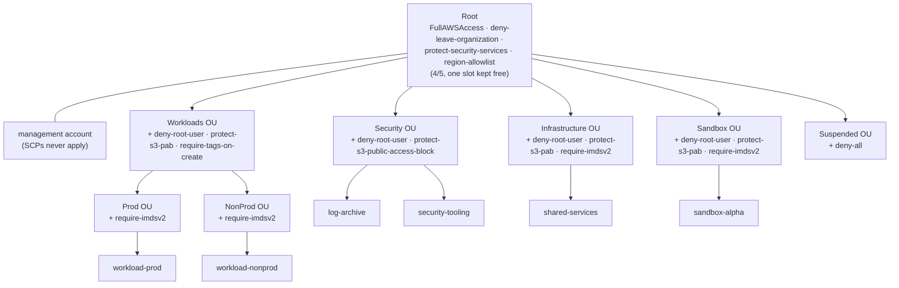
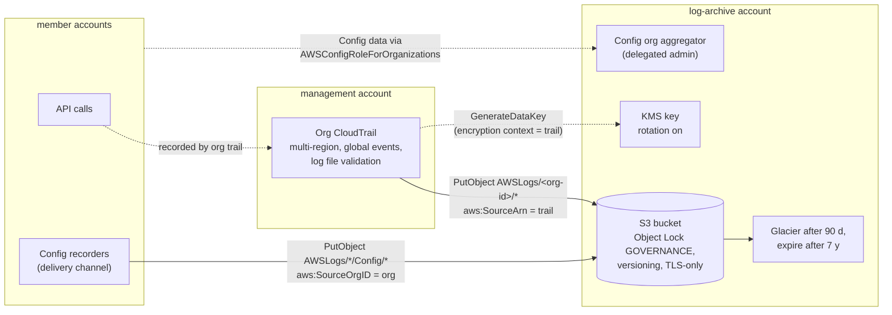
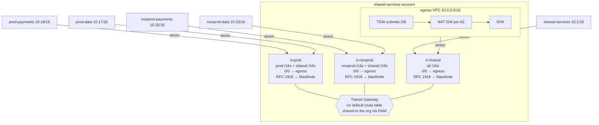
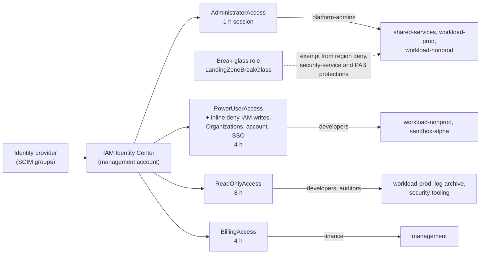

# Architecture

Reference implementation of a pattern used in production work; all names,
accounts and values are synthetic. Account names below are the keys in
`terraform/environments/management/terraform.tfvars.example`.

## OU and account tree

OUs are cut along policy boundaries ([ADR 0001](decisions/0001-ou-by-policy-boundary.md)).
Each box lists the SCPs attached **directly** to that node. Everything below
also inherits its ancestors' SCPs.

Every node also has the AWS-managed `FullAWSAccess` attached. SCPs filter
permissions and never grant them, and an action must be allowed at **every**
level of the path. If you remove FullAWSAccess from an OU without replacing
it with an allow list, everything below that OU is implicitly denied.
`simulate_scp.py` models this, and reports "implicit: no SCP attached to X
allows the action".

The attachment layout is the file `policy/attachments.json`. Terraform
(`environments/management`), `check_scps.py` and `simulate_scp.py` all read
it.

| Target | Direct SCPs | Why here |
|---|---|---|
| root | FullAWSAccess, deny-leave-organization, protect-security-services, region-allowlist | Universal. One slot stays free for an emergency deny |
| security | + deny-root-user, protect-s3-public-access-block | Log archive and security tooling: no root, no PAB changes |
| infrastructure | + deny-root-user, protect-s3-pab, require-imdsv2 | Shared services run EC2 (directory, CI runners) |
| workloads | + deny-root-user, protect-s3-pab, require-tags-on-create | Shared by Prod and NonProd |
| prod / nonprod | + require-imdsv2 | Leaves room for environment-specific SCPs (4 slots free) |
| sandbox | + deny-root-user, protect-s3-pab, require-imdsv2 | No tag requirement, to keep experiments cheap to start |
| suspended | + deny-all | Quarantine. One move, no policy edit |

## Log flow

- The trail lives in the management account (org trails must). Its bucket
  and key live in the log-archive account, so nobody who operates a workload,
  or the management account day to day, can delete logs.
- **Bucket policy**: TLS-only; CloudTrail writes pinned to this trail's ARN
  under both the management account's prefix and the organization prefix;
  Config writes pinned to the organization with `aws:SourceOrgID`, because
  every member account's delivery channel has a different source ARN; Object
  Lock bypass, lock reconfiguration and bucket deletion denied to everyone
  except the log-archive break-glass role.
- **Object Lock** is enabled at creation (it can't be added later) with a
  365-day governance default. [Security](security.md#log-integrity) covers
  governance versus compliance mode.
- **Provider aliases**: `aws.management` creates the trail, and
  `aws.log_archive` creates the rest. Both use `assume_role`.

## Network hub and route-table isolation

The model, as written in `modules/network-hub/main.tf`:

| Attachment environment | Associated with | Propagates into |
|---|---|---|
| prod | rt-prod | rt-prod, rt-shared |
| nonprod | rt-nonprod | rt-nonprod, rt-shared |
| shared | rt-shared | rt-prod, rt-nonprod, rt-shared |
| egress VPC | rt-shared | (none, static 0/0 routes point at it) |

- **Association** picks the table used to route traffic *from* an
  attachment. **Propagation** puts an attachment's CIDR *into* a table. Prod
  never propagates into rt-nonprod and nonprod never into rt-prod, so
  neither table has a route to the other.
- **The hairpin, and why the blackholes exist.** Every table has
  `0.0.0.0/0 → egress`. Without blackholes, a packet from prod to
  `10.32.0.5` (nonprod) matches `0.0.0.0/0` and goes to the egress VPC. The
  egress public subnets route `10.0.0.0/8` back to the TGW, and the egress
  attachment uses rt-shared, which knows nonprod. Isolation is gone.
  Blackholing `10.0.0.0/8`, `172.16.0.0/12` and `192.168.0.0/16` in every
  table fixes it: propagated /16s are more specific and still win, and
  every other private destination is dropped at the TGW.
- **No default route table** (`default_route_table_association` and
  `_propagation` disabled). Auto-accept is on so org accounts can attach
  without a manual step, but a new attachment routes nowhere until the hub
  associates it. That's the control point.
- **Egress VPC**: public subnets with a NAT gateway per AZ (or one, with
  `single_nat_gateway`), small TGW subnets routing `0.0.0.0/0` to the NAT
  in the same AZ, and appliance mode on the attachment so both directions of
  a flow stay in one AZ ([ADR 0003](decisions/0003-centralized-egress.md)).
- **Spokes** (`modules/spoke-vpc`) have private subnets only, no IGW, and
  `0.0.0.0/0 → TGW`. The CIDR is looked up in the plan by name, never typed.
  The module receives the whole plan and refuses an overlapping one. Flow
  logs record rejected traffic.

### Address plan

`policy/cidr-plan.json`: `/16` spokes from `10.0.0.0/8`, with the egress
VPC and a future on-premises block reserved. Overlaps are caught three ways:

1. `policy/cidr_plan.py` in CI (general overlap check with `ipaddress`).
2. A `check` block and a precondition on the Transit Gateway in
   `network-hub`. Both truncate each pair to the shorter prefix with
   `cidrsubnet(..., 0, 0)` and compare.
3. Variable validations in `spoke-vpc`, which reject non-canonical,
   non-/16, non-RFC 1918 or duplicate entries.

## Access model

- **Groups only.** Assignments are `group → account → permission sets`. No
  users are created, and joiners and leavers are handled in the IdP.
- **Admin is short-lived**: a 1-hour session, assigned only where the
  platform team operates.
- **PowerUser can't touch identity**: the AWS-managed PowerUserAccess plus
  an explicit inline deny on IAM writes (service-linked roles excepted),
  Organizations, account, SSO and identity store actions. `iam:PassRole`
  stays, so existing roles can be used to deploy.
- **SCPs still apply on top.** An AdministratorAccess session in
  workload-prod still can't stop CloudTrail or work outside the allowed
  regions.
- **Break-glass** is an IAM role (`LandingZoneBreakGlass`), not an Identity
  Center permission set, so it keeps working if Identity Center or the IdP
  is down. See [operations](operations.md#break-glass-access).
