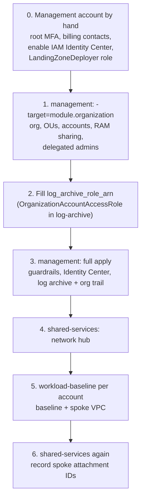

# Operations

Runbooks for the landing zone. Nothing here has been run against a real
organization. These are the procedures the code is designed around, with
the commands you'd use. All IDs are placeholders.

## Bootstrap order

The landing zone builds the accounts it then deploys into. That is a
chicken-and-egg problem, so the first build is staged.



0. **Management account, by hand.** Root MFA and contacts, IAM Identity
   Center enabled in the home region (the API can't enable it), and a
   deployer role that your SSO identity or CI OIDC role can assume. This is
   the only console work.
1. **Organization first.**
   `terraform -chdir=terraform/environments/management apply -target=module.organization`.
   This creates the org with trusted access, the OUs, the accounts (each
   with `OrganizationAccountAccessRole`), RAM sharing, and the delegated
   administrators (Config → log-archive, Access Analyzer and GuardDuty /
   Security Hub → security-tooling). Delegated admins need the accounts to
   exist, and the aggregator, the hub's RAM share and the security services
   need the delegated admins. That's why this goes first.
2. **Point the second provider at the new account.** Set
   `log_archive_role_arn` to
   `arn:aws:iam::<log-archive-id>:role/OrganizationAccountAccessRole`. The
   `aws.log_archive` provider can't be configured before that account exists,
   which is why step 1 is targeted.
3. **Everything else in management.** A full apply creates the SCPs and
   attachments, the tag policy, the permission sets and assignments, the
   bucket and key, the org trail and the aggregator. Apply SCPs **after** the
   pipeline roles exist. The region allow-list exempts only the break-glass
   and security automation roles, so make sure the home region is allowed
   (a `check` block warns if it isn't).
4. **Network hub.** In the shared-services environment, set
   `organization_arn` from the management output and apply.
5. **Each workload account.** Run workload-baseline with the account's role,
   environment, budget and `spoke_name`. Output: the TGW attachment ID.
6. **Associate the spokes.** Add each attachment ID to `spoke_attachment_ids`
   in shared-services and apply. Until then the spoke routes nowhere,
   because there's no default route table.

After the bootstrap, replace `OrganizationAccountAccessRole` as the
pipeline's way in with a narrower deployer role per account, and restrict
who can assume the original.

## Vending a new account

1. **Address space.** For an account with a VPC, run `python3 policy/cidr_plan.py`.
   It prints the next free `/16`. Add the spoke to `policy/cidr-plan.json`
   and run the check again.
2. **Account entry.** Add the account to `accounts` in the management tfvars
   with a unique `example.com` (in real life, company) address and the
   target OU. Plus-addressing (`aws+name@...`) keeps one mailbox.
3. **Access.** Add assignments to `identity_center_assignments`.
4. **PR.** CI runs the tests, `check_scps.py`, `cidr_plan.py` and
   `terraform validate`. Review the plan: exactly one
   `aws_organizations_account` create and its assignments.
5. **Apply management**, then **workload-baseline** for the new account,
   then **record the attachment** in shared-services.
6. **Remove the default VPCs.** Terraform isn't used for this:
   `aws_default_vpc` only adopts a default VPC. With `force_destroy = true`,
   destroying the resource deletes the VPC, but only in one region, only
   after its dependencies are gone, and a later apply of the same resource
   re-creates it. A one-off script at vending time is more reliable:

   ```bash
   # Run as the new account's deployer role, before anything is launched.
   # The default security group, NACL and route table go with the VPC.
   for r in $(aws ec2 describe-regions --query 'Regions[].RegionName' --output text); do
     vpc=$(aws ec2 describe-vpcs --region "$r" --filters Name=is-default,Values=true \
           --query 'Vpcs[0].VpcId' --output text)
     [ "$vpc" = "None" ] && continue
     for igw in $(aws ec2 describe-internet-gateways --region "$r" \
                  --filters Name=attachment.vpc-id,Values="$vpc" \
                  --query 'InternetGateways[].InternetGatewayId' --output text); do
       aws ec2 detach-internet-gateway --region "$r" --internet-gateway-id "$igw" --vpc-id "$vpc"
       aws ec2 delete-internet-gateway --region "$r" --internet-gateway-id "$igw"
     done
     for subnet in $(aws ec2 describe-subnets --region "$r" --filters Name=vpc-id,Values="$vpc" \
                     --query 'Subnets[].SubnetId' --output text); do
       aws ec2 delete-subnet --region "$r" --subnet-id "$subnet"
     done
     aws ec2 delete-vpc --region "$r" --vpc-id "$vpc" && echo "deleted default VPC $vpc in $r"
   done
   ```

   Run it before the region SCP is in force for the account, or with the
   break-glass role, because the SCP denies EC2 calls in disallowed
   regions.

   A default VPC left behind in a blocked region can't be used: the region
   SCP denies launching anything there.

## Moving an account to Suspended

For an account that's being decommissioned or is compromised:

1. **Move it.** Change the account's `ou` to `suspended` and apply.
   Moving an account between OUs is an in-place update. The deny-all SCP
   takes effect within minutes for every principal in the account,
   including break-glass and administrators. It doesn't affect AWS
   services acting through service-linked roles, so the org trail keeps
   recording.
2. **Emergency path.** If Terraform isn't fast enough, move the account in
   the console or with
   `aws organizations move-account --account-id 444444444444 --source-parent-id ou-xxxx --destination-parent-id ou-suspended`,
   then update the tfvars to match so the next apply doesn't move it back.
3. **Investigate from outside.** Logs are already in the log-archive
   account. To work inside the account, temporarily move it to a forensic
   OU or detach deny-all with a reviewed change. Don't add exceptions to
   deny-all.
4. **Close it** after the retention period, by hand (`close_on_deletion` is
   `false`, and `prevent_destroy` blocks Terraform). Then remove the account
   from the tfvars with `terraform state rm`. A closed account stays
   restorable for 90 days.

## Break-glass access

For when Identity Center, the IdP or an SCP is in the way during an
incident.

- **What it is.** An IAM role, `LandingZoneBreakGlass`, in each account,
  assumable only from two hardware-MFA-protected IAM users in the management
  account (or from the management account root, which is never subject to
  SCPs). It's exempt from the region allow-list, the security-service
  protection, the account S3 public access block protection and the
  metadata-options lock. It's **not** exempt from deny-leave-organization,
  the root deny or Suspended.
- **Using it.** Open an incident, retrieve the credentials (sealed, two
  people), assume the role, and do the minimum.
- **Detection.** Any `AssumeRole` into `LandingZoneBreakGlass` should page
  the security team. It's visible in the org trail. An EventBridge rule on
  that event is the natural addition (out of scope here; the sibling
  security project shows the pattern).
- **Afterwards.** Rotate the credentials, review the CloudTrail session,
  and write up why it was needed.

## Adding a region

1. **Allow it.** Add the region to `allowed_regions` in
   `policy/template-values.json`. That file feeds both the Terraform
   templatefile and `check_scps.py`, so CI checks the rendered policy.
2. **Check the size.** `python3 policy/check_scps.py` shows the region
   allow-list's minified size (each region adds about 12 characters).
3. **Opt in** if it's an opt-in region (account settings, per account).
4. **Coverage.** The org trail is multi-region and the aggregator covers all
   regions already. GuardDuty and Security Hub need enabling in the new
   region through their delegated administrator.
5. **Network.** A new region needs its own TGW (TGW is regional), peered
   with the home hub, and its own address block in the plan. That isn't
   modelled here.
6. **Simulate before and after:**
   `python3 policy/simulate_scp.py --ou prod --action ec2:RunInstances --region ap-southeast-1 --context ec2:MetadataHttpTokens=required ...`

## Changing an SCP safely

1. Edit the JSON, then run `check_scps.py` and the tests.
2. Add a simulator test for the behaviour you're adding or removing (see
   `tests/test_simulate_scp.py`). That's the regression net.
3. Attach to **Sandbox** first (edit `policy/attachments.json`), watch
   CloudTrail for `AccessDenied` with the policy's ARN, then promote to
   NonProd, then the wider OU.
4. Never test on the root first. A broken root SCP hits every account
   except management.
