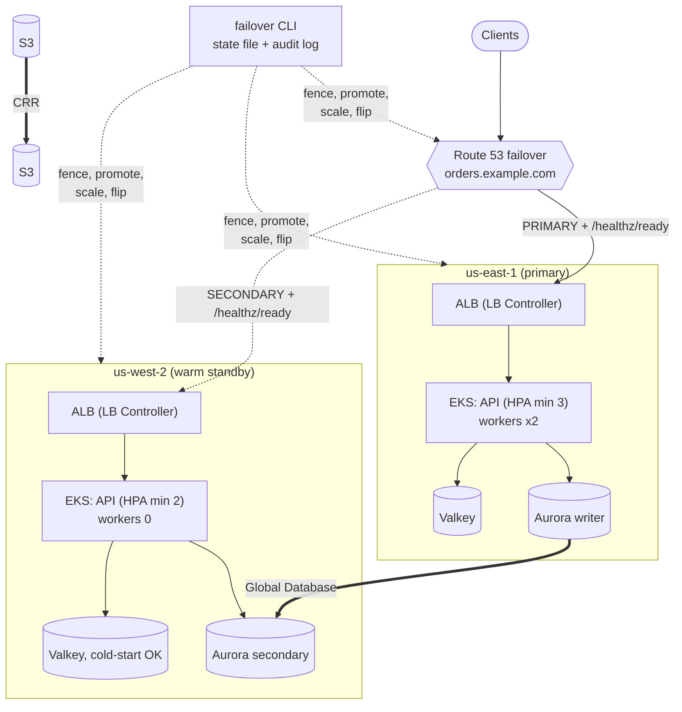

# Multi-Region EKS: Warm-Standby DR with Automated, Guarded Failover

> **Classification: Production case study.** Reference implementation of a pattern used in production work; all names, accounts and values are synthetic. No production RTO/RPO figures are claimed.
> Owner: Muhammad Salahuddin, Senior DevOps Engineer. The Terraform is validated and has never been
> applied. The chart is linted and schema-checked, never installed. The failover orchestrator is tested
> against in-memory fakes, and its real AWS adapters have never run. Costs are illustrative.

A synthetic order API on EKS, deployed **warm standby** across two
regions (us-east-1 primary, us-west-2 DR, both variables), plus a
**failover orchestrator** that moves the writer between them in a fixed,
resumable, audited order. The orchestrator fences the old region before it
promotes the new one, and it refuses anything that could leave two
writers. The data layer is an Aurora PostgreSQL Global Database, S3
Cross-Region Replication, a replicated Secrets Manager secret, and Route 53
failover records with deep health checks. Valkey is treated as a cache
that rebuilds itself.

## Problem

Multi-region setups usually fail at the seams, not at the replication:

- **The standby has never served a request.** It was built once, it
  drifted, and the first time anyone finds out is during the incident.
- **Failover is a wiki page of 20 commands.** People run them out of
  order under pressure, one fails halfway, and nobody knows what state the
  system is in.
- **Two writers.** The old primary comes back after an unplanned
  failover, its workers resume, Route 53's health check turns green, and
  orders are taken in both regions against diverging databases.
- **Jobs run twice.** The queue redelivers, or someone replays the last
  hour to be safe, and payments are captured again.
- **RPO and RTO are slide numbers.** Nobody has measured them, and
  "planned" and "unplanned" failover lose different amounts of data
  without anyone writing that down.

## What it demonstrates

| Area | Implementation |
|---|---|
| Regional stack (x2) | `modules/regional-stack`: 3-AZ VPC (public / private / data tiers, NAT per AZ or single), EKS with access entries (`authentication_mode = "API"`, no aws-auth), KMS envelope encryption, a managed node group with validated min/desired/max (DR runs 2 nodes), Pod Identity for the app and the AWS Load Balancer Controller, a Valkey replication group with TLS required, one CMK per region |
| ALB | Created by the **Load Balancer Controller** from the chart's Ingress, not by Terraform. Terraform creates the controller's role and Pod Identity association and tags the subnets. Route 53 picks up the ALB names in phase 2 of the bootstrap |
| Global data | `modules/global-data` (`configuration_aliases = [aws.primary, aws.dr]` + validation harness): Aurora PostgreSQL Global Database with a per-region CMK, a password generated as an ephemeral value and written only through write-only arguments, S3 CRR in both directions with optional RTC, a secret with a `replica` block, Route 53 deep health checks and PRIMARY/SECONDARY failover records, lag and health alarms |
| Terraform layout | Three roots, `environments/{primary,dr,global}`, so the DR region can be changed while the primary is unreachable ([ADR 0004](docs/decisions/0004-terraform-layout.md)). `aws >= 6.0, < 7.0`, variable validation, `default_tags`, no credentials |
| Helm chart | API + **separate worker Deployment** (`workers.enabled` / `workers.replicas`), probes (startup / deep readiness / shallow liveness), preStop sleep < grace period, non-root, read-only root filesystem, drop ALL, seccomp, zone topology spread, HPA v2, PDB, default-deny NetworkPolicy, Ingress for the ALB controller, a values schema. Separate `values-primary.yaml` and `values-dr.yaml` |
| Failover CLI | `python3 -m failover status / plan / execute`, standard library only. Steps: precheck, fence, promote (switchover or detach+promote), scale, flip DNS, postcheck. Confirm token = global cluster ID, JSON-lines audit log, state file, idempotent steps, resume after a crash |
| Split-brain guards | Refuses to promote when an unfinished run already promoted the other region, or when two unfenced writers exist. Refuses failback without `--rebuild-confirmed`, then verifies the rebuild ([ADR 0005](docs/decisions/0005-fencing-before-promotion.md)) |
| Duplicate processing | `src/worker_idempotency.py`: an idempotency-key claim in a replicated table, a lease, an epoch fencing token, and a refusal to run in a fenced region. A job replayed after failover is skipped |
| Runbooks | Planned, unplanned, failback, game day: who declares, when not to fail over, durations as **targets to measure**, real CLI output |

## Architecture



The per-region stack, the replication paths and the failover sequence are
diagrammed in [docs/architecture.md](docs/architecture.md).

## Layout

```text
terraform/  modules/regional-stack, modules/global-data (+ validation-harness), environments/{primary,dr,global}
helm/       dr-app chart: values.yaml, values-primary.yaml, values-dr.yaml, values.schema.json
src/        failover/ (CLI, orchestrator, ports, fakes, aws adapters), worker_idempotency.py
config/     failover.example.json (shape of the Terraform failover_config output + kube settings)
runbooks/   planned-failover, unplanned-failover, failback, game-day
tests/      unittest suites (stdlib), a small YAML reader for rendered chart checks
docs/       architecture, operations, security, cost, decisions/ (ADRs 0001-0005)
```

## Quickstart

Python 3.12 (the CI version; also runs on newer 3.x), nothing to install.
From this directory:

```bash
python3 -m unittest discover -s tests -v                      # all tests
PYTHONPATH=src python3 -m failover status                     # fakes by default
PYTHONPATH=src python3 -m failover plan --mode planned
PYTHONPATH=src python3 -m failover execute --mode planned --confirm dr-app-global --target us-west-2
PYTHONPATH=src python3 -m failover --scenario primary-down plan --mode unplanned
```

The CLI uses in-memory fakes unless you pass `--adapters aws` and a real
`--config`. `--scenario healthy|primary-down|lagging|split-brain` picks the
starting world, and `--fake-world FILE` keeps it between invocations, so
`execute` followed by `status` shows the result. State and audit go to
`.failover/` unless `--state-file` and `--audit-log` say otherwise. Exit
codes: 0 ok, 2 usage or confirm mismatch, 3 refused by a guard, 4 pre-check
failed (nothing changed), 5 step failed (re-run to resume).

## Sample output

All excerpts below are real output from this machine, run on 2026-10-14,
using the fake adapters.

`status` on the healthy starting world:

```text
$ PYTHONPATH=src python3 -m failover status
Global cluster dr-app-global  record orders.example.com
Aurora global writer: us-east-1   writers now: us-east-1   DNS PRIMARY: us-east-1   state: writer us-east-1, epoch 0

REGION      DEPLOYED AS  HEALTH       AURORA              LAG     DNS        WORKERS  API MIN  FENCED
us-east-1   primary      healthy      writer (global)     -       PRIMARY    2        3        no
us-west-2   dr           healthy      secondary (global)  0.4s    SECONDARY  0        2        no

Warnings: none
(exit 0)
```

`plan` for a planned failover. Nothing is executed:

```text
$ PYTHONPATH=src python3 -m failover plan --mode planned
Plan: planned failover us-east-1 -> us-west-2  (global cluster dr-app-global)
  1. precheck        us-west-2 deep health OK; us-east-1 healthy (planned needs both); Aurora
                     global writer is us-east-1 and us-west-2 is a member; replication lag into
                     us-west-2 < 5s
  2. fence-source    scale workers to 0 in us-east-1 (helm: workers.enabled=false); mark
                     us-east-1 fenced in the state file. Must succeed in planned mode
  3. promote-target  failover-global-cluster --switchover to dr-app-us-west-2 (managed
                     switchover: waits for replication to catch up, no data loss; us-east-1
                     becomes a secondary)
  4. scale-target    us-west-2: HPA minReplicas 3, workers.enabled=true, workers.replicas=2
  5. flip-dns        Route 53 orders.example.com: us-west-2 -> PRIMARY, us-east-1 -> SECONDARY
                     (one change batch)
  6. postcheck       us-west-2 healthy, a writer, PRIMARY in DNS, workers > 0; no unfenced second
                     writer; workers 0 in us-east-1 if reachable
Notes:
  - execute needs: --confirm dr-app-global
Nothing was executed.
(exit 0)
```

An unplanned failover with us-east-1 unreachable. The fence can't reach
the old region, so it is recorded as skipped (and the region marked
fenced). The DR cluster is detached and promoted, and the last known lag
is reported as the RPO exposure:

```text
$ PYTHONPATH=src python3 -m failover --scenario primary-down --fake-world outage.json execute --mode unplanned --confirm dr-app-global --target us-west-2
Run 20261014T071925Z-unplanned-us-west-2: unplanned failover us-east-1 -> us-west-2
[1/6] precheck        done: us-west-2 healthy, us-east-1 unreachable (connect timeout), writer us-east-1, last known lag 1.2s (potential data loss)
[2/6] fence-source    skipped: us-east-1 EKS API unreachable (us-east-1: EKS API endpoint timed out); workers NOT confirmed at 0. us-east-1 marked fenced: scale its workers to 0 before it rejoins (runbooks/unplanned-failover.md, 'Fence later')
[3/6] promote-target  done: dr-app-us-west-2 detached from dr-app-global and promoted; RPO exposure was 1.2s; epoch 1
[4/6] scale-target    done: us-west-2: API min replicas 3, workers 2
[5/6] flip-dns        done: us-west-2 is PRIMARY, us-east-1 is SECONDARY
[6/6] postcheck       done: us-west-2 healthy, writer, PRIMARY, 2 workers; us-east-1 unreachable: its workers are unverified
Completed: us-west-2 is the writer (epoch 1); us-east-1 is fenced
(exit 0)
```

The guards: planned mode with lag above the threshold, and two unfenced
writers.

```text
$ PYTHONPATH=src python3 -m failover --scenario lagging execute --mode planned --confirm dr-app-global --target us-west-2
state already shows us-west-2 as the writer (epoch 1); nothing to do
(exit 0)
```

```text
$ PYTHONPATH=src python3 -m failover --scenario split-brain execute --mode planned --confirm dr-app-global --target us-west-2
state already shows us-west-2 as the writer (epoch 1); nothing to do
(exit 0)
```

Helm lint and kubeconform, both value sets (Kubernetes 1.34, the EKS
version the Terraform defaults to):

```text
$ helm lint helm/dr-app -f helm/dr-app/values-primary.yaml
==> Linting helm/dr-app
[INFO] Chart.yaml: icon is recommended

1 chart(s) linted, 0 chart(s) failed
$ helm lint helm/dr-app -f helm/dr-app/values-dr.yaml
==> Linting helm/dr-app
[INFO] Chart.yaml: icon is recommended

1 chart(s) linted, 0 chart(s) failed
$ helm template dr-app helm/dr-app --namespace orders -f helm/dr-app/values-primary.yaml | kubeconform -strict -summary -kubernetes-version 1.34.0
Summary: 11 resources found parsing stdin - Valid: 11, Invalid: 0, Errors: 0, Skipped: 0
$ helm template dr-app helm/dr-app --namespace orders -f helm/dr-app/values-dr.yaml | kubeconform -strict -summary -kubernetes-version 1.34.0
Summary: 11 resources found parsing stdin - Valid: 11, Invalid: 0, Errors: 0, Skipped: 0
```

All 11 objects are core Kubernetes kinds (Deployment, Service, Ingress,
HPA `autoscaling/v2`, PDB `policy/v1`, NetworkPolicy, ConfigMap,
ServiceAccount), so kubeconform checks every one against the upstream
strict schemas. Nothing is skipped and no CRD schemas are needed.

## Tests

```bash
python3 -m unittest discover -s tests -v
# Ran 100 tests ... OK
```

They cover:

- **the planned happy path**: the exact step order, the exact order of
  side effects (fence, switchover, scale, DNS), the end state, the state
  file, and a second `execute` being a no-op;
- **unplanned mode** with the primary unreachable: fence recorded as
  skipped with `workers_confirmed_zero: false`, detach+promote (never a
  switchover), RPO exposure recorded; unplanned refused while the primary
  is healthy, planned refused while it is down, an unhealthy target
  refused;
- **resume after a crash**: a failed Route 53 call resumes with only that
  call repeated; a crash *after* the switchover but before the state save
  resumes without a second switchover; resuming in the other mode is
  refused; post-check failures (workers left in the old region) are
  resumable;
- **guards**: confirm token mismatch (nothing written, refusal audited),
  split brain from an unfinished run and from two unfenced writers,
  failback refused without the flag, failback after a planned switchover,
  failback after an unplanned failover refused until the rebuild happens,
  lag above, at and just below the threshold, and unknown lag;
- **the audit log**: the exact event sequence, context on every line,
  ordered timestamps, JSON lines on disk;
- **worker idempotency**: a job replayed after failover is skipped,
  redelivery, live and expired leases, a stale-epoch completion discarded,
  release after a handler failure, refusal in a fenced region, a missing
  key, and the documented RPO gap (an unreplicated claim runs again);
- **the real adapters** through stub boto3 clients and a stub process
  runner: the switchover parameters (`Switchover=True`, no
  `AllowDataLoss`), detach, lag in seconds, the DR-region-first describe
  with fallback, an atomic two-record Route 53 UPSERT, helm commands and
  unreachable mapping, the HTTP health classification;
- **the CLI** through `subprocess`: status (text and JSON), plan with no
  side effects, exit codes 0/2/3/4, the audit file, and importing without
  boto3;
- **the rendered chart** (`helm template`, skipped cleanly without helm):
  resources, three probes and a hardened securityContext on every
  container, the PDB and all three NetworkPolicies, Ingress annotations,
  DR workers at 0, the promotion values, and the schema rejecting `latest`;
- **Terraform invariants**: lock files, version pins, aliases, no
  credentials, placeholder-only account IDs, access entries, Pod Identity,
  no ALB in Terraform, the LB controller policy as valid JSON, no Valkey
  global datastore, per-region keys, write-only password, secret replica,
  CRR with optional RTC, failover records that Terraform no longer owns
  after creation;
- **docs**: every CLI sample in this README and the runbooks re-run and
  compared, the classification line, no TODO markers, no empty files.

## Terraform validation

Validation only. Never planned or applied:

```bash
cd terraform
terraform fmt -check -recursive
for d in environments/primary environments/dr environments/global \
         modules/regional-stack modules/global-data/validation-harness; do
  terraform -chdir=$d init -backend=false && terraform -chdir=$d validate
done
# Success! The configuration is valid.   (all five)
```

Validated with Terraform 1.14.8 and `hashicorp/aws` 6.68.0. Lock files
are committed for all five directories. `global-data` can't be validated
on its own because it declares `configuration_aliases`. Its
`validation-harness` supplies region-only providers and sets the phase-2
DNS inputs, so the Route 53 resources are type-checked as well.

## Limitations

- **Never deployed.** No EKS cluster, Aurora Global Database, replication,
  health check, ALB or failover has run. `validate`, `lint` and
  `kubeconform` check the schemas, not the behaviour.
- **No measured RTO or RPO.** The runbooks give targets to measure, and
  [game-day.md](runbooks/game-day.md) says how to measure them.
- **Unverified AWS details**, each kept behind one adapter method or one
  Terraform argument:
  - `failover_global_cluster(..., Switchover=True)` as the managed
    switchover call (`switchover_global_cluster` is the alternative);
  - the readiness of a detached cluster, inferred from
    `describe_db_clusters` (status `available`, no global cluster ID);
  - an `UPSERT` that swaps PRIMARY/SECONDARY between two records being
    accepted as one atomic batch;
  - EKS Pod Identity working with `automountServiceAccountToken: false`;
  - the condensed Load Balancer Controller policy, which must be compared
    with the upstream `iam_policy.json` for the installed version.
- **The app doesn't exist.** The image, `/healthz/*`, the worker and its
  idempotency store are a contract that the chart and the stub assume.
  `worker_idempotency.py` is the logic with an in-memory store, and its
  SQL is documented but not executed.
- **The workload adapter shells out to `helm upgrade --reuse-values`**
  and `kubectl`. It needs authenticated kube contexts, and it inherits
  `--reuse-values` behaviour (a chart upgrade between failovers should
  use full values files).
- **State and audit are local files.** Production needs shared storage
  outside both regions, with locking ([security.md](docs/security.md#gaps-not-implemented)).
- **The fence is soft.** Workers to 0 and DNS SECONDARY. The old writer's
  database access is not revoked. After an unplanned failover, the
  runbook's "Fence later" steps carry that risk.
- **Rebuilding after an unplanned failover is manual**, including the
  Terraform state moves ([failback.md](runbooks/failback.md)), and not
  rehearsed here.
- **Route 53's control plane is in us-east-1.** If us-east-1 is impaired,
  the DNS flip may fail while health-check failover still works. The run
  stays resumable.

## Interview talking points

- **The danger is two writers, not the outage.** Everything in the
  orchestrator is ordered around that: fence first, refuse when the state
  or the database shows another writer, make DNS follow the writer, and
  require proof of a rebuild before failback.
- **Planned and unplanned are different operations.** A switchover waits
  for replication and loses nothing. Detach and promote loses the
  un-replicated tail. The CLI makes the operator choose, refuses the wrong
  choice (unplanned while the primary is healthy, planned with lag above
  5 s), and records the lag as the data you chose to lose.
- **Resumable beats fast.** Each step checks before it acts and is saved
  before the next starts. A crash right after the switchover API call
  resumes without a second switchover, and the test for that case is the
  one I'd show first.
- **Warm standby earns its cost by being tested every 30 seconds.** The
  DR API serves the deep health check against the replicated database.
  Only the workers are at zero, because only the writer may write.
- **Not everything should replicate.** Valkey rebuilds from Aurora. A warm
  cache that disagrees with the promoted database is worse than a cold one
  ([ADR 0003](docs/decisions/0003-valkey-rebuildable.md)).
- **Terraform must not undo a failover.** The failover roles, the
  detached cluster's membership and the DR node group size are ignored
  after creation, and the three-root layout lets you change DR while
  us-east-1 is down ([ADR 0004](docs/decisions/0004-terraform-layout.md)).
- **Idempotency is the last line of defence.** Fencing stops two regions
  processing at once. It can't stop a replay of a job that already
  finished. The claim table lives in Aurora, so it fails over with the
  data, and its one gap (the RPO tail) is tested and documented.
