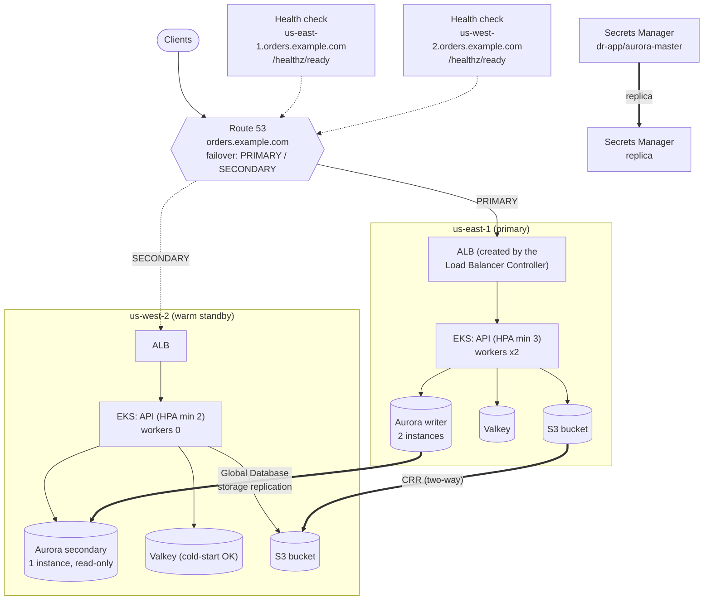
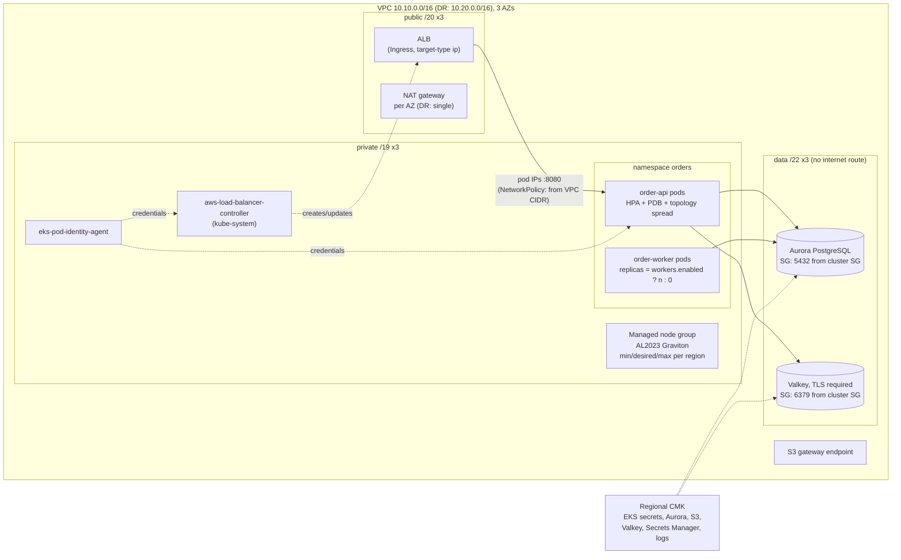
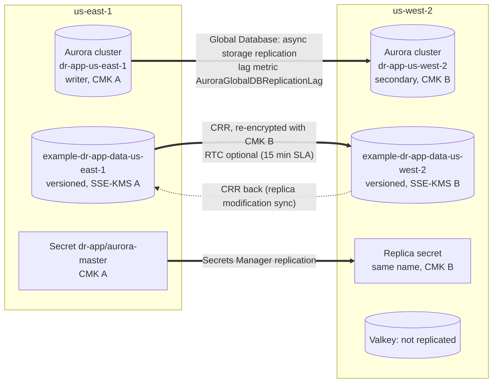
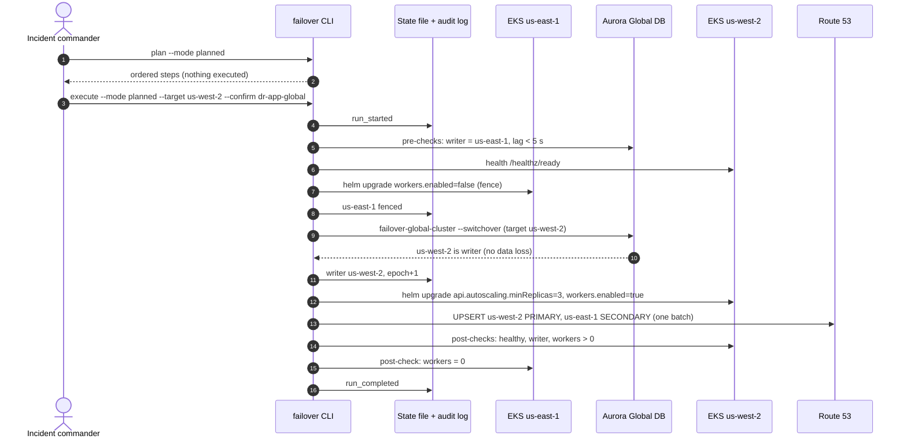

# Architecture

Warm standby across two regions. us-east-1 is the primary and us-west-2 is
the DR region; both are variables. Everything below is a reference
implementation: validated, never deployed.

## 1. High-level topology

The standby is not idle. Its API pods serve `/healthz/ready` against the
Aurora secondary and the local Valkey, so Route 53 probes the full DR
path continuously. Workers are the only component kept at zero: they
write, and only the writer region may write ([ADR 0005](decisions/0005-fencing-before-promotion.md)).

## 2. One region in detail

Both regions use the same `regional-stack` module.

Notes:

- **The ALB is not in Terraform.** The AWS Load Balancer Controller creates
  it from the chart's Ingress (`ingressClassName: alb`, `target-type: ip`,
  health check on `/healthz/ready`). Terraform creates the controller's IAM
  role and its Pod Identity association, and tags the public subnets
  `kubernetes.io/role/elb=1` so the controller can find them. The ALB DNS
  name is read after the chart is installed and fed to Route 53
  ([operations.md](operations.md#two-phase-bootstrap)).
- **Access entries, not aws-auth.** The cluster runs with
  `authentication_mode = "API"` and
  `bootstrap_cluster_creator_admin_permissions = false`. Admin roles come
  from `cluster_admin_principal_arns`.
- **Pod Identity, not IRSA.** There is no OIDC provider. Two roles trust
  `pods.eks.amazonaws.com`, with conditions on `aws:SourceAccount` and the
  cluster ARN: one for the order API (its secret, its bucket, its key,
  region-scoped) and one for the Load Balancer Controller.
- **Readiness is deep, liveness is shallow.** `/healthz/ready` checks the
  DB connection, the cache and the loaded secret, but not that the
  database is writable, so the standby is "ready". `/healthz/live` checks
  only the process, so a database outage doesn't restart every pod.
- **NetworkPolicy is enforced** by the VPC CNI (`enableNetworkPolicy` on
  the add-on): default deny, ingress only from the VPC CIDR on 8080, and
  egress only to DNS, the data subnets on 5432 and 6379, the Pod Identity
  agent, and HTTPS.

## 3. Data replication

| Data | Mechanism | Planned failover | Unplanned failover |
|---|---|---|---|
| Orders (Aurora) | Global Database storage replication | No loss (switchover waits for catch-up) | Loses the un-replicated tail (the lag at failure) |
| Objects (S3) | CRR, optional RTC | Writes in flight may arrive a few minutes late | Objects not yet replicated are missing until the source is back |
| DB credentials | Secrets Manager replica | Same secret name, read locally | Replica can be promoted (`stop-replication-to-replica`) to rotate while the primary is down |
| Cache (Valkey) | None | Cold start | Cold start ([ADR 0003](decisions/0003-valkey-rebuildable.md)) |
| Job claims (`processed_jobs`) | In Aurora, so replicated with the data | No duplicates | Claims in the lost tail are re-run; downstream idempotency keys absorb it |

Each region has its own key, and nothing uses multi-Region KMS keys: a
key disabled or scheduled for deletion in one region does not take the
other region's data with it.

## 4. Failover sequence (planned)

The unplanned sequence has the same shape, with three differences: the
pre-check requires the primary to be unhealthy; the fence is skipped (and
recorded as skipped) when us-east-1's EKS API doesn't answer; and the
promote step is `remove-from-global-cluster` followed by a wait for a
standalone writer ([ADR 0002](decisions/0002-managed-switchover-vs-detach-promote.md)).
Every step is saved before the next one starts, so a crash at any point
resumes at the first step that isn't done.

## Where Route 53 fits in an outage

Route 53 health checks fail over traffic on their own when the primary's
`/healthz/ready` fails `failure_threshold` times. The CLI's flip-dns step
does not replace that. It makes the result stick: the DR record becomes
PRIMARY, so traffic does not go back to the fenced region when its health
check recovers. Route 53's control plane (record changes) lives in
us-east-1. If us-east-1 is impaired, the change call can fail while the
data plane (health-check failover) keeps working. The step then fails,
the run stays resumable, and traffic is already on DR because of the
health check. [runbooks/unplanned-failover.md](../runbooks/unplanned-failover.md)
covers this case.
