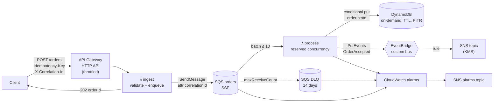

# AWS Serverless Event-Driven Order Pipeline

> **Classification: Working portfolio implementation. Synthetic domain, no production results claimed.**
> Owner: Muhammad Salahuddin, Senior DevOps Engineer. The Terraform is validated, never applied;
> cost figures are illustrative, approximate list prices.

An order intake pipeline on AWS: API Gateway, Lambda, SQS with a
dead-letter queue, DynamoDB and EventBridge. The Python handlers use only
the standard library and run end to end on your laptop against in-memory
fakes, and a Terraform module describes the AWS deployment. The focus is
the parts that usually go wrong in event-driven systems: duplicate
requests, partial failures, poison messages, and following a single request
through asynchronous hops.

## Problem

Taking an order looks like one write. In a distributed system it is several
steps, each of which can fail or be retried on its own:

- Clients time out and retry, and SQS standard queues deliver at least once.
  Without a contract for retries, the same order gets created twice.
- One malformed message in a batch shouldn't hold back, or push into the
  DLQ, the nine valid orders delivered with it.
- A burst of traffic or a slow dependency shouldn't turn into 5xx errors for
  clients.
- When an order goes missing, someone has to find it across an API, a queue,
  a function and an event bus.

## What it demonstrates

| Area | Implementation |
|---|---|
| Idempotency at the contract | Required `Idempotency-Key` header (`400` without it), deterministic order ID, one conditional `PutItem` deciding first-seen / in-progress / completed, stored result returned on duplicates, payload-hash check against key reuse, TTL plus lock expiry ([ADR 0001](docs/decisions/0001-idempotency-at-the-contract.md)) |
| Partial batch failure | `ReportBatchItemFailures`, per-record isolation, only failed `messageId`s returned, retryable vs poison classification ([ADR 0002](docs/decisions/0002-partial-batch-responses.md)) |
| Failure handling | SQS redrive to a DLQ after `maxReceiveCount`, redrive-allow policy, `start-message-move-task` runbook, idempotency claim released on downstream failure |
| Load levelling | HTTP API stage throttling, SQS buffer, processor reserved concurrency with ESM `maximum_concurrency` kept at or below it (Terraform precondition) |
| Observability | One-line JSON logs; correlation ID carried from the HTTP header to SQS message attributes, processor logs, the order record and the EventBridge `detail`; 8 alarms (DLQ depth, oldest message age, errors and throttles per function, rule failed invocations, API 5xx) |
| Least privilege | One IAM role per function with only the actions it calls (no `GetItem` at all), topic policy scoped to one rule ARN, KMS key policy for EventBridge/CloudWatch, TLS-only queue policies ([security](docs/security.md)) |
| Testability | Ports and adapters: boto3 imported lazily inside the Lambda runtime only, fakes that model SQS receive counts and redrive and the DynamoDB condition; 74 stdlib `unittest` tests |
| Infrastructure as code | Terraform module plus example, `aws >= 6.0, < 7.0`, variable validation, `default_tags`, `archive_file` packaging, local state, no credentials |

## Architecture



Sequence and failure-path diagrams, plus why SQS sits in the middle and why
this isn't a Step Functions workflow: [docs/architecture.md](docs/architecture.md).

## Quickstart

Python 3.12 (the Lambda runtime and CI version; also runs on newer 3.x), nothing to install. From this directory:

```bash
python3 scripts/local_demo.py              # whole flow in-process, readable trace
python3 scripts/local_demo.py --show-logs  # plus the structured JSON log lines
python3 -m unittest discover -s tests -v
```

The demo runs the real handlers (`src/ingest.py`, `src/process.py`) with
in-memory adapters: a client retry with the same key, two rejected
requests, and a truncated message written straight to the queue. The clock
and IDs are fixed, so the output is the same on every run.

## Sample output

Real output of `python3 scripts/local_demo.py` (excerpt; the demo uses
`maxReceiveCount=3` to keep the trace short, Terraform defaults to 5):

```text
== 1. API Gateway -> ingest Lambda ==
POST /orders  new order                        -> 202  orderId=ord_9d88e2064f8bb678647f49e5 correlationId=req-demo-001
POST /orders  client retry, same key           -> 202  orderId=ord_9d88e2064f8bb678647f49e5 correlationId=req-demo-001
POST /orders  second order, no correlation id  -> 202  orderId=ord_fb65a56758b217b136c4f5ff correlationId=gen-0001
POST /orders  missing Idempotency-Key          -> 400  Idempotency-Key: header is required
POST /orders  invalid body                     -> 400  customerId: must match ^cus_[A-Za-z0-9]{4,60}$; currency: must be one of EUR, GBP, USD; items: must be a list of 1 to 50 items
(a buggy producer writes a truncated message straight to the queue: msg-0004)
queue depth: 4 messages

== 2. SQS -> process Lambda (ReportBatchItemFailures, maxReceiveCount=3) ==
poll 1: 4 record(s)
  msg-0001 [req-demo-001] processed  orderId=ord_9d88e2064f8bb678647f49e5 totalCents=3900
  msg-0002 [req-demo-001] duplicate  skipped, stored result orderId=ord_9d88e2064f8bb678647f49e5
  msg-0003 [gen-0001] processed  orderId=ord_fb65a56758b217b136c4f5ff totalCents=2450
  msg-0004 [req-poison-1] failed     (poison) body is not valid JSON (Unterminated string starting at, char 32)
  batchItemFailures: ['msg-0004']
poll 2: 1 record(s)
  ...
poll 3: 1 record(s)
  msg-0004 [req-poison-1] failed     (poison) body is not valid JSON (Unterminated string starting at, char 32)
  batchItemFailures: ['msg-0004']
  redrive policy: ['msg-0004'] moved to DLQ after 3 receives

== 3. EventBridge bus -> rule -> SNS ==
OrderAccepted on orders-demo-bus -> SNS orders-notifications
  detail: {"data": {"currency": "USD", "customerId": "cus_demo0001", "itemCount": 3, "orderId": "ord_9d88e2064f8bb678647f49e5", "totalCents": 3900}, "id": "2bef7816-660b-59e3-9f0b-05ec4b5b024a", "metadata": {"correlationId": "req-demo-001"}, "occurredAt": "2026-09-21T14:13:25.000Z", "version": "1"}
...

== 4. Summary ==
API requests: 5 (202: 3, 400: 2)   messages enqueued: 4 (incl. 1 injected)
orders recorded: 2   events published: 2   duplicates skipped: 1
DLQ depth: 1 -> CloudWatch alarm '<prefix>-dlq-not-empty' would fire
log records for correlation_id=req-demo-001: order_enqueued, order_enqueued, order_accepted, duplicate_skipped
```

A structured log line from `--show-logs`:

```json
{"timestamp":"2026-09-21T14:13:25.000Z","level":"INFO","service":"orders-process","message":"duplicate_skipped","correlation_id":"req-demo-001","message_id":"msg-0002","receive_count":1,"order_id":"ord_9d88e2064f8bb678647f49e5","stored_result":{"eventId":"2bef7816-660b-59e3-9f0b-05ec4b5b024a","orderId":"ord_9d88e2064f8bb678647f49e5","status":"ACCEPTED","totalCents":3900}}
```

## Tests

```bash
python3 -m unittest discover -s tests -v
# Ran 74 tests ... OK
```

They cover:

- validation errors returning `400` with every field error, and a missing
  `Idempotency-Key` returning `400` with nothing enqueued;
- `413` for oversized bodies and `503` with `Retry-After` when SQS is down;
- the same key twice: one `orderId`, one processing, one event, and the
  stored result returned for the duplicate, both across batches and within
  one batch;
- a held lock reported as retryable, lock takeover after a crash, TTL expiry
  before physical deletion, and key reuse with another payload treated as
  poison;
- partial batch failure returning only the failed `messageId`s, with nothing
  else in the response;
- a poison message reported on each receive and redriven to the DLQ after
  `maxReceiveCount` without holding back its batch neighbours;
- a transient `PutEvents` failure releasing the claim and recovering on
  redelivery;
- correlation-ID propagation from header to SQS attribute to logs to event
  `detail`, including rejection of unsafe client values;
- the event envelope shape and deterministic event IDs;
- the boto3 adapters driven through stub clients, and the demo script run as
  a subprocess (exit code, key lines, determinism).

## Terraform validation

The module is [`terraform/modules/order-pipeline`](terraform/modules/order-pipeline),
with an example in [`terraform/examples/basic`](terraform/examples/basic). It has
never been applied. Validation only:

```bash
cd terraform
terraform fmt -check -recursive
terraform -chdir=modules/order-pipeline init -backend=false && terraform -chdir=modules/order-pipeline validate
terraform -chdir=examples/basic init -backend=false && terraform -chdir=examples/basic validate
```

Validated with Terraform 1.14.8, `hashicorp/aws` 6.68.0 and `hashicorp/archive`
2.8.1. Resources: HTTP API with a throttled `$default` stage and JSON access
logs; two arm64 Python 3.12 functions from one `archive_file` zip; SQS queue
plus DLQ with SSE, redrive and redrive-allow policies; an on-demand DynamoDB
table with TTL and PITR; a custom EventBridge bus with a rule, an input
transformer and a retry policy targeting a KMS-encrypted SNS topic; log
groups with retention; and the alarms. There are no account IDs or
credentials: `aws_caller_identity` supplies the account at plan time. See
also [operations](docs/operations.md) and [cost](docs/cost.md).

## Limitations

- **Never deployed.** The handlers are tested against fakes that model the
  behaviour they depend on (the claim condition, receive counts, redrive),
  not against AWS. IAM sufficiency, the KMS key policy and the alarm
  dimensions are checked by `terraform validate` and review only, not by a
  live apply.
- **The boto3 DynamoDB path is not unit tested.** `DynamoDbStore` needs
  `boto3`/`botocore`, which the stdlib-only suite doesn't import. The fake
  implements the same condition expression, and the SQS and EventBridge
  adapters are tested through stub clients.
- **No authentication on the API.** A real deployment needs an authorizer
  and per-client idempotency keys ([security](docs/security.md#gaps-on-purpose-for-a-portfolio-stack)).
- **Events are at least once.** A crash between `PutEvents` and marking the
  claim complete republishes, with the same event ID for consumers to dedupe.
- **Poison messages retry before quarantine.** They cost `maxReceiveCount`
  deliveries before reaching the DLQ, which was a deliberate trade-off (ADR 0002).
- **No order status endpoint.** The order record and stored result exist, but
  no `GET /orders/{id}` route is exposed.
- **The demo's queue is a model.** It is a single process with no visibility
  timeout or concurrency. Concurrent-duplicate behaviour is unit tested
  through the claim logic instead.

## Interview talking points

- **Idempotency belongs in the contract, not in hope.** Only the client
  knows whether a request is a retry or a second order, so the key is
  required and a missing key is a `400`. One conditional write then covers
  client retries, SQS redelivery and our own partial failures, and storing a
  payload hash catches a key reused for a different order.
- **The atomic primitive is a conditional write.** "Read, then write if
  absent" races. `attribute_not_exists(pk) OR expires_at < :now OR (in
  progress AND lock expired)` decides everything in one call, and
  `ReturnValuesOnConditionCheckFailure` returns the stored result without a
  second read, or a `GetItem` permission.
- **Partial batch responses change the failure model.** Without them, one bad
  message retries and can dead-letter nine good ones. With them, the
  `Errors` metric stops meaning "records failed", so the alarms move to
  queue age and DLQ depth. That is the operational consequence people miss.
- **A queue between the API and the work is a design decision with a cost.**
  It buys fast `202`s, load levelling, retries and replay. It costs
  eventual consistency (the client gets "accepted", not "done") and the need
  for idempotent consumers. For a single fast step I'd still choose it over
  Step Functions, which earns its cost when there is a real workflow with
  compensation.
- **Concurrency is a safety control.** Reserved concurrency on the processor
  caps the write rate DynamoDB and EventBridge see. Setting the event source
  mapping's `maximum_concurrency` at or below it avoids the throttling and
  retry loops you get when SQS polling outruns the function. Terraform
  refuses the misconfiguration with a precondition.
- **Correlation IDs are cheap and pay off at 3 a.m.** Carrying one ID through
  the header, SQS attribute, logs, order record and event detail turns "where
  did order X go" into one Logs Insights query. It's also validated, because
  anything echoed into logs is an injection surface.
- **Make the expensive things visible.** In the per-million breakdown, Lambda
  compute is under 10% of variable cost. DynamoDB writes, API Gateway and
  EventBridge dominate, which is where optimisation effort should go
  ([cost](docs/cost.md)).
