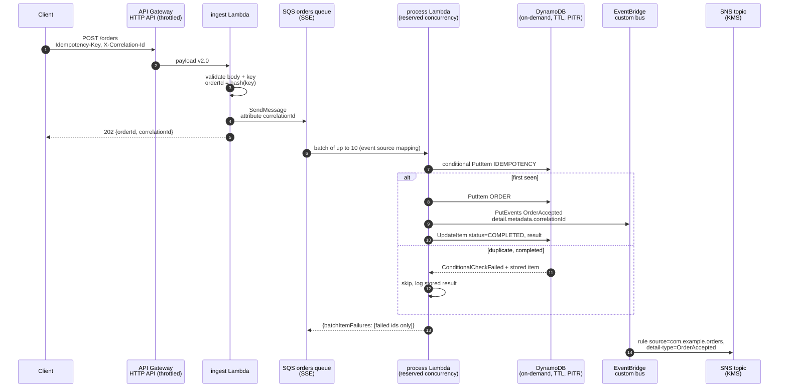
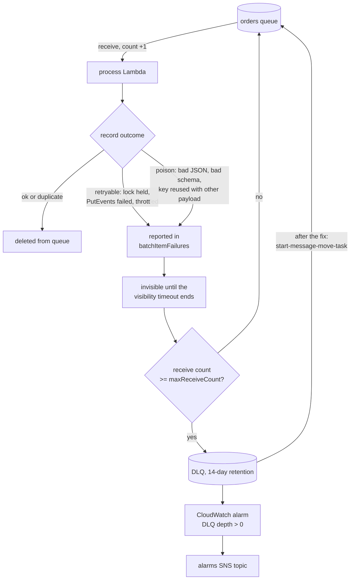

# Architecture

> Working portfolio implementation. Synthetic domain; the Terraform has been
> validated, never applied.

An order intake pipeline: a client posts an order, gets `202 Accepted` with
an order ID in a few milliseconds, and the order is then processed
asynchronously, exactly once in effect, with a domain event published for
downstream consumers.

## Request flow



The correlation ID is taken from the client's `X-Correlation-Id` header (if
it passes a character whitelist) or generated, returned in the response,
carried as an SQS message attribute, bound to every processor log line,
stored on the order record and placed in `detail.metadata.correlationId`
of the event. One Logs Insights query across both log groups follows a
request end to end:

```text
fields @timestamp, service, message, order_id, message_id
| filter correlation_id = "req-demo-001"
| sort @timestamp asc
```

## Failure and redrive path



What happens to each kind of failure:

| Failure | Detected by | Outcome |
|---|---|---|
| Invalid request | ingest validation | `400` with every field error; nothing enqueued |
| Missing `Idempotency-Key` | ingest validation | `400`; nothing enqueued |
| SQS unavailable | ingest `SendMessage` raises | `503` + `Retry-After: 1`; client retries with the same key |
| Duplicate message (client retry or SQS redelivery) | conditional write fails, item is `COMPLETED` | Acknowledged, stored result logged, no second event |
| Concurrent duplicate | conditional write fails, item is `IN_PROGRESS` with a live lock | Reported as failed, retried after the visibility timeout |
| Processor crashed mid-record | lock expires (`timeout + 5 s`) | Next delivery takes the key over and redoes the work |
| `PutEvents` fails | `FailedEntryCount > 0` | Idempotency claim released, record retried |
| Poison message | parse / schema / hash check | Retried until `maxReceiveCount`, then DLQ; alarm fires |
| EventBridge cannot reach SNS | target retry policy (24 attempts, 1 h) | `FailedInvocations` alarm |

Event publication is at least once: if the processor dies after
`PutEvents` but before marking the claim completed, the retry publishes
again. The event `id` is a UUIDv5 of the order ID, so consumers can dedupe
on it.

## Why SQS between the API and the processor

- **Fast, predictable API latency.** The synchronous path is one
  `SendMessage`. DynamoDB, EventBridge and anything added later (fraud
  checks, inventory) don't sit in front of the client.
- **Load levelling.** The API accepts a burst at its throttle limit; the
  processor drains it at the rate its reserved concurrency allows. Downstream
  services see a bounded request rate instead of the client's traffic shape.
- **Failure isolation and retries for free.** If DynamoDB throttles or
  EventBridge has a bad minute, messages wait in the queue rather than
  turning into 5xx responses. Retries, back-off by visibility timeout, and
  quarantine (DLQ) come from configuration, not code.
- **Replay.** A DLQ plus `start-message-move-task` is an operational
  "try again" button once a bug is fixed.
- **Why not invoke the processor asynchronously from ingest?** Lambda async
  invocation also queues and retries, but the queue is invisible: no depth or
  age metric to alarm on, at most two retries, and no batch processing or
  redrive tooling.
- **Why standard, not FIFO?** Orders are independent, so global ordering buys
  nothing, and FIFO deduplication only covers five minutes. Idempotency
  is enforced in DynamoDB for 24 hours instead (ADR 0001), which also covers
  the at-least-once delivery of a standard queue.

## Why not Step Functions here

Step Functions is the right tool when there is a *workflow*: several steps
with branching, waits, compensation (sagas), human approval, or a need to
see where each execution is. This pipeline has one unit of work per order
(validate, record, announce) that completes in milliseconds:

- **No orchestration to model.** A state machine with one task state adds a
  service, an IAM role and per-transition cost without adding behaviour.
- **Cost at volume.** Standard workflows are billed per state transition
  (roughly $25 per million transitions as a list price at the time of
  writing), several times the cost of the Lambda work itself here. Express
  workflows are cheaper but drop the execution history that is the main
  reason to choose Step Functions.
- **Buffering is still needed.** Step Functions doesn't level load the way
  a queue does. `StartExecution` has its own throttles, so a queue would
  still sit in front.

It becomes the better choice when acceptance grows into payment
authorisation, inventory reservation and shipment with compensation on
failure. Then `OrderAccepted` would start a state machine, and this pipeline
remains the intake stage.

## Data model

One DynamoDB table, partition key `pk` (string), no sort key:

| Item | Attributes | Lifetime |
|---|---|---|
| `IDEMPOTENCY#<key>` | `status` (`IN_PROGRESS`/`COMPLETED`), `request_hash`, `result` (JSON), `lock_expires_at`, `expires_at` | TTL on `expires_at` (24 h default) |
| `ORDER#<orderId>` | `status`, `customer_id`, `currency`, `total_cents`, `item_count`, `correlation_id`, `accepted_at` | Kept; PITR covers the last 35 days |

The claim condition, identical in the DynamoDB adapter and the in-memory
fake:

```text
attribute_not_exists(pk) OR expires_at < :now
  OR (#status = :in_progress AND lock_expires_at < :now)
```

`expires_at < :now` matters because TTL deletion is lazy (it can take days),
so an expired record must behave as absent before DynamoDB removes it.

## Code layout

| Module | Responsibility |
|---|---|
| `src/ingest.py` | HTTP API handler: decode, validate, derive order ID, enqueue, respond |
| `src/process.py` | SQS handler: per-record isolation, idempotent acceptance, partial batch response |
| `src/idempotency.py` | Claim / complete / release over one conditional write |
| `src/validation.py` | Order and header checks without a schema library |
| `src/events.py` | Versioned `OrderAccepted` envelope and `PutEvents` entry |
| `src/logging_utils.py` | One JSON object per log line, bound correlation ID |
| `src/adapters.py` | Ports, lazy-boto3 adapters, in-memory fakes (queue with redrive, store, bus) |

The handlers take their dependencies as an argument (`handle(event, deps)`);
the Lambda entry points (`handler(event, context)`) build the boto3 adapters
once per execution environment from environment variables.
