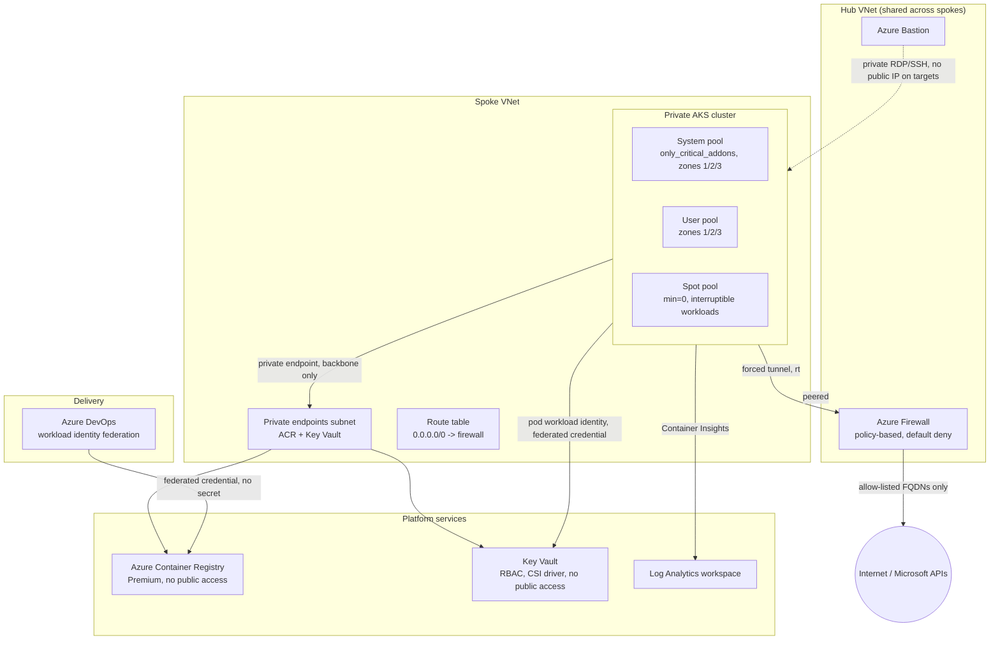
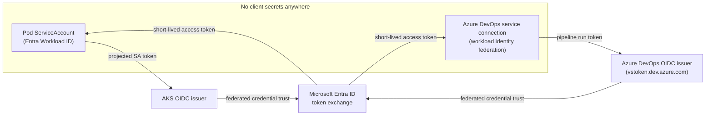

# Architecture

## Layers and their Terraform modules

| Layer | Module | Owns |
|---|---|---|
| Hub | `terraform/modules/hub` | Hub VNet, `AzureFirewallSubnet`/`AzureBastionSubnet`, Azure Firewall + policy, Bastion |
| Spoke | `terraform/modules/spoke` | Spoke VNet, AKS subnet, private-endpoints subnet, forced-tunneling route table, both halves of the hub<->spoke peering |
| Cluster | `terraform/modules/aks` | Private AKS cluster, Azure RBAC + Entra integration, system/user/spot node pools, OIDC issuer, Key Vault Secrets Provider add-on |
| Platform | `terraform/modules/platform` | ACR, Key Vault, both private endpoints + private DNS zones, Log Analytics workspace |
| Pod identity | `terraform/modules/workload-identity` | One `azurerm_user_assigned_identity` + `azurerm_federated_identity_credential` per pod ServiceAccount |
| Pipeline identity | `terraform/modules/pipeline-identity` | Entra app registration + federated credential for the Azure DevOps service connection, scoped to `AcrPush` only |

`terraform/examples/reference` wires all six into one root purely so `terraform validate` can exercise the whole graph in one pass; see `docs/decisions/0002-separate-state-per-root.md` for why a real deployment splits them.

## Why forced tunneling, not NAT-per-spoke

The spoke's route table sends `0.0.0.0/0` to the hub firewall's private IP (`next_hop_type = "VirtualAppliance"`). AKS is told `outbound_type = "userDefinedRouting"` so it never tries to provision its own outbound rule or NAT gateway on top of that route. Every byte a node or pod sends anywhere other than the Microsoft backbone (private endpoints bypass the firewall entirely — that traffic never leaves Microsoft's network) is inspected and logged by exactly one Azure Firewall, shared by every spoke that peers to this hub. Adding a second spoke means one more VNet peering and one more route table, not a second firewall and a second egress bill.

## Why the AKS control plane needs its own identity

`outbound_type = "userDefinedRouting"` means AKS can no longer manage its own default route on the subnet, so the cluster is given a user-assigned managed identity (`azurerm_user_assigned_identity.control_plane`) with `Network Contributor` on the spoke's route table. Without that role assignment, cluster creation fails validating the UDR configuration before a single node boots.
