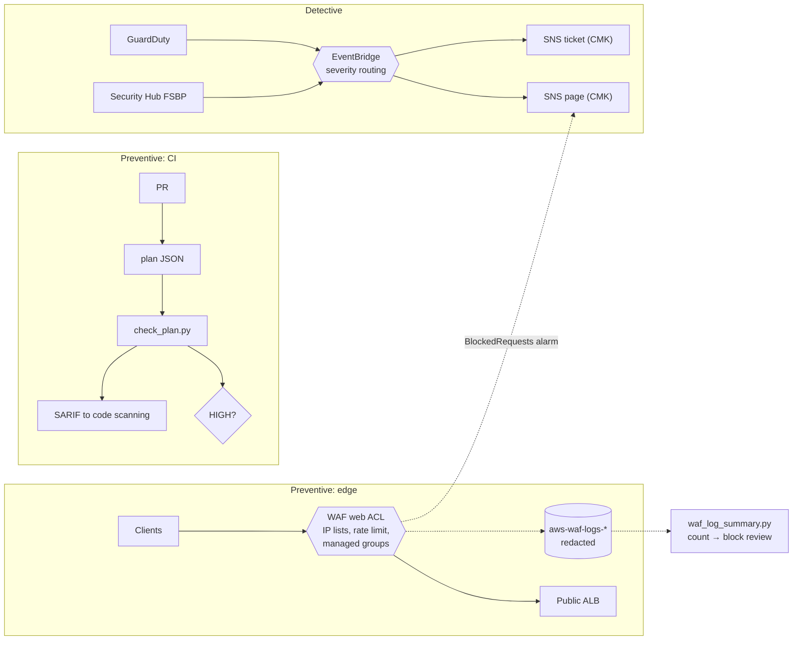

# Cloud Security & WAF Automation

> **Classification: Working portfolio implementation. Synthetic environment, no production results claimed.**
> Owner: Muhammad Salahuddin, Senior DevOps Engineer. The Terraform is validated, never applied;
> logs and plans are hand-built synthetic data; cost figures are illustrative, approximate list prices.

Security automation for an AWS web workload in three layers:
**preventive controls at the edge** (a WAFv2 web ACL with managed rule
groups, a per-IP rate limit, IP lists and redacted logging),
**policy-as-code in CI** (a standard-library checker that gates Terraform
plans and reports to GitHub code scanning in SARIF), and **detective
findings routed by severity** (GuardDuty and Security Hub, through
EventBridge, to encrypted page and ticket topics). The focus is on the
operational parts that usually go wrong: blocking customers with a rule
nobody tested, exceptions that never expire, and alerts that either page for
everything or quietly fail to deliver.

## Problem

Turning on security services is easy. Running them well is not:

- **A WAF rule switched straight to block** breaks a legitimate feature,
  such as an upload, a report builder or a health checker. Then someone
  disables the whole group "for now".
- **There's no view of what a count-mode rule would do**, so rules stay in
  count mode forever, or get flipped on a guess.
- **Policy checks get bypassed with permanent exceptions** that have no
  owner, no reason and no expiry.
- **Findings route to one noisy channel.** Every GuardDuty finding alerts
  twice (once directly, once through Security Hub), low-severity noise
  drowns the real page, and nobody notices that the encrypted SNS topic
  rejects EventBridge because the key policy doesn't allow it.
- **Credentials leak into logs.** WAF logs record request headers,
  including `Authorization` and cookies, unless they're redacted.

## What it demonstrates

| Area | Implementation |
|---|---|
| Edge protection | WAFv2 web ACL (REGIONAL default, CLOUDFRONT allowed with a us-east-1 precondition): AWS IP reputation, CommonRuleSet, KnownBadInputs, optional SQLi; per-IP rate-based rule; IP-set allow and block lists; optional ALB association |
| Count-then-block | A `count`/`block` mode per rule, validated in Terraform. New rules start in count. Single-rule exclusions through `rule_action_override` ([ADR 0001](docs/decisions/0001-count-before-block.md)) |
| Flip-to-block evidence | `waf_log_summary.py`: top blocked rules (including the rule inside a managed group), top client IPs, and for every count-mode rule the requests it would *newly* block, distinct clients, dominant URI and a hint |
| Logging | CloudWatch log group `aws-waf-logs-<prefix>` (the prefix AWS requires), `authorization` and `cookie` redacted, explicit log-delivery resource policy, retention, optional KMS |
| Edge alarm | `AWS/WAFV2 BlockedRequests` spike alarm to the page topic, which catches an attack or a bad flip to block |
| Policy as code | `check_plan.py`: 6 rules over `terraform show -json` output (S3 public access block, open SSH/RDP, `*` on `*` IAM, RDS encryption, CloudTrail validation, public ALB without WAF). Resolves configuration references and module inputs for values unknown at plan time |
| Exceptions | `policy/exceptions.json` with owner, reason and mandatory expiry; exact rule-and-resource match; expired entries ignored and reported; excepted findings kept in SARIF as suppressed |
| Code scanning | SARIF 2.1.0 with rules, `security-severity`, line-accurate locations and fingerprints, uploaded by the only CI job with `security-events: write` |
| Detective routing | GuardDuty severity ≥ 7 → page, 4-6.9 → ticket, low not routed; Security Hub CRITICAL → page, HIGH → ticket (NEW, ACTIVE, GuardDuty duplicates excluded); input transformers produce one readable line |
| Encrypted notifications | SNS topics on a rotating CMK whose key policy allows EventBridge and CloudWatch to publish; topic policies pinned to the routing rules' ARNs and TLS-only |
| Secrets rotation | `aws_secretsmanager_secret_rotation` wiring for an existing rotation Lambda. No Lambda written, because AWS provides maintained templates ([security](docs/security.md#secrets-rotation-why-there-is-no-lambda-here)) |
| Infrastructure as code | Two modules plus an example, `aws >= 6.0, < 7.0`, variable validation, preconditions, `default_tags`, no credentials or account IDs |

## Architecture



The request path through each rule, the finding-routing flow and the CI flow
are detailed in [docs/architecture.md](docs/architecture.md).

## Layout

```text
terraform/    modules/waf, modules/detective-response, examples/basic
policy/       check_plan.py, exceptions.json, fixtures/ (compliant and non-compliant plan JSON)
scripts/      waf_log_summary.py
sample-data/  waf-logs.jsonl (synthetic, RFC 5737 IPs, real WAF log schema)
tests/        unittest suites
docs/         architecture, operations, security, cost, checkov, decisions/
```

## Quickstart

Python 3.12 (the CI version; also runs on newer 3.x), nothing to install.
From this directory:

```bash
python3 -m unittest discover -s tests -v                       # all tests
python3 policy/check_plan.py --list-rules
python3 policy/check_plan.py policy/fixtures/plan-compliant.json       # exit 0
python3 policy/check_plan.py policy/fixtures/plan-noncompliant.json    # exit 1
python3 policy/check_plan.py policy/fixtures/plan-noncompliant.json --format sarif -o reports/check_plan.sarif
python3 scripts/waf_log_summary.py sample-data/waf-logs.jsonl
python3 scripts/waf_log_summary.py --json sample-data/waf-logs.jsonl

# against a real plan (needs credentials; not done in this repo)
terraform plan -out tfplan && terraform show -json tfplan > plan.json
python3 policy/check_plan.py plan.json
```

`check_plan.py` exits 0 when there is no unexcepted HIGH finding, 1 when there
is one, and 2 on bad input (unreadable plan, malformed exceptions file). It
reads `policy/exceptions.json` by default. Use `--no-exceptions`,
`--exceptions <file>`, and `--today YYYY-MM-DD` to evaluate expiry as of a
fixed date.

## Sample output

All excerpts below are real output from this machine, run on 2026-10-14.
That date matters for the exceptions: one expires in 2027, the other
expired in June 2026.

The rule catalogue:

```text
$ python3 policy/check_plan.py --list-rules
CSP-S3-001   HIGH   S3 bucket must have a public access block with all four flags true
CSP-SG-001   HIGH   Security group must not allow 0.0.0.0/0 or ::/0 on port 22 or 3389
CSP-IAM-001  HIGH   IAM policy must not allow Action "*" on Resource "*"
CSP-RDS-001  HIGH   RDS instance or cluster must set storage_encrypted = true
CSP-CT-001   MEDIUM CloudTrail trail must enable log file validation
CSP-WAF-001  MEDIUM Internet-facing ALB should have a WAF web ACL association
```

The compliant plan. The public ALB is protected through the WAF module (the
checker follows `module.waf`'s `var.alb_arn` back to `aws_lb.public`), and one
public access block is linked to its bucket only by a configuration
reference, because the bucket ID is unknown at plan time:

```text
$ python3 policy/check_plan.py policy/fixtures/plan-compliant.json
check_plan: policy/fixtures/plan-compliant.json: 14 resources, 6 rules
EXPIRED  exception for CSP-RDS-001 on aws_db_instance.reporting (owner data-team@example.com) expired 2026-06-30: ignored
UNUSED   exception for CSP-SG-001 on aws_vpc_security_group_ingress_rule.legacy_bastion_ssh matched no finding (owner platform-team@example.com)
Summary: 0 finding(s) (none), 0 excepted, 1 expired exception(s). Result: PASS
(exit 0)
```

The non-compliant plan. Every rule fires. The SSH rule on the legacy bastion
is excepted until 2027-03-31. The RDS exception expired, so that finding
counts again:

```text
$ python3 policy/check_plan.py policy/fixtures/plan-noncompliant.json
check_plan: policy/fixtures/plan-noncompliant.json: 10 resources, 6 rules
FAIL HIGH   CSP-S3-001   aws_s3_bucket.public_site: bucket has no aws_s3_bucket_public_access_block
     fix: Add an aws_s3_bucket_public_access_block for the bucket with block_public_acls, block_public_policy, ignore_public_acls and restrict_public_buckets all set to true. Serve public content through CloudFront with origin access control instead of a public bucket.
FAIL HIGH   CSP-S3-001   aws_s3_bucket_public_access_block.uploads: public access block has restrict_public_buckets not true
     fix: (same as above)
FAIL HIGH   CSP-SG-001   aws_security_group.admin: ingress[1] allows 0.0.0.0/0 on port 3389
     fix: Remove the world-open SSH/RDP rule. Use SSM Session Manager (no inbound port), or restrict the source to a bastion security group or a known corporate range.
FAIL HIGH   CSP-IAM-001  aws_iam_policy.break_glass: Sid 'BreakGlassAdmin' allows Action "*" on Resource "*"
     fix: Replace the wildcard statement with the specific actions and resource ARNs the workload needs. Use IAM Access Analyzer policy generation from CloudTrail activity to find them.
FAIL HIGH   CSP-RDS-001  aws_db_instance.reporting: storage_encrypted is false
     fix: Set storage_encrypted = true (and kms_key_id for a customer managed key). An existing unencrypted instance needs a snapshot, an encrypted copy and a restore; it cannot be encrypted in place.
FAIL MEDIUM CSP-CT-001   aws_cloudtrail.main: enable_log_file_validation is not true
     fix: Set enable_log_file_validation = true so digest files prove that delivered log files were not modified or deleted.
FAIL MEDIUM CSP-WAF-001  aws_lb.public: internet-facing ALB has no WAF web ACL association
     fix: Associate a REGIONAL WAFv2 web ACL (aws_wafv2_web_acl_association) with the load balancer; terraform/modules/waf does this with associate_alb = true.
EXCEPTED CSP-SG-001  aws_vpc_security_group_ingress_rule.legacy_bastion_ssh (owner platform-team@example.com, until 2027-03-31): Vendor appliance only supports SSH from its dynamic IPv6 range; replacement with SSM Session Manager tracked in SEC-142
EXPIRED  exception for CSP-RDS-001 on aws_db_instance.reporting (owner data-team@example.com) expired 2026-06-30: ignored
Summary: 7 finding(s) (5 HIGH, 2 MEDIUM), 1 excepted, 1 expired exception(s). Result: FAIL
(exit 1)
```

(The second `fix:` line is shortened here. The tool prints the full
remediation for each finding.)

One SARIF result, the excepted one. It's kept as a suppressed result so code
scanning shows it as dismissed, with the justification:

```json
{
  "ruleId": "CSP-SG-001",
  "ruleIndex": 1,
  "level": "error",
  "message": { "text": "aws_vpc_security_group_ingress_rule.legacy_bastion_ssh: ingress allows ::/0 on port 22" },
  "locations": [{
    "physicalLocation": {
      "artifactLocation": { "uri": "projects/cloud-security-waf-automation/policy/fixtures/plan-noncompliant.json" },
      "region": { "startLine": 134 }
    },
    "logicalLocations": [{ "fullyQualifiedName": "aws_vpc_security_group_ingress_rule.legacy_bastion_ssh", "kind": "resource" }]
  }],
  "partialFingerprints": { "checkPlanFinding/v1": "d5c9cd1a47236008a0e74c69dfdfb7d23a715b30d763a2c7b5f5d507cd7fb292" },
  "suppressions": [{
    "kind": "external",
    "status": "accepted",
    "justification": "Vendor appliance only supports SSH from its dynamic IPv6 range; replacement with SSM Session Manager tracked in SEC-142 (owner platform-team@example.com, expires 2027-03-31)"
  }]
}
```

The WAF log summary over the 47-record synthetic sample:

```text
$ python3 scripts/waf_log_summary.py sample-data/waf-logs.jsonl
WAF log summary: 47 records (2026-10-14T08:00:37Z .. 2026-10-14T08:28:59Z)
Actions: ALLOW 32, BLOCK 15

Top blocked rules (15 blocked):
      5   33.3%  ip-block-list
      3   20.0%  AWS-AWSManagedRulesCommonRuleSet/CrossSiteScripting_QUERYARGUMENTS
      2   13.3%  AWS-AWSManagedRulesAmazonIpReputationList/AWSManagedIPReputationList
      2   13.3%  AWS-AWSManagedRulesCommonRuleSet/NoUserAgent_HEADER
      2   13.3%  AWS-AWSManagedRulesKnownBadInputsRuleSet/Log4JRCE_HEADER

Top client IPs by blocked requests:
      4 blocked /     4 total  198.51.100.23
      4 blocked /     4 total  203.0.113.66
      2 blocked /     2 total  203.0.113.201
      2 blocked /     2 total  203.0.113.67
      2 blocked /     2 total  203.0.113.99

Count-mode matches that would block (flip-to-block review):
  rate-limit-per-ip  [count-mode rule]
      matches 6, would newly block 6, unique IPs 1, top URI /login (6/6)
      hint: concentrated on few clients: likely hostile, candidate to block
  AWSManagedRulesSQLiRuleSet/SQLi_BODY  [count-mode group]
      matches 5, would newly block 5, unique IPs 5, top URI /api/reports/query (5/5)
      hint: many clients on one path: check for a false positive (scope-down or exclusion) first
  AWSManagedRulesCommonRuleSet/SizeRestrictions_BODY  [rule override]
      matches 3, would newly block 3, unique IPs 3, top URI /account/avatar (3/3)
      hint: many clients on one path: check for a false positive (scope-down or exclusion) first
  AWSManagedRulesSQLiRuleSet/SQLi_QUERYARGUMENTS  [count-mode group]
      matches 3, would newly block 3, unique IPs 1, top URI /products (3/3)
      hint: concentrated on few clients: likely hostile, candidate to block
```

Reading it: the rate rule and `SQLi_QUERYARGUMENTS` are ready to flip, since
each has one client and clear attack traffic. `SQLi_BODY` isn't ready: five
different clients hit one report endpoint, which is a false positive to fix
first. `SizeRestrictions_BODY` is the existing exclusion for avatar uploads,
still visible. The procedure is in [operations](docs/operations.md#count-then-block-rollout).

## Tests

```bash
python3 -m unittest discover -s tests -v
# Ran 99 tests ... OK
```

They cover:

- **every policy rule, with pass and fail cases**: all four public access
  block flags individually, block-to-bucket linking by name and by
  configuration reference, a block for the wrong bucket; SSH and RDP over
  IPv4 and IPv6, port ranges, protocol `-1`, UDP ignored, all three
  security-group rule resource types; `*`/`*` in string and list form and
  for all four IAM policy resource types, Deny ignored, invalid JSON
  failing closed, unknown policies skipped; RDS instance and cluster;
  CloudTrail; public, internal and network load balancers, and WAF
  associations by root reference, through a module variable, by known ARN
  and for the wrong ALB;
- **exceptions**: valid, valid on its expiry day, expired (ignored and
  reported), wrong resource, wrong rule, every missing field, bad dates,
  unknown rules, and the shipped file;
- **SARIF**: top-level keys, every rule in the driver with level and
  `security-severity`, each result's `ruleId`/`ruleIndex`/location/fingerprint,
  the expected rule IDs, start lines that point at the resource, suppressions
  and expired-exception notifications;
- **exit codes** 0, 1 and 2 (including a MEDIUM-only plan passing), and the
  exact expected findings on both fixtures;
- **log summary math**: action counts and time window, malformed lines,
  managed-group labels, all three count-mode shapes, "newly blocked"
  excluding already-blocked requests, the hints, and the README numbers
  pinned against the sample. The sample is also checked to use RFC 5737
  addresses only, with credentials redacted;
- **CLI smoke tests** through `subprocess` for both scripts;
- **Terraform invariants** `validate` can't see: the `aws-waf-logs-` prefix,
  the default redactions, count/block validation, the severity bands, CMK
  usage, the provider constraint, and no account IDs other than the
  documentation placeholder.

## Terraform validation

Modules: [`terraform/modules/waf`](terraform/modules/waf) and
[`terraform/modules/detective-response`](terraform/modules/detective-response),
composed in [`terraform/examples/basic`](terraform/examples/basic). Never
applied. Validation only:

```bash
cd terraform
terraform fmt -check -recursive
terraform -chdir=modules/waf init -backend=false && terraform -chdir=modules/waf validate
terraform -chdir=modules/detective-response init -backend=false && terraform -chdir=modules/detective-response validate
terraform -chdir=examples/basic init -backend=false && terraform -chdir=examples/basic validate
# Success! The configuration is valid.   (all three)
```

Validated with Terraform 1.14.8 and `hashicorp/aws` 6.68.0.

- **WAF module**: up to two IP sets, the web ACL with dynamic rules
  (allow list P0, block list P1, rate limit P2, managed groups P10+), a
  CloudWatch log group, a log-delivery resource policy, the logging
  configuration with redacted headers, an optional ALB association
  (`associate_alb` is a separate flag so the count is known at plan time)
  and the blocked-requests alarm. There are preconditions for CLOUDFRONT
  scope in us-east-1, ALB association with REGIONAL scope only, and unique
  managed-group priorities.
- **Detective module**: a GuardDuty detector and Security Hub with the
  FSBP v1.0.0 subscription (each can be turned off for accounts managed
  centrally), a CMK and alias, two SNS topics with policies and optional
  subscriptions, four EventBridge rules with input-transformer targets and
  retry policies, and optional secret rotation wiring.

No account IDs or credentials: `aws_caller_identity`, `aws_region` and
`aws_partition` supply them at plan time. See [cost](docs/cost.md).

## Limitations

- **Never deployed.** Nothing has run in AWS: not the WAF rules against
  real traffic, the log delivery permissions, the EventBridge patterns
  against real findings, the KMS key policy with SNS, or the input
  transformers. `terraform validate` checks the schema, not the behaviour.
- **Synthetic data.** The WAF log sample and the plan fixtures are
  hand-built to match the documented schemas (`terminatingRuleId`,
  `ruleGroupList`, `nonTerminatingMatchingRules` with `overriddenAction`;
  `resource_changes[].change.after` and `configuration`). They weren't
  captured from a live web ACL or a real `terraform show -json`. In
  particular, how a managed group in count mode appears in the log is
  taken from AWS documentation, not observed.
- **Six policy rules.** Real coverage needs a maintained rule set (Checkov
  or OPA). See [ADR 0002](docs/decisions/0002-stdlib-policy-checker-vs-opa-checkov.md)
  and [checkov.md](docs/checkov.md). Values unknown at plan time (an IAM
  policy built from a data source) are skipped, not judged.
- **CI checks fixtures, not a live plan.** There are no credentials in
  this repo, so the gate runs on the synthetic plans.
- **No scope-down statement support** in the module yet. False positives
  are handled with `rules_to_count`. A path-scoped scope-down is the better
  fix and is documented in [operations](docs/operations.md#handling-a-false-positive).
- **The summary hint is a heuristic.** A distributed attack on one
  endpoint looks like a false positive. Read sampled requests before
  flipping.
- **No dead-letter queue** on the EventBridge targets, and no
  `FailedInvocations` alarm. A delivery failure after an hour of retries
  is silent. That's the next thing to add.
- **Single account, single region.** A real deployment would use a
  GuardDuty and Security Hub delegated administrator with organisation-wide
  auto-enable, and WAF Firewall Manager policies across accounts.
- **IPv4 only** for the IP sets. No Bot Control, ATP or Shield Advanced.

## Interview talking points

- **Count first, then block, from evidence.** A managed rule group knows
  nothing about this application. The rollout is a variable per rule,
  a week of logs and a summary that answers one question: what would this
  rule newly block, from how many clients, on which path? "Five clients,
  one endpoint" means fix a false positive. "One client, six requests to
  `/login`" means flip it.
- **Exclusions should stay visible.** Overriding one rule to COUNT keeps it
  logging, so the summary keeps listing it. Disabling the group, or
  removing the rule, makes the exclusion invisible and permanent.
- **Rule order is part of the design.** The allow list terminates, so
  it's a bypass to guard like an admin grant. Cheap rules (IP sets, rate)
  go before the 700-WCU group. A count-mode rule must sit at its final
  priority or its numbers mean nothing.
- **Check the plan, not the source.** Plans resolve modules and variables.
  New resources have unknown IDs, so linking a public access block to its
  bucket, or an ALB to its WAF through a module input, means reading the
  plan's configuration references. That's the part that usually goes wrong
  in home-grown checkers.
- **Exceptions need an owner and an end date.** Exact rule-and-resource
  matching, a mandatory expiry, expired entries that fail the build again,
  and suppressed (not deleted) SARIF results. The diff to `exceptions.json`
  is the approval record.
- **Route by severity, deduplicate, make the alert readable.** Numeric
  bands for GuardDuty, labels for Security Hub, `ProductName anything-but
  GuardDuty` to stop double pages, `Workflow.Status = NEW` so acknowledging
  stops re-alerts, and an input transformer so the page is one line.
- **Encrypted SNS fails silently.** If the CMK's policy doesn't let
  `events.amazonaws.com` generate data keys, EventBridge shows failed
  invocations and nobody is paged. The key policy and the topic policy
  both name their publishers.
- **Honest tooling choice.** In a real organisation I'd use Checkov or
  OPA/Conftest. This checker is standard-library to stay dependency-free
  and to show the rule logic. The parts I'd still build myself are the
  exceptions process and SARIF routing.
