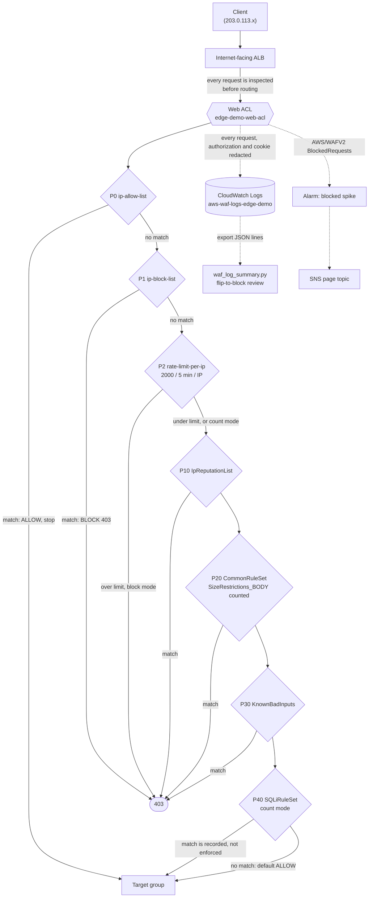
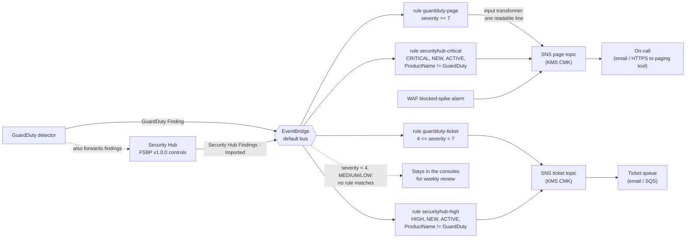
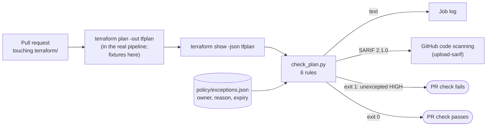

# Architecture

Three layers, each with a different job and failure mode:

| Layer | When it acts | What it stops or surfaces | Where |
|---|---|---|---|
| **Preventive, at the edge** | Every HTTP request | Known-bad IPs, floods, common exploit payloads | WAFv2 web ACL ([`modules/waf`](../terraform/modules/waf)) |
| **Preventive, before deploy** | Every pull request | Misconfigured infrastructure reaching an account | `policy/check_plan.py` in CI |
| **Detective, after the fact** | Continuously | Compromise signals and configuration drift | GuardDuty, Security Hub, EventBridge, SNS ([`modules/detective-response`](../terraform/modules/detective-response)) |

Nothing here has been deployed. The diagrams describe what the Terraform
declares and what AWS documents.

## 1. Edge request path through WAF

Ordering matters:

- **Allow list first**, because an allowed request skips everything after
  it. That's the point for synthetic monitoring. It's also why the list
  has to stay tiny and reviewed: an over-broad allow list is a WAF bypass.
- **Block list and rate limit before managed groups.** They cost 1-2 WCUs
  and decide cheaply, so a flood from a blocked range never reaches the
  700-WCU CommonRuleSet.
- **IP reputation before the payload rules.** It's 25 WCUs and stops
  known scanners before inspection.
- **Count-mode rules sit wherever they will sit in block mode.** A rule in
  count mode only sees requests that earlier rules let through. If you
  test it at a different priority, the counts you collect won't match
  what it would actually block.

How a request shows up in the logs, which the summary script relies on:

| Situation | `action` | `terminatingRuleId` | Where the match is recorded |
|---|---|---|---|
| Custom rule blocks | `BLOCK` | `ip-block-list` | (terminating) |
| Managed group blocks | `BLOCK` | `AWS-AWSManagedRulesCommonRuleSet` | `ruleGroupList[].terminatingRule.ruleId` |
| Custom rule in count mode | `ALLOW` | `Default_Action` | `nonTerminatingMatchingRules[]` with `action: COUNT` |
| Managed group in count mode | `ALLOW` | `Default_Action` | group in `nonTerminatingMatchingRules[]`, inner rule in `ruleGroupList[].terminatingRule` |
| One rule inside a group overridden to count | `ALLOW` | `Default_Action` | `ruleGroupList[].nonTerminatingMatchingRules[]` with `overriddenAction: BLOCK` |

## 2. Finding-routing flow

Design points:

- **Severity bands are numeric for GuardDuty and labels for Security Hub.**
  GuardDuty findings carry a 1.0-10.0 `detail.severity`. AWS calls
  7.0-8.9 High and 9.0-10.0 Critical, so `>= 7` is "page". Security Hub
  normalises everything to `Severity.Label`. CRITICAL pages, HIGH opens a
  ticket: a failed FSBP control is real, but rarely a 3 a.m. problem.
- **No double alerts.** GuardDuty forwards its findings into Security Hub.
  Without the `ProductName` `anything-but` filter, every GuardDuty finding
  would alert twice, once from each source.
- **`Workflow.Status = NEW` and `RecordState = ACTIVE`.** Security Hub
  re-emits a finding each time it's updated. Filtering on NEW means
  that once a responder sets it to NOTIFIED or SUPPRESSED, it stops
  re-alerting. That status change is the acknowledgement mechanism.
- **Input transformers** turn the event into a single line naming the
  severity, the finding type, the account and the finding ID. The
  responder sees something actionable on their phone instead of 4 KB of JSON.
- **Encrypted topics need a key policy that names the publishers.** SNS
  calls `kms:GenerateDataKey*` and `kms:Decrypt` on behalf of whoever
  publishes. `events.amazonaws.com` and `cloudwatch.amazonaws.com` are
  allowed, conditioned on `aws:SourceAccount`. Without this the EventBridge
  target fails silently: the rule shows invocations, `FailedInvocations`
  climbs and nobody is paged. Each topic policy also pins
  `aws:SourceArn` to the routing rules that are meant to publish to it.

## 3. Policy-as-code in CI

Why the plan rather than the `.tf` source: the plan has the evaluated values,
so variables, `for_each`, module inputs and defaults are already resolved. A
bucket whose public access block comes from a module three levels down still
shows up as a resource change. For new resources, IDs and ARNs are unknown
at plan time, so the checker also reads the plan's `configuration` section to
see *what refers to what*. It follows module input variables back to their
source, which is how it knows the WAF module's `resource_arn = var.alb_arn`
protects `aws_lb.public`.

In this repository CI runs the checker on the two synthetic fixtures (there
are no credentials to produce a real plan). In a real pipeline the plan step
runs with a read-only role through OIDC, and the JSON is the input.
[ADR 0002](decisions/0002-stdlib-policy-checker-vs-opa-checkov.md) explains
why the checker is hand-written, and [checkov.md](checkov.md) shows the
off-the-shelf equivalent.
