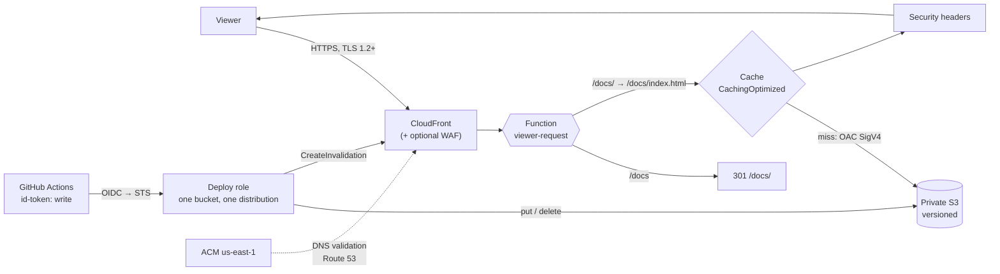

# CloudFront + S3 Static Delivery

> **Classification: Working portfolio implementation. Synthetic site, no production results claimed.**
> Owner: Muhammad Salahuddin, Senior DevOps Engineer. The Terraform is validated, never applied;
> the site, build and header captures are hand-built synthetic data; cost figures are illustrative,
> approximate list prices. Domains are `example.com` / `www.example.com` only.

Secure static-site delivery on AWS: a **private S3 origin** read only by one
**CloudFront distribution through Origin Access Control**, a
**CloudFront Function** for directory indexes and trailing-slash redirects,
a **security headers policy**, an **ACM certificate in us-east-1** validated
through Route 53, and **GitHub Actions deploys over OIDC** with no stored
keys. A standard-library `deploy_plan.py` decides what to upload, delete and
invalidate, and sets the `Cache-Control` on each file. The focus is on the parts
that usually go wrong: a bucket readable around the CDN, a certificate in
the wrong region, stale HTML after a deploy, `/*` invalidations that empty
the cache every time, and CI roles that any branch can assume.

## Problem

Putting a static site behind a CDN takes an afternoon. Running it well is
harder:

- **The bucket is public anyway.** Website hosting endpoints need a public
  policy, so the CDN's WAF, headers and logs can be skipped with one URL.
- **Directory URLs break after locking the bucket down.** The S3 REST
  endpoint has no index documents, so `/docs/` returns 403.
- **Deploys leave stale pages, or empty the cache.** Long TTLs everywhere
  mean users see old HTML. `/*` on every deploy throws away every cached
  asset too.
- **The certificate or WAF is in the wrong region.** CloudFront only reads
  ACM and WAF from us-east-1, and the failure shows up late, at apply time.
- **CI holds long-lived keys**, or its OIDC trust says `repo:org/*`, so any
  repository, branch or workflow in the organisation can deploy.

## What it demonstrates

| Area | Implementation |
|---|---|
| Private origin | S3 with `BucketOwnerEnforced`, all four public-access blocks, versioning, SSE-S3 by default (SSE-KMS optional, with the key-policy grant output), noncurrent-version lifecycle, TLS-only bucket policy |
| Origin access | OAC (SigV4, `signing_behavior = always`), not legacy OAI. The bucket policy allows `s3:GetObject` only to `cloudfront.amazonaws.com` with `AWS:SourceArn` = this distribution ([ADR 0001](docs/decisions/0001-oac-over-oai.md)) |
| Caching | AWS managed `CachingOptimized`, looked up **by name** with `data "aws_cloudfront_cache_policy"`. No pasted IDs |
| Edge logic | CloudFront Function (`cloudfront-js-2.0`, JS in its own file): `/path/` → `/path/index.html`, extensionless `/path` → 301 `/path/` with the query string kept. **`scripts/rewrite.py` is the spec**, and the JS is checked against it ([ADR 0002](docs/decisions/0002-cloudfront-functions-vs-lambda-edge.md)) |
| Security headers | Response headers policy: HSTS (2 years, `includeSubDomains`), strict same-origin CSP, `nosniff`, `DENY`, `strict-origin-when-cross-origin`, Permissions-Policy. S3 headers stripped. `check_headers.py` verifies a live or captured response |
| Errors | 403 and 404 → `/404.html` with status 404, 10 s error TTL |
| TLS and DNS | `TLSv1.2_2021`, `http2and3`, SNI. ACM in us-east-1 through `aws.us_east_1` (`configuration_aliases` plus a `check` block on the alias's region), DNS validation in a zone passed by ID, alias A/AAAA records |
| Logging | Optional CloudFront standard logging v2 to CloudWatch Logs in us-east-1 (no ACL-enabled log bucket needed). [Why](docs/security.md#access-logging-v2-to-cloudwatch-logs-not-legacy-s3-logging) |
| WAF | Optional `web_acl_arn`, validated as CLOUDFRONT scope in us-east-1. The cloud-security-waf-automation project's module can supply one |
| CI identity | GitHub OIDC provider (or an existing one by ARN). Trust requires `aud = sts.amazonaws.com` and an exact `sub`: one repo plus `main` or a named environment. The role can put/delete/list one bucket and create invalidations on one distribution, nothing else |
| Deploy planning | `deploy_plan.py`: upload/delete sets from MD5 vs ETag, per-file `Cache-Control` and `Content-Type`, safe upload order, minimal invalidation paths with a `/*` threshold, hashed assets never invalidated ([ADR 0003](docs/decisions/0003-cache-strategy-hashed-assets.md)) |
| Infrastructure as code | Two modules, a validation harness and an example, `aws >= 6.0, < 7.0`, variable validation, `default_tags`, no credentials or real account IDs |

## Architecture



The request path, the deploy sequence and the certificate/DNS ordering are
detailed in [docs/architecture.md](docs/architecture.md).

## Layout

```text
terraform/    modules/static-site (+ functions/uri-rewrite.js, validation-harness/),
              modules/github-oidc-deployer, examples/basic
scripts/      deploy_plan.py, check_headers.py, rewrite.py (the function's spec)
site/         the demo site: index.html, docs/index.html, 404.html, styles.css
sample-data/  build/ + remote-manifest.json (a synthetic release), headers-good.txt, headers-bad.txt
tests/        unittest suites (node runs the JS when installed)
docs/         architecture, operations, security, cost, decisions/
```

## Quickstart

Python 3.12 (the CI version; also runs on newer 3.x), nothing to install.
Node is optional and only used by one test. From this directory:

```bash
python3 -m unittest discover -s tests -v
python3 scripts/deploy_plan.py sample-data/build --manifest sample-data/remote-manifest.json
python3 scripts/check_headers.py sample-data/headers-good.txt     # exit 0
python3 scripts/check_headers.py sample-data/headers-bad.txt      # exit 1
python3 scripts/rewrite.py / /docs /docs/ /a.css

# against a real site (explicit network access; not done in this repo)
python3 scripts/check_headers.py --url https://www.example.com/
```

`deploy_plan.py` exits 0 on success and 2 on bad input. It accepts a
`key → etag` map or the raw output of `aws s3api list-objects-v2 --output
json`. The flags are `--threshold N` (the `/*` cut-over, default 15),
`--short-ttl`, `--keep-old-hashed` and `--compact`. `check_headers.py`
exits 0 when every check passes, 1 when one fails and 2 on bad input. It
has `--json` output and `--url` for a live HEAD request.

## Sample output

All excerpts below are real output from this machine, run on 2026-10-14.

The sample release (`sample-data/build` against `remote-manifest.json`, a
`list-objects-v2` capture) adds an About page and rebuilt hashed assets,
changes the home page and `robots.txt`, and retires the pricing page:

```text
$ python3 scripts/deploy_plan.py sample-data/build --manifest sample-data/remote-manifest.json
{
  "upload": [
    {
      "key": "assets/app.3f9a1c2e7b.js",
      "reason": "new",
      "md5": "564e77d865b1c505e410148c92f82392",
      "cache_control": "public, max-age=31536000, immutable",
      "content_type": "text/javascript; charset=utf-8",
      "phase": "hashed-asset"
    },
    ... assets/site.8d4e6f01.css (new, immutable),
        robots.txt (changed, "public, max-age=300", other),
        about/index.html (new, "no-cache", html) ...
    {
      "key": "index.html",
      "reason": "changed",
      "md5": "8b3d4213f0d494c9a4edabce187480e3",
      "cache_control": "no-cache",
      "content_type": "text/html; charset=utf-8",
      "phase": "html"
    }
  ],
  "delete": [
    "assets/app.0b1c2d3e4f.js",
    "assets/site.1a2b3c4d.css",
    "pricing/index.html"
  ],
  "retained": [],
  "invalidation": {
    "paths": [
      "/index.html",
      "/",
      "/pricing/index.html",
      "/pricing/",
      "/robots.txt"
    ],
    "wildcard": false,
    "path_count": 5,
    "threshold": 15
  },
  "summary": {
    "local_files": 8,
    "remote_objects": 8,
    "new": 3,
    "changed": 2,
    "unchanged": 3,
    "deleted": 3,
    "retained": 0,
    "invalidation_paths": 5
  }
}
```

(Three middle upload entries are shortened here; the tool prints each in
full.) Reading it: uploads are ordered hashed assets → other → HTML, so the
new `index.html` lands after the bundles it references. Five paths are
invalidated. The new About page isn't (nothing stale can be cached for it),
and neither are the rebuilt or deleted hashed assets (new hash, new URL).
The changed home page and the retired pricing page get their `/dir/` form
too. With `--threshold 4` the same release collapses to one wildcard:

```text
$ python3 scripts/deploy_plan.py sample-data/build --manifest sample-data/remote-manifest.json --threshold 4 --compact
... "invalidation": {"paths": ["/*"], "wildcard": true, "path_count": 5, "threshold": 4} ...
```

The pricing trade-off: the first 1,000 paths a month are free, and `/*`
counts as one path. A wildcard is never more expensive, but it empties the
cache of every unchanged asset at every edge. See
[cost](docs/cost.md#invalidation-per-path-vs-wildcard).

Header check, good capture (a `curl -sSIL` of `/docs` through the
function's 301; the last response is checked):

```text
$ python3 scripts/check_headers.py sample-data/headers-good.txt
check_headers: sample-data/headers-good.txt (HTTP/2 200)
PASS  Strict-Transport-Security  max-age=63072000
PASS  Content-Security-Policy    11 directives
PASS  X-Content-Type-Options     nosniff
PASS  X-Frame-Options            DENY
PASS  Referrer-Policy            strict-origin-when-cross-origin
Result: PASS (0 fail, 0 warn)
(exit 0)
```

Header check, bad capture (what a site without a headers policy looks like):

```text
$ python3 scripts/check_headers.py sample-data/headers-bad.txt
check_headers: sample-data/headers-bad.txt (HTTP/1.1 200 OK)
FAIL  Strict-Transport-Security  max-age=86400 is below one year (31536000)
FAIL  Content-Security-Policy    missing
FAIL  X-Content-Type-Options     missing
FAIL  X-Frame-Options            'ALLOWALL' is not one of deny, sameorigin
FAIL  Referrer-Policy            'unsafe-url' is not one of no-referrer, same-origin, strict-origin, strict-origin-when-cross-origin
Result: FAIL (5 fail, 0 warn)
(exit 1)
```

The rewrite specification:

```text
$ python3 scripts/rewrite.py / /docs /docs/ /a.css '/docs?page=2&lang=en'
{"input": "/", "action": "rewrite", "uri": "/index.html"}
{"input": "/docs", "action": "redirect", "status": 301, "location": "/docs/"}
{"input": "/docs/", "action": "rewrite", "uri": "/docs/index.html"}
{"input": "/a.css", "action": "pass", "uri": "/a.css"}
{"input": "/docs?page=2&lang=en", "action": "redirect", "status": 301, "location": "/docs/?page=2&lang=en"}
```

## Tests

```bash
python3 -m unittest discover -s tests -v
# Ran 129 tests ... OK            (with node on PATH)
# Ran 129 tests ... OK (skipped=3) (without node)
```

They cover:

- **the rewrite spec**: `/`, `/docs`, `/docs/`, nested paths, `/a.css`,
  hashed assets, explicit `index.html`, dotfiles, dotted directories
  (`/v1.2/guide`), query strings (kept on rewrite and redirect, bare keys,
  repeated keys, encoded values), and encoded paths (`%C3%A9`, `%2F` isn't a
  slash, `%2E` isn't a dot);
- **the function against the spec**: a regex-level check that the JS and
  the Python have the same three branches, literals and response shape.
  That check is static, **not a JS runtime test**. When `node` is
  installed (always in CI), the JS handler is also executed under node on
  19 events, and its output must equal the Python's. Without node that
  class skips cleanly;
- **the deploy plan**: new, changed, unchanged, deleted, multipart ETags,
  Cache-Control for hashed/HTML/other (including near-miss hash names),
  content types, upload phase order, `--keep-old-hashed`, invalidation of
  changed and deleted HTML with directory forms, new pages and hashed
  assets never invalidated, URL encoding, the threshold at and above the
  limit, all three manifest shapes, and the README numbers pinned against
  the sample;
- **the header checker**: both sample files, HSTS at exactly one year and
  one second under, quoted or uppercase directives, missing
  `includeSubDomains`, CSP warnings, every allowed and rejected value of
  the other headers, and parse errors;
- **CLI smoke tests** through `subprocess` for all three scripts: exit
  codes 0/1/2, JSON output, `--url` rejected without https before any
  network access;
- **Terraform and repo invariants** `validate` can't see: OAC and no
  OAI, the `AWS:SourceArn` pin, a cache policy by name with no hardcoded
  IDs, TLS and HTTP versions, the certificate on `aws.us_east_1`, OIDC trust
  conditions and the exact action list, the workflow's read-only default
  and the disabled deploy job, the provider constraint, lock files, no
  account ID but `123456789012`, only `example.com` hostnames, and no
  placeholder markers or empty files.

## Terraform validation

Never applied. Validation only:

```bash
cd terraform
terraform fmt -check -recursive
terraform -chdir=modules/static-site/validation-harness init -backend=false && terraform -chdir=modules/static-site/validation-harness validate
terraform -chdir=modules/github-oidc-deployer init -backend=false && terraform -chdir=modules/github-oidc-deployer validate
terraform -chdir=examples/basic init -backend=false && terraform -chdir=examples/basic validate
# Success! The configuration is valid.   (all three)
```

Validated with Terraform 1.14.8 and `hashicorp/aws` 6.68.0. The
static-site module declares `configuration_aliases = [aws.us_east_1]`, so it
validates through a minimal harness that supplies a region-only us-east-1
provider and turns on the optional paths (WAF ARN, KMS key, logging).

- **static-site**: bucket and controls, OAC, the function, the headers
  policy, the distribution, the certificate, validation records and
  alias records, and optional log delivery (log group, resource policy,
  delivery source, destination and delivery, all in us-east-1).
- **github-oidc-deployer**: optional OIDC provider, the role with exact
  `aud`/`sub` trust, and an inline policy for one bucket and one
  distribution (plus the KMS key when given).

No account IDs or credentials: `aws_caller_identity` and `aws_partition`
supply them at plan time. See [cost](docs/cost.md) and
[operations](docs/operations.md) for the first-deploy order, rollback from
S3 versions, and troubleshooting.

## Limitations

- **Never deployed.** Nothing has run in AWS: not OAC against the bucket
  policy, the certificate validation, the log delivery permissions, or the
  OIDC trust. `terraform validate` checks the schema, not the behaviour.
- **The JS runs under node, not CloudFront.** The logic is proven identical
  to the spec. Whether CloudFront's `cloudfront-js-2.0` runtime accepts the
  code is not verified (`aws cloudfront test-function` would do that).
- **Which cache key an invalidation path matches** (the viewer URI
  `/docs/` or the rewritten `/docs/index.html`) wasn't observed, so
  `deploy_plan.py` invalidates both. That's one extra path per changed
  page.
- **ETag comparison is MD5-based.** Multipart uploads and SSE-KMS objects
  are always re-uploaded. That's correct, just not minimal.
- **Rollback is manual** (restore previous versions, then invalidate), and
  needs a role with version permissions that the deploy role doesn't have.
- **The deploy job is a template.** It's disabled with `if: false` and has
  never run. Its shell steps (`jq`, `xargs -d`) assume the Ubuntu runner.
- **Synthetic data.** The header captures and the bucket listing are
  hand-built to match the real formats, not captured from a live
  distribution.
- **Not included:** WAF rules (attach an ACL by ARN), CSP reporting,
  Subresource Integrity, multiple origins or behaviours, signed URLs, and a
  default-certificate mode without a custom domain.

## Interview talking points

- **CloudFront must be the only door.** OAC plus `AWS:SourceArn` means even
  another distribution in the same account can't read the bucket. A
  public website endpoint makes the WAF and headers optional for anyone who
  finds the bucket URL.
- **Locking the bucket down moves work to the edge.** No website endpoint
  means no index documents, so a small viewer-request function does the
  rewrite before the cache lookup. Because there's no local runtime for
  it, I specify it in tested Python and diff the JS against it under node.
- **Cache by URL meaning, not by file type.** Hashed URLs never change
  meaning, so they get a year and `immutable`. HTML always revalidates.
  Invalidate only what was cached before and isn't hashed. `/*` is cheaper
  per call but costs every edge its warm cache.
- **Order uploads for the reader in the middle of a deploy.** Assets first,
  HTML last, deletes after everything, and keep the previous release's
  bundles for a while.
- **us-east-1 is part of the interface.** Certificates, CLOUDFRONT-scope
  WAF ACLs and CloudFront log delivery all live there. The module makes it
  a required provider alias with a region check, and validates the WAF ARN,
  so a wrong region fails at plan instead of at apply.
- **OIDC trust is only as good as its `sub`.** Exact repo and branch or
  environment, never `repo:org/*`. Knowing that a job with `environment:`
  presents a different `sub` saves an afternoon of "not authorized"
  errors.
- **Least privilege includes protecting the rollback.** The deploy role
  can write objects but can't list or delete versions, so a compromised
  pipeline can't erase the history needed to undo it.
