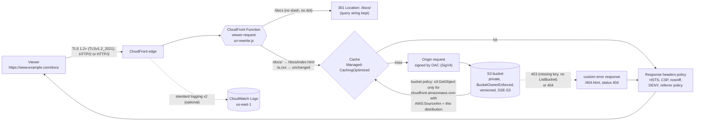
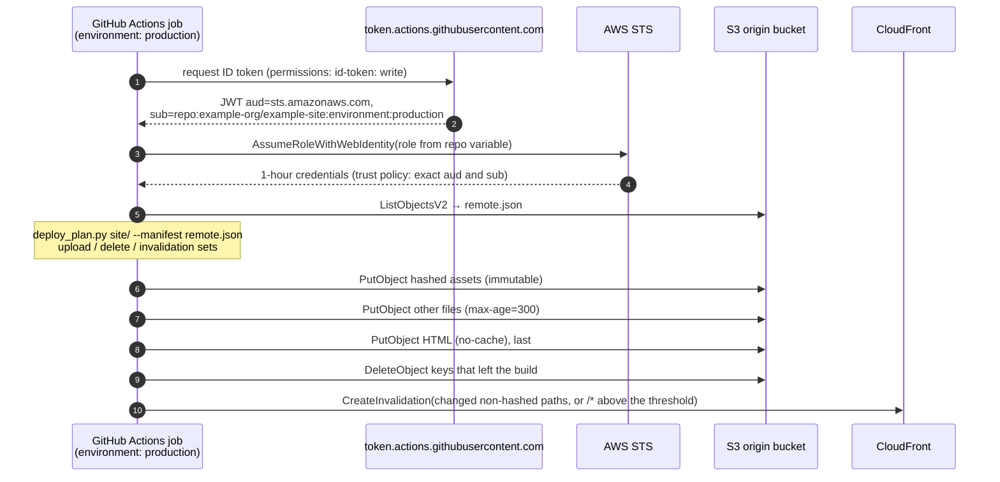
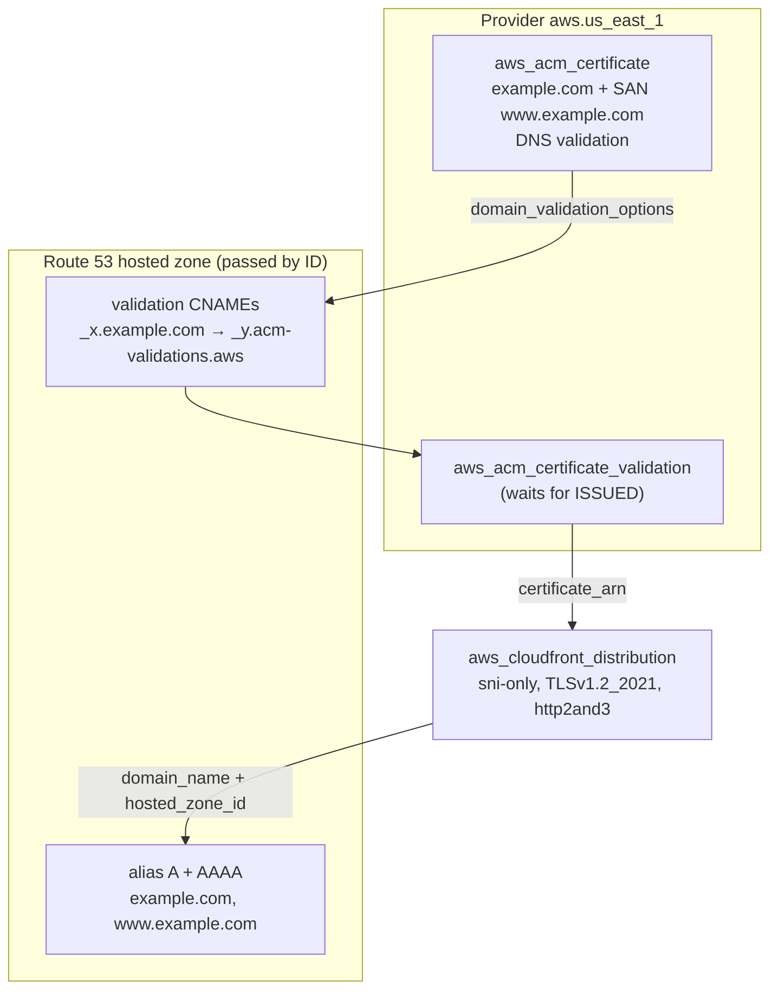

# Architecture

> Working portfolio implementation. Synthetic site, no production results claimed.
> Nothing here has been deployed; the flows below describe what the Terraform
> configures and what the scripts compute.

Three flows: how a viewer's request reaches an object, how a change gets
from a merge to the edge, and how the certificate and DNS records come to
exist in the right order.

## 1. Request path

Details that matter:

- **The function runs before the cache lookup.** `/docs/` and
  `/docs/index.html` therefore share one cache entry (key
  `/docs/index.html`), and the redirect for `/docs` is generated at the edge
  without touching the cache or the origin. The function is specified by
  `scripts/rewrite.py` (see [the mirror section](#the-python-mirror-is-the-specification)).
- **The cache key** comes from the AWS managed `CachingOptimized` policy,
  looked up by name with `data "aws_cloudfront_cache_policy"`. It ignores
  query strings, headers and cookies, which is right for static files: a
  `?utm_source=` tag cannot fragment the cache. It also sets Gzip and Brotli
  in the key, so compressed variants are cached separately.
- **TTL comes from the object's `Cache-Control`** within the policy's
  bounds (min 1 s, default 1 day, max 1 year). `deploy_plan.py` sets
  `immutable` on hashed assets, `no-cache` on HTML and five minutes on
  everything else ([ADR 0003](decisions/0003-cache-strategy-hashed-assets.md)).
- **OAC signs every origin request** (`signing_behavior = "always"`). The
  bucket has no website endpoint and no public policy, so the only reader is
  this one distribution ([ADR 0001](decisions/0001-oac-over-oai.md)).
- **Missing objects return 403 from S3**, because the distribution is not
  granted `s3:ListBucket`. Both 403 and 404 map to `/404.html` with status
  404 and a 10-second error TTL. The real status helps crawlers and
  monitors, and the short TTL keeps a cached 404 from hiding a page
  published right after someone requested it.
- **The security headers policy** applies to every response from the
  behaviour, including the error page. `override = true` means a header
  set wrongly on an object cannot weaken it.
- **A WAF web ACL is optional** (`web_acl_arn`). It must be CLOUDFRONT
  scope, which AWS only creates in us-east-1. The variable's validation
  rejects a REGIONAL ARN at plan time. The cloud-security-waf-automation
  project's WAF module can produce one; it is not duplicated here.

### The Python mirror is the specification

CloudFront Functions run in a restricted JavaScript runtime
(`cloudfront-js-2.0`) with no local emulator. Rather than trusting a
console "Test function" click, the behaviour is written down twice:

1. `scripts/rewrite.py` is the **specification**. It takes and returns the
   same event shapes as the function, and `tests/test_rewrite.py` covers
   the cases: `/`, `/docs`, `/docs/`, `/a.css`, query strings (bare keys,
   repeated keys, encoded values), encoded paths (`%C3%A9`, `%2F`, `%2E`),
   dotted directories and dotfiles.
2. `functions/uri-rewrite.js` is **reviewed against it** branch for branch.
   `tests/test_cloudfront_function.py` checks with regular expressions that
   both files have the same three branches and literals. That check is
   static: it is not a JavaScript runtime test. When `node` is on PATH
   (always in CI), the same test file also executes the JS handler under
   node on the same 19 events and requires output identical to the Python.
   Node is not the CloudFront runtime, so this proves the logic, not that
   CloudFront will accept the code. The function sticks to features
   that runtime documents (`var`, `for...in`, `String.prototype.endsWith`).

Change the Python and its tests first, then mirror the change in the JS.

## 2. Deploy flow

- **No stored credentials.** The role ARN is a repository *variable*, not
  a secret. The trust policy accepts only `aud = sts.amazonaws.com` and an
  exact `sub`: `repo:<org>/<repo>:ref:refs/heads/main` for a job without an
  environment, or `repo:<org>/<repo>:environment:<name>` for one with an
  environment. A job that declares `environment:` always gets the
  environment form, so a trust policy listing only the branch would reject
  it. The example trusts both.
- **Upload order is part of correctness.** Hashed assets go first, HTML
  last, deletions after everything. A viewer can never load new HTML that
  references an asset that is not there yet. `--keep-old-hashed` (used in
  the workflow) also keeps superseded bundles for one release, for pages
  loaded before the deploy.
- **The role can only do this.** `s3:ListBucket` on the bucket,
  `s3:PutObject`/`s3:DeleteObject` on its objects, and
  `cloudfront:CreateInvalidation` on the one distribution ARN (plus
  `kms:GenerateDataKey`/`kms:Decrypt` on the bucket key, only when SSE-KMS
  is used). It cannot read objects, list versions, touch the distribution
  configuration or delete the bucket.
- The workflow's `deploy-example` job is a **disabled template**
  (`if: false`). See [operations](operations.md#enabling-the-deploy-job).

## 3. Certificate and DNS

- CloudFront only uses ACM certificates from **us-east-1**, whatever region
  the bucket is in. The module declares `configuration_aliases =
  [aws.us_east_1]` and a `check` block that fails the plan if the alias
  points at another region.
- The distribution takes the ARN from `aws_acm_certificate_validation`, not
  from the certificate. That one reference makes Terraform create the
  CNAMEs, wait until ACM reports ISSUED, and only then create the
  distribution, so the first apply orders itself.
- The validation records live in the same zone and stay there: ACM uses
  them to renew the certificate automatically.
- Alias records to CloudFront are free to query and work at the zone apex
  (`example.com`), which a CNAME cannot.
