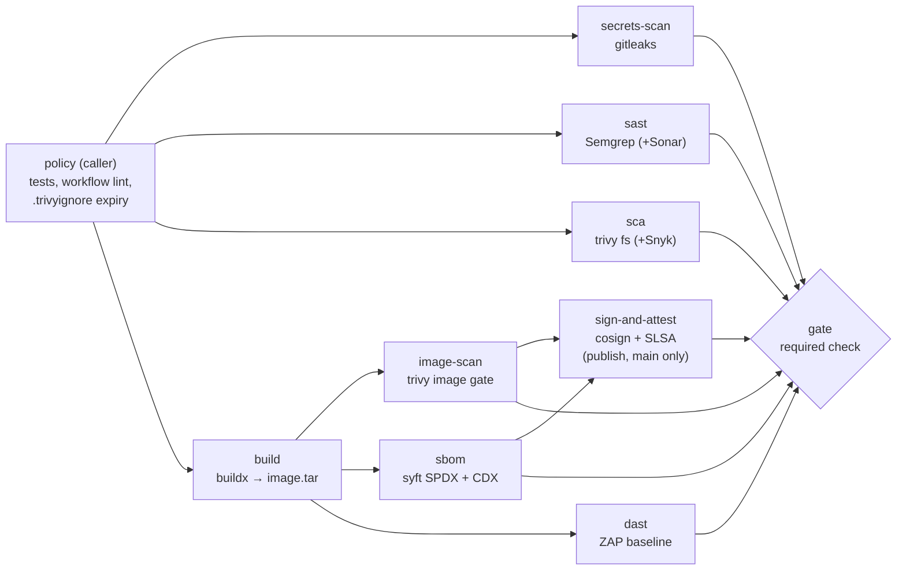

# DevSecOps Supply-Chain Pipeline (GitHub Actions)

> **Classification: production case study.** Reference implementation of a pattern used in production work; the application, findings and values are synthetic.
> Owner: Muhammad Salahuddin, Senior DevOps Engineer. In production this pattern ran as SonarQube, Snyk
> and image-scanning gates in Jenkins, GitLab CI and GitHub Actions. The code here rebuilds it on GitHub
> Actions around a small synthetic service. It has not run on GitHub yet; see [What ran locally](#what-ran-locally-via-docker).

A reusable GitHub Actions workflow that puts supply-chain security gates in
front of a container image: secrets scanning, SAST, SCA, an image
vulnerability gate, SBOMs, keyless signing with SLSA provenance, and a DAST
baseline. A summary **gate** job is the single required check. Two stdlib
Python linters keep the pipeline itself honest. One hardens every workflow
file in the repository; the other makes vulnerability exceptions expire.

This is the GitHub Actions side. The AWS-native delivery path, with a
CodeBuild buildspec lint and a Trivy gate before the ECR push, is
[`aws-codepipeline-container-delivery`](../aws-codepipeline-container-delivery/).
SARIF from a custom policy tool is shown in
[`cloud-security-waf-automation`](../cloud-security-waf-automation/).

## What it demonstrates

| Area | Implementation |
|---|---|
| Reusable pipeline | `on: workflow_call` with typed inputs (directory, image name, severity thresholds, `enable-dast`, `sonar-enabled`, `publish`) and optional secrets ([ADR 0001](docs/decisions/0001-reusable-workflow.md)) |
| Secrets scanning | gitleaks 8.30.1 (pinned image digest): PR range on PRs, pushed range on push, full history otherwise; reviewed `.gitleaks.toml` allowlists; SARIF |
| SAST | Semgrep OSS `p/python` (`--error`, SARIF). SonarQube/SonarCloud only when enabled **and** `SONAR_TOKEN` is set, checked without exposing the secret ([ADR 0002](docs/decisions/0002-semgrep-default-sonar-optional.md)) |
| SCA | `trivy fs` on the manifests (fixable CRITICAL/HIGH block). Snyk when `SNYK_TOKEN` is set |
| Build once | buildx, then a docker-archive tar artifact. Scan, SBOM, DAST and signing all use the **same bytes** |
| Image gate | `trivy image --exit-code 1 --severity <input> --ignore-unfixed --ignorefile .trivyignore`; the DB is cached daily |
| Expiring exceptions | `.trivyignore` entries need `exp:YYYY-MM-DD` and a reason. `policy/trivyignore_check.py` rejects missing, expired or >180-day entries; Trivy itself drops expired ones |
| SBOM | syft: SPDX 2.3 JSON plus CycloneDX JSON, uploaded as artifacts |
| Signing and provenance | cosign keyless (OIDC, `id-token: write` on that job only), a CycloneDX attestation, and `actions/attest-build-provenance`. Gated on `publish` plus a push to `main`, off by default ([ADR 0003](docs/decisions/0003-keyless-signing.md)) |
| DAST | OWASP ZAP baseline against the built container (`--read-only --cap-drop ALL`, bound to loopback), with a rules file for informational alerts |
| Least privilege | Top level `contents: read` everywhere. `security-events: write` only on the 4 SARIF uploaders; `packages`, `id-token` and `attestations` only on sign; gate gets `permissions: {}`. A unit test asserts the mapping |
| Action supply chain | Every action pinned to a 40-char SHA, resolved with `git ls-remote` (none from memory) with `# vX.Y.Z`; scanner images and the base image pinned by digest |
| Workflow hardening linter | `policy/check_workflows.py`: 12 rules (WF000–WF050) for permissions, SHA pinning, `pull_request_target` + PR-head checkout, script injection, top-level `id-token`, `persist-credentials`. Text or SARIF; stdlib with its own YAML-subset reader |
| Hardened image | Pinned trixie base by digest, non-root UID 10001, `HEALTHCHECK`, pip removed from the runtime image, security headers, no Python version in `Server` |

## Pipeline



Full graph, block/no-block table and data flow: [docs/architecture.md](docs/architecture.md).

## Layout

```
projects/devsecops-pipeline/
  app/                 server.py, healthcheck.py, Dockerfile, requirements.txt (empty), .zap/rules.tsv
  policy/              check_workflows.py, yaml_subset.py, trivyignore_check.py
  tests/               52 unittest tests; fixtures/workflows, fixtures/trivyignore, fixtures/sca
  docs/                architecture, operations, security, cost, decisions/ (3 ADRs)
  .gitleaks.toml  .trivyignore
.github/workflows/devsecops-reusable.yml   (workflow_call; GitHub requires repo root)
.github/workflows/devsecops-pipeline.yml   (caller, path-filtered)
```

## Quickstart (stdlib only, no installs)

Run these from `projects/devsecops-pipeline/`. The output shown is real, from
2026-10-14.

```console
$ python3 -m unittest discover -s tests -v
...
Ran 52 tests in 0.907s

OK

$ python3 policy/check_workflows.py --uri-base ../.. \
    ../../.github/workflows/devsecops-reusable.yml ../../.github/workflows/devsecops-pipeline.yml
per file (errors/warnings):
  ok   .github/workflows/devsecops-reusable.yml  0/0
  ok   .github/workflows/devsecops-pipeline.yml  0/0
2 file(s) checked: 0 error(s), 0 warning(s)

$ python3 policy/trivyignore_check.py .trivyignore
.trivyignore:11: CVE-2026-76642 exp:2027-01-31 (109 days left)
1 entry checked against 2026-10-14: 0 problem(s)

$ python3 policy/check_workflows.py --uri-base ../.. ../../.github/workflows      # whole repo, read-only
per file (errors/warnings):
  ok   .github/workflows/aws-backup-cross-region-dr.yml  0/0
  ok   .github/workflows/aws-codepipeline-container-delivery.yml  0/0
  ok   .github/workflows/aws-landing-zone.yml  0/0
  ok   .github/workflows/aws-serverless-event-driven.yml  0/0
  ok   .github/workflows/cloud-security-waf-automation.yml  0/0
  ok   .github/workflows/cloudfront-s3-static-delivery.yml  0/0
  ok   .github/workflows/devsecops-pipeline.yml  0/0
  ok   .github/workflows/devsecops-reusable.yml  0/0
  ok   .github/workflows/ecs-fargate-blue-green.yml  0/0
  ok   .github/workflows/finops-cost-optimization.yml  0/0
10 file(s) checked: 0 error(s), 0 warning(s)
```

SARIF output: `--format sarif --output lint.sarif`. Exit status is 1 on any
error; add `--fail-on warning` to make warnings block too.

## What ran locally via docker

Each official image was pulled once, run, and then removed. Nothing was
pushed. Image tags are pinned by digest in the workflow.

| Tool | Ran? | Result (real excerpts) |
|---|---|---|
| `docker build` (app) | yes | built; runs as `uid=10001(app)`; health check `healthy`; all 9 security headers present; `Server: app` |
| Trivy 0.75.0, image gate | yes | **First run failed the gate**: the original base `python:3.12.12-slim-bookworm` had 37 fixable CRITICAL/HIGH findings. After moving to `python:3.13.16-slim-trixie`, 4 fixable HIGH remained, all in **pip's vendored** urllib3/msgpack/setuptools. After removing pip from the runtime image: `/s/scan/image.tar (debian 13.7) │ debian │ 0`, exit 0 |
| Trivy, ignorefile behaviour | yes | the inline `# reason` form is accepted (CVE-2026-76642 suppressed: 44 → 35 HIGH without `--ignore-unfixed`). An entry with `exp:2026-01-01` is **not** honoured (back to 44), and `trivyignore_check.py` reports `TI003 ... expired` |
| Trivy fs, SCA gate | yes | `app/` clean, exit 0. Fixture `tests/fixtures/sca/requirements.txt` (old PyYAML/Jinja2/urllib3): `Total: 10 (HIGH: 8, CRITICAL: 2)`, exit 1 |
| gitleaks 8.30.1 | yes | **The first full-history run found 4 `generic-api-key` hits** in `projects/ecs-fargate-blue-green/*.example`. They were false positives: example ECR URIs tagged with a 40-hex SHA under account `123456789012`. A narrow line-regex allowlist was added. Re-run: `9 commits scanned ... no leaks found`, exit 0. A planted fake `ghp_` token in a scratch repo was still caught (`leaks found: 1`, `RuleID: github-pat`, exit 1) |
| syft 1.54.1 | yes | `SPDX-2.3 packages 89`; CycloneDX 1.7 document written |
| Semgrep 1.180.0 | yes (pip venv; the docker pull was interrupted) | `Ran 151 rules on 2 files: 0 findings.`, exit 0. Planted `subprocess.call(..., shell=True)` in a scratch dir: `subprocess-shell-true`, exit 1 |
| actionlint 1.7.7 | yes | both new workflows: no findings, exit 0 (an extra check, not part of the pipeline) |
| OWASP ZAP baseline | **no** | the image is very large on a slow link; not attempted. DAST is unverified |
| cosign / attest-build-provenance | **no** | needs a registry and GitHub OIDC; never run |
| Snyk / Sonar | **no** | need tokens and a server by design |

## Pin before use

Nothing. Every `uses:` in both workflows is a full commit SHA resolved on
2026-10-14 with `git ls-remote https://github.com/<owner>/<repo> refs/tags/<tag>`
(the annotated-tag `^{}` peeled where present):

| Action | Release | SHA |
|---|---|---|
| actions/checkout | v7.0.1 | `3d3c42e5aac5ba805825da76410c181273ba90b1` |
| actions/setup-python | v7.0.0 | `5fda3b95a4ea91299a34e894583c3862153e4b97` |
| actions/cache | v6.1.0 | `55cc8345863c7cc4c66a329aec7e433d2d1c52a9` |
| actions/upload-artifact | v7.0.2 | `cf430e030ddbb5b0abf93d22962f4752f3646cd9` |
| actions/download-artifact | v8.0.2 | `9000827ccba6bdab643e8b6fd33ac0654aef8333` |
| actions/attest-build-provenance | v4.2.2 | `4d101475d8b20a2381f78447822ac1eab6504dd8` |
| github/codeql-action/upload-sarif | v4.38.3 | `24c54180a607b1449ed407dd24f251e4e9147c8d` |
| docker/setup-buildx-action | v4.4.1 | `f87e5991a6d7451dcb8d9637bfbc97413f497069` |
| docker/build-push-action | v7.4.0 | `c3c9e263c25d99ce0380d002d59b67737d91b0dc` |
| docker/login-action | v4.6.0 | `dbcb813823bdd20940b903addbd779551569679f` |
| sigstore/cosign-installer | v4.1.2 | `6f9f17788090df1f26f669e9d70d6ae9567deba6` |
| SonarSource/sonarqube-scan-action | v8.3.0 | `d209202bc7d53ff1cc128f7f907dac145c9d6ae9` |
| snyk/actions/setup | v1.0.0 | `9adf32b1121593767fc3c057af55b55db032dc04` |
| zaproxy/action-baseline | v0.15.0 | `de8ad967d3548d44ef623df22cf95c3b0baf8b25` |

Input names for ZAP, attest-build-provenance, sonarqube-scan-action, snyk
setup, build-push and checkout were checked against each action's
`action.yml` at that SHA. Before first use, re-check that these releases are
still current, and let Dependabot own the bumps after that.

## Limitations

- **Never run on GitHub.** The workflows pass actionlint, a YAML parse and the
  project's own linter, but the jobs have not executed on a hosted runner. The
  most likely first-run surprises: GitHub's nested-permission validation for
  the reusable call, SARIF upload being refused on fork PRs (read-only
  token), and ZAP's network mode reaching `127.0.0.1`.
- **DAST and signing are unverified.** ZAP was not pulled. cosign and
  provenance need a registry and OIDC.
- The image gate blocks on **fixable** CRITICAL/HIGH only (`ignore-unfixed`).
  On 2026-10-14 the trixie base still carried 44 unfixed HIGH OS findings,
  which are visible in SARIF but do not block.
- Semgrep's `p/python` registry ruleset is fetched at run time, so results can
  change between runs without a code change. Semgrep is pinned by version, not
  by hash.
- `check_workflows.py` reads a YAML subset: no anchors or aliases, no
  multi-line flow collections. It does not follow composite actions or remote
  reusable workflows. The WF050 "job pushes" heuristic looks for
  `contents: write`, `git push` and `gh pr create|merge` / `gh release create`.
- `tests/fixtures/sca/requirements.txt` pins vulnerable versions on purpose.
  If Dependabot alerts are enabled on the repository it will flag them;
  dismiss them as "used in tests".
- gitleaks scans commits. Run `gitleaks dir` as well for uncommitted files. That
  was done locally: `no leaks found`.

## Whole-repo findings (fixed)

The first whole-repo run of the linter reported **39 errors and 46 warnings
in the other 8 projects' workflow files**. They were fixed in a follow-up
commit, and the run above is the result after the fix:

| Rule | Count | Where | Fix applied |
|---|---|---|---|
| WF050 checkout without `persist-credentials: false` | 27 errors | every job with a checkout in all 8 files | added `with: persist-credentials: false` (none of these jobs pushes) |
| WF010 third-party action on a tag | 12 errors | `hashicorp/setup-terraform@v3` ×9, `docker/setup-qemu-action@v3`, `docker/setup-buildx-action@v3`, `aws-actions/configure-aws-credentials@v4` | pinned to commit SHAs resolved with `git ls-remote`, keeping the same major version, with a `# vX.Y.Z` comment |
| WF011 first-party action on a tag | 46 warnings | `actions/checkout@v4`, `actions/setup-python@v5`, `actions/setup-node@v4`, `actions/upload-artifact@v4`, `github/codeql-action/upload-sarif@v3` | pinned the same way |

There were no WF001, WF002, WF020, WF030 or WF040 findings. All 8
declare top-level `permissions: contents: read`, and the one `id-token: write`
(cloudfront-s3-static-delivery) is correctly job-scoped. Also recommended for
the repository as a whole: a `.github/dependabot.yml` for the `github-actions`
and `docker` ecosystems, and CODEOWNERS on `.trivyignore`, `.gitleaks.toml`
and `.github/workflows/`.

## Interview talking points

- **Why a gate job:** branch protection requires one check (`gate`), so adding
  a scanner never touches protection rules. Optional jobs may skip; any
  failure blocks.
- **Scan what you ship:** one build, one tar. Scan, SBOM, DAST and signing all
  use it, and signing is by digest. "Rebuild for prod" breaks that chain.
- **The gate caught real things locally:** the pinned bookworm base failed
  with 37 fixable CRITICAL/HIGH findings. After rebasing, the remaining
  fixable HIGH findings were all in pip's vendored libraries, so the fix was
  to remove pip from the runtime image, not to add exceptions. Explain fixable
  versus unfixed, and why `ignore-unfixed` keeps a gate credible.
- **Exceptions are code that expires:** Trivy honours `exp:` natively
  (verified), the checker caps it at 180 days, and the reason sits on the
  same line.
- **Secrets scanning false positives:** the first history scan flagged 4
  example image URIs. The fix was a line regex pinned to the documentation
  account's URI shape, not a path allowlist, and a planted token is still
  caught.
- **CI is an attack surface:** `pull_request_target` combined with a PR-head
  checkout, `${{ github.event.* }}` script injection, the tj-actions tag
  hijack, persisted checkout tokens. Each maps to a linter rule, and running
  the linter on this repository found 39 real errors.
- **Least privilege in reusable workflows:** the caller grants a ceiling,
  because GitHub validates nested permissions at start. Each job narrows it,
  so `id-token: write` exists only in a job that cannot run on a PR.
- **Semgrep default, Sonar optional:** the gate works with zero external
  services and on fork PRs. Sonar and Snyk add depth when tokens exist.
- **Keyless signing:** no key to leak or rotate; the identity is the workflow
  path and ref. Verify with `cosign verify --certificate-identity-regexp` and
  `gh attestation verify`. Enforce it with an admission controller.
