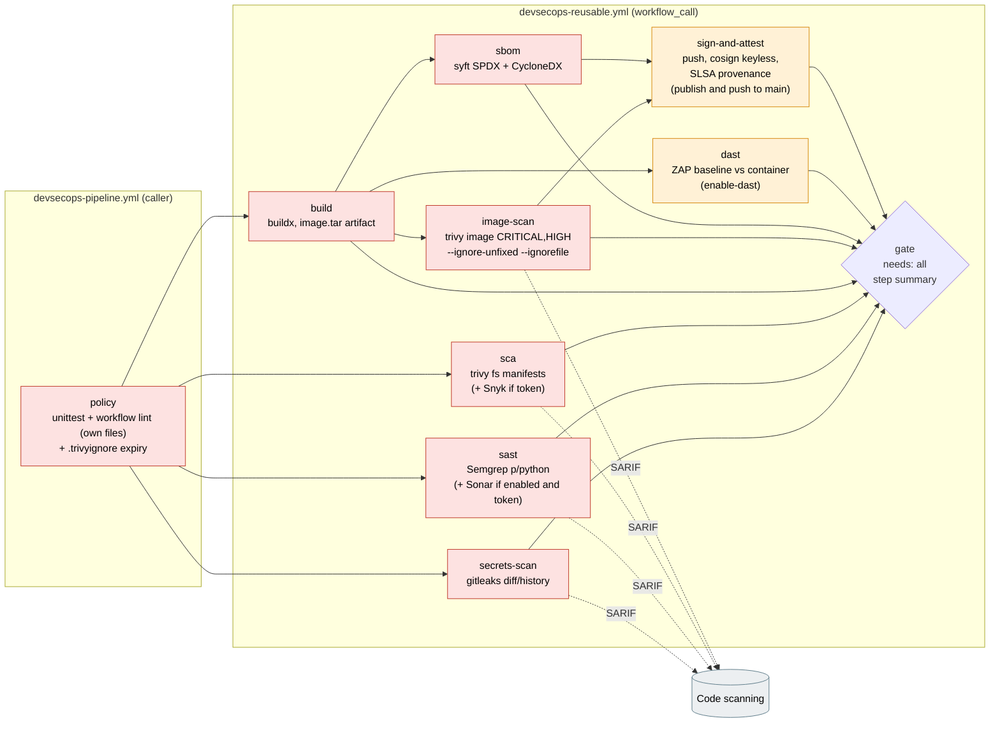

# Architecture

## Pipeline graph

The caller (`.github/workflows/devsecops-pipeline.yml`) runs the project's own
policy checks, then hands the app directory to the reusable workflow
(`.github/workflows/devsecops-reusable.yml`). Red nodes block the merge when
they fail. Amber nodes are optional and run only when their input is enabled,
but a failure still blocks. Grey nodes produce evidence and never block.

## What blocks, and on what

| Job | Blocks when | Does not block on |
|---|---|---|
| `policy` (caller) | a unit test fails; this project's two workflows have a lint **error**; a `.trivyignore` entry has no reason, has expired, or expires more than 180 days out | other projects' workflow findings (reported in the step summary only) |
| `secrets-scan` | gitleaks finds a secret in the PR range, the pushed range, or full history (manual runs) | paths and line patterns in the reviewed `.gitleaks.toml` allowlists |
| `sast` | Semgrep `p/python` reports any finding (`--error`); Sonar quality gate fails (only when enabled) | Sonar when the token is missing (warning annotation) |
| `sca` | Trivy finds a fixable vulnerability at `sca-severity` in the manifests; Snyk finds `high`+ (only with a token) | unfixed findings (`ignore-unfixed: true`); entries in `.trivyignore` |
| `build` | the image does not build | |
| `image-scan` | Trivy finds a fixable vulnerability at `image-severity` | unfixed findings; unexpired `.trivyignore` entries |
| `sbom` | syft fails to produce either document | |
| `dast` | ZAP baseline raises a WARN or FAIL alert not set to IGNORE in `app/.zap/rules.tsv` | skipped when `enable-dast: false` |
| `sign-and-attest` | push, signing or attestation fails | skipped unless `publish: true` on a push to `main` |
| `gate` | any required job is not `success`, or an optional job failed | optional jobs that were skipped |

Make **`gate`** the single required status check in branch protection. Then
adding or renaming a scanner job never means editing the protection rules.

## Data flow between jobs

- `build` writes a docker-archive tar (`image-tar` artifact, retained 1 day).
  `image-scan`, `sbom`, `dast` and `sign-and-attest` all consume **that same
  tar**. So the bytes that were scanned are the bytes that get signed, and
  nothing is rebuilt between the scan and the signature.
- The SARIF from gitleaks, Semgrep, Trivy fs and Trivy image goes to GitHub
  code scanning under separate categories (`gitleaks`, `semgrep`, `trivy-fs`,
  `trivy-image`). The SARIF upload runs even when the blocking step fails
  (`!cancelled()`), so the finding is visible where the reviewer looks.
- Each Trivy job runs twice over one cached DB. A non-blocking pass emits SARIF
  for all severities, then a blocking pass applies the thresholds. Code
  scanning shows everything; only the policy breaks the build.

## Relationship to the sibling projects

- `aws-codepipeline-container-delivery` is the AWS-native version. It runs
  CodeBuild with a buildspec lint and a Trivy CRITICAL gate before the ECR push.
  This project is the GitHub Actions version, and it adds secrets, SAST, SBOM,
  signing and DAST around the same gate.
- `cloud-security-waf-automation` shows SARIF from a custom policy tool, with
  `security-events: write` scoped to one job. This project uses the same
  scoping for four uploaders.
