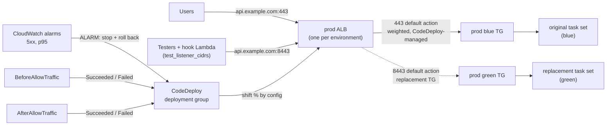

# ECS Fargate Blue/Green with CodeDeploy

> **Classification: Working portfolio implementation. Synthetic application, no production results claimed.**
> Owner: Muhammad Salahuddin, Senior DevOps Engineer. The Terraform is validated, never applied;
> the traffic-shift simulator is a model of documented CodeDeploy behaviour, not a recording;
> cost figures are illustrative. Domains are `example.com` names only, and the only account ID is
> the AWS documentation placeholder `123456789012`.

A multi-environment ECS Fargate platform deployed **blue/green by AWS
CodeDeploy**: dev, staging and prod services, each behind **its own ALB**
(`dev.api.example.com`, `staging.api.example.com` and `api.example.com`
alias their environment's ALB), two target groups per service, a production
listener and a **CIDR-restricted test listener** whose single default action
CodeDeploy rewrites, **Lambda lifecycle hooks** that smoke-test the
new task set before and after traffic moves, and **CloudWatch alarms that
stop a deployment and roll it back**. Tasks run on **Graviton (ARM64)**, with
a Fargate Spot / on-demand mix per environment.

This is the sibling that
[aws-codepipeline-container-delivery](../aws-codepipeline-container-delivery/)
points to in its [ADR 0001](../aws-codepipeline-container-delivery/docs/decisions/0001-ecs-rolling-with-circuit-breaker.md):
that project deploys with ECS rolling updates and the circuit breaker; this
one covers what rolling can't: a test route before any user sees the new
version, controlled traffic percentages, and an instant way back.

## Problem

Rolling deploys answer "does the new version start?" but not "is it right?":

- **Users are the first testers.** Old and new tasks serve side by side from
  the first healthy new task; there is no route to the new version that
  only the team can reach.
- **A healthy-but-wrong release goes 100% live.** The circuit breaker only
  sees tasks that fail to start or fail health checks. Elevated 5xx or
  latency doesn't stop anything.
- **Rolling back means redeploying.** The old tasks are already gone, so
  recovery takes as long as a deploy.
- **The tooling fights Terraform.** With CodeDeploy in charge, the task
  definition and the live target group change outside Terraform; without
  `ignore_changes` the next `apply` "reverts" a production release.

## What it demonstrates

| Area | Implementation |
|---|---|
| Blue/green | ECS service with `deployment_controller { type = "CODE_DEPLOY" }`; CodeDeploy deployment group (`BLUE_GREEN`, `WITH_TRAFFIC_CONTROL`) with blue and green target groups ([ADR 0001](docs/decisions/0001-codedeploy-bluegreen-vs-rolling.md)) |
| Load balancing | One ALB per environment; production (443) and test (8443) listeners each with a single default forward action, as CodeDeploy documents, and no listener rules; ECR and the ECS cluster stay shared ([ADR 0004](docs/decisions/0004-alb-per-environment.md)) |
| Traffic shifting | `deployment_config_name` validated against the five predefined `CodeDeployDefault.ECS*` configs: dev `AllAtOnce`, staging `Linear10PercentEvery1Minutes`, prod `Canary10Percent5Minutes` |
| Pre-traffic validation | HTTPS test listener (8443) on each environment's ALB, open only to `test_listener_cidrs`; the `BeforeAllowTraffic` hook checks health, the deployed image tag and a p95 latency budget there ([ADR 0002](docs/decisions/0002-test-listener-validation.md)) |
| Rollback | `auto_rollback_configuration` on `DEPLOYMENT_FAILURE` and `DEPLOYMENT_STOP_ON_ALARM`; `alarm_configuration` with 5xx-count and p95 `TargetResponseTime` alarms for the replacement target group (both colours, because they alternate); blue kept for `termination_wait_minutes` |
| Manual gate | prod waits for `aws deploy continue-deployment` (`deployment_ready_option` `STOP_DEPLOYMENT` after 60 min) before any production traffic moves |
| Lifecycle hooks | Stdlib Python Lambdas; boto3 imported lazily; HTTP client, AWS adapters and clock injected; status reported **exactly once** in `try/finally`, proved by tests |
| Terraform ownership | `ignore_changes = [task_definition, load_balancer, desired_count]` on the service and `[default_action]` on both CodeDeploy-managed listeners, each documented |
| Graviton and Spot | `runtime_platform` ARM64 (validated `ARM64`/`X86_64`); FARGATE base plus FARGATE / FARGATE_SPOT weights per environment; prod keeps an on-demand base of 2 ([ADR 0003](docs/decisions/0003-graviton-and-spot.md)) |
| Scaling | Target tracking on CPU, and on ALB requests per target summed over **both** target groups with metric math, so scaling survives the blue/green swap |
| Policy as code | `check_bluegreen_policy.py` lints `config/environments/*.json`, the same files the Terraform roots `jsondecode()` (single source of truth) |
| Release artifacts | `render_appspec.py` fills the appspec and task definition, validates every value, derives `IMAGE_TAG` from the image, and refuses `latest` or untagged images |
| Modelling | `traffic_shift_sim.py` prints the minute-by-minute traffic split and whether an alarm at minute N rolls back |
| Least privilege | Execution role: one ECR repository, one secret, one log group. Task role: no permissions. Hook role: one deployment group. Test listener: listed CIDRs only ([security](docs/security.md)) |

## Architecture



The full listener and target-group layout, the deployment lifecycle with
the hooks, and the rollback path are in [docs/architecture.md](docs/architecture.md).

## Layout

```text
app/          server.py (stdlib HTTP: /healthz, /version), healthcheck.py, Dockerfile (arm64-ready, non-root)
config/       environments/{dev,staging,prod}.json: the single source of truth
deploy/       appspec.template.yaml, taskdef.template.json, values.example.json
src/hooks/    before_allow_traffic.py, after_allow_traffic.py, lifecycle.py, smoke.py
scripts/      render_appspec.py, traffic_shift_sim.py, check_bluegreen_policy.py
terraform/    modules/shared-platform (ECR, cluster), modules/ecs-service-bluegreen (ALB, service, CodeDeploy),
              environments/{shared,dev,staging,prod}
tests/        unittest suites + fixtures/ (bad settings files)
docs/         architecture, operations, security, cost, decisions/
```

## Quickstart

Python 3.12 (CI and the Lambda runtime; also runs on newer 3.x), nothing to
install. From this directory:

```bash
python3 -m unittest discover -s tests -v
python3 scripts/check_bluegreen_policy.py
python3 scripts/traffic_shift_sim.py --config CodeDeployDefault.ECSCanary10Percent5Minutes \
  --minutes 20 --termination-wait 10 --alarm-at 3
python3 scripts/render_appspec.py --values deploy/values.example.json --out-dir build

# the service, locally
IMAGE_TAG=local PORT=8081 python3 app/server.py &
curl -s localhost:8081/version

# optional, needs Docker with buildx
docker buildx build --platform linux/arm64 --build-arg IMAGE_TAG=local -t bluegreen-api:local --load app
```

## Sample output

All excerpts below are real output from this machine, and
`tests/test_readme.py` re-runs every `$ python3 scripts/...` block and
compares it (except the one that writes files).

A prod canary with no alarm. Minute 0 is when traffic starts moving, after
`BeforeAllowTraffic` has passed on the test listener:

```text
$ python3 scripts/traffic_shift_sim.py --config CodeDeployDefault.ECSCanary10Percent5Minutes --minutes 20 --termination-wait 10 --events-only
config:      CodeDeployDefault.ECSCanary10Percent5Minutes
model:       canary, 10% for 5 min, then 100%
termination: blue kept 10 min after the full shift (terminated at minute 15)
alarm:       none
minute  green   blue  event
     0    10%    90%  BeforeAllowTraffic passed; traffic shift starts (10% to green)
     5   100%     0%  shift to 100% green
                      100% on green; AfterAllowTraffic runs; blue kept on standby
    15   100%     0%  blue task set terminated; deployment SUCCEEDED
result: SUCCEEDED at minute 15; 100% on green, no rollback
(exit 0)
```

The same canary with an alarm going into ALARM at minute 3: only the 10%
canary slice ever reached green.

```text
$ python3 scripts/traffic_shift_sim.py --config CodeDeployDefault.ECSCanary10Percent5Minutes --minutes 20 --termination-wait 10 --alarm-at 3
config:      CodeDeployDefault.ECSCanary10Percent5Minutes
model:       canary, 10% for 5 min, then 100%
termination: blue kept 10 min after the full shift (terminated at minute 15)
alarm:       breach at minute 3
minute  green   blue  event
     0    10%    90%  BeforeAllowTraffic passed; traffic shift starts (10% to green)
     1    10%    90%
     2    10%    90%
     3     0%   100%  alarm in ALARM: deployment stopped, rollback reroutes 100% to blue
result: ROLLED_BACK at minute 3; 100% back on blue (green peaked at 10%)
(exit 0)
```

Staging's linear config with an alarm at minute 6: by then 60% of traffic
was on green, which is the argument for canary in prod.

```text
$ python3 scripts/traffic_shift_sim.py --config CodeDeployDefault.ECSLinear10PercentEvery1Minutes --minutes 30 --termination-wait 15 --alarm-at 6 --events-only
config:      CodeDeployDefault.ECSLinear10PercentEvery1Minutes
model:       linear, +10% every 1 min
termination: blue kept 15 min after the full shift (terminated at minute 24)
alarm:       breach at minute 6
minute  green   blue  event
     0    10%    90%  BeforeAllowTraffic passed; traffic shift starts (10% to green)
     1    20%    80%  shift to 20% green
     2    30%    70%  shift to 30% green
     3    40%    60%  shift to 40% green
     4    50%    50%  shift to 50% green
     5    60%    40%  shift to 60% green
     6     0%   100%  alarm in ALARM: deployment stopped, rollback reroutes 100% to blue
result: ROLLED_BACK at minute 6; 100% back on blue (green peaked at 60%)
(exit 0)
```

The policy lint over the real environment files, then over five bad ones:

```text
$ python3 scripts/check_bluegreen_policy.py
PASS config/environments/dev.json
PASS config/environments/prod.json
PASS config/environments/staging.json
3/3 environment file(s) passed
(exit 0)
```

```text
$ python3 scripts/check_bluegreen_policy.py tests/fixtures/bad-prod-all-at-once.json tests/fixtures/bad-prod-no-alarms.json tests/fixtures/bad-rollback-off.json tests/fixtures/bad-zero-termination.json tests/fixtures/bad-open-test-listener.json
FAIL tests/fixtures/bad-prod-all-at-once.json
  [BG001] prod uses 'CodeDeployDefault.ECSAllAtOnce'; use a canary or linear config so alarms can stop a partial shift
FAIL tests/fixtures/bad-prod-no-alarms.json
  [BG002] prod must have alarms.enabled = true (5xx and p95 latency on the green target group)
FAIL tests/fixtures/bad-rollback-off.json
  [BG003] auto_rollback.enabled must be true
FAIL tests/fixtures/bad-zero-termination.json
  [BG004] termination_wait_minutes must be > 0, got 0; blue would be gone before anyone could roll back
FAIL tests/fixtures/bad-open-test-listener.json
  [BG005] test listener open to the internet (0.0.0.0/0); restrict it to known ranges
0/5 environment file(s) passed
(exit 1)
```

Rendering the release artifacts, then the same call with a mutable tag:

```text
$ python3 scripts/render_appspec.py --values deploy/values.example.json --out-dir build
wrote build/taskdef.json
wrote build/appspec.yaml
image tag: 3f9c2b1e7a4d5c6b8e9f0a1b2c3d4e5f6a7b8c9d
(exit 0)
```

```text
$ python3 scripts/render_appspec.py --values deploy/values.example.json --set IMAGE=123456789012.dkr.ecr.us-east-1.amazonaws.com/bluegreen-api:latest
error: IMAGE '123456789012.dkr.ecr.us-east-1.amazonaws.com/bluegreen-api:latest' uses the mutable tag 'latest'; deploy an immutable tag (commit SHA)
(exit 1)
```

The rendered appspec:

```text
$ python3 scripts/render_appspec.py --values deploy/values.example.json --only appspec --stdout
--- appspec.yaml
# CodeDeploy AppSpec for an Amazon ECS blue/green deployment.
# Rendered by scripts/render_appspec.py; every placeholder must be filled.
# The task definition ARN is a registered revision (immutable image tag).
version: 0.0
Resources:
  - TargetService:
      Type: AWS::ECS::Service
      Properties:
        TaskDefinition: "arn:aws:ecs:us-east-1:123456789012:task-definition/bluegreen-prod:42"
        LoadBalancerInfo:
          ContainerName: "app"
          ContainerPort: 8080
        PlatformVersion: "LATEST"
Hooks:
  # Runs after the replacement task set is behind the test listener and
  # before any production traffic moves: smoke tests against the test URL.
  - BeforeAllowTraffic: "arn:aws:lambda:us-east-1:123456789012:function:CodeDeployHook_bluegreen-prod-before-allow-traffic"
  # Runs once 100% of production traffic is on the replacement task set.
  - AfterAllowTraffic: "arn:aws:lambda:us-east-1:123456789012:function:CodeDeployHook_bluegreen-prod-after-allow-traffic"
(exit 0)
```

Docker (Docker Engine 29.8.1, `docker buildx build --platform linux/arm64`):
the image builds for `arm64`, runs as `uid=10001(app)` with `--read-only`,
reports `healthy` through its `HEALTHCHECK`, answers `/version` with the
`IMAGE_TAG` build argument, logs `sigterm_received` / `stopped` on
`docker stop`, and is about 212 MB uncompressed. The image was removed
afterwards.

## Tests

```bash
python3 -m unittest discover -s tests -v
# Ran 105 tests ... OK
```

They cover:

- **hooks**: pass; version mismatch; health failure; p95 budget breach
  (including one slow sample in ten under nearest-rank p95); HTTP and AWS
  exceptions; missing or malformed environment; not enough Lambda time
  left. Every path asserts `PutLifecycleEventHookExecutionStatus` was
  called **exactly once** with the right status. A failing report call is
  attempted once and propagates; an event without IDs reports nothing; a
  `KeyboardInterrupt` still reports `Failed`. The expected tag is read from
  the deployment's AppSpec and task definition through fakes;
- **smoke checks** end to end with the real `urllib` client against the real
  app on an ephemeral port;
- **render_appspec.py**: both files, number vs string fields, `--only`,
  missing keys, invalid ARNs and ports, Fargate CPU/memory pairs, `latest`
  and untagged images refused, `IMAGE_TAG` derived and never hand-set;
- **traffic_shift_sim.py**: AllAtOnce, canary and linear timelines, uneven
  linear steps capped at 100%, rollback on an alarm mid-canary, at the
  canary step, mid-linear, during the termination wait, and no rollback
  once blue is terminated;
- **check_bluegreen_policy.py**: the three real files pass; each bad fixture
  fails with exactly its rule IDs; prod aliases, IPv6 `::/0`, invalid CIDRs,
  booleans posing as numbers;
- **Terraform static checks**: `CODE_DEPLOY` and `ignore_changes`, the
  deployment-config validation list equals the simulator's, alarms wired,
  listeners use CodeDeploy-managed default actions and no listener rules
  exist anywhere, the three environment roots differ only by name, lock
  files pin aws 6.68.0, only the placeholder account ID anywhere, no empty
  files;
- CLI exit codes, the hook modules importing with boto3 unavailable, and
  the README samples above.

## Terraform validation

Six directories, never applied:

```bash
cd terraform
terraform fmt -check -recursive
for d in modules/shared-platform modules/ecs-service-bluegreen \
         environments/shared environments/dev environments/staging environments/prod; do
  terraform -chdir=$d init -backend=false -input=false && terraform -chdir=$d validate
done
# Success! The configuration is valid.   (all six)
```

Validated with Terraform 1.14.8 and `hashicorp/aws` 6.68.0
(`required_version >= 1.9.0` for the cross-variable validation). Apply
order: `environments/shared` (ECR, cluster), then each environment root,
which creates its own ALB and finds the shared resources by name. Each
environment root reads `config/environments/<env>.json`; `terraform
console` shows prod resolving to `ECSCanary10Percent5Minutes`, on-demand
base 2 and manual reroute. See [operations](docs/operations.md) for
bootstrap, packaging the hooks and running a deployment.

## Limitations

- **Never deployed.** Nothing has run in AWS: not CodeDeploy's traffic
  shifting, the hooks' network path, the IAM, or the alarm timing.
  `terraform validate` checks the schema, not the behaviour. The listener
  layout follows the shape AWS documents for CodeDeploy (one production
  and one test listener per service, default actions only), but that too
  is unobserved here.
- **The simulator is a model.** It assumes instant alarm detection and
  rerouting, and doesn't model hook duration or the manual-reroute wait.
  Real alarms need their evaluation periods (1-2 minutes here) first.
- **The CodeDeploy role uses the AWS managed policy** `AWSCodeDeployRoleForECS`,
  which is broader than one service. A hand-scoped policy needs a real
  deployment to verify.
- **The hooks reach the internet-facing ALB through NAT**, so the NAT EIPs
  must be listed in `test_listener_cidrs`. The examples use
  documentation ranges.
- **Three ALBs cost more than one** (about USD 33 a month extra at idle,
  approximate; see [cost](docs/cost.md)). A shared ALB would need ECS-native
  blue/green instead of CodeDeploy ([ADR 0004](docs/decisions/0004-alb-per-environment.md)).
- **Single account**, three environments in one cluster. A production
  layout would split accounts.
- **No database.** `DB_PASSWORD` only proves the secret path; the app
  reports whether it's present, never its value.

## Interview talking points

- **Blue/green is about the way back, not the way forward.** The point of
  keeping blue for `termination_wait_minutes` is that rollback is a
  listener change, seconds, rather than a redeploy. `termination_wait = 0`
  throws that away, so the lint refuses it.
- **Test the new version before users can reach it.** The test listener
  gives the replacement task set a real ALB route, TLS and all, that only
  the hook and the team's CIDRs can reach. A failed `BeforeAllowTraffic`
  means production never saw green.
- **Canary vs linear is blast radius vs time.** The simulator shows an
  alarm at minute 3 costs 10% of traffic on canary but 40-60% on linear.
  Prod uses canary with a manual gate; staging uses linear to exercise the
  machinery cheaply; dev goes all at once.
- **The replacement target group alternates.** "Alarm on green" is only true
  for odd-numbered deployments. Alarms exist for both colours, and the
  request-count scaling metric sums both target groups for the same reason.
- **Report exactly once.** CodeDeploy waits up to an hour for a hook that
  never reports. Status starts as `Failed`, flips only on success, and is
  sent from `finally`; the hook also stops before the Lambda timeout so the
  `finally` gets to run.
- **Follow the documented traffic model.** CodeDeploy moves traffic by
  rewriting listener default actions, so each environment gets its own
  ALB. A shared ALB with host rules looked cheaper but relied on
  undocumented behaviour, which is an outage risk; if one ALB is a hard
  requirement, ECS-native blue/green works on rules.
- **Let Terraform and CodeDeploy each own their half.** Terraform creates the
  service and routes; CodeDeploy owns the task definition and which target
  group is live. `ignore_changes` draws that line, and the docs say what
  it does and doesn't mean (changing the task definition in Terraform
  deploys nothing).
- **Spot during blue/green doubles the exposure.** The green task set
  inherits the capacity strategy, so in dev both colours may be on Spot
  during a deployment. Prod's on-demand base of 2 is the floor a Spot
  reclaim can't take.
