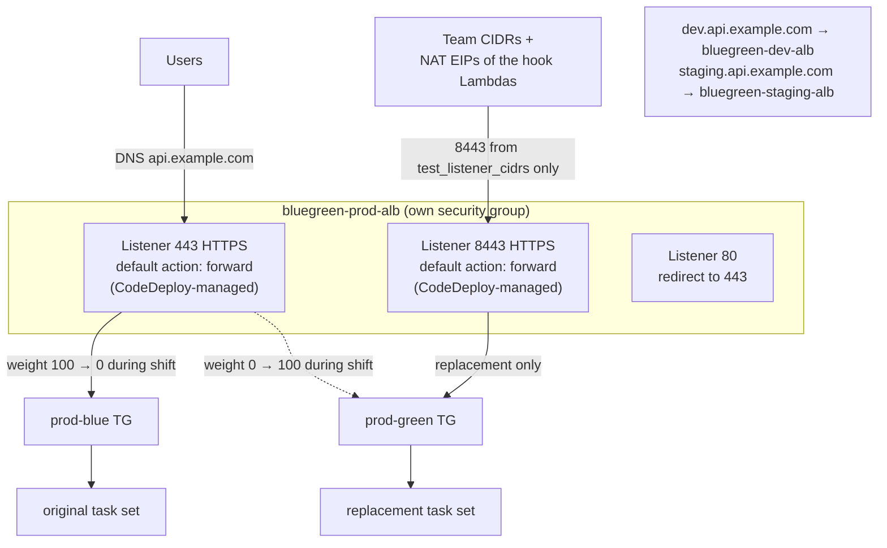
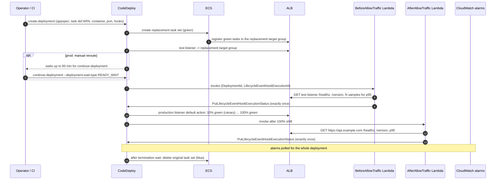
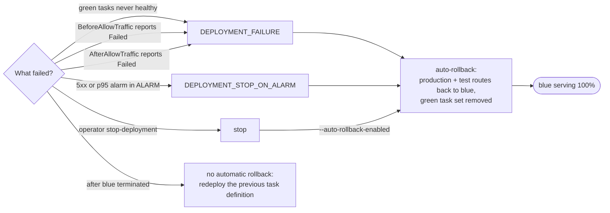

# Architecture

Working portfolio implementation; synthetic application, never deployed.
All names are `example.com` and the account is `123456789012`.

## Components

| Component | Where | Notes |
|---|---|---|
| ECR repository `bluegreen-api` | `modules/shared-platform` | Immutable tags, scan on push, KMS, keeps 50 images (rollback targets) |
| ECS cluster | `modules/shared-platform` | Capacity providers `FARGATE` and `FARGATE_SPOT`, Container Insights |
| ALB per environment | `modules/ecs-service-bluegreen` | `bluegreen-<env>-alb`, internet-facing, `drop_invalid_header_fields`, defensive desync mitigation, TLS 1.3 policy, its own security group |
| Production listener 443 | `modules/ecs-service-bluegreen` | ACM certificate input; **one default forward action**, rewritten by CodeDeploy (`ignore_changes = [default_action]`); port 80 redirects |
| Test listener 8443 | `modules/ecs-service-bluegreen` | Same shape as production; SG ingress only from `test_listener_cidrs` |
| DNS | outside Terraform | `dev.api.example.com`, `staging.api.example.com`, `api.example.com` alias their environment's ALB (`alb_dns_name` output) |
| Blue and green target groups | `modules/ecs-service-bluegreen` | `ip` targets, `/healthz` matcher 200, `deregistration_delay` from settings |
| ECS service | `modules/ecs-service-bluegreen` | `CODE_DEPLOY` controller, private subnets, capacity provider strategy, `ignore_changes` |
| CodeDeploy app + deployment group | `modules/ecs-service-bluegreen` | ECS platform, blue/green with traffic control, auto-rollback, alarms |
| Alarms | `modules/ecs-service-bluegreen` | Per target group: `HTTPCode_Target_5XX_Count` (Sum) and `TargetResponseTime` p95 |
| Hook Lambdas | `modules/ecs-service-bluegreen` | `CodeDeployHook_<name>-before-allow-traffic` / `-after-allow-traffic`, Python 3.12 arm64, in the VPC |
| Autoscaling | `modules/ecs-service-bluegreen` | Target tracking on CPU and on requests per target (both target groups) |

Environment settings live in `config/environments/<env>.json`. Each
environment root `jsondecode()`s its file, and `scripts/check_bluegreen_policy.py`
lints the same file, so the lint checks exactly what is deployed.

| Setting | dev | staging | prod |
|---|---|---|---|
| Deployment config | `ECSAllAtOnce` | `ECSLinear10PercentEvery1Minutes` | `ECSCanary10Percent5Minutes` |
| Manual reroute | no | no | yes, 60 min wait |
| Blue kept after shift | 5 min | 15 min | 60 min |
| Capacity | Spot only | on-demand base 1, then 1:1 | on-demand base 2, then 1:1 |
| Tasks (min/max) | 1/2 | 2/4 | 3/12 |
| Alarm thresholds | 10 5xx/min, p95 1.0 s, 2 periods | 5, 0.5 s, 2 | 5, 0.3 s, 1 |

## Listeners and target groups

Each environment has the same layout on its own ALB. Prod shown:

There are no listener rules. CodeDeploy moves traffic by rewriting each
listener's default action: the test listener forwards to the replacement
target group, and the production listener becomes a weighted forward
across both groups, stepped by the deployment config
([ADR 0004](decisions/0004-alb-per-environment.md)).

Before the first deployment both production and test routes forward to
blue. During a deployment CodeDeploy points the test listener at the
replacement target group, runs `BeforeAllowTraffic`, then moves the
production route by the configured percentages. After the next
deployment the roles are reversed: green is original and blue is the
replacement. That is why the alarms and the request-count scaling metric
cover both target groups.

## Deployment lifecycle

Hook order for ECS (from the AppSpec reference): `BeforeInstall`,
`AfterInstall`, `AfterAllowTestTraffic`, `BeforeAllowTraffic`,
`AfterAllowTraffic`. This project uses the last two as the task asked:
`BeforeAllowTraffic` runs when green is already reachable on the test
listener and no production traffic has moved.

## Rollback path

The window for a listener-only rollback is from the start of the
deployment until blue is terminated (`termination_wait_minutes` after the
full shift). `scripts/traffic_shift_sim.py` models this window per config.
It is a model: real alarms need their evaluation periods (one or two
minutes here) before they enter ALARM, and CodeDeploy polls them.

## Why one ALB per environment

CodeDeploy's documented ECS shape is a production listener (and an
optional test listener) whose default action forwards to one of the two
target groups; AWS's ECS migration guidance says CodeDeploy needs separate
listeners per service. An earlier draft shared one ALB with host-header
rules for all three environments; that shape is not documented for
CodeDeploy and was rejected as unverified. The reasoning, the cost
trade-off and the ECS-native blue/green alternative (which works on
listener rules, so it can share an ALB) are in
[ADR 0004](decisions/0004-alb-per-environment.md).

## Design choices

- **Separate failure and permission domains.** Each environment's ALB has
  its own security group and CIDR list, so a dev tester can't reach prod's
  replacement task set, and dev load tests don't share prod's LCUs.
- **Hooks in the VPC.** The hooks call the ALB's public name. From private
  subnets that traffic leaves through NAT, so the NAT EIPs go into
  `test_listener_cidrs`. Running the hooks outside the VPC would need the
  test listener open to all of Lambda's address space.
- **Expected tag from the deployment itself.** The `BeforeAllowTraffic` hook
  reads the deployment's AppSpec, finds the task definition, and takes the
  container's image tag. Nothing has to pass the tag to the Lambda, so the
  check can't be fed a stale value. `EXPECTED_IMAGE_TAG` overrides it for
  manual testing.
- **Spot and blue/green together.** See [ADR 0003](decisions/0003-graviton-and-spot.md).
