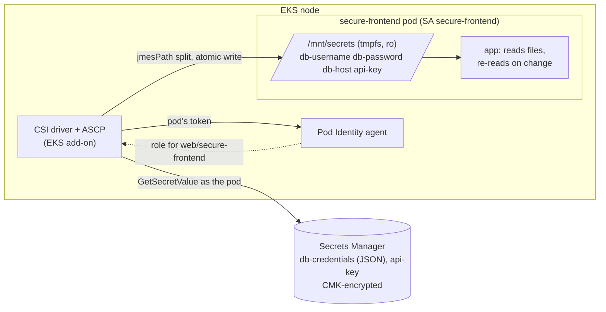

# Zero Hard-Coded Secrets on EKS: Secrets Manager + Secrets Store CSI Driver

> **Classification: Working portfolio implementation — synthetic application, no production results claimed.**
> Owner: Muhammad Salahuddin, Senior DevOps Engineer. The Terraform is validated and has never been
> applied. The chart is linted and schema-checked (the SecretProviderClass CRD included), never
> installed. The app, the scanners and the rotation drill run locally and are tested. Costs are illustrative.

A synthetic Next.js-style frontend (`secure-frontend`) on an existing EKS cluster gets its
DB credential and API key from **AWS Secrets Manager** through the **Secrets Store CSI
Driver and the AWS provider (ASCP)**, installed as the EKS add-on. ASCP fetches *as the
pod's own identity* through **EKS Pod Identity**. The values land as read-only files in a
tmpfs, the app re-reads them when they rotate, and nothing holds a value: not git, not the
image, not Helm values, not Terraform state, not etcd.

## Problem

- **Secrets baked in at build time.** `--build-arg DB_PASSWORD=...` ends up in image
  history, readable by everyone with pull access to the registry.
- **Secrets in values files and env vars.** They end up in git history, in a base64
  Kubernetes Secret in etcd, in `/proc/<pid>/environ` and in crash dumps.
- **Rotation means redeploying,** so it doesn't happen, and a leaked key stays valid for months.
- **One identity reads everything.** A node role or a shared controller can read every
  secret in the account, so any pod on the node effectively can too.

## What it demonstrates

| Area | Implementation |
|---|---|
| Terraform module | `modules/secrets-store-csi` for an **existing** cluster: the `aws-secrets-store-csi-driver-provider` **EKS add-on** (driver + ASCP) with `syncSecret.enabled`, `enableSecretRotation` and `rotationPollInterval` as variables (sync off, rotation on, 2m, minimum 30s by validation). Two Secrets Manager secrets **without versions** (values set out of band), one CMK with rotation, optional managed rotation with an existing Lambda (`rotate_immediately = false`). `aws >= 6.0, < 7.0`, validated inputs, `default_tags` in the example, no credentials |
| Least privilege | Pod Identity role trusted by `pods.eks.amazonaws.com` with `aws:SourceAccount` and `aws:SourceArn` (cluster). Policy: `GetSecretValue` + `DescribeSecret` on the two exact secret ARNs, `kms:Decrypt` only with `kms:ViaService = secretsmanager.<region>`. IRSA documented as the alternative ([ADR 0002](docs/decisions/0002-pod-identity-vs-irsa.md)) |
| Helm chart | `SecretProviderClass` (`provider: aws`, `usePodIdentity`) splitting the JSON secret into `db-username` / `db-password` / `db-host` files with **jmesPath**, plus the API key. Optional `secretObjects`, off, with the etcd trade-off explained. CSI volume **read-only** at `/mnt/secrets`, non-root, read-only rootfs, drop ALL, seccomp, three probes, resources, PDB, default-deny NetworkPolicy with **DNS-only egress** (the app makes no AWS call), automount off, a values schema |
| Rotation | The app polls file `stat()` and re-reads atomically swapped files. No restart, no Reloader. A checksum annotation covers only the SPC *mapping* ([ADR 0003](docs/decisions/0003-files-not-env-vars.md)) |
| App | `app/server.py`, stdlib: reads a configurable directory, `/healthz` reports `secrets_loaded`, names and a version fingerprint (never a value), logs names and fingerprints only, with a redacting filter as a backstop. Non-root Dockerfile |
| Policy tooling | `scan_manifests.py`: 7 rules over rendered manifests (literal env secrets by name or value, literal `Secret` data, writable CSI mounts, mounted kube-API tokens, env secret refs, `secretObjects`). `find_hardcoded_secrets.py`: 5 rules + entropy, masked output, an allowlist where every entry needs a reason |
| Rotation drill | `secret_rotation_drill.py` runs the real app, lays files out like the driver (`..data` symlink), swaps v2 in with one rename, and polls `/healthz` until the new fingerprint shows. It prints the timeline and checks the app's logs for every value |
| CI | `.github/workflows/eks-secrets-store-csi.yml`: unittest on 3.12, the drill, the detector, helm lint + kubeconform (checksum-verified binaries, CRD schema from the catalog), the manifest scan, terraform fmt + validate, workflow lint. SHA-pinned actions, `contents: read`, `persist-credentials: false` |

## Architecture



The flow at pod start, the rotation sequence and the before/after picture are in
[docs/architecture.md](docs/architecture.md).

## Layout

```text
terraform/  modules/secrets-store-csi (add-on, secrets, CMK, Pod Identity), examples/basic
helm/       secure-frontend chart: SecretProviderClass, Deployment, SA, Service, PDB, NetworkPolicy, schema
app/        server.py (stdlib HTTP service), Dockerfile (non-root)
scripts/    scan_manifests.py, find_hardcoded_secrets.py, secret_rotation_drill.py, secret_patterns.py, yaml_lite.py
tests/      unittest suites, fixtures/manifests/{good,bad}.yaml
docs/       architecture, operations, security, cost, decisions/ (ADRs 0001-0003)
```

## Quickstart

Python 3.12 (the CI version; also runs on newer 3.x), nothing to install. From this directory:

```bash
python3 -m unittest discover -s tests -v                    # all tests (chart tests need helm)
python3 scripts/secret_rotation_drill.py                    # rotation drill against the real app
helm template secure-frontend helm/secure-frontend -n web | python3 scripts/scan_manifests.py -
python3 scripts/find_hardcoded_secrets.py .
mkdir -p /tmp/s && printf 'app' > /tmp/s/db-username       # run the app by hand
SECRETS_DIR=/tmp/s SECRETS_REQUIRED=db-username PORT=8080 python3 app/server.py
```

## Sample output

All excerpts below are real output from this machine, run on 2026-10-14.

The rotation drill. The app is a subprocess, v2 arrives through one `..data` rename, and
only fingerprints cross `/healthz`:

```text
$ python3 scripts/secret_rotation_drill.py
t+  0.001s  wrote v1 secret files (4 files, atomic ..data layout), expected version 7270457026bfbb73
t+  0.003s  started app pid 87146 on 127.0.0.1:59438 (file poll every 0.5s)
t+  0.123s  app ready: secrets_loaded=true version=7270457026bfbb73
t+  0.124s  swapped in v2 (one rename of ..data), expected version 7bee1412c877fa25
t+  0.551s  app observed v2: version=7bee1412c877fa25 rotations=1 (0.427s after the swap, 5 polls)
t+  1.112s  log check: 0 of 8 secret values in 10 app log lines
PASS rotation observed 0.427s after the swap (app poll 0.5s, timeout 15.0s)
(exit 0)
```

The values are random per run, so the fingerprints and timings differ each time. With an
app poll longer than the timeout (`--app-poll 30 --timeout 2`), the drill prints
`FAIL v2 not observed within 2.0s` and exits 1. A test covers that case.

The manifest policy on the good and bad fixtures (values are masked):

```text
$ python3 scripts/scan_manifests.py tests/fixtures/manifests/good.yaml
scan_manifests: 4 objects, 0 error(s), 0 warning(s)
(exit 0)
```

```text
$ python3 scripts/scan_manifests.py tests/fixtures/manifests/bad.yaml
tests/fixtures/manifests/bad.yaml ServiceAccount/web/legacy: ERROR SM005 automountServiceAccountToken is not false
tests/fixtures/manifests/bad.yaml Secret/web/db-credentials: ERROR SM003 Secret with literal data and stringData (keys: password, username)
tests/fixtures/manifests/bad.yaml SecretProviderClass/web/legacy: WARNING SM007 secretObjects syncs into Kubernetes Secret(s) legacy-env (stored in etcd)
tests/fixtures/manifests/bad.yaml Deployment/web/legacy: ERROR SM004 CSI volume `secrets-store` is not `readOnly: true`
tests/fixtures/manifests/bad.yaml Deployment/web/legacy: ERROR SM001 container `web` env `DB_PASSWORD` has a literal value (Supe...<21 chars>)
tests/fixtures/manifests/bad.yaml Deployment/web/legacy: ERROR SM002 container `web` env `UPLOADER_IDENTITY` value looks like a credential (AWS access key ID, AKIA...<20 chars>)
tests/fixtures/manifests/bad.yaml Deployment/web/legacy: ERROR SM002 container `web` env `UPSTREAM_SIGNATURE` value looks like a credential (high-entropy string, q8Zr...<32 chars>)
tests/fixtures/manifests/bad.yaml Deployment/web/legacy: WARNING SM006 container `web` env `STRIPE_KEY_REF` reads Secret `db-credentials`; mount files instead
tests/fixtures/manifests/bad.yaml Deployment/web/legacy: WARNING SM006 container `web` envFrom Secret `legacy-env`; mount files instead
tests/fixtures/manifests/bad.yaml Deployment/web/legacy: ERROR SM004 container `web` mounts CSI volume `secrets-store` without `readOnly: true`
tests/fixtures/manifests/bad.yaml Deployment/web/legacy: ERROR SM005 pod mounts the kube-API token (automountServiceAccountToken True, ServiceAccount `legacy`)
scan_manifests: 4 objects, 8 error(s), 3 warning(s)
(exit 1)
```

The rendered chart is clean, even at `--fail-on warning`:

```text
$ helm template secure-frontend helm/secure-frontend --namespace web | python3 scripts/scan_manifests.py - --fail-on warning
scan_manifests: 6 objects, 0 error(s), 0 warning(s)
```

The hard-coded secret detector on this project. Two allowlisted paths: the deliberate bad
fixture, and the detector's own test cases. Without the allowlist, those two files are
exactly what it finds (a test asserts that):

```text
$ python3 scripts/find_hardcoded_secrets.py .
find_hardcoded_secrets: 51 files scanned, 0 finding(s) (2 path and 0 line allowlist entries)
(exit 0)
```

Helm lint and kubeconform, both with `secretObjects` off (default) and on. The
SecretProviderClass is validated against the community CRD catalog schema, not skipped:

```text
$ helm lint helm/secure-frontend
==> Linting helm/secure-frontend
[INFO] Chart.yaml: icon is recommended

1 chart(s) linted, 0 chart(s) failed
$ helm template secure-frontend helm/secure-frontend --namespace web | kubeconform -strict -summary -kubernetes-version 1.34.0 -schema-location default -schema-location 'https://raw.githubusercontent.com/datreeio/CRDs-catalog/main/{{.Group}}/{{.ResourceKind}}_{{.ResourceAPIVersion}}.json'
Summary: 6 resources found parsing stdin - Valid: 6, Invalid: 0, Errors: 0, Skipped: 0
$ helm template secure-frontend helm/secure-frontend --namespace web --set secrets.sync.enabled=true | kubeconform -strict -summary -kubernetes-version 1.34.0 -schema-location default -schema-location '...same catalog URL...'
Summary: 6 resources found parsing stdin - Valid: 6, Invalid: 0, Errors: 0, Skipped: 0
```

## Tests

```bash
python3 -m unittest discover -s tests -v
# Ran 74 tests ... OK
```

They cover:

- **the app**: loading every required file, trailing newlines, missing and empty files
  (503, `missing` listed), rotation pickup through the driver's `..data` layout (direct
  and via the watcher thread), the fingerprint (stable, order-independent, changes with
  values), `/healthz` and `/` never containing a value, and log output, both captured
  in-process and from the real process across a rotation, with no value in it. The
  redacting filter catches a careless `log.error(..., password)`;
- **scan_manifests**: the good fixture clean, the bad fixture hitting all seven rules with
  exact counts, no value in any finding, each rule on its own including the reference
  names (`*_FILE`, `SECRETS_DIR`) that must pass, SA/pod automount inheritance and
  override, the justification annotation, CronJob and `List`, exit codes, stdin, JSON, and
  the YAML reader's block scalars;
- **find_hardcoded_secrets**: true positives for every rule, false positives (env refs,
  templates, f-strings, paths, ARNs, placeholders, identifiers, image URIs), skipping
  `.git` and binaries, allowlist paths and regexes, an entry with no reason rejected, masked
  CLI output, and this project clean with only the two deliberate entries;
- **the rotation drill**: the atomic writer's layout and cleanup, a real drill in-process
  (passes, prints no value), the CLI passing, and the CLI failing (exit 1) when the app
  can't pick up v2 in time;
- **the rendered chart** (skipped without helm): object list (no `Secret`), the SPC's
  provider, Pod Identity and jmesPath mapping, the app told exactly the files the SPC
  produces, the read-only mount, hardening, probes, PDB, DNS-only egress with no
  `ipBlock`, the checksum following the mapping but not the poll setting, the scanner clean
  on the chart, `secretObjects` when sync is on (and the SM007 warning), and the schema
  rejecting `latest`, one replica and a relative mount path;
- **Terraform invariants**: version pins and lock files (aws 6.68.0, no helm provider), no
  credentials and only the placeholder account, no secret version resource, CMK on both
  secrets, optional non-immediate rotation, the exact IAM actions and ARNs with
  `kms:ViaService`, Pod Identity and no IRSA, the add-on and its configuration keys,
  descriptions and validation on inputs, and chart/Terraform name agreement;
- **docs**: the classification line, the scanner samples above re-run and compared, no
  unfinished-work markers, no empty files.

## Terraform validation

Validation only. Never planned or applied:

```bash
cd terraform
terraform fmt -check -recursive
for d in modules/secrets-store-csi examples/basic; do
  terraform -chdir=$d init -backend=false && terraform -chdir=$d validate
done
# Success! The configuration is valid.   (both)
```

Validated with Terraform 1.14.8 and `hashicorp/aws` 6.68.0. Lock files are committed for
both directories. The `rotation_poll_interval` validation was checked with
`terraform console`: `10s` and `5x` are rejected, while `30s`, `2m` and `1h` pass. The
add-on route needs no Helm provider. `aws_eks_addon` takes the add-on name as a string, so
`validate` can't confirm that the add-on exists. That rests on AWS's add-on catalog (see
Limitations).

## Limitations

- **Never deployed.** No cluster, add-on, mount, Pod Identity exchange or Secrets Manager
  call has run. `validate`, `lint`, `kubeconform` and the tests check the schemas and the
  local behaviour, not AWS.
- **Unverified AWS details**, each in one place:
  - the add-on's configuration schema. `syncSecret.enabled` under `secrets-store-csi-driver`
    matches public usage, but `enableSecretRotation` and `rotationPollInterval` at the same
    level are assumed from the upstream chart. Check with
    `aws eks describe-addon-configuration` before the first apply ([operations](docs/operations.md#before-the-first-apply));
  - that the add-on's `CSIDriver` carries the `tokenRequests` audience ASCP needs for Pod
    Identity, so `automountServiceAccountToken: false` holds end to end (also listed as
    unverified by the multi-region sibling);
  - the VPC CNI network policy agent blocking the app's egress to the Pod Identity agent
    (`169.254.170.23`), a link-local address ([security](docs/security.md#network)).
- **The driver half of rotation isn't exercised.** The drill measures the app's pickup
  after an atomic swap, not `rotationPollInterval` or ASCP's fetch.
- **The rotation Lambda isn't here.** The module takes an existing ARN. The API key has no
  automated rotation.
- **The detector is deliberately small** (it misses unquoted YAML values and vendor token
  formats). Run gitleaks or trufflehog org-wide as well.
- **`yaml_lite.py` reads the subset this chart and the fixtures use**, and raises on
  anything else. CI renders with real helm, so that's a scanner limit, not a validation gap.

## Interview talking points

- **The best place for a secret is nowhere you can list.** Count the copies: in the
  before picture there are five (image, git, etcd, env, registry). Here there are two
  (Secrets Manager and a tmpfs in running pods), and CI checks for the other three.
- **Whose identity reads the secret is the real design decision.** CSI with Pod Identity
  makes the *consuming pod* the principal, so the IAM policy is the boundary. ESO or
  synced Secrets move that boundary to Kubernetes RBAC on `Secret` objects
  ([ADR 0001](docs/decisions/0001-csi-driver-vs-external-secrets-operator.md)).
- **Make the scanner rule match reality.** "Automount off" sounds like it would break Pod
  Identity. It doesn't: the CSI driver gets its token from kubelet and Pod Identity injects
  its own. I wrote down which token each component uses, made SM005 enforce exactly that,
  and gave it an opt-out that leaves an audit trail.
- **A checksum annotation can't see a value Helm never had.** Rotation is the app's job:
  re-read atomically swapped files. The checksum is still useful for the mapping, which
  only applies at mount time.
- **Rotation strategy beats poll interval.** Pickup takes minutes, so single-user DB rotation
  breaks every pod until the next poll. Alternating users keeps the old credential valid,
  and then a 2-minute interval is plenty and cheap ([cost](docs/cost.md)).
- **Contain first, then investigate, then rewrite history.** Rewriting git history doesn't
  revoke anything. The runbook leads with revoking the key and an explicit deny on the role
  ([operations](docs/operations.md#incident-a-credential-was-exposed)).
