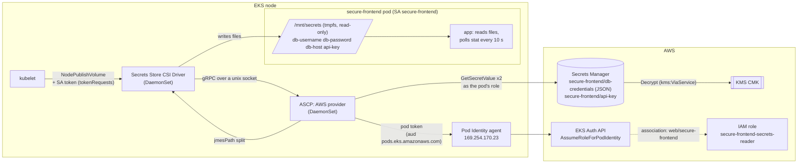
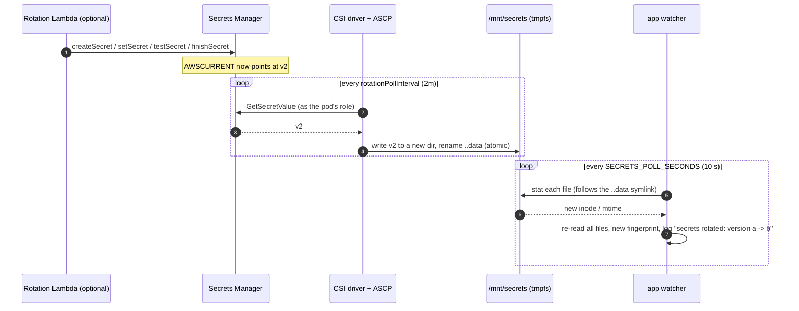
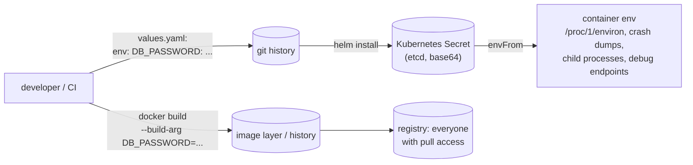

# Architecture

This page shows three things: how a secret gets from Secrets Manager into the pod, how a
rotated value reaches the app without a restart, and what this design replaces.

## Components

| Component | Where it runs | Owned by | Job |
|---|---|---|---|
| Secrets Manager secrets (`db-credentials` JSON, `api-key`) | AWS | Terraform creates the empty secrets. Operators or the rotation Lambda write the values | The source of truth |
| CMK `alias/<name>-secrets` | AWS KMS | Terraform | Encrypts both secrets. Only Secrets Manager may use it on the app's behalf (`kms:ViaService`) |
| `aws-secrets-store-csi-driver-provider` EKS add-on | `kube-system` DaemonSets on every node | Terraform (`aws_eks_addon`) | The Secrets Store CSI Driver plus the AWS provider (ASCP), and the `CSIDriver` object with its `tokenRequests` |
| EKS Pod Identity agent | `kube-system` DaemonSet, host network, `169.254.170.23` | the cluster stack (or this module with `manage_pod_identity_agent_addon`) | Exchanges a pod's ServiceAccount token for credentials of the associated role |
| Pod Identity association + IAM role | EKS / IAM | Terraform | Binds `web/secure-frontend` to a role that can read exactly two secrets |
| `SecretProviderClass` | the app's namespace | Helm chart | Says which secrets to fetch and how to lay them out (jmesPath) |
| secure-frontend pods | the app's namespace | Helm chart | Read `/mnt/secrets/*` and watch it for changes |

## Secret flow at pod start

1. The scheduler places the pod. The kubelet can't start the container until every volume
   is mounted, so a secret that can't be fetched stops the pod in `ContainerCreating` with a
   `FailedMount` event. The app never starts without its secrets.
2. The kubelet calls the CSI driver's `NodePublishVolume` with the pod's identity and a
   short-lived ServiceAccount token. The `CSIDriver` object's `tokenRequests` tell the kubelet
   to mint that token. It does not come from the pod's own token mount, which is why
   `automountServiceAccountToken: false` is safe (see [security.md](security.md)).
3. The driver passes the `SecretProviderClass` parameters to ASCP. Because
   `usePodIdentity: "true"`, ASCP asks the node's Pod Identity agent for credentials,
   presenting the pod's token. The agent calls `eks-auth:AssumeRoleForPodIdentity`, and EKS
   looks up the association for `web/secure-frontend` and returns that role's credentials.
4. ASCP calls `GetSecretValue` once per secret *as the pod's role*. Secrets Manager decrypts
   with the CMK; the role's `kms:Decrypt` only works through Secrets Manager. ASCP applies
   `jmesPath` to the JSON and returns one file per key (plus the whole document as
   `db-credentials`).
5. The driver writes the files into a tmpfs mount at `/mnt/secrets`, read-only for the pod.
   The app reads them, and `/healthz` reports `secrets_loaded: true` and a version
   fingerprint, never a value.

The app pod itself makes **no AWS call**. Its NetworkPolicy allows DNS out and nothing else.

## Rotation without a restart

- **Worst-case pickup** is `rotationPollInterval + SECRETS_POLL_SECONDS`, about 2 min 10 s with
  the defaults. The [rotation drill](../scripts/secret_rotation_drill.py) measures the second
  half locally (the driver half needs a cluster).
- **Atomic swap.** The driver updates files the way kubelet updates projected volumes: it
  writes the new set into a fresh timestamped directory and renames the `..data` symlink
  over the old one. A reader never sees a v2 username with a v1 password. The drill uses
  the same layout.
- **Why the app re-reads instead of restarting** ([ADR 0003](decisions/0003-files-not-env-vars.md)).
  Helm never sees the secret values, so a `checksum/` annotation over them can't change on
  rotation, and a Reloader-style controller only helps with synced Kubernetes Secrets,
  which this design avoids. The chart does carry `checksum/secretproviderclass`, over the
  *mapping*: changing which secrets or keys are mounted takes effect only at mount time,
  so pods must roll.
- **Rotation strategy matters more than the poll interval.** With single-user rotation, the
  old password stops working as soon as `finishSecret` runs, and every pod is broken until
  its next poll. Use the alternating-users strategy for databases, so the previous user stays
  valid for one rotation cycle, longer than the pickup window above.

## The anti-pattern this replaces

The value ends up in five places, each with its own readers and retention: image layers,
git history, etcd, the process environment and the registry. Rotating it means a rebuild
and a redeploy, so it rarely happens. In the target design the value exists in Secrets
Manager (encrypted, access logged in CloudTrail) and in a tmpfs file inside running pods.
Nothing else holds it.

`scan_manifests.py` (rendered manifests) and `find_hardcoded_secrets.py` (the source tree)
fail CI if the old pattern comes back.
