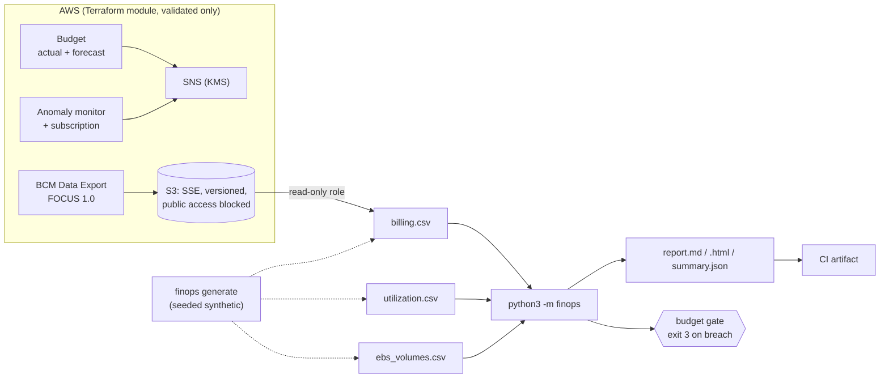

# FinOps Cost Optimization Toolkit

> **Classification: Working portfolio implementation. Synthetic data, no production results claimed.**
> All prices are illustrative, approximate us-east-1 on-demand list prices. Verify against current AWS pricing.

A local, reproducible cloud cost-analysis toolkit (Python standard library
only) and a Terraform module for AWS cost guardrails. It works through the
FinOps loop (allocate spend, rightsize, size commitments against the baseline,
forecast, alert) on a synthetic, seeded dataset that anyone can rerun. The
approach follows my AWS cost-optimisation work on rightsizing, resource
tuning and volume/snapshot lifecycle; none of the numbers come from that work.

## Problem

Cloud bills grow through drift rather than single bad decisions: untagged
resources nobody owns, instances sized for a launch-day peak, volumes left
behind by terminated hosts, commitments bought against an average that
doesn't hold, and budgets that only alert after the money is spent.
Engineering teams need answers they can act on and check:

- Who is spending what, and how much can't be attributed?
- Which resources are oversized or idle, and what's the risk of changing them?
- How much should we commit to, and why that number?
- Will we breach budget this month, and can CI catch it before a human does?

## What it demonstrates

| Area | Implementation |
|---|---|
| Showback and tag hygiene | Cost by `team`/`env`/`app`, untagged spend per key, tag-value normalisation (`Search` vs `search`), largest untagged resources |
| Rightsizing | p95-CPU and memory rules with projected utilisation after each size step, Graviton (m5→m7g, c5→c7g, r5→r7g) with an explicit arm64 compatibility flag, idle detection, unattached EBS; each item has current, proposed, monthly delta, confidence and rationale |
| Commitments | Coverage % on a list-price basis, hourly on-demand baseline, percentile-based sizing with a sweep showing why not the mean ([ADR 0002](docs/decisions/0002-baseline-percentile-commitments.md)) |
| Forecast | OLS on daily cost with R², a residual band and documented limitations; no ML |
| Budget gate | Month-to-date plus forecast vs budget, 80/100% thresholds, exit code 3 on breach for CI |
| Reporting | Markdown, self-contained HTML (light/dark), and `summary.json` |
| Guardrails as code | AWS Budget (actual + forecast), Cost Anomaly Detection, FOCUS 1.0 BCM Data Export to an encrypted, private S3 bucket, KMS-encrypted SNS alerts |
| Engineering hygiene | `Decimal` money, frozen dataclasses, 71 unit tests, deterministic generator, CI with path filters and least-privilege token |

## Architecture



More detail, including the guardrails diagram: [docs/architecture.md](docs/architecture.md).

## Quickstart

Python 3.11+, nothing to install. From this directory:

```bash
python3 -m finops generate --out sample-data          # deterministic synthetic data (seed 42)
python3 -m finops rightsize                           # or: allocate | commitments | forecast
python3 -m finops budget --budget 6000; echo "exit=$?" # CI gate: exit 3 on breach
python3 -m finops report --budget 6500 --out out --html
```

Every analysis command takes `--format text|json|markdown`. See
[docs/operations.md](docs/operations.md) for options, exit codes and how to
point it at a real FOCUS export.

## Sample output

Real output from the commands above on the committed sample data (90 days,
2026-07-01 to 2026-09-28, synthetic).

`report.md` summary:

```text
- Total spend analysed: $17,805.12 (effective cost); 27.8% carries no allocation tags.
- Rightsizing: 21 recommendations, estimated monthly delta -$1,118.26 (negative = saving).
- Commitments: coverage 29.4%; recommended additional $1.6692/h -> est. $467.20/month net.
- Forecast: $6,645.68 over the next 30 days (trend $0.42/day).
- Budget 2026-09: forecast 96.8% of $6,500.00 -> OK.
```

`python3 -m finops allocate` (excerpt):

```text
Total effective cost: $17,805.12. Spend with none of the allocation tags: $4,955.83 (27.8%).
Tag key  Untagged cost  Untagged %
-------  -------------  ----------
team     $4,955.83      27.8%
env      $5,117.88      28.7%
app      $5,117.88      28.7%
```

`python3 -m finops rightsize` (excerpt):

```text
Resource               Owner               Action         Current                   Proposed              Est. monthly delta  Confidence  Compat test
---------------------  ------------------  -------------  ------------------------  --------------------  ------------------  ----------  -----------
i-012da86a78c49ea20    data/etl            terminate      c5.2xlarge                stop or terminate     -$248.20            high        -
vol-085813dbad3c681d0  data/etl            delete-volume  gp2 1000 GB (unattached)  snapshot then delete  -$100.00            high        -
i-030877432d1026706    payments/api        downsize       m5.2xlarge                m5.xlarge             -$140.16            high        -
i-05d2cce8038a39d5e    search/opensearch   graviton       r5.2xlarge                r7g.2xlarge           -$55.19             medium      yes
```

`python3 -m finops commitments` sweep:

```text
Level  Covers OD $/h  Commit $/h  Utilisation  Net monthly saving
-----  -------------  ----------  -----------  ------------------
P0     2.2464         1.6174      100.0%       $459.16
P10    2.2768         1.6393      99.9%        $463.68
P20    2.3184         1.6692      99.6%        $467.20
mean   2.7703         1.9946      95.0%        $465.17
P30    2.7972         2.0140      94.8%        $465.00
P50    2.8927         2.0828      93.7%        $457.75
P75    3.0281         2.1802      91.1%        $421.74
```

`python3 -m finops budget --budget 6000`:

```text
2026-09 budget $6,000.00: month-to-date $5,863.13 (97.7%) after 28/30 days; forecast month-end $6,290.86 (104.8%). Gate: forecast >= 100% -> BREACH.
Threshold  Actual crossed  Forecast crossed
---------  --------------  ----------------
80%        yes             yes
100%       no              yes
exit=3
```

These figures come from synthetic data and an illustrative price table.
They show the method, not achieved savings.

## Tests

```bash
python3 -m unittest discover -s tests -v
# Ran 71 tests ... OK
```

Hand-built fixtures cover allocation maths and per-key untagged detection,
every rightsizing rule and its edge cases (exact threshold, projected-CPU
ceiling, memory-bound, smallest size, unpriced types, run ratio), Graviton
mapping, percentile interpolation and commitment simulation, budget breach
and exit codes, forecasting a perfect line, generator determinism (same seed
gives byte-identical files), input validation with line numbers, and CLI smoke
tests through `subprocess`.

## Terraform validation

The module lives in [`terraform/modules/cost-guardrails`](terraform/modules/cost-guardrails),
with an example in [`terraform/examples/basic`](terraform/examples/basic). It has
never been applied. Validation only:

```bash
cd terraform
terraform fmt -check -recursive
terraform -chdir=modules/cost-guardrails init -backend=false && terraform -chdir=modules/cost-guardrails validate
terraform -chdir=examples/basic init -backend=false && terraform -chdir=examples/basic validate
```

Validated with Terraform 1.14.8 and `hashicorp/aws` 6.68.0. Variables are
validated (thresholds 1-200, email format, ARN shape), `default_tags` apply
`project`/`owner`/`managed-by`, state is local, and there are no credentials
or account IDs (`aws_caller_identity` supplies them at plan time). Cost and
security notes: [docs/cost.md](docs/cost.md), [docs/security.md](docs/security.md).

## Limitations

- **Synthetic data only.** The estate, utilisation and prices are invented.
  The price table is a small illustrative subset (m5/c5/r5/m7g/c7g/r7g,
  large to 4xlarge).
- **Daily granularity.** The commitment baseline spreads each day evenly over
  24 hours, which hides intra-day peaks. Use hourly exports for real purchases.
- **Commitment model is simplified.** It assumes one discount rate across
  eligible usage and fully utilised existing plans, and it ignores RI/SP
  instance-family scoping and payment options.
- **Rightsizing is rule-based.** It assumes vCPU and memory double per size
  step, and it doesn't model network/EBS bandwidth limits, burstable types,
  or licensing. Rightsizing an instance covered by a commitment moves savings
  into commitment headroom rather than the invoice.
- **Forecast is linear.** No seasonality, and it follows step changes slowly.
- **Real FOCUS service names differ.** EBS and NAT appear under EC2, so
  commitment eligibility needs a `ResourceType`/usage-type filter before you
  trust coverage on real data (see [operations](docs/operations.md)).
- **In-memory processing.** Fine for tens of thousands of rows. Very large
  hourly, resource-level exports would need streaming or a query engine
  ([ADR 0001](docs/decisions/0001-stdlib-only.md)).
- **Terraform is validated, not applied.** API-level acceptance of the FOCUS
  query and the anomaly subscription hasn't been exercised against a live
  account.

## Interview talking points

- **Tag hygiene comes before optimisation.** If 28% of spend has no owner,
  every rightsizing ticket stalls on "whose is this?". Measure untagged spend
  per key, normalise values, fix it at the source (IaC defaults, tag policies,
  launch templates), and remember tag activation isn't retroactive.
- **Commit to the baseline, not the average.** A marginal dollar of commitment
  only pays off if usage reaches it in more than `(1 - discount)` of hours, so
  levels above the discount-rate percentile lose money. Commit low, layer
  more later, and rightsize first so you don't lock in waste.
- **Graviton is an engineering migration.** Price per vCPU is lower, but the
  saving only counts once multi-arch images, native dependencies, agents and
  AMIs are verified and the service is load-tested on arm64. That's why every
  Graviton recommendation carries a compatibility flag and lower confidence.
- **Use p95, not averages, and project the result.** Halving an instance
  doubles its utilisation, so check projected p95 CPU and memory against a
  ceiling, and step down one size at a time.
- **Unit economics beat absolute spend.** A rising bill can be healthy if cost
  per transaction or per customer is falling. The next step for this toolkit
  is joining allocation output to business metrics.
- **Showback first, chargeback later.** Showback builds trust in the numbers.
  Chargeback needs near-complete tagging, agreed rules for shared costs (EKS
  control plane, NAT, data transfer) and amortised commitment cost, otherwise
  teams argue about allocation instead of reducing usage.
- **Alert before the invoice.** Forecast-based budget alerts, anomaly
  detection and a CI budget gate shorten the feedback loop from a month to a
  day.
