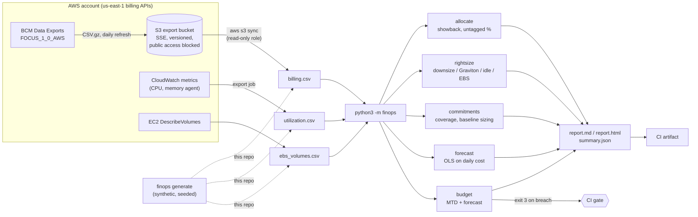
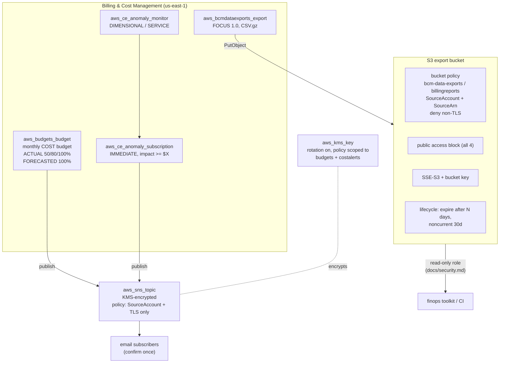

# Architecture

This project has two halves that meet at an S3 prefix:

1. **Guardrails** (Terraform, `terraform/modules/cost-guardrails`): an AWS Budget,
   Cost Anomaly Detection and a FOCUS 1.0 billing export into a locked-down S3
   bucket. These alert people in near real time and produce the raw data.
2. **Toolkit** (Python stdlib, `finops/`): reads a FOCUS-shaped export plus
   utilization and volume inventory, then produces allocation, rightsizing,
   commitment, forecast and budget results as text/JSON/Markdown/HTML. The
   `budget` command doubles as a CI gate.

In this repository the toolkit runs on synthetic data from `sample-data/`; the
Terraform is validated but never applied.

## Data flow

### Module boundaries

| Module | Responsibility | Depends on |
|---|---|---|
| `models.py` | Dataclasses, money rounding (`Decimal`, half-up to cents), JSON conversion | - |
| `pricing.py` | Illustrative price table, instance-type parsing, Graviton map | - |
| `io.py` | CSV read/write, FOCUS column mapping, line-numbered input errors | models |
| `generator.py` | Seeded synthetic estate | pricing, io |
| `allocation.py` | Tag-based showback, untagged detection, top services | models |
| `rightsizing.py` | Rule engine for idle / downsize / Graviton / unattached EBS | pricing |
| `commitments.py` | Coverage, hourly baseline, percentile sizing, sweep | models |
| `forecast.py` | Daily totals, OLS fit, projection | models |
| `budget.py` | MTD + forecast vs budget, thresholds, exit code | forecast |
| `report.py` | Block model rendered to text / Markdown / HTML | all results |
| `cli.py` | argparse wiring, exit codes | everything |

Analyses are pure functions over lists of records and return frozen
dataclasses. Rendering is separate, so the same result object feeds the
terminal, JSON (for other tools) and the report, and tests assert on numbers
rather than formatted strings.

### Key design choices

- **Effective (amortised) cost for showback.** A team that runs on a Savings
  Plan should see the discounted cost of its usage, not $0 on the days the
  plan fee happened to be invoiced. `--cost-column billed` gives the invoice
  view for reconciliation.
- **Rightsizing deltas are additive.** Graviton recommendations are computed
  from the post-downsize type, so summing the column doesn't double count.
- **Commitments are sized from the remaining on-demand baseline**, after
  existing coverage, using a percentile of hourly spend
  ([ADR 0002](decisions/0002-baseline-percentile-commitments.md)).
- **No dependencies** ([ADR 0001](decisions/0001-stdlib-only.md)).

## Guardrails architecture

Notes:

- The provider region is `us-east-1` because Budgets, Cost Explorer and BCM
  Data Exports are served from there. The bucket lives in the same region.
- AWS allows one AWS-services anomaly monitor per account. If the account
  already has one, pass its ARN as `existing_anomaly_monitor_arn` and the module
  only adds the subscription.
- The account ID never appears in code: it comes from `aws_caller_identity`
  at plan time and is used for the bucket name and `aws:SourceAccount`
  conditions.
- No backend block in the example, so state is local and git-ignored.
