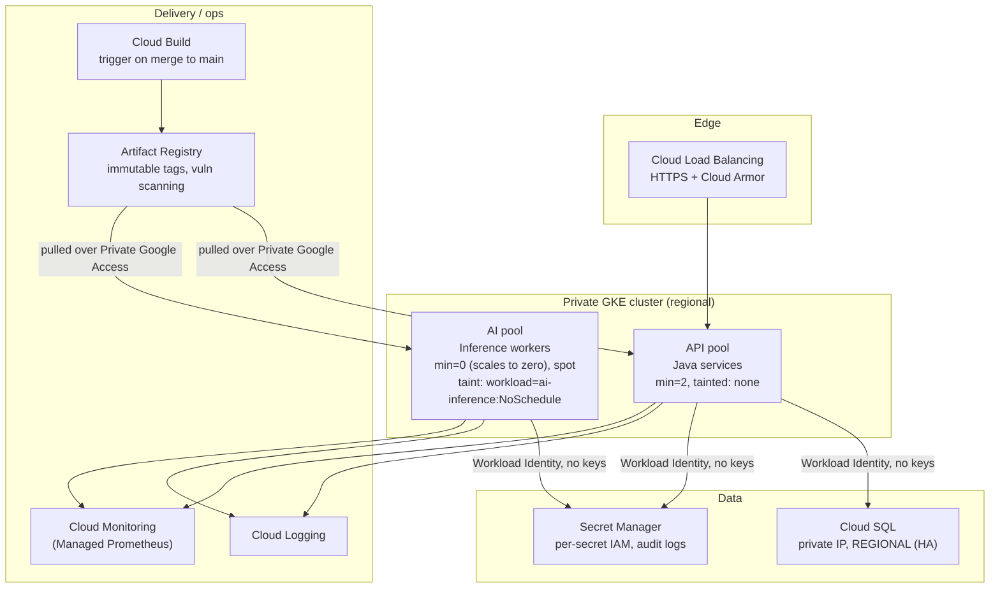
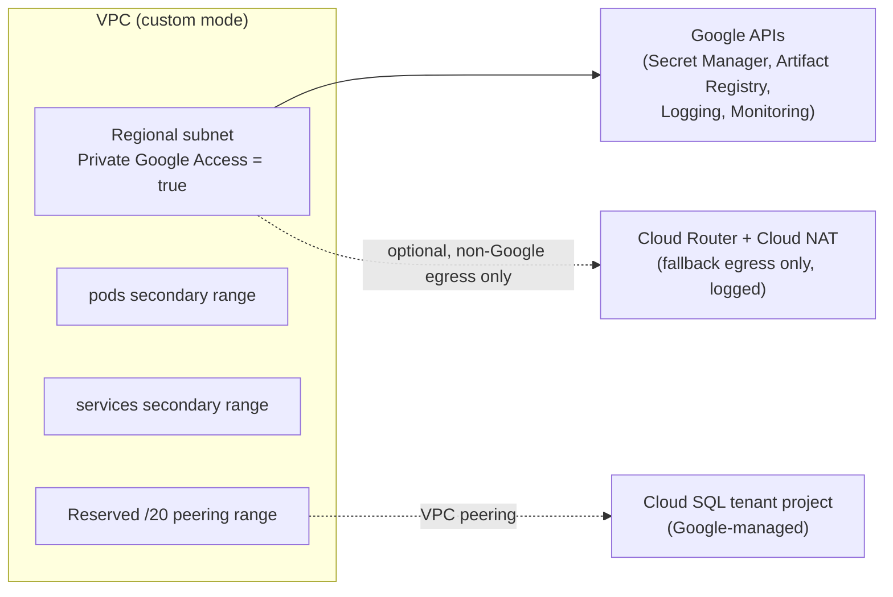

# GCP AI Pharmacy Infrastructure

Working portfolio implementation — synthetic reference implementation of a real pattern, never deployed, no real GCP project or account used.

Infrastructure for a Java-based, AI-assisted pharmacy application on Google Cloud: a private GKE cluster, Cloud SQL, Secret Manager, Cloud Build and Artifact Registry, with logging and monitoring built in from the start.

The website's project page classifies this as "production" evidence with the basis note "Application logic and data are anonymized here." What's built in this directory is the infrastructure pattern that backed that evidence, rebuilt from scratch against a synthetic project ID and synthetic data, so it can be read, validated and reused without exposing (or even referencing) any real account, client, patient data, or credential. Nothing here has ever been applied against a real GCP project.

## Problem

Healthcare-adjacent data — even a synthetic pharmacy catalog and order history shaped like one — needs private networking, auditable access, and no credentials sitting in code or container images. At the same time, the product's AI assistant features (drug-interaction checks, dosage suggestions) add a bursty, compute-heavy inference workload running right next to a conventional, latency-sensitive Java API. Those two workloads have opposite scaling shapes: the API wants a small, steady, always-on pool; inference wants to scale from zero to a lot of capacity and back, on a schedule that rarely coincides with API traffic.

Putting both on one undifferentiated node pool means either over-provisioning the API's capacity to survive inference spikes, or risking the API getting starved when inference bursts.

## Solution

- **Private GKE with Workload Identity.** Pods authenticate as a Google service account by impersonation through the metadata server (`GKE_METADATA` node mode + a per-namespace/ServiceAccount IAM binding) — no `google_service_account_key` resource, no downloaded JSON key, nothing to leak or rotate in a pod image.
- **Cloud SQL over private IP**, peered into the VPC through a Service Networking connection, with `ipv4_enabled = false` so there is no public endpoint to even have a firewall rule for.
- **Separate node pools for API and AI.** The `api` pool stays warm (`min_count = 2`) for latency; the `ai` pool is tainted (`workload=ai-inference:NoSchedule`), spot-priced, and scales from `min_count = 0` so an idle inference fleet costs nothing overnight, and a loaded one can never starve the API pool because they are different pools with different autoscalers.

## Architecture





Each Terraform module (`network`, `gke-cluster`, `cloud-sql`, `secret-manager`, `delivery`, `project-apis`) is designed to hold its own state in a real deployment, so a cluster upgrade's plan can never touch the database module's state file. `terraform/examples/reference` wires all six into a single root purely so `terraform validate`/`plan` can exercise the full graph in one pass during review; see `docs/decisions/0002-separate-state-per-layer.md`.

## Security

- **Workload Identity, not service-account keys.** `google_service_account_iam_member.workload_identity` (in `terraform/modules/gke-cluster/main.tf`) binds a Kubernetes `namespace/ServiceAccount` pair to a Google service account's `roles/iam.workloadIdentityUser`. `kubectl` never carries a key; `grep -r google_service_account_key terraform/` returns nothing in this repo.
- **No public IPs on data stores.** Cloud SQL's `ip_configuration.ipv4_enabled = false`; the GKE cluster's nodes have `enable_private_nodes = true`. Only the control plane's endpoint can be public (restricted to `master_authorized_networks`, never `0.0.0.0/0`), or private too if `enable_private_endpoint = true`.
- **Private Google Access, not public egress, for Google APIs.** The subnet sets `private_ip_google_access = true`; Cloud NAT exists only as a logged fallback for the rare non-Google egress case (e.g. pulling a public base image before everything is mirrored into Artifact Registry).
- **Least-privilege Secret Manager access.** `modules/secret-manager` grants `roles/secretmanager.secretAccessor` per secret, to the specific service account that needs it — the AI workload's GSA cannot read the database credential secret, and vice versa.
- **Data-access audit logs.** `google_project_iam_audit_config` resources in `modules/delivery` turn on `ADMIN_READ`/`DATA_READ`/`DATA_WRITE` audit logging for both `cloudsql.googleapis.com` and `secretmanager.googleapis.com`, so "who read which secret" and "who queried which table" are both answerable from Cloud Logging, not just "who connected."
- **Build-time vulnerability scanning.** Artifact Registry's Docker repository has `immutable_tags = true`, so a scanned, approved image tag can never be silently swapped later. Scanning itself runs automatically once the Container Scanning API is enabled (`modules/project-apis`); the build-time *gate* — failing a Cloud Build run on a HIGH/CRITICAL finding — is a step in the application repo's `cloudbuild.yaml`, not Terraform, since it's a pipeline policy rather than infrastructure.

## Reliability

- **Regional cluster.** The GKE control plane runs across multiple zones (`location = var.region`), surviving a single zone outage without a manual failover step.
- **Cloud SQL HA.** `availability_type = "REGIONAL"` by default gives a synchronous standby in a second zone with automatic failover; point-in-time recovery is on with a 7-day transaction log retention and 30 daily backups retained.
- **Isolation between workloads, not just resource requests/limits.** The AI pool's taint means a Kubernetes scheduler decision — not a best-effort resource request — is what keeps inference pods off API-pool nodes. A runaway inference batch job can max out its own pool's autoscaler ceiling (`max_count = 10`) without touching the API pool's nodes at all.
- **PodDisruptionBudgets and health probes** on both workloads (`helm/pharmacy-service`) keep a voluntary disruption (node upgrade, cluster autoscaler scale-down) from taking out every replica of either workload at once.

## Cost (illustrative — not sourced from a real bill)

| Line item | Illustrative monthly cost (us-central1) | Notes |
|---|---|---|
| API pool (2× `e2-standard-4`, always on) | ~$140 | Steady-state baseline for latency-sensitive traffic. |
| AI pool (`n2-highmem-8`, spot, scales 0–10) | ~$0 idle, ~$900 at full burst | Spot pricing + scale-to-zero is the whole cost story here: an idle overnight AI pool costs nothing. |
| Cloud SQL (`db-custom-2-8192`, REGIONAL HA) | ~$250 | HA roughly doubles a single-zone instance's compute cost. |
| Secret Manager | <$5 | Priced per active secret version + access operation; negligible at this scale. |
| Artifact Registry + Cloud Build | ~$10–30 | Storage + build minutes, usage-dependent. |
| Cloud Logging / Monitoring | ~$20–50 | Scales with log/metric volume; `DATA_READ` audit logs on Cloud SQL are the largest single driver once query volume is real. |

These are order-of-magnitude placeholders for a reference deployment, not a bill from any real environment — say so whenever they're quoted.

## Results (illustrative)

Because this is a synthetic reference that has never been deployed, there is no production traffic graph to show. The illustrative claim this pattern is built to support: separating the API and AI pools, with the AI pool spot-priced and scaling to zero, keeps a bursty inference workload from forcing the API pool's baseline capacity (and bill) up to cover worst-case AI demand — the two pools' autoscalers never compete for the same quota.

## Limitations

- Never applied against a real GCP project; there is no `terraform plan` output, only `validate`, in this repository's CI and in this README.
- `terraform/examples/reference` wires all modules into one root for validation convenience; a real deployment should split each module into its own state/backend (see `docs/decisions/0002-separate-state-per-layer.md`).
- The Helm chart renders one workload's Deployment per release; it does not include the Secret Manager CSI driver's `SecretProviderClass` manifests (those existed in a prior, AWS-flavored project, `eks-secrets-store-csi`; porting that mechanism to GCP's Secret Manager CSI provider is out of scope here — this reference instead documents the app reading secrets directly through the Secret Manager client library using its Workload Identity credentials).
- Cloud Build's `github` trigger block points at a synthetic `example-org/pharmacy-platform` repo that doesn't exist; it demonstrates the wiring, not a working webhook.
- The AI pool's taint/toleration pair is the scheduling mechanism shown; a production setup would likely add a dedicated `nodeSelector` on `cloud.google.com/gke-accelerator` as well if the inference workers use GPUs, which this reference's CPU-only `n2-highmem-8` machine type doesn't need.

## Lessons

- Workload Identity's binding is two-sided and both sides have to agree exactly: the IAM member string (`serviceAccount:PROJECT.svc.id.goog[namespace/ksa]`) and the pod's `ServiceAccount` annotation (`iam.gke.io/gcp-service-account`) must name the same namespace/KSA pair and the same GSA email, or impersonation fails with an opaque 403 from the metadata server rather than a Terraform-time error — this is invisible to `terraform validate`, which is why `tests/test_helm_static.py` and `tests/test_terraform_static.py` both assert on the exact binding shape independently.
- A node pool's taint is necessary but not sufficient on its own: without the Helm chart's matching `nodeSelector`, a pod without the toleration could still end up scheduled onto *any other, untainted* pool rather than the one you intended — the two have to be read together, not just "taint = isolation".
- `google_project_iam_audit_config` is authoritative for a project's entire audit configuration for that service: a second module that also tried to manage audit config for `cloudsql.googleapis.com` would fight this one on every plan. It belongs in exactly one place (`modules/delivery` here), documented as project-wide rather than per-environment.

## Repository layout

```
terraform/
  modules/
    project-apis/     # enables required Google APIs
    network/           # VPC, private subnet, Private Service Access, Cloud NAT
    gke-cluster/        # private regional GKE cluster, api/ai node pools, Workload Identity bindings
    cloud-sql/           # private-IP, HA Postgres instance
    secret-manager/       # per-secret Secret Manager resources + IAM
    delivery/              # Artifact Registry, Cloud Build trigger, audit log configs
  examples/
    reference/              # wires all modules into one root (validation only)
helm/
  pharmacy-service/            # one chart, two releases (api / ai) via values overlay
tests/
  test_terraform_static.py       # static assertions on every .tf file
  test_helm_static.py             # static assertions on the chart source
  test_readme.py                   # keeps this file's claims honest
```

## Validation

```text
$ python3 -m unittest discover -s tests -v
...
----------------------------------------------------------------------
Ran 41 tests in 0.025s

OK
```

```text
$ terraform fmt -check -recursive terraform
(no output — already formatted)
```

```text
$ terraform -chdir=terraform/examples/reference init -backend=false -input=false && terraform -chdir=terraform/examples/reference validate
Success! The configuration is valid.
```

```text
$ helm lint helm/pharmacy-service && helm lint helm/pharmacy-service -f helm/pharmacy-service/values-ai.yaml
1 chart(s) linted, 0 chart(s) failed
1 chart(s) linted, 0 chart(s) failed
```

```text
$ helm template pharmacy-api helm/pharmacy-service --namespace pharmacy | kubeconform -strict -summary
Summary: 5 resources found parsing stdin - Valid: 5, Invalid: 0, Errors: 0, Skipped: 0
```

See `docs/operations.md` for the full command list and `docs/security.md` / `docs/architecture.md` for the design rationale.
