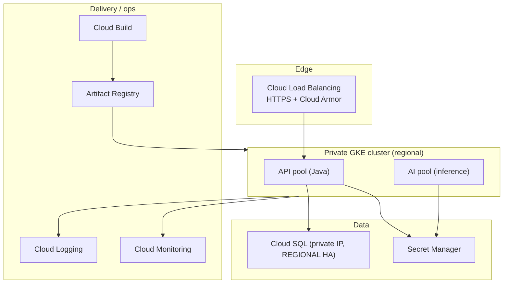
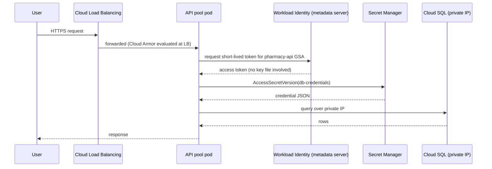
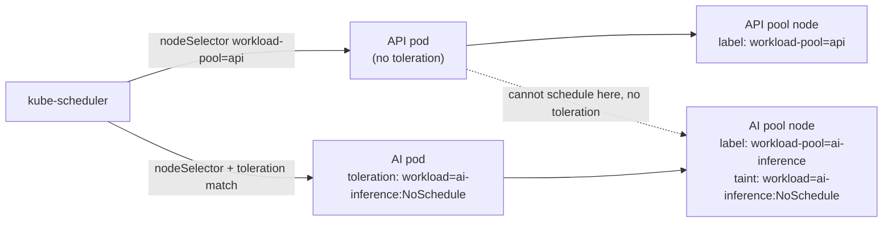
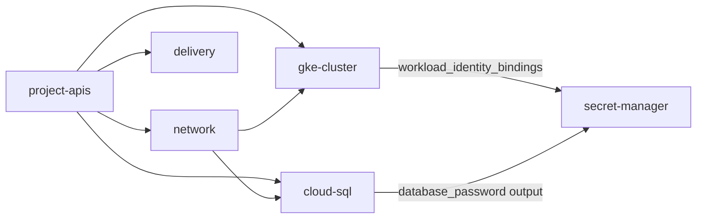

# Architecture

## Tiers

## Request path

## Node-pool isolation

The taint is what actually prevents an API pod from ever landing on an AI-pool node, even accidentally; the `nodeSelector` on both workloads is what stops the reverse (an AI pod landing on the API pool, where it isn't tainted away).

## Terraform module graph

Each box is a separate module with its own `versions.tf`/`variables.tf`/`main.tf`/`outputs.tf`; in a real deployment each also gets its own state file (see `docs/decisions/0002-separate-state-per-layer.md`). `terraform/examples/reference` is the only place all of them are instantiated together.
