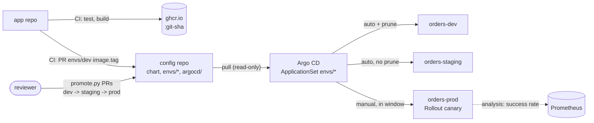

# GitOps Delivery: Argo CD, Helm and PR-Based Promotion Across dev, staging and prod

> **Classification: production case study.**
> Reference implementation of a pattern used in production work; all names and values are synthetic. No production figures are claimed.
> Owner: Muhammad Salahuddin, Senior DevOps Engineer. The chart renders and passes `helm lint` and
> kubeconform for every environment, the Argo CD manifests pass kubeconform with the CRD schemas, and the
> scripts are tested. Nothing here has been installed into a cluster.

Standardized Helm-based deployment with pull-based GitOps: an app repository
whose CI builds an immutable image and opens a pull request, a config
repository that is the desired state of dev, staging and prod, and Argo CD
reconciling the cluster to it. An **ApplicationSet** fans out one Application
per environment with different sync policies, an **AppProject** fences the
team in, prod is synced by hand inside **sync windows** and rolled out as an
**Argo Rollouts canary** gated by the same success-rate SLI as the
observability project. Promotion is a **one-line PR** made by
`promote.py`, drift is reported per field by `drift_report.py`, and
`check_gitops_policy.py` keeps the guardrails from eroding.

## Problem

- **CI holds the keys to production.** A pipeline that runs `helm upgrade`
  needs cluster credentials, so every compromised dependency or workflow
  change is a path into prod.
- **Nobody knows what is running.** The cluster is whatever the last job or the
  last `kubectl edit` left; the difference from git is found during incidents.
- **Promotion by copy-paste.** Tags are retyped per environment, `latest`
  sneaks in, staging gets skipped "just this once" with no record.
- **Every release goes to 100% at once.** Readiness probes pass, the error
  rate doesn't, and all users see it.

## What it demonstrates

| Area | Implementation |
|---|---|
| Two-repo split | `app-repo/` (stdlib service, non-root Dockerfile, CI example) and `config-repo/` (chart, `envs/*`, `argocd/`); separate repositories in reality ([ADR 0002](docs/decisions/0002-two-repo-split.md)) |
| App CI (example) | `app-repo/.github/workflows/ci.yml`: test, build, push `ghcr.io/example-org/orders-api:<git sha>`, PR on the config repo via a GitHub App token and `peter-evans/create-pull-request`. SHA-pinned, `contents: read`, no cluster credentials. Documentation only; it never runs here |
| Helm chart | `charts/orders-api`: Deployment or Rollout, Service, Ingress, HPA, PDB, NetworkPolicy, ServiceAccount, ServiceMonitor, ExternalSecret; non-root, read-only root FS, no token, seccomp, drop ALL; `values.schema.json` and a template check that reject a missing or mutable tag |
| Environments | `envs/{dev,staging,prod}/values.yaml`, each with its own `image.tag`, sizing, host and secret store |
| Argo CD | app of apps `root`; AppProjects `orders-api` (one repo, three namespaces, **no cluster-scoped kinds**, kind whitelist, roles) and `platform`; ApplicationSet with a git directory generator over `envs/*` and a `templatePatch`: **dev** automated + selfHeal + prune, **staging** automated without prune, **prod** manual ([ADR 0001](docs/decisions/0001-pull-based-gitops.md)) |
| Sync windows | deny windows on the AppProject for `orders-api-prod` outside 08:00-17:00 UTC Mon-Fri, `manualSync: false`; break-glass override by PR ([operations](docs/operations.md#sync-windows)) |
| Drift handling | `ignoreDifferences` for HPA-managed replicas on Deployments and Rollouts plus `RespectIgnoreDifferences=true`; Slack notifications for sync failed and health degraded |
| Progressive delivery | prod `Rollout`: setWeight 10, pause, analysis, 50, pause, analysis, 100; `AnalysisTemplate` with a Prometheus success-rate query on the canary pods (the availability SLI from [observability-sre-platform](../observability-sre-platform/README.md)); `rollout.enabled` per env ([ADR 0004](docs/decisions/0004-argo-rollouts-canary-for-prod.md)) |
| Secrets | External Secrets Operator: `ExternalSecret` per env, one `ClusterSecretStore` per env with its own IAM role and a namespace condition, Pod Identity for the controller; no secret values anywhere ([ADR 0003](docs/decisions/0003-external-secrets-vs-sealed-secrets.md)) |
| `promote.py` | edits only the `tag:` line under `image:` (byte-exact otherwise), refuses mutable tags and skipped environments, `--force-hotfix --reason` recorded as git trailers, optional commit and branch, PR body with the diff |
| `drift_report.py` | desired (rendered) vs live (`kubectl get -o json/yaml`) per resource and field, Argo-style ignores, exit 1 on drift; samples with a `kubectl edit` |
| `check_gitops_policy.py` | expands the ApplicationSet like Argo CD and checks 10 rules: prod not automated, prune only in dev, no cluster-scoped kinds, allowed destinations and repos, no `latest`, prod canary with analysis, sync windows cover every off-hours minute, notifications, replica ignores, dev/staging automation |
| CI | `.github/workflows/gitops-delivery-platform.yml`: unittest on 3.12, policy check (and the bad fixture must fail), drift samples, helm lint and kubeconform per env, `argocd/` and `platform/` with the CRD catalog, workflow lint of this workflow and the example |

## Architecture



The two-repo flow, the promotion PR sequence, the ApplicationSet fan-out, the
canary with analysis and the drift self-heal loop are in
[docs/architecture.md](docs/architecture.md).

## Layout

```text
app-repo/                     separate repository in reality
  app/orders_api.py           stdlib HTTP service: /healthz /readyz /orders /version /metrics
  tests/                      its unit tests (also run by this project's suite)
  Dockerfile                  digest-pinned base, UID 10001, no dependencies
  .github/workflows/ci.yml    EXAMPLE CI: test -> build -> push :sha -> PR on the config repo
config-repo/                  separate repository in reality
  charts/orders-api/          hardened chart (Deployment or Rollout + AnalysisTemplate)
  envs/{dev,staging,prod}/    values.yaml per environment (image.tag lives here)
  argocd/                     bootstrap/root-app.yaml, projects/, apps/, applicationsets/
  platform/                   namespaces (PSA restricted), ClusterSecretStores
  bootstrap/                  argo-cd-values.yaml for the pinned argo/argo-cd chart
scripts/                      promote.py, drift_report.py, check_gitops_policy.py,
                              patch_catalog_schema.py, yaml_lite.py
sample-data/                  desired/dev.yaml (rendered), live/dev-in-sync.json, live/dev-drifted.json
tests/                        unittest suites and fixtures (policy/bad is a deliberately broken config repo)
docs/                         architecture, operations, security, cost, decisions/ (ADRs 0001-0004)
```

## Quickstart

Python 3.12 (CI's version; newer 3.x works), nothing to install. From this directory:

```bash
python3 -m unittest discover -s tests -v       # helm/kubeconform tests need helm, kubeconform and network
python3 scripts/promote.py --from dev --to staging --dry-run
python3 scripts/drift_report.py --desired sample-data/desired/dev.yaml --live sample-data/live/dev-drifted.json
python3 scripts/check_gitops_policy.py
```

After a chart change, re-render the drift sample (a test fails if it is stale):
`helm template orders-api config-repo/charts/orders-api -n orders-dev -f config-repo/envs/dev/values.yaml > sample-data/desired/dev.yaml`.

## Sample output

All excerpts are real output from this machine, run on 2026-10-15. A test
re-runs every `$ python3` block and compares it byte for byte.

A promotion one step along the chain (dry run, so nothing is written). The PR
diff is exactly one line:

````text
$ python3 scripts/promote.py --from dev --to staging --dry-run
promote: dev -> staging  4b8e1d0c6a2f9e3b7d5c1a8f0e6b2d4c9a7e3f1b -> 9f3c2a7e5b1d4c8f6a0e2b7d9c1f3a5e7b9d0c2e
dry run: envs/staging/values.yaml not written
--- commit message ---
staging: promote orders-api 9f3c2a7e5b1d4c8f6a0e2b7d9c1f3a5e7b9d0c2e from dev

image.tag 4b8e1d0c6a2f9e3b7d5c1a8f0e6b2d4c9a7e3f1b -> 9f3c2a7e5b1d4c8f6a0e2b7d9c1f3a5e7b9d0c2e in envs/staging/values.yaml.

Promoted-From: dev
Promoted-To: staging
Image-Tag: 9f3c2a7e5b1d4c8f6a0e2b7d9c1f3a5e7b9d0c2e
--- PR body ---
## Promote orders-api to `staging`

| | |
|---|---|
| From | `dev` |
| To | `staging` |
| Old tag | `4b8e1d0c6a2f9e3b7d5c1a8f0e6b2d4c9a7e3f1b` |
| New tag | `9f3c2a7e5b1d4c8f6a0e2b7d9c1f3a5e7b9d0c2e` |
| File | `envs/staging/values.yaml` |

```diff
--- a/envs/staging/values.yaml
+++ b/envs/staging/values.yaml
@@ -6,3 +6,3 @@
   # Immutable tag, copied from dev by the promotion PR.
-  tag: 4b8e1d0c6a2f9e3b7d5c1a8f0e6b2d4c9a7e3f1b
+  tag: 9f3c2a7e5b1d4c8f6a0e2b7d9c1f3a5e7b9d0c2e
 
```

Checklist:
- [ ] `9f3c2a7e5b1d4c8f6a0e2b7d9c1f3a5e7b9d0c2e` is healthy in `dev`
- [ ] Argo CD diff for the target app shows only the image change
(exit 0)
````

Skipping staging is refused:

```text
$ python3 scripts/promote.py --from dev --to prod --dry-run
promote: REFUSED: refusing dev -> prod: the next env after dev is staging (chain dev -> staging -> prod); use --force-hotfix --reason to override
(exit 1)
```

The same move as a hotfix, committed into a throwaway copy of the config repo
(the temp path is shortened; not re-run by the test because the path and
commit change):

```console
$ python3 scripts/promote.py --config-repo /tmp/demo/orders-config --from dev --to prod --force-hotfix --reason "INC-1234: checkout timeouts" --commit --branch hotfix/prod-9f3c2a7e5b1d
promote: dev -> prod  v1.3.0-7a1c9e2 -> 9f3c2a7e5b1d4c8f6a0e2b7d9c1f3a5e7b9d0c2e  [HOTFIX]
wrote envs/prod/values.yaml, committed f17aaf217505
...
$ git log -1 --format='%(trailers:key=Promotion-Hotfix)%(trailers:key=Hotfix-Reason)'
Promotion-Hotfix: true
Hotfix-Reason: INC-1234: checkout timeouts
$ git diff --stat main HEAD
 envs/prod/values.yaml | 2 +-
 1 file changed, 1 insertion(+), 1 deletion(-)
```

The drift report on the dev sample after someone ran `kubectl edit`
(new image, a `debug` label). The HPA's replica count and `status` differ too,
and are ignored:

```text
$ python3 scripts/drift_report.py --desired sample-data/desired/dev.yaml --live sample-data/live/dev-drifted.json --app config-repo/argocd/applicationsets/orders-api.yaml
drift report: 9 desired resource(s), 9 live
ignored everywhere: status, and metadata bookkeeping (managedFields, resourceVersion, uid, generation, creationTimestamp, last-applied and revision annotations)
ignored on HPA targets: spec.replicas (Deployment/orders-api)
NetworkPolicy/orders-api: in sync
PodDisruptionBudget/orders-api: in sync
ServiceAccount/orders-api: in sync
Service/orders-api: in sync (ignored: status)
Deployment/orders-api: DRIFT
  + metadata.labels.debug: "true" (live only)
  ~ spec.template.spec.containers[orders-api].image: desired "ghcr.io/example-org/orders-api:9f3c2a7e5b1d4c8f6a0e2b7d9c1f3a5e7b9d0c2e", live "ghcr.io/example-org/orders-api:hotfix-manual"
  (ignored: spec.replicas, status)
HorizontalPodAutoscaler/orders-api: in sync (ignored: status)
Ingress/orders-api: in sync
ExternalSecret/orders-api: in sync (ignored: status)
ServiceMonitor/orders-api: in sync
summary: DRIFT: 1 of 9 resource(s) differ, 2 field(s); 5 ignored difference(s)
(exit 1)
```

The policy check on the config repo. It expands the ApplicationSet over
`envs/*` the way Argo CD does:

```text
$ python3 scripts/check_gitops_policy.py
check_gitops_policy: 2 AppProject(s), 5 Application(s) (3 generated from 1 ApplicationSet(s))
  orders-api-dev       orders-api  ns orders-dev        automated selfHeal prune  (ApplicationSet/orders-api)
  orders-api-prod      orders-api  ns orders-prod       manual, 2 deny window(s)  (ApplicationSet/orders-api)
  orders-api-staging   orders-api  ns orders-staging    automated selfHeal  (ApplicationSet/orders-api)
  platform-base        platform    ns external-secrets  automated selfHeal  (argocd/apps/platform-base.yaml)
  root                 platform    ns argocd            automated selfHeal  (argocd/bootstrap/root-app.yaml)
0 error(s), 0 warning(s)
(exit 0)
```

And on `tests/fixtures/policy/bad`, a config repo that breaks every rule:

```text
$ python3 scripts/check_gitops_policy.py --config-repo tests/fixtures/policy/bad
check_gitops_policy: 1 AppProject(s), 4 Application(s) (3 generated from 1 ApplicationSet(s))
  orders-api-dev       orders-api  ns orders-dev        automated selfHeal  (ApplicationSet/orders-api)
  orders-api-prod      orders-api  ns orders-prod       automated prune, 2 deny window(s)  (ApplicationSet/orders-api)
  orders-api-staging   orders-api  ns orders-staging    automated prune  (ApplicationSet/orders-api)
  debug-tools          orders-api  ns kube-system       manual  (argocd/debug-app.yaml)
ERROR   GP001 Application/orders-api-prod: prod must be synced by hand; remove syncPolicy.automated
ERROR   GP002 Application/orders-api-prod: prune is enabled in prod; only dev may prune
ERROR   GP002 Application/orders-api-staging: prune is enabled in staging; only dev may prune
ERROR   GP003 AppProject/orders-api: allows cluster-scoped kinds (*/*); must be []
ERROR   GP004 Application/debug-tools: destination https://kubernetes.default.svc namespace 'kube-system' not allowed by project orders-api
ERROR   GP004 Application/debug-tools: repo https://github.com/example-org/random-tools.git not in project orders-api sourceRepos
ERROR   GP005 envs/dev/values.yaml: tag 'latest' is mutable and never deployable
ERROR   GP005 envs/staging/values.yaml: tag 'main' is not immutable: use a 40-char git SHA or <semver>-<7..40 hex sha>
ERROR   GP006 Application/orders-api-prod: chart charts/orders-api has no AnalysisTemplate referenced from the Rollout steps
ERROR   GP006 Application/orders-api-prod: prod values must name rollout.analysis.templateName
ERROR   GP006 Application/orders-api-prod: prod values must set rollout.enabled: true (canary with analysis)
ERROR   GP007 Application/orders-api-prod: deny window '0 17 * * 1-5' sets manualSync: true, so it does not stop a manual prod sync
ERROR   GP007 Application/orders-api-prod: prod can sync outside 08:00-17:00 Mon-Fri UTC: 75h00m a week uncovered, first at Mon 00:00
WARNING GP008 Application/orders-api-dev: no notifications.argoproj.io/subscribe.on-health-degraded.<service> annotation
WARNING GP008 Application/orders-api-dev: no notifications.argoproj.io/subscribe.on-sync-failed.<service> annotation
WARNING GP008 Application/orders-api-prod: no notifications.argoproj.io/subscribe.on-health-degraded.<service> annotation
WARNING GP008 Application/orders-api-prod: no notifications.argoproj.io/subscribe.on-sync-failed.<service> annotation
WARNING GP008 Application/orders-api-staging: no notifications.argoproj.io/subscribe.on-health-degraded.<service> annotation
WARNING GP008 Application/orders-api-staging: no notifications.argoproj.io/subscribe.on-sync-failed.<service> annotation
ERROR   GP009 Application/orders-api-dev: ignoreDifferences lacks apps/Deployment /spec/replicas (the HPA owns it)
ERROR   GP009 Application/orders-api-dev: ignoreDifferences lacks argoproj.io/Rollout /spec/replicas (the HPA owns it)
ERROR   GP009 Application/orders-api-dev: syncOptions lacks RespectIgnoreDifferences=true, so a sync resets replicas
ERROR   GP009 Application/orders-api-prod: ignoreDifferences lacks apps/Deployment /spec/replicas (the HPA owns it)
ERROR   GP009 Application/orders-api-prod: ignoreDifferences lacks argoproj.io/Rollout /spec/replicas (the HPA owns it)
ERROR   GP009 Application/orders-api-prod: syncOptions lacks RespectIgnoreDifferences=true, so a sync resets replicas
ERROR   GP009 Application/orders-api-staging: ignoreDifferences lacks apps/Deployment /spec/replicas (the HPA owns it)
ERROR   GP009 Application/orders-api-staging: ignoreDifferences lacks argoproj.io/Rollout /spec/replicas (the HPA owns it)
ERROR   GP009 Application/orders-api-staging: syncOptions lacks RespectIgnoreDifferences=true, so a sync resets replicas
ERROR   GP010 Application/orders-api-dev: dev must be automated with selfHeal and prune
23 error(s), 6 warning(s)
(exit 1)
```

Helm and kubeconform. `Rollout`, `AnalysisTemplate`, `ExternalSecret`,
`ServiceMonitor`, `Application`, `ApplicationSet` and `AppProject` are
validated against the community CRD catalog, not skipped; a test adds an
unknown field to the ApplicationSet and expects `Invalid`:

```text
$ for env in dev staging prod; do helm lint charts/orders-api -f envs/$env/values.yaml; done   # in config-repo/
1 chart(s) linted, 0 chart(s) failed
1 chart(s) linted, 0 chart(s) failed
1 chart(s) linted, 0 chart(s) failed
$ helm template orders-api charts/orders-api -n orders-$env -f envs/$env/values.yaml | kubeconform -strict -summary -kubernetes-version 1.34.0 -schema-location default -schema-location 'https://raw.githubusercontent.com/datreeio/CRDs-catalog/main/{{.Group}}/{{.ResourceKind}}_{{.ResourceAPIVersion}}.json'
dev:     Summary: 9 resources found parsing stdin - Valid: 9, Invalid: 0, Errors: 0, Skipped: 0
staging: Summary: 9 resources found parsing stdin - Valid: 9, Invalid: 0, Errors: 0, Skipped: 0
prod:    Summary: 10 resources found parsing stdin - Valid: 10, Invalid: 0, Errors: 0, Skipped: 0
$ kubeconform -strict -summary ...same flags... argocd/
Summary: 5 resources found in 5 files - Valid: 5, Invalid: 0, Errors: 0, Skipped: 0
$ kubeconform -strict -summary ...same flags plus the repaired schema dir first... platform/
Summary: 6 resources found in 2 files - Valid: 6, Invalid: 0, Errors: 0, Skipped: 0
```

One catalog defect is handled explicitly instead of skipped. The catalog's
`external-secrets.io` v1 `ClusterSecretStore` schema puts a stray
`"additionalProperties": false` inside a `properties` map (the CRD has a field
literally named `properties`); kubeconform 0.8.0 cannot compile it and reports
`could not find schema for ClusterSecretStore` (without the repair:
`Valid: 3, Invalid: 0, Errors: 3`). `scripts/patch_catalog_schema.py` fetches
the schema, drops that one boolean entry and writes it to a directory that is
searched first. With the repaired schema, an unknown field under
`spec.provider.aws` is rejected, so the rest of the schema is applied.

The Argo CD bootstrap values were also rendered once against the real pinned
chart (`argo/argo-cd` 10.10.3, downloaded to a temp dir and deleted): 59
objects, kubeconform `Valid: 56, Errors: 3`, the three errors being the
chart's own CustomResourceDefinitions, for which kubeconform has no schema.
The app image was built and run once with `--read-only --cap-drop ALL`:
`/healthz` returned 200, `/version` the build-arg SHA, and `id` reported
`uid=10001(app)`. Both were then deleted.

## Tests

```bash
python3 -m unittest discover -s tests -v
# Ran 85 tests ... OK
```

They cover:

- **promote**: immutable tag patterns and the rejected ones (`latest`, branch
  names, bare semver, short or uppercase SHAs), the happy path dev to staging
  to prod, a skipped environment refused, backwards and same-env moves,
  `--tag` only into dev, the hotfix trailers and the required reason, no-op
  promotions, **byte-for-byte preservation** of everything except the tag line
  (CRLF, quotes, trailing comments, look-alike `tag:` keys elsewhere), and
  **git commits in a temp repo** (branch, one-file diff, real git trailers,
  refusal over local edits);
- **drift**: no drift despite defaults and metadata noise, image drift, HPA
  replicas ignored (and reported as drift without an HPA), the
  ApplicationSet's `ignoreDifferences`, added labels and annotations, an
  injected container, missing and extra resources, the shipped samples;
- **policy**: the real config repo is clean and fans out to the expected
  Applications and sync policies, the bad fixture trips all ten rules, one
  mutation per rule on a copy of the real repo, a new env directory defaults
  to manual, unsupported template syntax fails closed, the cron and window maths;
- **helm** (skipped without helm): lint per env, objects per env (prod a Rollout
  and AnalysisTemplate, dev and staging a Deployment, no Secret), pod
  hardening, image tag from the env file, HPA target kind, canary steps and the
  analysis query, NetworkPolicy, per-env secret stores, mutable tags refused
  at render, the drift sample matches the current render;
- **kubeconform** (skipped without kubeconform or network): each env render,
  `argocd/`, `platform/` with the repaired schema, and a negative case proving
  the CRD schemas are applied;
- **the app**: HTTP endpoints, validation, bounded metric labels, readiness;
- **CLI smoke tests**, the **workflow lint** of both workflows, and **docs**: the
  classification line, the `$ python3` samples re-run, no unfinished-work
  markers, no empty files, no client names.

## Limitations

- **Never installed into a cluster.** No kind demo was run: the config repo
  URL is a placeholder, so a real sync would need an in-cluster git server,
  plus the External Secrets and Prometheus Operator CRDs. Sync, self-heal,
  sync windows and the canary are validated by schema, tests and the policy
  check, not observed.
- **Weights are pod ratios.** No traffic router, so 10% means one canary pod
  out of four replicas (ADR 0004).
- **The policy check's ApplicationSet renderer is a subset.** It supports the
  git directory generator and the `if eq .path.basename` patches this repo uses,
  and fails closed (GP000) on anything else; it is not Argo CD.
- **The drift report compares declared fields only**, like Argo CD's diff.
  A field that the API server defaults and someone then edits is not seen
  unless it is in the chart (labels, annotations and named list items are the
  exceptions).
- **Sync windows are checked in UTC only.**
- **The CI example is documentation.** Its secrets (`CONFIG_BOT_APP_ID`,
  `CONFIG_BOT_PRIVATE_KEY`) and the config repository don't exist.
- **The ClusterSecretStore schema is repaired at validation time**, which
  loosens one unused sub-schema (the CRD provider's whitelist rule).
- Image signing and admission verification are described as next steps, not built.

## Interview talking points

- **CI proposes, Argo CD disposes.** The pipeline can push an image and open a
  PR; only a reviewed merge changes desired state, and only Argo CD writes to
  the cluster. No kubeconfig in CI is a security property, not a convenience.
- **One template, three behaviours.** dev heals and prunes, staging heals but
  never deletes, prod waits for a human inside a window. A new directory is
  safe by default (manual).
- **Promotion is a one-line diff.** Same artifact, same tag, next environment
  only; skipping is possible but leaves a trailer you can grep for.
- **The canary is gated by the SLO, not by readiness.** The analysis is the
  availability SLI from the observability project, scoped to canary pods, and
  no data counts as failure.
- **Ignore what someone else owns.** The HPA owns replicas, so they are
  neither drift nor something a sync should reset; everything else that differs
  is a finding.
- **Guardrails need tests too.** The policy check has a fixture that breaks
  every rule and one mutation per rule, so loosening a guardrail fails CI.
