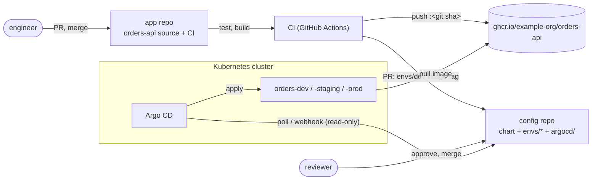
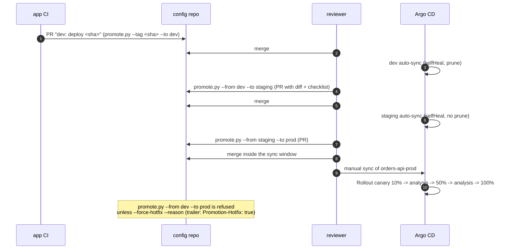
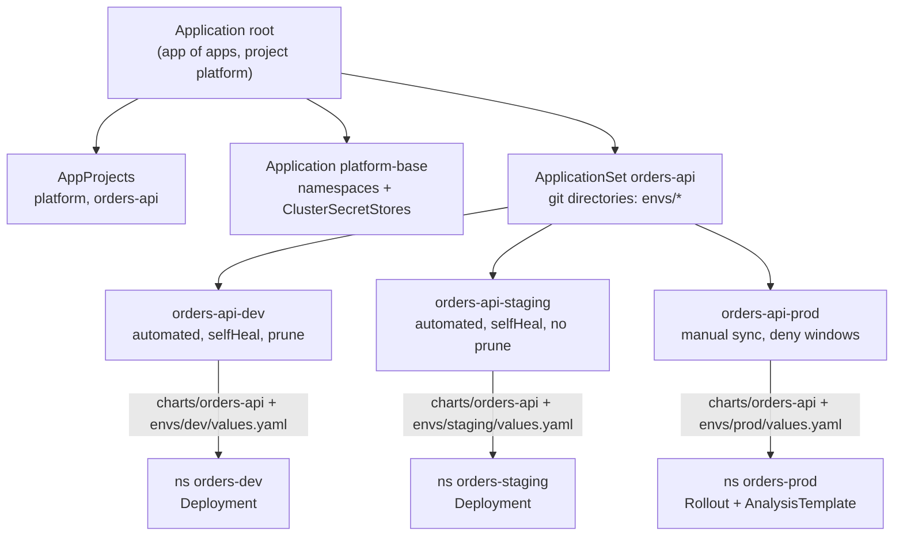
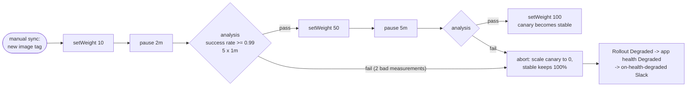
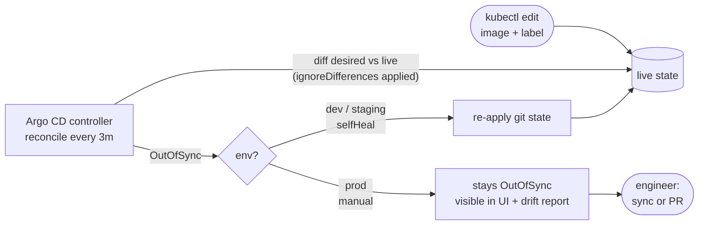

# Architecture

Pull-based GitOps for one service, `orders-api`, across dev, staging and prod.
Two repositories, Argo CD in the cluster, Helm for packaging, promotion by pull
request, and an Argo Rollouts canary in prod. In this portfolio both
repositories are folders of one project (`app-repo/`, `config-repo/`); in real
use they are separate repositories with separate permissions.

## 1. Two-repo flow

The app repository builds an image and proposes a change; the config
repository is the desired state; Argo CD is the only thing that writes to the
cluster.



CI has push access to the registry and can open PRs on the config repository
through a GitHub App limited to that one repository. It has no kubeconfig, no
cloud deploy role and no network path to the API server (docs/security.md).

## 2. Promotion PR flow

`scripts/promote.py` copies the tag one step along the chain and refuses
anything else unless `--force-hotfix --reason` is given, which is then written
into the commit trailers.



Only the `tag:` line under `image:` changes. The rest of the values file
(comments, ordering, quoting) stays byte for byte, so the PR diff is a single
line and reviewers can trust it.

## 3. ApplicationSet fan-out

A git directory generator over `envs/*` creates one Application per
directory. The template is shared; `templatePatch` sets the sync policy per
environment. A directory the patch doesn't name (a new `envs/qa`) gets the
template default: manual sync, no prune.



The `orders-api` AppProject allows one source repository, the three
namespaces, and no cluster-scoped kinds at all (`clusterResourceWhitelist: []`).
Namespaces and ClusterSecretStores belong to the `platform` project, so the
application team can't create them, and `CreateNamespace=true` isn't needed.
`scripts/check_gitops_policy.py` expands the ApplicationSet the same way
Argo CD does and checks the result.

## 4. Canary with analysis (prod)

`rollout.enabled: true` (prod only) swaps the Deployment for an Argo Rollouts
`Rollout`. Without a traffic router, weights are approximated by the ratio of
canary to stable pods. Each analysis step runs the `orders-api-success-rate`
AnalysisTemplate: the availability SLI from
[projects/observability-sre-platform](../../observability-sre-platform/README.md)
(good = non-5xx requests, total = all requests), restricted to the canary pods
by their `rollouts-pod-template-hash`, which the ServiceMonitor copies onto
every series.



```promql
sum(rate(http_requests_total{job="orders-api",namespace="orders-prod",
    rollouts_pod_template_hash="{{args.canary-hash}}",code!~"5.."}[2m]))
/
sum(rate(http_requests_total{job="orders-api",namespace="orders-prod",
    rollouts_pod_template_hash="{{args.canary-hash}}"}[2m]))
```

No data is a failed measurement (`len(result) > 0 && ...`), so a canary that
gets no traffic does not pass by default.

## 5. Drift and self-heal



`ignoreDifferences` on `/spec/replicas` for Deployments and Rollouts, with
`RespectIgnoreDifferences=true`, keeps the HPA's replica count from showing up
as drift or being reset by a sync. The chart also leaves `spec.replicas` out
when the HPA is on. `scripts/drift_report.py` reproduces the comparison
offline, on a `kubectl get -o json` export, for audits and for prod where
nothing heals automatically.

## Components and versions

| Component | Version referenced | Where |
|---|---|---|
| Argo CD | chart `argo/argo-cd` 10.10.3 (app v3.5.5) | `config-repo/bootstrap/argo-cd-values.yaml`, docs/operations.md |
| Argo Rollouts | chart `argo/argo-rollouts` 2.43.7 (app v1.10.1) | docs/operations.md |
| External Secrets Operator | chart `external-secrets` 2.12.0, API `external-secrets.io/v1` | `platform/`, chart `externalsecret.yaml` |
| Prometheus Operator | `monitoring.coreos.com/v1` ServiceMonitor | chart `servicemonitor.yaml` |
| Kubernetes schemas | 1.34.0 | kubeconform |

The versions are pinned in the docs and the bootstrap values; nothing here was
installed into a cluster (see Limitations in the README).
