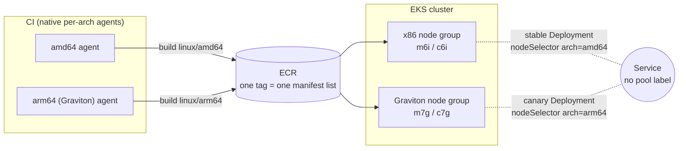

# AWS Graviton ARM64 Migration: One Multi-Arch Tag, Scheduling-Based Rollback

> **Classification: Reference implementation — synthetic services, never deployed, no production results claimed.**
> Owner: Muhammad Salahuddin, Senior DevOps Engineer. The Terraform is validated and has
> never been applied. The Helm chart is linted and schema-checked, never installed. The
> compatibility linter and its test suite run locally and are tested. Costs are illustrative.

A staged migration from x86 (amd64) to AWS Graviton (arm64) for containerized
services on EKS. Every image is built once as a **multi-arch manifest list**
(`docker buildx build --platform linux/amd64,linux/arm64 --push`), published
under one ECR tag. Moving a service between architectures is then a
**Kubernetes scheduling decision** — `nodeSelector`/`affinity` on
`kubernetes.io/arch` — not an image change, so rollback is one `helm upgrade
--set` away, never a rebuild.

## Problem

- **"It builds" isn't "it's compatible."** A service with native dependencies
  can build cleanly under QEMU emulation and still misbehave only once it
  actually runs on real arm64 hardware — the failure shows up in production,
  not in CI.
- **Base images aren't always multi-arch, and when they are, the two
  platforms can drift.** Pinning by tag doesn't protect against that; the
  tag can move under either platform independently.
- **A registry tag per architecture turns rollback into a rebuild.** If
  `service:1.4.0-amd64` and `service:1.4.0-arm64` are separate artifacts,
  going back to x86 means trusting that the old amd64 tag is still exactly
  what was running before, or rebuilding it.
- **All-or-nothing cutovers hide the one bad service.** Moving every
  workload to Graviton in one change makes it hard to isolate which service
  (if any) actually has an architecture-specific problem.

## Solution

Build every image as a multi-arch manifest list first (`ci/Jenkinsfile`:
native agents per architecture, merged with `docker buildx imagetools
create`), so the registry side of the migration is a one-time setup per
service, done before any workload moves. Then move workloads one at a time
by node affinity (`helm/multiarch-app`): a stable pool on one architecture,
an optional small canary pool on the other, sharing one Kubernetes Service.
Because the image tag never changes, rollback is removing the arm64
affinity — a scheduling change, not a rebuild. A per-service compatibility
manifest (`docs/compatibility-manifest.yaml`), enforced by
`scripts/compatibility_check.py`, gates which services are even allowed to
reach the canary stage.

## Architecture



Full diagrams (including the rollback sequence) are in
[docs/architecture.md](docs/architecture.md).

## Layout

```text
terraform/  modules/eks-arch-node-group (architecture-parameterized managed node group),
            modules/ecr-multiarch (immutable, scanned repo), examples/mixed-fleet
helm/       multiarch-app chart: stable + optional canary Deployment, one shared Service,
            PDB, values.schema.json
ci/         Jenkinsfile: native per-arch build agents merged into one manifest list
scripts/    compatibility_check.py (the compatibility manifest linter), yaml_lite.py
docs/       architecture, operations, security, cost, compatibility-checklist,
            compatibility-manifest.yaml (the live checklist data), decisions/ (ADRs 0001-0002)
tests/      unittest suites, fixtures/compatibility/{good,bad}.yaml
```

## What it demonstrates

| Area | Implementation |
|---|---|
| Terraform | `modules/eks-arch-node-group`: one managed node group per call, `architecture` (`amd64`/`arm64`) drives `ami_type` (AL2023 x86_64/ARM_64) and the default instance family (m6i/c6i vs m7g/c7g), optional taint while under test, node IAM role created or supplied, `desired_size` left for a runbook/autoscaler to own. `modules/ecr-multiarch`: immutable tags, scan-on-push (optional enhanced/continuous scanning), untagged-image lifecycle policy. `examples/mixed-fleet` wires an x86 pool and a Graviton pool to one existing cluster via `for_each` over a `node_pools` map — the architecture toggle is that map |
| Compatibility gate | `scripts/compatibility_check.py`: 8 rules (GC001-GC008) over `docs/compatibility-manifest.yaml` — both platforms present, base image pinned by digest per platform, a scan recorded per platform, promotion past `canary` blocked without a passing scan on both, a "pass" status with findings rejected, QEMU flagged (error when native modules are involved), runtime-version drift without a documented reason |
| Helm chart | `multiarch-app`: a stable Deployment and an optional small canary Deployment, same Service (no `pool` label on its selector, so it balances across both — a replica-count canary, not a weighted split), `nodeSelector`/preferred-or-required `affinity` on `kubernetes.io/arch`, PodDisruptionBudget covering both pools, non-root/read-only-rootfs/drop-ALL hardening, a values schema rejecting `latest` and unknown architectures |
| Build pipeline | `ci/Jenkinsfile`: native amd64 and arm64 (Graviton) agents build their platform in parallel, merged into one manifest-list tag with `docker buildx imagetools create` — the per-arch tags are build-time intermediates, never referenced by a Deployment |
| CI | `.github/workflows/graviton-arm64-migration.yml`: unittest on 3.12, the compatibility gate, helm lint + kubeconform (stable and canary-enabled), terraform fmt + validate across all three directories, workflow lint. SHA-pinned actions, `contents: read`, `persist-credentials: false` |

## Quickstart

Python 3.12 (the CI version; also runs on newer 3.x), nothing to install. From this directory:

```bash
python3 -m unittest discover -s tests -v                                   # all tests (chart tests need helm)
python3 scripts/compatibility_check.py --fail-on warning                   # lint the live manifest
helm template multiarch-app helm/multiarch-app -n web --set canary.enabled=true
```

## Sample output

All excerpts below are real output from this machine, run on 2026-10-19.

The compatibility linter against the live manifest (clean — every listed
service has both platforms pinned by digest and a recorded scan):

```text
$ python3 scripts/compatibility_check.py docs/compatibility-manifest.yaml --fail-on warning
compatibility_check: 0 error(s), 0 warning(s)
(exit 0)
```

The same linter against the deliberately broken fixture, hitting all 8
rules across two services:

```text
$ python3 scripts/compatibility_check.py tests/fixtures/compatibility/bad.yaml --fail-on warning
tests/fixtures/compatibility/bad.yaml GC001 ERROR [legacy-batch] missing platform 'linux/arm64'
tests/fixtures/compatibility/bad.yaml GC002 ERROR [legacy-batch] linux/amd64: base_image 'ubuntu:22.04' is not pinned by digest (@sha256:<64 hex>)
tests/fixtures/compatibility/bad.yaml GC003 ERROR [legacy-batch] linux/amd64: image_scan.status 'unknown' must be one of ('pass', 'fail', 'pending')
tests/fixtures/compatibility/bad.yaml GC005 ERROR [image-resizer] linux/amd64: image_scan.status is 'pass' but critical=1 high=2
tests/fixtures/compatibility/bad.yaml GC006 WARNING [image-resizer] linux/arm64: build_method is 'qemu'; native agents are the default policy
tests/fixtures/compatibility/bad.yaml GC007 ERROR [image-resizer] linux/arm64: build_method is 'qemu' with native_modules ['pillow']; build these natively, emulation hides arch-specific failures
tests/fixtures/compatibility/bad.yaml GC004 ERROR [image-resizer] rollout.stage is 'canary' but linux/arm64 image_scan.status is 'fail', not 'pass'
tests/fixtures/compatibility/bad.yaml GC008 WARNING [image-resizer] runtime_version differs across platforms ({'linux/amd64': '3.11.6', 'linux/arm64': '3.12.1'}) with no runtime_version_note explaining why

compatibility_check: 6 error(s), 2 warning(s)
(exit 1)
```

Helm lint and kubeconform, both with the canary pool off (default) and on:

```text
$ helm lint helm/multiarch-app
==> Linting helm/multiarch-app
[INFO] Chart.yaml: icon is recommended

1 chart(s) linted, 0 chart(s) failed
$ helm template multiarch-app helm/multiarch-app --namespace web | kubeconform -strict -summary -kubernetes-version 1.34.0
Summary: 4 resources found parsing stdin - Valid: 4, Invalid: 0, Errors: 0, Skipped: 0
$ helm template multiarch-app helm/multiarch-app --namespace web --set canary.enabled=true | kubeconform -strict -summary -kubernetes-version 1.34.0
Summary: 5 resources found parsing stdin - Valid: 5, Invalid: 0, Errors: 0, Skipped: 0
```

## Tests

```bash
python3 -m unittest discover -s tests -v
# Ran 45 tests ... OK
```

They cover:

- **the compatibility linter**: every one of the 8 rules firing on the bad
  fixture with the exact expected message, the good fixture and the live
  `docs/compatibility-manifest.yaml` both clean at `--fail-on warning`, a
  `runtime_version_note` suppressing the drift warning, warning-only
  findings passing at `--fail-on error`, and the CLI's exit codes (0/1/2);
- **the rendered chart** (skipped without helm): the stable Deployment's
  `nodeSelector`/`affinity` on the configured architecture, the canary
  Deployment appearing only when enabled and targeting its own architecture,
  the Service's selector carrying no `pool` label (so it spans both
  Deployments), the PodDisruptionBudget covering both pools, hardening
  (non-root, read-only rootfs, dropped capabilities, no `:latest`), the
  image tag staying identical between an amd64 render and an arm64 render
  (the whole point — only scheduling changes), required vs. preferred
  affinity, and the schema rejecting `latest`, an unknown architecture and
  zero replicas;
- **Terraform invariants**: version pins and lock files, no credentials or
  real account IDs, the architecture variable driving `ami_type` and
  instance family, the node label coming from the architecture variable
  (never guessed), the optional taint defaulting to none, the node role
  created only when not supplied, `desired_size` left for a runbook to own,
  the ECR repository's immutability/scan-on-push defaults, the lifecycle
  policy being optional and untagged-only, every variable documented and
  the key ones validated, and the example wiring both pools plus the shared
  repository;
- **docs**: the classification line, the compatibility-linter samples above
  re-run and compared byte-for-byte, required docs present, no
  unfinished-work markers, no empty files, only the placeholder account ID
  anywhere in the project.

## Terraform validation

Validation only. Never planned or applied:

```bash
export TF_PLUGIN_CACHE_DIR=~/.terraform.d/plugin-cache
cd terraform
terraform fmt -check -recursive
for d in modules/eks-arch-node-group modules/ecr-multiarch examples/mixed-fleet; do
  terraform -chdir=$d init -backend=false && terraform -chdir=$d validate
done
# Success! The configuration is valid.   (all three)
```

Validated with Terraform 1.14.8 and `hashicorp/aws` 6.68.0. Lock files are
committed for all three directories.

## Security

- **Image scanning runs per architecture.** `ecr-multiarch` scans on push by
  default; `compatibility_check.py` (GC003-GC005) requires a recorded,
  consistent scan result per platform and blocks promotion past `canary`
  without a passing scan on both. See [docs/security.md](docs/security.md).
- **Base images are pinned by digest, per platform**, not by tag — rule
  GC002. A manifest-list tag's two platform manifests can trail each other
  by a patch release; pinning by digest makes "what's actually running"
  answerable without trusting a mutable tag.
- **ECR tags are immutable** (`image_tag_mutability = "IMMUTABLE"`), which is
  what makes the scheduling rollback trustworthy: the tag a rolled-back
  Deployment points at can't have silently changed shape.
- **Pods are hardened identically regardless of pool**: non-root, read-only
  root filesystem, all capabilities dropped, no privilege escalation, the
  default seccomp profile, no mounted service-account token. Architecture
  never changes a pod's trust boundary.

## Reliability

- **Rollback is reverting the scheduling constraint.** `helm upgrade --set
  canary.enabled=false` or `--set architecture=amd64` — no rebuild, no
  re-push, same image tag throughout (verified by
  `test_architecture_flip_changes_only_scheduling`).
- **Both architectures keep capacity until a service's rollout reaches
  `complete`.** The capacity-side rollback (shrinking the Graviton node
  group) is deliberately a separate, slower lever from the scheduling-side
  one — see [docs/decisions/0002](docs/decisions/0002-scheduling-rollback-over-per-arch-tags.md).
- **PodDisruptionBudgets keep the service available while pods move pools.**
  The chart's PDB selector matches both the stable and canary Deployments'
  shared labels, not either pool alone, so draining a node in either pool
  during the migration can't take minAvailable pods below the floor.
- **`desired_size` is deliberately ignored by Terraform** on every node
  group, so a runbook or Cluster Autoscaler can resize a pool during the
  migration without the next `terraform apply` fighting it.

## Cost

Illustrative — see [docs/cost.md](docs/cost.md) for the full breakdown and
caveats. The headline: Graviton3 instances list at roughly 15% below the
matching Intel/AMD instance size, before any per-workload throughput
difference; AWS's wider "up to ~40%" figure depends on the workload and
isn't assumed here. During an active migration both pools exist
simultaneously, so cost is additive until the old pool is actually scaled
down at the `complete` rollout stage — a migration that never finishes that
step keeps paying for both.

## Results

**Illustrative, not measured.** No service in this repository has actually
run on Graviton hardware; there is no before/after benchmark to report. The
cost table in [docs/cost.md](docs/cost.md) uses published list prices, not a
load test. What's real here is the mechanism (multi-arch build, scheduling-
based migration, the compatibility gate) and its test coverage, not a
production outcome.

## Limitations

- **Never deployed.** No cluster, node group, pod or ECR push has run.
  `validate`, `lint`, `kubeconform` and the tests check the schemas and
  local behavior, not AWS or a real Kubernetes API server.
- **The canary is a replica-count split, not a weighted one.** Without a
  service mesh, the share of traffic the canary pool sees is approximately
  `canary.replicaCount / (canary.replicaCount + replicaCount)`, not a
  configured percentage. Good enough to validate a pool under real traffic;
  not a precise traffic-shaping tool.
- **`compatibility_check.py` is a manifest linter, not a live scanner.** It
  checks that a scan result and a digest are *recorded*, not that the
  recorded digest or scan result is current. Keeping the manifest in sync
  with reality (CI writing it automatically after each push, rather than by
  hand) is the natural next step and isn't built here.
- **The Jenkinsfile is illustrative.** It's never been run against a real
  Jenkins controller or Graviton agent pool; it documents the agent-label
  pattern, not a tested pipeline.
- **No service mesh / Istio / Linkerd integration**, which would turn the
  replica-count canary into a precise weighted one and allow shadow traffic
  before any real request hits the Graviton pool.

## Interview talking points

- **Decouple the registry decision from the scheduling decision.** Building
  multi-arch once, up front, means every later step — canary, partial
  rollout, rollback — is a Kubernetes change, never a CI rebuild. That's the
  single idea this whole project is built around.
- **A migration needs a cheap "undo," or nobody will attempt stage 2.**
  Making rollback one `--set` flag instead of a rebuild changes the risk
  calculus for every subsequent service: the cost of trying is a few
  minutes, not a release cycle.
- **Emulation hides exactly the failures you're migrating to find.** QEMU
  lets a native-module build "succeed" while producing something that only
  breaks on real silicon. The compatibility gate makes that an error, not a
  judgment call left to whoever's running the migration that week
  ([ADR 0001](docs/decisions/0001-native-arm64-build-agents.md)).
- **Pin by digest, per platform, not by tag.** A manifest-list tag is a
  moving target across two platforms that can drift independently; a
  digest per platform is the one thing that can't.
- **Decouple infrastructure rollback from scheduling rollback.** Scaling
  down the x86 node group and removing the arm64 node affinity are two
  different levers with two different blast radii and two different speeds
  — conflating them is how a migration either can't roll back fast enough,
  or can't actually save money because the old capacity never goes away.
