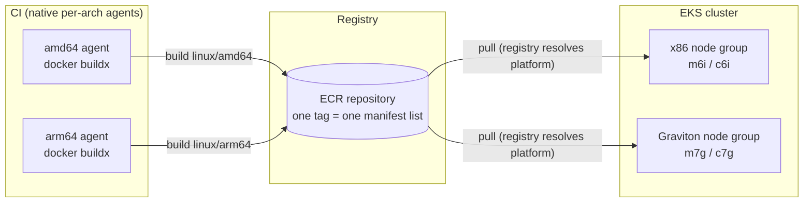
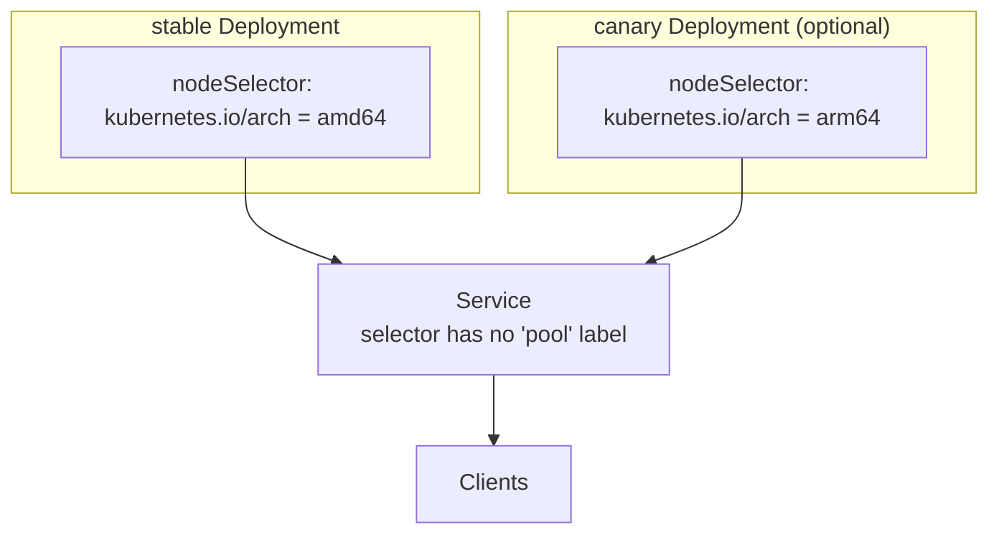
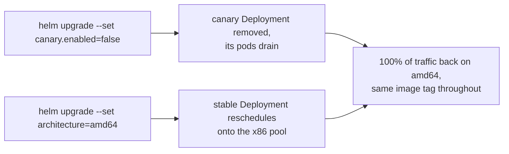

# Architecture

## The shape of the migration

One `docker buildx build --platform linux/amd64,linux/arm64 --push` writes a
single tag. The registry stores it as an OCI manifest list: two platform
manifests under one index. Every puller — x86 node, Graviton node, a laptop —
asks for the same tag and gets the layer that matches its own platform. There
is never an "arm64 tag" and an "amd64 tag" to keep in sync; the multi-arch
build step (CI) and the scheduling step (Kubernetes) are completely separate,
which is what makes rollback cheap (see below).

## Where architecture is decided

Architecture is decided in exactly one place: the Deployment's
`nodeSelector`/`affinity` on `kubernetes.io/arch`
(`helm/multiarch-app/templates/deployment.yaml`). EKS sets that label on every
node from the AMI family, not from anything Terraform writes, so it can never
drift from what the instance actually is.

The Service's selector only matches labels both Deployments share
(`app.kubernetes.io/name`, `app.kubernetes.io/instance`) — it never mentions
`pool`. So when the canary Deployment exists, its pods join the same
endpoint list as the stable pods, and it gets a share of traffic roughly
proportional to its replica count. There's no service mesh here, so this is
a **replica-count canary**, not a weighted traffic split; see
[operations.md](operations.md) for the rollout sequence this is used in and
its limits.

## Rollback

Both rollback paths are `helm upgrade --set ...`. Neither touches the image
tag, rebuilds anything, or calls ECR: the manifest list already has the
amd64 layer, because it was built in the same `buildx` invocation as the
arm64 layer. The infrastructure-side equivalent — shrinking or deleting the
Graviton node group in `terraform/examples/mixed-fleet` — is independent and
slower (it changes capacity, not where pods are scheduled right now), so the
scheduling rollback is always the first lever.

## Node pools

`terraform/modules/eks-arch-node-group` creates one managed node group per
call. `architecture` is the only variable that changes AMI family
(`AL2023_x86_64_STANDARD` vs `AL2023_ARM_64_STANDARD`) and the default
instance family (m6i/c6i vs m7g/c7g — see [cost.md](cost.md) for why those
two families). `terraform/examples/mixed-fleet` calls it twice, once per
architecture, against one existing cluster, alongside
`terraform/modules/ecr-multiarch` for the shared repository. A pool can be
created, join the cluster, and pass compatibility testing (see
[compatibility-checklist.md](compatibility-checklist.md)) before a single pod
is scheduled onto it — the Terraform side and the Helm side are deliberately
decoupled.

## Compatibility testing

See [compatibility-checklist.md](compatibility-checklist.md) for the
per-service checklist and `scripts/compatibility_check.py` for the linter
that enforces it against `docs/compatibility-manifest.yaml`: both platforms
present, base images pinned by digest, a scan recorded per architecture
(not just per tag), native build agents preferred over QEMU for services
with native modules, and a promoted rollout stage requires a passing scan on
both platforms.
