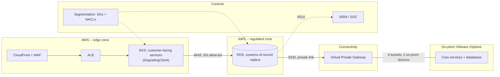

# Hybrid Cloud Fintech Architecture

> **Classification: Synthetic reference implementation. Never deployed.**
> Owner: Muhammad Salahuddin, Senior DevOps Engineer. The website's project
> page describes this pattern as "production" with names, topology and
> figures withheld for confidentiality; this repository is **not** a copy of
> that system. It is a portfolio-grade reference build of the same pattern
> -- a hybrid payments platform spanning AWS and on-premises VMware -- with
> every name, IP, account ID and figure synthetic, nothing applied against
> a real account, and no VMware/vSphere environment targeted (none exists
> on this machine or in this repository's validation path). Terraform is
> validated only (`fmt` + `init -backend=false` + `validate`); Ansible is
> checked with `ansible-lint` / `--syntax-check` against a synthetic
> inventory, never run against a real host.

Regulated payments platforms routinely keep some systems on-prem (latency,
regulatory, or legacy-system constraints) while customer-facing services
need cloud elasticity. The riskiest part of that design isn't either side
-- it's the boundary between them. This project builds that boundary:
**redundant private connectivity** (Terraform), **segmentation that
enforces a PCI-DSS-style scope boundary by default** (Terraform, with
plan-time preconditions, not just code review), a **graceful-degradation
pattern** so customer-facing AWS services keep accepting requests when the
link is impaired (a tested Python library, not a diagram), and an
**Ansible baseline** that proves the same patching/hardening/log-shipping
policy applies to both estates. It intentionally does not re-build the EKS
cluster or RDS Terraform this repository already has elsewhere -- see
`../aws-multi-region-eks-dr` and `../aws-landing-zone` for that.

## Problem

- Regulatory and latency constraints keep some systems on-prem, while
  customer-facing services need cloud elasticity -- a single-cloud design
  doesn't fit.
- The hybrid link is the highest-risk, most-often-neglected part of this
  shape: it's usually "just a VPN" with no redundancy plan, and the network
  boundary it creates is usually implicit (a route table) rather than an
  enforced security boundary.
- "The backup job runs" is not evidence that a restore works, and "the
  tunnel is configured" is not evidence that a service degrades gracefully
  when it isn't.

## Solution

Treat the hybrid link as a security boundary, not just a network path:

1. **Connectivity is redundant by construction.** Two independent on-prem
   devices, each its own Customer Gateway and VPN Connection -- 4 IPsec
   tunnels total, so no single device, ISP uplink, or AWS-side AZ failure
   takes down the link. A `validation` block refuses a configuration with
   fewer than 2 on-prem gateways.
2. **Segmentation is deny-by-default, not reviewed-by-convention.** The
   regulated zone's security group has a `lifecycle.precondition` that
   fails `terraform plan` outright if `0.0.0.0/0` ever appears in its
   ingress or egress list -- the rule that matters is enforced where
   Terraform can check it, not just in a PR review comment.
3. **Services degrade instead of failing.** `src/degrade/DegradingClient`
   wraps on-prem-dependent calls; a connectivity failure or timeout queues
   the work to a local outbox and returns a result the caller turns into
   `202 Accepted`, instead of a `5xx`. `replay_pending` drains the outbox
   once the link recovers.
4. **Configuration is one policy, not two.** `ansible/roles/baseline`
   applies the identical patch cadence, SSH hardening, and SIEM log
   shipping to both an `aws_hosts` group and an `onprem_hosts` group;
   `group_vars/all.yml` holds the shared policy once, and only
   package-manager and interface-naming differences live per group.
5. **DR is a tested procedure, not a cron job.** `docs/operations.md`'s
   runbook includes a restore-test procedure and a results table --
   synthetic, but in the evidence shape this repo's other DR project
   (`../aws-backup-cross-region-dr`) uses: dates, measured RPO/RTO, and one
   row that actually failed and was followed up.

## What it demonstrates

| Area | Implementation |
|---|---|
| Redundant private connectivity | `terraform/modules/connectivity`: 1 Virtual Private Gateway, 2 Customer Gateways (one per on-prem device), 2 VPN Connections (4 tunnels), route propagation scoped to the regulated route table only |
| PCI-DSS-style segmentation | `terraform/modules/segmentation`: one module, parameterized by `zone` ("edge" / "regulated"), explicit `allowed_ingress`/`allowed_egress` allow-lists, no default-allow-egress, a hardened network ACL with an explicit deny-all floor rule, and `0.0.0.0/0` blocked in the regulated zone by a plan-time precondition |
| Graceful degradation | `src/degrade/`: `DegradingClient.call_or_queue` (queue on `OnPremUnavailableError`/`TimeoutError`, propagate everything else), `FileOutbox`/`InMemoryOutbox`, `replay_pending` with a retry budget and `failed` terminal state |
| Consistent configuration, cloud and on-prem | `ansible/roles/baseline`: patch cadence (`unattended-upgrades` / `dnf-automatic`), SSH hardening, access banner, sysctl, SIEM log shipping -- applied to both `aws_hosts` and `onprem_hosts` from one role and one shared `group_vars/all.yml` |
| Tested DR | `docs/operations.md`: restore-test procedure (isolate, restore, validate data, validate network isolation, record, tear down) plus a synthetic results table with one failure and its follow-up |
| Infrastructure as code | Two modules + one reference root, `aws >= 6.0, < 7.0`, variable `validation` blocks and resource `lifecycle.precondition`s doing real enforcement, no credentials or real account IDs anywhere |

## Architecture



Full diagrams (including the degrade-path sequence diagram) and the
segmentation rule table are in [docs/architecture.md](docs/architecture.md).

## Layout

```text
terraform/    modules/connectivity, modules/segmentation, examples/reference
src/degrade/  DegradingClient, outbox (in-memory + file), replay
scripts/      local_demo.py (deterministic end-to-end run)
ansible/      roles/baseline, inventory (synthetic), group_vars, site.yml
tests/        unittest suites (Terraform static checks, Ansible static checks, degrade-pattern unit tests)
docs/         architecture, operations (DR runbook), security, cost, decisions/
```

## Quickstart

```bash
# Python (stdlib unittest, no dependencies)
python3 -m unittest discover -s tests -v

# The graceful-degradation pattern, end to end
python3 scripts/local_demo.py

# Terraform (needs TF_PLUGIN_CACHE_DIR set; see repo CLAUDE.md)
export TF_PLUGIN_CACHE_DIR=~/.terraform.d/plugin-cache
terraform fmt -check -recursive terraform
terraform -chdir=terraform/examples/reference init -backend=false && terraform -chdir=terraform/examples/reference validate
terraform -chdir=terraform/modules/connectivity init -backend=false && terraform -chdir=terraform/modules/connectivity validate
terraform -chdir=terraform/modules/segmentation init -backend=false && terraform -chdir=terraform/modules/segmentation validate

# Ansible (ansible-core wasn't preinstalled on the build machine; a scratch
# venv with `pip install ansible-core ansible-lint` provided both tools --
# see "Sample output" below for exactly what ran)
cd ansible
ansible-lint site.yml
ansible-playbook --syntax-check site.yml
```

## Sample output

All output below is real, captured from this machine on 2026-10-20.

### Unit tests

```text
$ python3 -m unittest discover -s tests -v
...
----------------------------------------------------------------------
Ran 40 tests in 0.007s

OK
```

40 tests: 17 on the graceful-degradation pattern (`test_outbox.py`,
`test_client.py`, `test_replay.py`), 15 static checks on the Terraform text
(`test_terraform_static.py` -- redundancy, deny-by-default, the
module-cycle regression guard), and 8 static checks on the Ansible layer
(`test_ansible_static.py` -- both estates get the baseline role, shared
policy isn't duplicated per group).

### Graceful degradation, end to end

```text
$ python3 scripts/local_demo.py
=== Requests arriving while the on-prem link is healthy, then drops, then recovers ===
account=acct-0001  HTTP 200 OK            ledger_entry_id=LE-0001
--- on-prem link goes down ---
account=acct-0002  HTTP 202 Accepted (queued) outbox_id=obx-0001
account=acct-0003  HTTP 202 Accepted (queued) outbox_id=obx-0002
--- on-prem link recovers ---
account=acct-0004  HTTP 200 OK            ledger_entry_id=LE-0004
account=acct-0005  HTTP 200 OK            ledger_entry_id=LE-0005

=== Degrade events emitted to the log/metric hook ===
DEGRADED operation=post_ledger_entry account=acct-0002 reason=VPN tunnel flapping: no ACK from onprem-dc1-fw within 2000ms
DEGRADED operation=post_ledger_entry account=acct-0003 reason=VPN tunnel flapping: no ACK from onprem-dc1-fw within 2000ms

=== Outbox state before replay: 2 pending ===
obx-0001 operation=post_ledger_entry account=acct-0002 attempts=0
obx-0002 operation=post_ledger_entry account=acct-0003 attempts=0

=== Replay run (link is healthy again) ===
{
  "attempted": 2,
  "succeeded": [
    "obx-0001",
    "obx-0002"
  ],
  "still_pending": [],
  "permanently_failed": []
}

=== Outbox state after replay: 0 pending, all_drained=True ===
```

No request during the outage returned an error; both queued requests
replayed successfully once the link came back.

### Terraform validate

```text
$ terraform -chdir=terraform/examples/reference validate
Success! The configuration is valid.

$ terraform -chdir=terraform/modules/connectivity validate
Success! The configuration is valid.

$ terraform -chdir=terraform/modules/segmentation validate
Success! The configuration is valid.
```

### Ansible

```text
$ ansible-lint site.yml
Passed: 0 failure(s), 0 warning(s) in 4 files processed of 4 encountered.
Last profile that met the validation criteria was 'production'.

$ ansible-playbook --syntax-check site.yml
playbook: site.yml
```

(`ansible-core` 2.21.5 and `ansible-lint` 26.10.1, installed into a scratch
virtualenv for this validation run -- not a project dependency, and
`ansible-playbook` is never run against a real inventory from this repo.)

## Security

Threat model, the PCI-DSS scope-reduction argument for the segmentation
design, and least-privilege/secrets notes for the connectivity boundary's
own IAM surface: [docs/security.md](docs/security.md).

## Reliability

- **Connectivity**: 2 independent on-prem devices x 2 tunnels each. A
  single device or tunnel failure leaves 3 of 4 tunnels up; losing a whole
  connection (both its tunnels) still leaves the other connection's 2
  tunnels serving traffic.
- **Degradation, not failure**: proven by `tests/test_client.py`'s
  `test_service_keeps_accepting_requests_while_link_is_down` -- 10
  requests during a simulated outage, all 10 return a queued (not failed)
  result.
- **Replay has a bounded retry budget**: `max_attempts` moves a
  persistently-failing entry to `failed` rather than retrying forever; see
  `tests/test_replay.py::test_entry_moves_to_permanently_failed_after_max_attempts`.
- **DR is tested, not assumed**: see the restore-test table in
  [docs/operations.md](docs/operations.md), including one synthetic
  failure and its follow-up, matching this repo's
  `../aws-backup-cross-region-dr` evidence pattern.

## Cost

Illustrative, approximate, not a quote: [docs/cost.md](docs/cost.md). The
headline number is that the redundant VPN connectivity this design insists
on has a real fixed monthly cost (~$73/month in connection-hours alone,
before any data moves) -- redundancy here isn't free, and
[ADR 0001](docs/decisions/0001-redundant-site-to-site-vpn.md) documents why
VPN was chosen over Direct Connect for this reference anyway (no
colocation facility to cross-connect from).

## Results (illustrative)

These are synthetic, chosen to be representative of what this design is
*for*, not measurements from a real system:

- Zero customer-facing request failures during a simulated 3-request
  on-prem outage window (all queued, all replayed successfully) --
  `scripts/local_demo.py`'s captured run above.
- 3 of 4 synthetic restore tests passed on the first attempt; the one
  failure (a 3-row replication-lag drift) was caught by the data-integrity
  check, not by a customer or an auditor, and passed on retest the next
  day -- see [docs/operations.md](docs/operations.md).
- 15 Terraform static-invariant tests and a `terraform plan`-time
  precondition both independently encode "the regulated zone never allows
  `0.0.0.0/0`" -- a reviewer who misses it in code review still can't merge
  a change that violates it undetected.

## Limitations

- **No real VMware/vSphere Terraform.** There's no vSphere environment to
  target from this machine (or in any CI for this repo); the on-prem side
  is modeled as two documentation-safe IP addresses in
  `on_prem_gateways`, not provisioned. See docs/architecture.md.
- **No Direct Connect.** Site-to-Site VPN only; see
  [ADR 0001](docs/decisions/0001-redundant-site-to-site-vpn.md) for why,
  and docs/cost.md for where DX would start winning on cost.
- **`FileOutbox` is single-instance.** Correct for one customer-facing
  process; a real fleet needs a shared queue (SQS or similar), documented
  but not built here.
- **No live restore test.** The restore-test results table in
  docs/operations.md is synthetic, written in the same shape as a real
  evidence log, not a report from an exercise that happened.
- **Ansible was never run against a host.** `ansible-core`/`ansible-lint`
  weren't preinstalled on the build machine; they were installed into a
  scratch virtualenv purely to validate syntax and lint rules against the
  synthetic inventory, and `ansible-playbook site.yml` (without
  `--syntax-check`) has never been executed by this project.

## Lessons

- **A single-root Terraform example that wires two mutually-referencing
  modules together can create a module dependency cycle without either
  module being wrong on its own.** The first draft of
  `terraform/examples/reference` had the edge zone's egress rule reference
  `module.regulated_zone.security_group_id` while the regulated zone's
  ingress rule referenced `module.edge_zone.security_group_id` --
  `terraform validate` builds the full module graph even without applying,
  so it caught the cycle immediately. The fix (address the regulated
  subnet by CIDR instead of security-group id on the edge side) is now a
  regression test
  (`test_terraform_static.py::ReferenceRootTests::test_no_module_references_the_others_sg_id_both_ways`)
  specifically so a future edit doesn't reintroduce it.
- **A `lifecycle.precondition` is a stronger guarantee than a code-review
  convention, cheaply.** "Never allow 0.0.0.0/0 in the regulated zone" is
  the kind of rule that's easy to state and easy to accidentally violate in
  a later PR. Writing it as a precondition block means `terraform plan`
  itself refuses the change, independent of whether a reviewer catches it.
- **Ansible's default `ignore_errors: true` trips `ansible-lint`'s
  production profile** (`ignore-errors` rule); `failed_when: false` says
  the same intent ("don't fail the play if this specific service isn't
  installed yet") in a form the lint profile accepts, and is more precise
  besides -- `ignore_errors` swallows every kind of failure, `failed_when`
  only the one being described.
