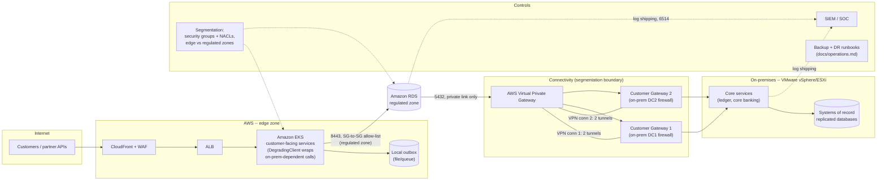
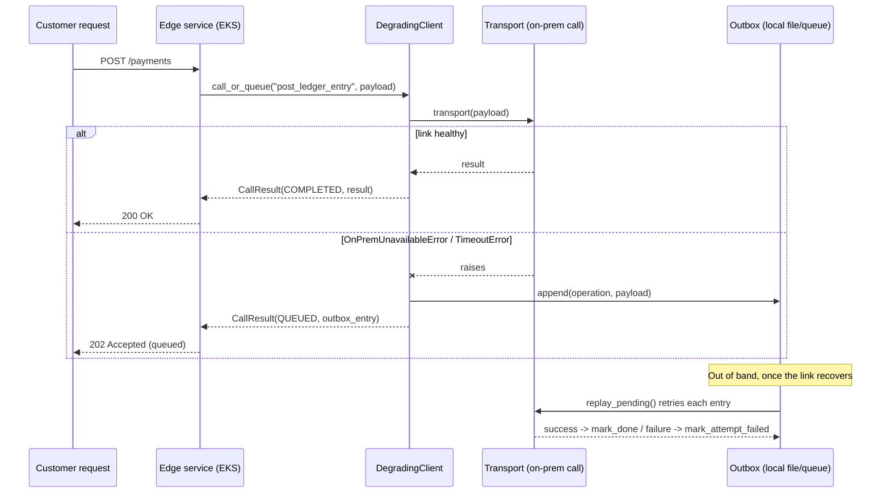

# Architecture

> Synthetic reference architecture. No real account, VMware environment, or
> client was involved; this documents the design this repository validates,
> not a system that has run in anyone's production.

## Tiers

Terraform in this repository builds the AWS side of this picture:
`terraform/modules/connectivity` (the VPN/CGW/VGW layer) and
`terraform/modules/segmentation` (the edge/regulated security groups and
NACLs), wired together in `terraform/examples/reference`. There is no
VMware/vSphere provider configuration here -- nothing on this machine or in
this repository's validation account connects to a real on-prem
environment, so the on-prem side is documented, not provisioned. The AWS
EKS cluster and RDS instances themselves are intentionally **not**
duplicated here; see `../aws-multi-region-eks-dr` and `../aws-landing-zone`
for this repository's EKS and multi-account Terraform. This project's new
surface is the boundary between the two estates: connectivity,
segmentation, graceful degradation, and the operational practices
(Ansible baseline, DR runbook) that keep both sides consistent.

## Why a boundary-first design

Most hybrid designs treat on-prem as "just another network" and bolt
security on afterward. This one treats the link itself as the thing with
the most risk, and designs every other decision around it:

1. **Segmentation is the default, not an afterthought.** The `segmentation`
   module's security groups start from zero rules; every allowed flow is
   named, and the regulated zone has a plan-time precondition that refuses
   to let `0.0.0.0/0` appear in it.
2. **Redundancy is structural, not a single bigger pipe.** Two independent
   on-prem devices, each on its own customer gateway and VPN connection
   (4 tunnels total), so one device, one ISP uplink, or one AWS AZ failing
   does not take the link down.
3. **Services degrade, they don't fail, when the link is impaired.** See
   "Graceful degradation" below -- this is the one piece of this project
   that is runnable application code, not just infrastructure.
4. **Configuration is the same policy on both sides.** `ansible/` applies
   one baseline role (patch cadence, hardening, log shipping) to both an
   AWS-side host group and an on-prem-side host group; only what's
   genuinely different (package manager, interface naming) varies.

## Segmentation rule table

| From | To | Port | Why |
|---|---|---|---|
| Internet (`0.0.0.0/0`) | Edge zone | 443 | Customer-facing HTTPS via CloudFront/ALB. The only `0.0.0.0/0` ingress anywhere in this design, and it terminates in the edge zone only. |
| Edge zone | Regulated zone | 8443 | Internal API: edge services calling the regulated-zone services that front on-prem systems of record. |
| Edge zone | Internet (`0.0.0.0/0`) | 443 | Outbound HTTPS for third-party/card-network API calls and package pulls. |
| Regulated zone | On-prem CIDR (via connectivity module) | 5432 | Database replication to on-prem systems of record, over the private VPN link only. |
| Regulated zone | Controls zone (SIEM CIDR) | 6514 | Log shipping (`rsyslog`/agent, TLS). |
| *(everything else)* | *(everything else)* | * | **Deny** -- both the security group default (no rule = no match = deny) and the network ACL's explicit rule 32766. |

The regulated zone never has an ingress or egress rule naming
`0.0.0.0/0`; `tests/test_terraform_static.py` checks the Terraform text
says so, and the segmentation module's own `precondition` blocks make
`terraform plan` refuse a change that violates it (not just a code review
catch).

## Graceful degradation

`src/degrade/` is the reference implementation of "redundant tunnels, with
services queuing/degrading rather than failing, when the link is down":

Key properties, each backed by a unit test in `tests/test_client.py` /
`tests/test_replay.py`:

- The customer-facing call never raises on a connectivity failure; it
  returns a `CallResult` the caller can turn into a `202 Accepted`.
- Only `OnPremUnavailableError`/`TimeoutError` degrade. A business-rule
  rejection (`ValueError` in the tests) still propagates -- queuing an
  invalid request for silent retry would hide a bug, not fix an outage.
- Replay is a separate, explicit step (`replay_pending`), never triggered
  inline from the request path, so a customer-facing request never blocks
  on a second on-prem attempt.
- An entry that keeps failing on replay is capped at `max_attempts` and
  moved to `failed` (kept for audit, not retried forever).

See `scripts/local_demo.py` for an end-to-end run and the README's
"Sample output" for its captured output.

## Where this stops short of a production build

- **No real VMware/vSphere Terraform.** There's no vSphere environment to
  target from this machine; the on-prem side is modeled through the
  `on_prem_gateways` variable (two documentation-safe IPs standing in for
  two on-prem edge devices) and documented in this file, not provisioned.
- **No Direct Connect.** Site-to-Site VPN over the internet is what's
  modeled; a real deployment at this scale would very likely add a Direct
  Connect circuit for the primary path and keep VPN as the backup. See
  [ADR 0001](decisions/0001-redundant-site-to-site-vpn.md).
- **Single-instance outbox.** `FileOutbox` is correct for one
  customer-facing instance; a fleet needs a shared queue (SQS, or a
  table), not N local files. Documented, not built, here.
