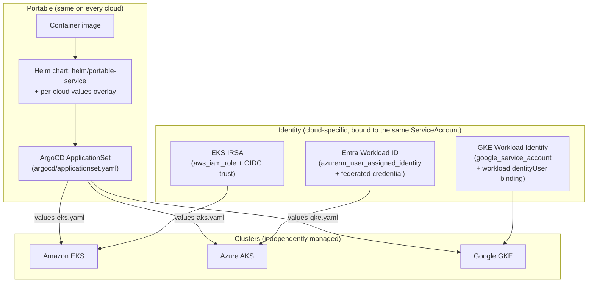

# Multi-Cloud Kubernetes Platform

> **Classification: Reference comparison — not a cross-cloud failover design.**
> One Helm chart deployed unmodified to EKS, AKS and GKE, with a documented,
> tested comparison of where the three platforms genuinely differ. Never
> applied against a real AWS, Azure or GCP account.

EKS, AKS and GKE compared through one deployment model: the same
Helm-packaged service, the same ArgoCD ApplicationSet, and the same
Kubernetes ServiceAccount name, deployed to all three managed Kubernetes
offerings — documenting, with runnable code rather than prose alone, where
they genuinely differ (identity, ingress, storage, pricing, upgrade cadence,
logging) and where they don't.

## Problem

Teams are regularly asked to be "cloud agnostic" without a clear view of
what that actually buys them. The instinct this project pushes back on is
building an abstraction layer — a custom operator, an identity broker — that
hides each cloud's native workload-identity mechanism behind one interface.
That abstraction is one more thing to operate, one more thing that fails in
an opaque, cloud-specific way at token-exchange time, and it doesn't remove
the underlying protocol difference; it just moves it somewhere less visible.

## Solution

Keep the workload portable where portability is genuinely cheap — one
container image, one Helm chart, one ArgoCD deployment model — and accept
that the platform layer underneath it (identity, ingress, storage, pricing)
is cloud-specific. Each cloud overlay sets that cloud's *real* ServiceAccount
annotation (`eks.amazonaws.com/role-arn`, `azure.workload.identity/client-id`,
`iam.gke.io/gcp-service-account`), never a synthetic unified key. The
portability claim here is narrower and more honest than "one manifest, no
cloud awareness": same chart, same ServiceAccount name, same deployment
model — not a unified identity API. See
[docs/decisions/0002-identity-bound-not-abstracted.md](docs/decisions/0002-identity-bound-not-abstracted.md).

## Architecture



Full tier breakdown, the portable-vs-not table, and why this project is a
module rather than three more full cluster stacks:
[docs/architecture.md](docs/architecture.md).

## Layout

```text
helm/        portable-service chart: one base values.yaml plus values-eks.yaml /
             values-aks.yaml / values-gke.yaml overlays
argocd/      one ApplicationSet (list generator, 3 clouds) + one AppProject
terraform/   modules/identity-bindings (IRSA / Entra Workload ID / GKE Workload
             Identity, bound to the same ServiceAccount name), examples/reference
scripts/     render_comparison.py (renders docs/comparison.yaml to Markdown)
docs/        architecture, security, cost, operations, comparison.yaml, decisions/
tests/       51 unittest tests across helm, terraform, argocd, comparison and docs
```

## What it demonstrates

| Area | Implementation |
|---|---|
| Portable workload | One Helm chart; image, replica count, resources, probes and PodDisruptionBudget are byte-identical across all three overlays — proven by `tests/test_helm_static.py`, not just claimed |
| Cloud-specific identity | `terraform/modules/identity-bindings`: one `aws_iam_role` (IRSA trust policy), one `azurerm_user_assigned_identity` + federated credential (Entra Workload ID), one `google_service_account` + `workloadIdentityUser` binding — all three bound to the exact same `namespace/ServiceAccount` subject |
| One deployment model | `argocd/applicationset.yaml`: a single `list` generator with one entry per cloud, each pointing at the same chart path with a different values file and destination — no per-cloud pipeline |
| Comparison, not prose | `docs/comparison.yaml` (5 dimensions × 3 clouds) + `scripts/render_comparison.py`, which raises if a cloud or dimension is ever missing a value — the comparison can't silently go stale |
| Explicitly not failover | No cross-cluster data replication, no cross-cloud traffic manager, no claim that a workload moves between clouds — stated in the architecture doc and enforced nowhere near as hard as the identity/portability claims, because it's a thing this project deliberately does *not* build |

## Quickstart

Terraform 1.x, Helm, kubeconform, Python 3.12+ (stdlib only). From this
directory:

```bash
python3 -m unittest discover -s tests -v                                     # all 51 tests
python3 scripts/render_comparison.py docs/comparison.yaml                    # render the comparison table
helm template portable-service helm/portable-service -f helm/portable-service/values-eks.yaml
```

## Sample output

Real output from this machine, run on 2026-10-20.

The three overlays differ **only** in the fields the "Solution" section
above describes — ingress class/annotations, the ServiceAccount's
workload-identity annotation, and the storage class:

```text
$ diff helm/portable-service/values-eks.yaml helm/portable-service/values-aks.yaml
...
<   className: alb
---
>   className: azure-application-gateway
...
<     eks.amazonaws.com/role-arn: "arn:aws:iam::111111111111:role/portable-service-irsa"
---
>     azure.workload.identity/client-id: "00000000-0000-0000-0000-000000000000"
...
<   className: gp3
---
>   className: managed-csi
```

`tests/test_helm_static.py::test_each_overlay_only_sets_cloud_specific_top_level_keys`
and `test_no_overlay_touches_image_replicas_resources_or_probes` assert this
holds for all three overlays, not just the diff above.

The comparison table, rendered from `docs/comparison.yaml`:

```text
$ python3 scripts/render_comparison.py docs/comparison.yaml
| Dimension | Amazon EKS | Azure AKS | Google GKE |
|---|---|---|---|
| Control plane pricing model | Flat hourly fee per cluster (~$0.10/hr), plus one Fargate/EC2 node fee per worker. | Free tier control plane by default; paid 'Standard'/'Premium' tiers add an SLA and longer support. | One free zonal cluster per billing account; Autopilot and additional/regional clusters bill a flat per-hour management fee. |
| Upgrade cadence / support window | ~4 minor versions supported at a time; ~14 months standard support, paid extended support beyond that. | ~2 latest GA minor versions supported ('N-2'); platform can auto-upgrade on a maintenance window. | Multiple release channels (Rapid/Regular/Stable) with Google-managed auto-upgrade; the channel chosen sets the support window. |
| Networking mode / CNI | VPC CNI by default: pods get real VPC IPs from the subnet's address space (IP-address-hungry at scale). | Azure CNI Overlay by default: pods get overlay IPs independent of the VNet's address space; classic Azure CNI (VNet IPs) remains available. | VPC-native (alias IP ranges) by default: pods get IPs from a dedicated secondary range, not the primary VPC range. |
| Ingress controller convention | AWS Load Balancer Controller provisions an ALB per Ingress (ingressClassName: alb); IRSA grants it ELB/EC2 permissions. | Application Gateway Ingress Controller (AGIC) or the built-in App Routing add-on (ingressClassName: azure-application-gateway or webapprouting.kubernetes.azure.com). | GKE Ingress-for-Anthos/the GCE controller provisions an external HTTP(S) load balancer (ingressClassName: gce). |
| Logging / monitoring integration | Control-plane log types opted into CloudWatch Logs individually; node/pod logs need Fluent Bit (or the CloudWatch agent) shipped explicitly. | Container insights (Azure Monitor) is an add-on; control-plane diagnostic categories stream to a Log Analytics workspace once enabled. | Cloud Logging/Monitoring is on by default for both the control plane and workloads unless explicitly disabled. |
```

Helm lint and kubeconform, all three overlays:

```text
$ for cloud in eks aks gke; do helm lint helm/portable-service -f helm/portable-service/values-$cloud.yaml; done
1 chart(s) linted, 0 chart(s) failed   (×3)
$ for cloud in eks aks gke; do helm template portable-service helm/portable-service -n portable-service -f helm/portable-service/values-$cloud.yaml | kubeconform -strict -summary; done
Summary: 6 resources found parsing stdin - Valid: 6, Invalid: 0, Errors: 0, Skipped: 0   (×3)
```

ArgoCD manifests against the community CRD catalog:

```text
$ kubeconform -strict -summary -kubernetes-version 1.34.0 -schema-location default \
    -schema-location 'https://raw.githubusercontent.com/datreeio/CRDs-catalog/main/{{.Group}}/{{.ResourceKind}}_{{.ResourceAPIVersion}}.json' argocd/
Summary: 2 resources found in 2 files - Valid: 2, Invalid: 0, Errors: 0, Skipped: 0
```

## Tests

```bash
python3 -m unittest discover -s tests -v
# Ran 51 tests ... OK
```

They cover: the overlays touch only cloud-specific top-level keys and never
touch image/replicas/resources/probes/PDB; each overlay's ServiceAccount
annotation matches that cloud's real workload-identity convention, never a
static-looking credential; each identity-bindings `.tf` file uses web/token
federation (`AssumeRoleWithWebIdentity`, `azurerm_federated_identity_credential`,
`workloadIdentityUser`) and never a static-credential resource
(`aws_iam_access_key`, `azuread_application_password`,
`google_service_account_key`); all three clouds' resource sets reference the
same `service_account_name`/`service_account_namespace` variables; the
ArgoCD ApplicationSet's list generator has exactly three clouds, each with a
distinct values file, deploying the same chart path, with
`preserveResourcesOnDeletion: true`; `docs/comparison.yaml` covers exactly
eks/aks/gke across every dimension with no missing or empty values, and the
renderer's `validate()` raises on a missing cloud value, a duplicate cloud
id, or zero dimensions; and docs hygiene (required files present, no
unfinished-work markers, no real-looking 12-digit account id anywhere).

## Terraform validation

Validation only. Never planned or applied:

```bash
export TF_PLUGIN_CACHE_DIR=~/.terraform.d/plugin-cache
cd terraform
terraform fmt -check -recursive
for d in modules/identity-bindings examples/reference; do
  terraform -chdir=$d init -backend=false && terraform -chdir=$d validate
done
# Success! The configuration is valid.   (both)
```

The `aws`, `azurerm` and `google` providers were all already cached on this
machine from the `azure-aks-platform` and `gcp-ai-pharmacy-platform`
projects built earlier this session, so `init` was fast here.

## Security

- **No static cloud credential anywhere.** Every ServiceAccount annotation
  in `helm/portable-service` is a workload-identity reference (an IAM role
  ARN, a managed identity client ID, a Google service account email) —
  never an access key, client secret, or JSON key file.
- **IRSA on EKS**: the IAM role's trust policy is scoped to
  `sts:AssumeRoleWithWebIdentity` from one named OIDC provider, with
  `StringEquals` conditions pinning both the exact
  `namespace:ServiceAccount` subject and the `sts.amazonaws.com` audience.
- **Entra Workload ID on AKS**: the federated credential's subject is the
  exact `system:serviceaccount:<namespace>:<name>` string; no client
  secret is ever created.
- **GKE Workload Identity**: `roles/iam.workloadIdentityUser` is granted to
  exactly one `PROJECT_ID.svc.id.goog[namespace/name]` member, not
  project-wide; no service-account key is ever created.
- **Hardened pod spec**, identical in every cloud: non-root, read-only root
  filesystem, no privilege escalation, all capabilities dropped, default
  seccomp profile.
- **ArgoCD AppProject scoping**: one allowed source repo, one Helm path, an
  empty `clusterResourceWhitelist`, and named per-cluster destinations.

Full threat table: [docs/security.md](docs/security.md).

## Reliability

Each cluster is independently highly available (its own node groups,
PodDisruptionBudgets) — this project does not claim or build cross-cloud
failover or data replication; see
[docs/decisions/0002-identity-bound-not-abstracted.md](docs/decisions/0002-identity-bound-not-abstracted.md).
The ArgoCD AppProject's `preserveResourcesOnDeletion` keeps a deleted
ApplicationSet (or one list entry) from deleting the workload it was
managing.

## Cost

Illustrative only — see [docs/cost.md](docs/cost.md). The actual cost
lesson: `terraform/modules/identity-bindings` creates only IAM-layer
objects (a role, a managed identity, a service account), none of which
carry a runtime cost on any of the three clouds. The cost of "being
multi-cloud" here is engineering time (maintaining three overlays, tracking
three clouds' upgrade policies), not infrastructure spend — running the
same workload on all three clouds simultaneously would cost roughly 3×
one cloud's node cost plus each control-plane fee, with no cost benefit,
which is exactly why this project never claims one.

## Results

Illustrative only — this is a reference comparison, never deployed to a real
cluster on any cloud. The "Sample output" section above is the full,
unedited result of running the committed code against the committed data.

## Limitations

- **Never deployed.** No EKS, AKS or GKE cluster, no ArgoCD instance, has
  run any of this. `validate`, `lint`, `kubeconform` and the tests check
  schemas and static invariants, not a live cluster or control plane.
- **Three full cluster stacks are intentionally out of scope.** This
  repository already validates one for each cloud
  (`aws-multi-region-eks-dr`, `azure-aks-platform`,
  `gcp-ai-pharmacy-platform`); rebuilding them here would duplicate that
  work without adding to the comparison. `terraform/modules/identity-bindings`
  takes each cluster's OIDC provider/issuer as an input rather than creating
  a cluster to produce one — see
  [docs/decisions/0001-identity-bindings-not-three-more-clusters.md](docs/decisions/0001-identity-bindings-not-three-more-clusters.md).
- **The comparison table is a snapshot, not a live feed.** Control-plane
  pricing, support windows and upgrade policies change; `docs/comparison.yaml`
  is dated "as of writing," not continuously synced against each cloud's
  current documentation.
- **No service mesh or multi-cluster traffic management.** Each cluster
  serves its own traffic independently; there is no cross-cluster service
  discovery or weighted routing between clouds.

## Lessons

- **Abstracting identity away is a false economy.** A unified identity
  broker is one more thing to operate and one more place a subject-string
  mismatch fails opaquely at token-exchange time; setting each cloud's
  *real* ServiceAccount annotation is both simpler and more debuggable.
- **Portability is cheapest at the workload layer and most expensive at the
  data layer** — the container image and the Helm chart's structure port
  for free; identity, ingress and storage never do, and pretending
  otherwise just moves the cost somewhere less visible.
- **A comparison that can't go stale beats a comparison that's just
  prose.** `scripts/render_comparison.py`'s `validate()` raising on a
  missing cloud or dimension is a small amount of code that keeps
  `docs/comparison.yaml` honest the same way a type checker keeps code
  honest.
