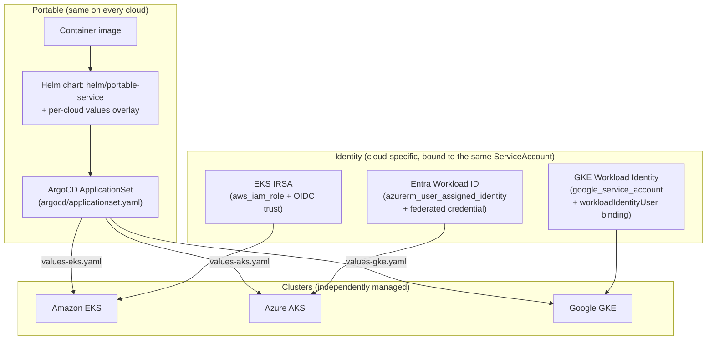

# Architecture

## Tiers

This is a **reference comparison**, not a cross-cloud failover design: the
three clusters are independently highly available (multi-AZ/zone node
groups, PodDisruptionBudgets), but there is no cross-cluster data
replication, no cross-cloud traffic manager, and no claim that a workload
fails over from one cloud to another. See `docs/decisions/0002-identity-bound-not-abstracted.md`.

## What is portable vs. what is not

| Layer | Portable? | Where it lives |
|---|---|---|
| Container image | Yes -- one image, no cloud-specific base layer | `image.repository`/`image.tag` in `values.yaml` |
| Helm chart (templates) | Yes -- identical rendered Deployment/Service/PDB on every cloud | `helm/portable-service/templates/` |
| Replica count, resources, probes | Yes -- same numbers in every overlay | `values.yaml` (base) |
| ArgoCD deployment model | Yes -- one ApplicationSet, one chart | `argocd/applicationset.yaml` |
| Ingress controller class/annotations | No -- each cloud's controller has its own vocabulary | `values-<cloud>.yaml` |
| Workload identity mechanism | No -- IRSA / Entra Workload ID / GKE Workload Identity are different protocols | `values-<cloud>.yaml` + `terraform/modules/identity-bindings` |
| StorageClass | No -- gp3 / managed-csi / standard-rwo are different CSI drivers | `values-<cloud>.yaml` |
| Control plane pricing, upgrade cadence, networking mode, logging | No -- see `docs/comparison.yaml` | n/a (operational, not code) |

## Why a module, not three more clusters

`aws-multi-region-eks-dr`, `azure-aks-platform` and `gcp-ai-pharmacy-platform`
already each build (and validate) a full cluster stack for their own cloud.
Rebuilding three cluster stacks here would duplicate that work and add
nothing this project is actually about: the point of
`multi-cloud-kubernetes` is the *workload and identity layer that sits on
top of* three clusters, not the clusters themselves. See
`docs/decisions/0001-identity-bindings-not-three-more-clusters.md`.
