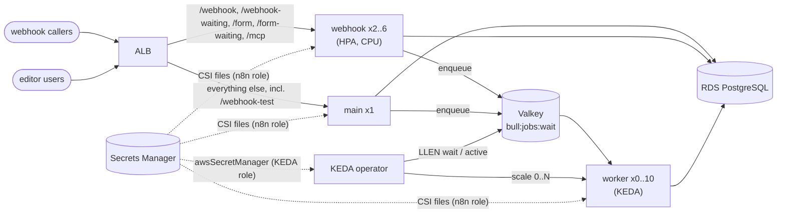

# Self-Hosted n8n on EKS: Queue Mode with KEDA Scale-to-Zero Workers

> **Classification: production case study.**
> Reference implementation of a pattern used in production work; all names, accounts and values are synthetic. No production figures are claimed.
> Owner: Muhammad Salahuddin, Senior DevOps Engineer. The Terraform is validated and has never been
> applied. The chart is linted and schema-checked (KEDA and CSI CRDs included), never installed. n8n's
> settings were checked against the `n8nio/n8n:2.41.3` image, partly by running it locally. Costs are illustrative.

n8n runs in **queue mode** on an existing EKS cluster: one `main` process for
the editor and schedules, HPA-scaled `webhook` processes that enqueue work in
**ElastiCache Valkey**, and `worker` processes that **KEDA** scales on the Bull
wait list, **down to zero when the queue is idle**. State lives in **RDS
PostgreSQL**. The encryption key, DB credentials and Redis token come from
**Secrets Manager** as files through the Secrets Store CSI driver and n8n's
`_FILE` support. KEDA reads the Redis token itself, with its own Pod Identity,
so no Kubernetes Secret exists.

## Problem

- **One n8n process does everything.** In regular mode the editor, webhooks,
  schedules and every execution share one pod, which can't be replicated (two
  would fire each schedule twice). One heavy workflow slows everything.
- **CPU is the wrong scaling signal.** Workers mostly wait on other APIs. A worker
  with every slot busy sits at low CPU while jobs pile up, and a CPU HPA never
  goes below one replica.
- **Scale-in kills running workflows** when the grace period is the 30-second default
  and executions run for minutes.
- **The encryption key is the crown jewel.** It decrypts every stored credential;
  it ends up in env vars, values files and Terraform state.

## What it demonstrates

| Area | Implementation |
|---|---|
| Helm chart (own, not vendored) | `helm/n8n-platform`: main (1 replica, `Recreate`, schema-enforced), webhook (HPA on CPU), worker (`--concurrency`), one pinned image. Shared queue-mode config with every secret as a `*_FILE` path into a read-only CSI mount. Ingress (ALB) splitting production webhook paths from main. PDBs, three NetworkPolicies, optional `SecurityGroupPolicy`, values schema, `values.yaml` + `values-prod.yaml` |
| KEDA scale-to-zero | `ScaledObject`: `minReplicaCount: 0`, two `redis` triggers on `bull:jobs:wait` (target `listLength`) and `bull:jobs:active` (target = concurrency), `activationListLength`, `pollingInterval`, `cooldownPeriod`, HPA `behavior` with scale-down stabilization ([ADR 0002](docs/decisions/0002-keda-redis-list-scaler-vs-cpu-hpa.md)) |
| TriggerAuthentication | `awsSecretManager` with `podIdentity.provider: aws`, operator identity: no synced Secret, works with zero n8n pods ([ADR 0003](docs/decisions/0003-trigger-authentication-secrets.md)) |
| Safe scale-in | `EXECUTIONS_TIMEOUT` = max execution time, `N8N_GRACEFUL_SHUTDOWN_TIMEOUT` = that + 30s, `terminationGracePeriodSeconds` = preStop + shutdown + 15s, all derived from one value. n8n's SIGTERM drain was checked in the image and observed locally ([architecture](docs/architecture.md#shutdown-on-scale-in)) |
| Terraform | `modules/n8n-platform` for an existing cluster: Valkey replication group (TLS required, Multi-AZ var, AUTH token through an **ephemeral read into write-only `auth_token_wo`**, so never in state), RDS PostgreSQL (CMK, backups, deletion protection, `manage_master_user_password`), three Secrets Manager secrets **without versions**, security groups that accept only security groups, two Pod Identity roles (n8n: three secrets; KEDA: the Redis token). `aws >= 6.0, < 7.0`. KEDA is a pinned `helm install`, not a Terraform resource ([ADR 0004](docs/decisions/0004-database-choice.md) for RDS vs Aurora) |
| Scaling simulator | `keda_scaling_sim.py`: replica timeline for a queue-depth CSV with the chart's settings. A model of documented KEDA + HPA semantics, not KEDA itself |
| Idempotency | `duplicate_job_guard.py`: retry-stable key, conditional-insert claim with a lease (memory and SQLite stores), crash-and-retry demo |
| Chart policy | `check_chart_policy.py`: 10 rules over rendered manifests (grace period vs max execution, shutdown window, main == 1, cooldown before zero, literal secrets, encryption key source, list key, queue mode) |
| CI | `.github/workflows/n8n-keda-automation-platform.yml`: unittest on 3.12, helm lint + kubeconform with the CRD catalog (both value files), the chart policy on the render, terraform fmt + validate, workflow lint. SHA-pinned actions, `contents: read`, `persist-credentials: false` |

## Architecture



The component diagram, the webhook to Redis to worker to Postgres sequence,
the idle to burst to zero sequence, and the shutdown timing are in
[docs/architecture.md](docs/architecture.md).

## Layout

```text
helm/n8n-platform/   Chart, values.yaml, values-prod.yaml, values.schema.json, templates/
terraform/           modules/n8n-platform (Valkey, RDS, secrets, SGs, Pod Identity), examples/basic
scripts/             keda_scaling_sim.py, duplicate_job_guard.py, check_chart_policy.py, yaml_lite.py
sample-data/         queue-depth.csv (burst, short gap, idle, second burst; synthetic)
tests/               unittest suites, fixtures/manifests/{good,bad}.yaml
docs/                architecture, operations, security, cost, decisions/ (ADRs 0001-0004)
```

## Quickstart

Python 3.12 (CI's version; newer 3.x works), nothing to install. From this directory:

```bash
python3 -m unittest discover -s tests -v          # all tests (chart tests need helm)
python3 scripts/keda_scaling_sim.py sample-data/queue-depth.csv --values helm/n8n-platform/values.yaml
helm template n8n helm/n8n-platform -n n8n | python3 scripts/check_chart_policy.py - --fail-on warning
python3 scripts/duplicate_job_guard.py demo
```

## Sample output

All excerpts below are real output from this machine, run on 2026-10-14. A
test re-runs every `$ python3` block and compares it byte for byte.

The scaling simulator on the sample with the chart's values. KEDA wakes the
workers from zero, the HPA sizes them, the 300-second stabilization rides out
the short gap at t=270-360 without scaling in, and KEDA returns them to zero
300 seconds after the last active poll. **This is a model of documented KEDA
and HPA semantics, not KEDA itself**: it ignores pod start-up time and treats the
queue depth as an input.

```text
$ python3 scripts/keda_scaling_sim.py sample-data/queue-depth.csv --values helm/n8n-platform/values.yaml
keda_scaling_sim: model of documented KEDA + HPA semantics, not KEDA itself
input sample-data/queue-depth.csv: 1800s
settings: listLength=10 activationListLength=0 min=0 max=10 pollingInterval=15s cooldownPeriod=300s scaleDown stabilization=300s (-50%/60s) scaleUp +4/15s activeTarget=10
t=   60s  wait=  40 active=  0   0 -> 1  KEDA activation (wait 40 > activationListLength 0)
t=   60s  wait=  40 active=  0   1 -> 4  HPA  ceil(40/10)
t=   75s  wait= 120 active= 10   4 -> 8  HPA  ceil(120/10), limited to +4 pods/15s
t=   90s  wait= 150 active= 40   8 -> 10 HPA  ceil(150/10)
t=  465s  wait=   0 active=  0  10 -> 7  HPA  ceil(0/10), held by 300s stabilization
t=  495s  wait=   0 active=  0   7 -> 5  HPA  ceil(0/10), limited to -50%/60s
t=  525s  wait=   0 active=  0   5 -> 4  HPA  ceil(0/10), limited to -50%/60s
t=  555s  wait=   0 active=  0   4 -> 3  HPA  ceil(0/10), limited to -50%/60s
t=  585s  wait=   0 active=  0   3 -> 2  HPA  ceil(0/10), held by 300s stabilization
t=  660s  wait=   0 active=  0   2 -> 1  HPA  ceil(0/10)
t=  675s  wait=   0 active=  0   1 -> 0  KEDA cooldown: idle 300s >= cooldownPeriod 300s
t= 1200s  wait=  60 active=  0   0 -> 1  KEDA activation (wait 60 > activationListLength 0)
t= 1200s  wait=  60 active=  0   1 -> 5  HPA  ceil(60/10), limited to +4 pods/15s
t= 1515s  wait=   0 active=  0   5 -> 3  HPA  ceil(0/10), held by 300s stabilization
t= 1575s  wait=   0 active=  0   3 -> 0  KEDA cooldown: idle 300s >= cooldownPeriod 300s
summary: peak 10 replicas, 15 scaling events, 2 scale-to-zero, 6420 worker-seconds vs 18010 at max always-on (35.6%)
(exit 0)
```

The chart policy on the good and bad fixtures (values are masked):

```text
$ python3 scripts/check_chart_policy.py tests/fixtures/manifests/good.yaml
check_chart_policy: 3 objects, 0 error(s), 0 warning(s)
(exit 0)
```

```text
$ python3 scripts/check_chart_policy.py tests/fixtures/manifests/bad.yaml
tests/fixtures/manifests/bad.yaml Deployment/n8n/n8n-main: ERROR CP007 container `n8n` sets N8N_ENCRYPTION_KEY literally (synt...<32 chars>); use N8N_ENCRYPTION_KEY_FILE or a secretKeyRef
tests/fixtures/manifests/bad.yaml Deployment/n8n/n8n-main: ERROR CP006 container `n8n` env `DB_POSTGRESDB_PASSWORD` has a literal value (synt...<21 chars>)
tests/fixtures/manifests/bad.yaml Deployment/n8n/n8n-main: ERROR CP003 main replicas is 2; single-main mode needs exactly 1
tests/fixtures/manifests/bad.yaml Deployment/n8n/n8n-main: WARNING CP004 main strategy is RollingUpdate; Recreate keeps two mains from overlapping
tests/fixtures/manifests/bad.yaml Deployment/n8n/n8n-webhook: ERROR CP006 container `n8n` env `LEGACY_REDIS_URL` value looks like a credential (URL with embedded password, redi...<54 chars>)
tests/fixtures/manifests/bad.yaml Deployment/n8n/n8n-webhook: ERROR CP008 n8n container `n8n` has no encryption key (N8N_ENCRYPTION_KEY_FILE or N8N_ENCRYPTION_KEY from a secretKeyRef)
tests/fixtures/manifests/bad.yaml Deployment/n8n/n8n-webhook: ERROR CP010 n8n container `n8n` EXECUTIONS_MODE is 'regular', not 'queue'
tests/fixtures/manifests/bad.yaml Deployment/n8n/n8n-worker: ERROR CP001 terminationGracePeriodSeconds 30 < max execution time 600s: scale-in would kill running executions
tests/fixtures/manifests/bad.yaml Deployment/n8n/n8n-worker: ERROR CP002 N8N_GRACEFUL_SHUTDOWN_TIMEOUT 30s < max execution time 600s: n8n force-exits before the run ends
tests/fixtures/manifests/bad.yaml ScaledObject/n8n/n8n-worker: ERROR CP005 minReplicaCount 0 with cooldownPeriod 30s < 120s: workers would flap to zero between bursts
tests/fixtures/manifests/bad.yaml ScaledObject/n8n/n8n-worker: ERROR CP009 redis trigger `wrong-key` watches 'bull:jobs'; n8n's Bull lists are ['bull:jobs:active', 'bull:jobs:wait']
check_chart_policy: 4 objects, 10 error(s), 1 warning(s)
(exit 1)
```

The rendered chart is clean at `--fail-on warning`, for both value files:

```text
$ helm template n8n helm/n8n-platform -n n8n | python3 scripts/check_chart_policy.py - --fail-on warning
check_chart_policy: 16 objects, 0 error(s), 0 warning(s)
$ helm template n8n helm/n8n-platform -n n8n -f helm/n8n-platform/values-prod.yaml | python3 scripts/check_chart_policy.py - --fail-on warning
check_chart_policy: 17 objects, 0 error(s), 0 warning(s)
```

The idempotency guard. Execution 101 crashes after the provider accepted the
e-mail; the retry (a new execution with `retryOf=101`) gets the same key,
takes over the expired claim, and the provider deduplicates on that key:

```text
$ python3 scripts/duplicate_job_guard.py demo
duplicate_job_guard demo (with guard, crash after send, provider dedupe on)
  execution 101 (worker-a): worker crashed after the send
  execution 102 retryOf=101 (worker-b): msg-1
messages delivered: 1
(exit 0)
```

```text
$ python3 scripts/duplicate_job_guard.py demo --no-guard
duplicate_job_guard demo (without guard, crash after send, provider dedupe on)
  execution 101 (worker-a): worker crashed after the send
  execution 102 retryOf=101 (worker-b): msg-2
messages delivered: 2
(exit 1)
```

With `--provider-no-dedupe` the guarded run also delivers twice. A claim
can't know whether a crashed worker's send went out, so "crashed after
sending" needs the downstream API to honour the key. A test pins that limit.

Helm lint and kubeconform for both value files. The `ScaledObject`,
`TriggerAuthentication`, `SecretProviderClass` and (prod) `SecurityGroupPolicy`
are validated against the community CRD catalog, not skipped. Adding an
unknown field to the ScaledObject or the TriggerAuthentication makes them
`Invalid`, so the schemas are really applied:

```text
$ helm lint helm/n8n-platform -f helm/n8n-platform/values-prod.yaml
==> Linting helm/n8n-platform
[INFO] Chart.yaml: icon is recommended

1 chart(s) linted, 0 chart(s) failed
$ helm template n8n helm/n8n-platform -n n8n | kubeconform -strict -summary -kubernetes-version 1.34.0 -schema-location default -schema-location 'https://raw.githubusercontent.com/datreeio/CRDs-catalog/main/{{.Group}}/{{.ResourceKind}}_{{.ResourceAPIVersion}}.json'
Summary: 16 resources found parsing stdin - Valid: 16, Invalid: 0, Errors: 0, Skipped: 0
$ helm template n8n helm/n8n-platform -n n8n -f helm/n8n-platform/values-prod.yaml | kubeconform -strict -summary ...same flags...
Summary: 17 resources found parsing stdin - Valid: 17, Invalid: 0, Errors: 0, Skipped: 0
```

## Verified vs assumed n8n settings

"Verified" means checked in the `n8nio/n8n:2.41.3` image: the config class
that reads the variable (`@n8n/config`), the code that uses it, or a local run
of the image (main, webhook and worker against `postgres:16` and
`valkey/valkey:8.1`, read-only root filesystem, all capabilities dropped).

| Setting | Status | How |
|---|---|---|
| `EXECUTIONS_MODE=queue`, `DB_TYPE=postgresdb`, `DB_POSTGRESDB_*` (host, port, database, schema, user, password, SSL, pool size) | verified | config classes; local queue-mode run |
| `QUEUE_BULL_REDIS_HOST/PORT/DB/TLS/PASSWORD`, `QUEUE_BULL_PREFIX` | verified | `scaling-mode.config.js`; local run with a password-protected Valkey |
| `<VAR>_FILE` for any config variable (`N8N_ENCRYPTION_KEY_FILE`, `DB_POSTGRESDB_USER_FILE`, `DB_POSTGRESDB_PASSWORD_FILE`, `QUEUE_BULL_REDIS_PASSWORD_FILE`) | verified | `readEnv` in `@n8n/config/dist/decorators.js` falls back to `<VAR>_FILE` and trims whitespace; local runs used all four |
| `N8N_WEBHOOK_URL` (not `WEBHOOK_URL`) | verified | `N8N_WEBHOOK_URL` is the config variable; `WEBHOOK_URL` still works but the deprecation service says to use `N8N_WEBHOOK_URL` |
| `N8N_EDITOR_BASE_URL`, `N8N_PROXY_HOPS`, `GENERIC_TIMEZONE`, `N8N_DIAGNOSTICS_ENABLED` | verified | config classes |
| `EXECUTIONS_DATA_PRUNE`, `EXECUTIONS_DATA_MAX_AGE` (hours, default 336), `EXECUTIONS_DATA_PRUNE_MAX_COUNT` | verified | `executions.config.js` |
| `EXECUTIONS_TIMEOUT`, `EXECUTIONS_TIMEOUT_MAX` (seconds) | verified (names, defaults) | `executions.config.js`; enforcement not exercised |
| `N8N_METRICS=true` serves `/metrics` | verified | local run on main and worker |
| `N8N_DISABLE_PRODUCTION_MAIN_PROCESS`, `OFFLOAD_MANUAL_EXECUTIONS_TO_WORKERS` | verified | `endpoints.config.js`; `workflow-runner.js` reads the latter from `process.env` |
| Webhook paths: production `/webhook`, `/webhook-waiting`, `/form`, `/form-waiting`, `/mcp` on the webhook process; `/webhook-test` only on main | verified | `abstract-server.js` (`webhooksEnabled` / `testWebhooksEnabled`), `server.js`; the webhook process has no `/webhook-test` route |
| Bull wait list `bull:jobs:wait` (LIST), active list `bull:jobs:active` | verified | queue name `jobs` in `scaling/queue-name.js`, `toKey` in bull 4.16.4; `LLEN`/`TYPE` locally with no worker, then wait 0 / active 3 with one |
| `{bull}:` prefix with Redis cluster nodes | verified (code only) | `toValidPrefix` in `redis-client.service.js` |
| `/healthz` (liveness) and `/healthz/readiness` (DB connected and migrated) on main and webhook | verified | `abstract-server.js`; locally `/healthz` is 200 during migrations while readiness is 503 |
| Worker health server: `QUEUE_HEALTH_CHECK_ACTIVE=true`, `QUEUE_HEALTH_CHECK_PORT` (default 5678), same paths | verified | `worker-server.js`; local run |
| `worker --concurrency=N` (default 10; `N8N_CONCURRENCY_PRODUCTION_LIMIT` overrides; warns below 5) | verified | `commands/worker.js` |
| SIGTERM drain: local queue pause, wait for running jobs, force exit after `N8N_GRACEFUL_SHUTDOWN_TIMEOUT` (default 30s) | verified | `scaling.service.js` `stopWorker`, `base-command.js`; `docker stop -t 60` mid-execution: the worker waited for the run, then exited |
| Writable paths `/home/node/.n8n`, `/home/node/.cache`, `/tmp`; uid 1000 | verified | image config; read-only run fails without `.cache` (`ENOENT: mkdir '/home/node/.cache'`) and starts with all three |
| Retry creates a new execution with `retryOf` | verified (code) | `execution.service.js` |
| Queue mode needs Postgres (no SQLite) | assumed | n8n's documentation; not tested |
| `N8N_EXECUTIONS_QUEUE_RECOVERY_INTERVAL` marks crashed executions | assumed (name verified) | variable exists in `executions.config.js`; behaviour from docs |
| TLS to ElastiCache with `QUEUE_BULL_REDIS_TLS=true` and a public-CA certificate | assumed | the local Valkey had no TLS |
| Task runner (internal mode) works on the read-only filesystem under load | assumed | it registered and started locally; Code nodes not exercised |

## Tests

```bash
python3 -m unittest discover -s tests -v
# Ran 96 tests ... OK
```

They cover:

- **the simulator**: idle stays at zero, KEDA activation on the first poll after
  work arrives and the strict `>` threshold, `ceil(wait/listLength)` for several
  depths, the max cap, the +4 pods per 15s policy, HPA tolerance, the scale-down
  stabilization window to the second, the Percent policy, cooldown to zero at
  the exact poll, no flapping across repeated gaps shorter than the cooldown,
  re-activation after zero, the active-list trigger holding workers that a
  wait-only trigger would scale to zero mid-run, the sample with the chart's
  values, and bad CSVs;
- **the duplicate guard**: retry-stable keys, a contract suite run against both the
  memory and SQLite stores (one winner among 16 threads, done returns the
  stored result, expired-lease takeover exactly once, a crashed owner can't
  complete), release on failure, and the crash-before, crash-after, no-crash,
  no-guard and no-downstream-dedupe scenarios;
- **the chart policy**: the good fixture clean, the bad fixture hitting all ten rules
  with exact counts, no secret value in any finding, and single-rule cases
  (grace vs max execution, preStop + shutdown window, flag and annotation
  overrides, KEDA defaults, list keys, boolean flags with secret-like names);
- **the rendered chart** (skipped without helm): object list with no `Secret`, one
  image in three roles, main as a `Recreate` singleton, queue-mode config from
  files, SPC files matching every `_FILE` variable, the shutdown window in both
  value files, ScaledObject and TriggerAuthentication fields, ingress routes,
  hardening and probes, PDBs, HPA and NetworkPolicies, the prod overlay, the
  policy clean on both renders, the schema rejecting unsafe values, and the
  checksum following the SPC mapping;
- **Terraform invariants**: version pins and lock files (aws 6.68.0, no helm
  provider), no secret versions and no plaintext token or password arguments,
  RDS and Valkey encryption settings, cluster mode off, the exact secret ARNs
  per role, Pod Identity trust conditions, SG-only ingress on the data stores,
  and descriptions on every input;
- **CLI smoke tests** for all three scripts (exit codes, stdin, JSON);
- **docs**: the classification line, every `$ python3` sample above re-run and
  compared, no unfinished-work markers, no empty files, only the placeholder
  account, no client names.

## Terraform validation

Validation only. Never planned or applied:

```bash
cd terraform
terraform fmt -check -recursive
for d in modules/n8n-platform examples/basic; do
  terraform -chdir=$d init -backend=false && terraform -chdir=$d validate
done
# Success! The configuration is valid.   (both)
```

Validated with Terraform 1.14.8 and `hashicorp/aws` 6.68.0; lock files are
committed for both directories. `required_version >= 1.11` because the
ElastiCache token uses a write-only argument fed by an ephemeral resource. The
`name` validation was checked with `terraform console`: `n8n-prod` passes,
`N8N` and `x` are rejected.

## Limitations

- **Never deployed.** No cluster, KEDA operator, CSI mount, ALB or AWS resource has
  existed. The n8n behaviour was checked against the real image locally; the
  KEDA, ALB and AWS behaviour rests on documentation and CRD schemas.
- **The simulator is a model.** It follows the documented KEDA activation and
  cooldown rules and the HPA algorithm (tolerance, stabilization, policies), but
  not pod start-up, KEDA's metric caching, or the queue draining as workers
  start (the CSV is the observed depth).
- **Unverified, each in one place:** KEDA honouring `identityOwner: keda` for the
  `aws` provider ([ADR 0003](docs/decisions/0003-trigger-authentication-secrets.md)); the
  KEDA chart version 2.17.2 being current when you install
  ([operations](docs/operations.md#install)); TLS from n8n and KEDA to
  ElastiCache; the first-apply ordering for the ephemeral token read (documented
  as two phases, not exercised).
- **The KEDA operator reaches Redis through the node security group** in the
  example, which also opens the port to other pods on those nodes
  ([security](docs/security.md#network)).
- **Main is a singleton.** A main restart pauses schedules and the editor;
  removing that needs n8n's licensed multi-main mode.
- **`yaml_lite.py`** (shared with the sibling `eks-secrets-store-csi` project) reads
  the YAML subset these manifests use and raises on anything else.

## Interview talking points

- **Scale on the work, not the symptom.** Workers wait on APIs, so CPU says
  nothing. The queue is the work. And the wait list alone lies the moment a job
  is picked up, which is why there is a second trigger on the active list.
- **Read the code for the key.** `bull:jobs:wait` comes from the queue name
  constant and Bull's `toKey`, then `LLEN` against a real queue. A wrong key
  doesn't error; it silently never scales. So a policy rule checks it.
- **Scale-in is a shutdown problem.** One value (max execution time) drives the
  execution timeout, n8n's shutdown timeout and the pod's grace period, and CI
  fails if they drift. I watched a worker wait for its run before exiting.
- **Fewer copies of the secret.** KEDA reading Secrets Manager with its own
  identity removes the synced Kubernetes Secret, and with it a hidden dependency:
  scaling from zero no longer needs some other pod to be mounting the volume.
- **The write-only argument closes the last state leak.** The ElastiCache token
  used to be the classic "secret in tfstate". An ephemeral read into
  `auth_token_wo` keeps it out of plan and state, at the price of a two-phase
  first apply.
- **At-least-once is the contract.** Retries are new executions, so the
  idempotency key comes from the original execution or the business event, and
  the guard is honest about the crash-after-send case.
