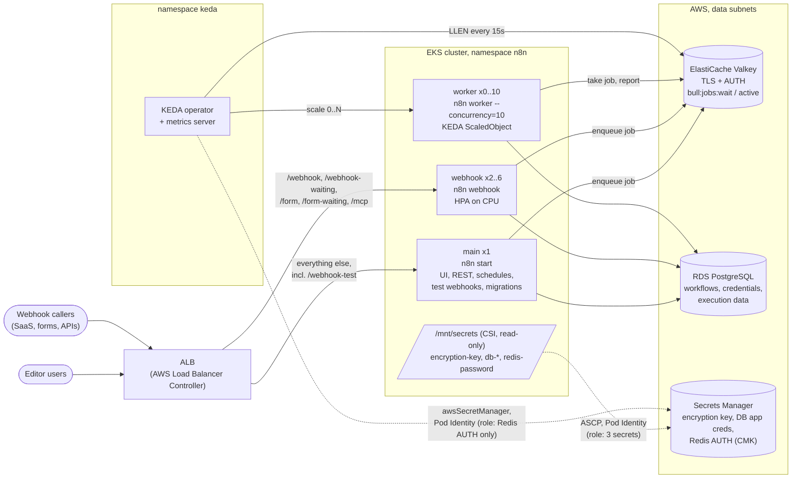
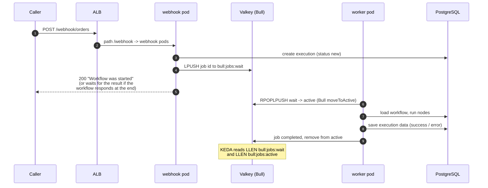
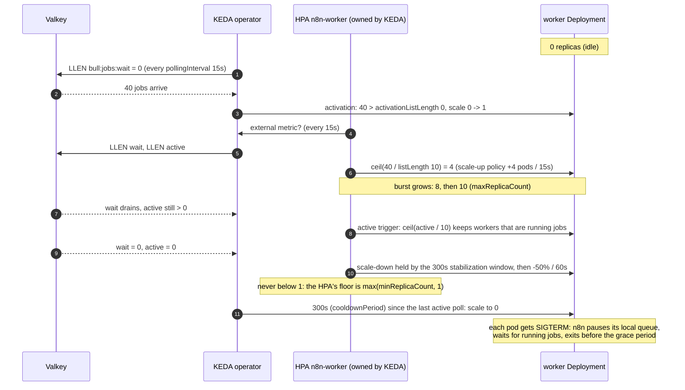

# Architecture

n8n runs in **queue mode**: one process type accepts work, Redis holds it, and
another runs it. That split is what makes event-driven scaling possible. The
web-facing processes stay small and always on, and the workers that do the
expensive part scale with the queue, down to zero.

## Components

| Component | Runs | Scales | Why this way |
|---|---|---|---|
| main | `n8n start` | fixed at 1, `Recreate` | Owns schedules, pollers and trigger registration. A second main fires every cron twice. Licensed multi-main (leader election) would lift this; this design doesn't assume a license |
| webhook | `n8n webhook` | HPA 2-6 on CPU | Stateless request handlers that only enqueue. CPU tracks their load well |
| worker | `n8n worker --concurrency=10` | KEDA 0-10 on queue depth | Their load is the queue, not their CPU. A worker waiting on a slow API uses no CPU yet holds a slot ([ADR 0002](decisions/0002-keda-redis-list-scaler-vs-cpu-hpa.md)) |
| Valkey | ElastiCache, cluster mode off | Multi-AZ pair | The Bull queue. Cluster mode would wrap the prefix in a hash tag (`{bull}:jobs:wait`) and gains nothing at this size |
| PostgreSQL | RDS, Multi-AZ | vertical | All durable state ([ADR 0004](decisions/0004-database-choice.md)) |
| Secrets | Secrets Manager + CSI | n/a | Files read through n8n's `_FILE` support; KEDA reads the Redis token as its own identity ([ADR 0003](decisions/0003-trigger-authentication-secrets.md)) |

### Which process serves which path

Checked in the `n8nio/n8n:2.41.3` image (`abstract-server.js`, `server.js`,
`webhooks/webhook-server.js`), not taken from a guide:

- `n8n webhook` registers production routes only: `/webhook/*`, `/webhook-waiting/*`,
  `/form/*`, `/form-waiting/*`, `/mcp/*`. It sets `testWebhooksEnabled = false`.
- `n8n start` (main) registers the test routes (`/webhook-test/*`, `/form-test/*`,
  `/mcp-test/*`) and, unless `N8N_DISABLE_PRODUCTION_MAIN_PROCESS=true`, the
  production ones too. The chart sets it, so production traffic can only land on
  the webhook pods.

So `/webhook-test/*` is routed to **main**, not to the webhook pods. A test
webhook is registered when someone clicks "Listen for test event" in the
editor, and only main has the route. Locally, the webhook process answered
`Cannot GET /webhook-test/x` (no route) where main answered 404 for an
unregistered test path.

## Request and queue flow

Observed locally with main, webhook and worker containers against Postgres
and Valkey: three POSTs with no worker running left `LLEN bull:jobs:wait = 3`
(`TYPE` list). Starting a worker moved them to `bull:jobs:active` (wait 0,
active 3), and 20 seconds later both were 0. That second observation is why
the ScaledObject has a trigger on `active` too: once a worker picks up a job,
the wait list says nothing about it.

### The key KEDA watches

Bull keys are `<prefix>:<queue>:<type>` (`Queue.prototype.toKey` in bull
4.16.4, the version in the image). n8n's prefix is `QUEUE_BULL_PREFIX`
(default `bull`) and the queue name is the constant `jobs` (`scaling/queue-name.js`).
With worker pools (a licensed feature), a worker's queue becomes `jobs-<pool>`;
this chart doesn't use them. If Redis runs in cluster mode, n8n wraps the
prefix in braces, so the key becomes `{bull}:jobs:wait`. The schema forbids
braces in `queue.bullPrefix`, and `check_chart_policy.py` (CP009) fails a
trigger on any other list.

## Scaling sequence: idle, burst, cooldown, zero

`scripts/keda_scaling_sim.py` plays this sequence for a CSV of queue depths
with the chart's settings; the README has its output on the sample. It is a
model of documented KEDA and HPA semantics, not KEDA itself. The details it
follows:

- KEDA alone moves 0 to 1 and back to 0. The HPA it creates can't go below 1, so
  between 1 and `maxReplicaCount` the HPA decides.
- "Active" means `LLEN > activationListLength`. That threshold applies only to
  waking from zero; the HPA target is `listLength`.
- `cooldownPeriod` counts from the last poll on which any trigger was active,
  and applies only to the step to zero. Scale-down above 1 follows the HPA
  behaviour (stabilization window, then the Percent policy).

## Shutdown on scale-in

Verified by reading `scaling.service.js` and `base-command.js` in the image,
and by stopping a worker mid-execution locally:

1. The kubelet runs the preStop (`sleep 5`), then sends SIGTERM.
2. n8n's worker calls `queue.pause(true, true)`, a *local* pause: this worker
   takes no new jobs while the queue keeps working for the others.
3. It waits while it still has running Bull jobs, logging
   `Waiting for N active executions to finish...` every few seconds.
4. A timer started at SIGTERM force-exits the process after
   `N8N_GRACEFUL_SHUTDOWN_TIMEOUT` seconds (default 30).

Locally, `docker stop -t 60` during a 20-second Wait node: SIGTERM at
:03, "Waiting for 1 active executions" every 2s, `Worker finished execution 4`
at :20, `Stopping worker...` at :21. The chart sizes the window from one value,
`executions.maxExecutionSeconds` (600):

| Setting | Value | Why |
|---|---|---|
| `EXECUTIONS_TIMEOUT`, `EXECUTIONS_TIMEOUT_MAX` | 600 | No run may outlive the window |
| `N8N_GRACEFUL_SHUTDOWN_TIMEOUT` | 630 | Longest run + 30s to close DB and Redis |
| preStop sleep | 5 | Short on purpose: the worker keeps pulling jobs until SIGTERM |
| `terminationGracePeriodSeconds` | 650 | preStop + shutdown timeout + 15s slack before SIGKILL |

`check_chart_policy.py` (CP001, CP002) fails the render if any of these drift apart.
