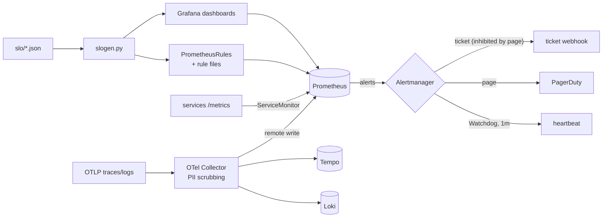

# SLO-Driven Observability: SLOs as Code, Burn-Rate Alerts, Dashboards and an Error-Budget Policy

> **Classification: production case study.**
> Reference implementation of a pattern used in production work; services, SLOs and data are synthetic. No production figures are claimed.
> Owner: Muhammad Salahuddin, Senior DevOps Engineer. The generated rules pass `promtool check rules` and
> hand-written `promtool test rules` cases (Prometheus 3.5.0). The chart and the PrometheusRules pass kubeconform
> with the CRD schemas; the chart has never been installed. The local demo stack was run once and paged.

Three synthetic services get SLOs written as small JSON files. A stdlib Python
generator turns them into **Prometheus recording rules** for seven windows,
**multi-window, multi-burn-rate alerts** (Google SRE workbook), the same rules
as **PrometheusRule CRDs**, a **Grafana dashboard** per service, and an
**error-budget report** that replays the alert tiers over historical hourly
counts. Around that: ServiceMonitors and a blackbox Probe, an
**AlertmanagerConfig** with page and ticket routes, inhibition and a
dead man's switch, an **OpenTelemetry Collector** gateway that scrubs PII,
runbooks per alert, an error-budget policy and an incident process.

## Problem

- **Alerts on symptoms, not on users.** CPU, a 5xx count or a latency threshold page
  people for blips nobody noticed, and stay quiet through a slow burn that misses the month.
- **Hand-written SLO PromQL drifts.** Thresholds like `> 0.0144` with no
  explanation, copied between services, wrong for the 28-day ones.
- **An alert without a decision behind it.** Nobody agreed what happens when
  the budget is gone, so the SLO is a number on a dashboard.
- **Telemetry leaks personal data.** Auth headers, e-mails and query strings
  end up in traces and logs, replicated and retained.

## What it demonstrates

| Area | Implementation |
|---|---|
| SLOs as code | `slo/*.json`: checkout-api availability (99.9%/30d) and latency (99% under 300 ms/28d), orders-worker freshness (99.5% within 5 min/28d), public-website availability from blackbox probes (99.5%/30d). SLI = good/total PromQL with `[$window]`, plus the alert tiers to enable |
| Generator | `generator/slogen.py`, stdlib: per SLO 7 windowed error ratios (5m..3d), objective, budget, period ratio and budget remaining; `or vector(0)` so a total outage with no "good" series still alerts. Deterministic output in `generated/`, `generate --check` fails CI on drift ([ADR 0002](docs/decisions/0002-slo-as-code-generator-vs-sloth-pyrra.md): Sloth or Pyrra would be the usual choice) |
| Burn-rate alerts | page at 14.4x (1h and 5m) and 6x (6h and 30m), ticket at 3x (1d and 2h) and 1x (3d and 6h); `severity`, `tier`, `burn_rate` labels; summary and description with the budget math; `runbook_url` into `runbooks/` ([ADR 0001](docs/decisions/0001-multiwindow-multiburn-alerts.md)) |
| Outputs | plain rule files, `PrometheusRule` CRDs, Grafana dashboards (SLI, budget remaining, burn rate with tier thresholds), Watchdog rule |
| Error-budget report | replays the tiers over hourly good/total CSV: budget consumed, burn per window, when each alert would have fired and resolved; exact fractions |
| Kubernetes | `helm/observability-stack`: ServiceMonitors, Probe, `AlertmanagerConfig` (Watchdog route first, page -> PagerDuty, ticket -> webhook, ticket inhibited by page for the same `service`/`slo`, credentials only as Secret references), hardened OTel Collector Deployment |
| OTel Collector | otlp in; `memory_limiter`, `attributes/scrub-pii` (delete / hash), `transform/strip-query`, `batch`; out to Prometheus remote write, Loki (OTLP) and Tempo placeholders ([ADR 0003](docs/decisions/0003-otel-collector-pii-scrubbing.md)) |
| Local demo | `docker-compose.yml`: Prometheus 3.5.0, Alertmanager 0.28.1, Grafana 12.0.2 and a stdlib app with synthetic counters, a fault toggle and a webhook sink |
| Runbooks and policy | one runbook per SLO and severity plus Watchdog; [error-budget policy](runbooks/error-budget-policy.md) (states, feature freeze, exceptions, cadence); [incident response](runbooks/incident-response.md) (severities, roles, comms and blameless postmortem templates) |
| CI | `.github/workflows/observability-sre-platform.yml`: unittest on 3.12, regenerate + `git diff --exit-code`, promtool check and test in the pinned image, helm lint + kubeconform with the CRD catalog, workflow lint. SHA-pinned actions, checksum-verified tools, `contents: read`, `persist-credentials: false` |

## Architecture



The telemetry pipeline, the SLO-as-code flow and the routing tree are in
[docs/architecture.md](docs/architecture.md).

## Layout

```text
slo/                      SLO definitions (JSON, one file per service)
generator/                slogen.py (generator, report), yaml_lite.py (YAML reader for tests)
generated/                prometheus/, kubernetes/, grafana/, reports/  (checked in, never hand-edited)
sample-data/              checkout-api-availability-hourly.csv (168 synthetic hours)
helm/observability-stack/ ServiceMonitors, Probe, AlertmanagerConfig, OTel Collector (files/otel-collector.yaml)
local/                    demo app, prometheus.yml, alertmanager.yml, Grafana provisioning
docker-compose.yml        optional local demo stack
runbooks/                 per-alert runbooks, watchdog, error-budget policy, incident response
tests/                    unittest suites, promtool/slo-alerts.test.yml
docs/                     architecture, operations, security, cost, decisions/ (ADRs 0001-0003)
```

## Quickstart

Python 3.12 (CI's version; newer 3.x works), nothing to install. From this directory:

```bash
python3 -m unittest discover -s tests -v       # helm/promtool tests need helm / docker + the image
python3 generator/slogen.py generate           # rewrite generated/
python3 generator/slogen.py explain            # the burn-rate math per tier
python3 generator/slogen.py report sample-data/checkout-api-availability-hourly.csv --slo slo/checkout-api.json --name availability
```

## Sample output

All excerpts are real output from this machine, run on 2026-10-14/15. A test
re-runs every `$ python3` block and compares it byte for byte.

The generator, checking that `generated/` matches the SLO files:

```text
$ python3 generator/slogen.py generate --check
checkout-api: 2 SLO(s), 22 recording rules, 8 alerts, 1 dashboard
orders-worker: 1 SLO(s), 11 recording rules, 4 alerts, 1 dashboard
public-website: 1 SLO(s), 11 recording rules, 3 alerts, 1 dashboard
slogen: 12 files, up to date
(exit 0)
```

The math behind every threshold. The 28-day SLOs spend slightly more budget
per window at the same factor, and the alert descriptions say so:

```text
$ python3 generator/slogen.py explain
checkout-api/availability: objective 99.9% over 30d, error budget 0.1%
  page-1h   page   burn >14.4x over 1h and  5m: error ratio > 1.44%, 2% of budget per 1h, empty in 2.1d
  page-6h   page   burn >   6x over 6h and 30m: error ratio > 0.6%, 5% of budget per 6h, empty in 5.0d
  ticket-1d ticket burn >   3x over 1d and  2h: error ratio > 0.3%, 10% of budget per 1d, empty in 10.0d
  ticket-3d ticket burn >   1x over 3d and  6h: error ratio > 0.1%, 10% of budget per 3d, empty in 30.0d
checkout-api/latency: objective 99% over 28d, error budget 1%
  page-1h   page   burn >14.4x over 1h and  5m: error ratio > 14.4%, 2.14% of budget per 1h, empty in 1.9d
  page-6h   page   burn >   6x over 6h and 30m: error ratio > 6%, 5.36% of budget per 6h, empty in 4.7d
  ticket-1d ticket burn >   3x over 1d and  2h: error ratio > 3%, 10.71% of budget per 1d, empty in 9.3d
  ticket-3d ticket burn >   1x over 3d and  6h: error ratio > 1%, 10.71% of budget per 3d, empty in 28.0d
orders-worker/freshness: objective 99.5% over 28d, error budget 0.5%
  page-1h   page   burn >14.4x over 1h and  5m: error ratio > 7.2%, 2.14% of budget per 1h, empty in 1.9d
  page-6h   page   burn >   6x over 6h and 30m: error ratio > 3%, 5.36% of budget per 6h, empty in 4.7d
  ticket-1d ticket burn >   3x over 1d and  2h: error ratio > 1.5%, 10.71% of budget per 1d, empty in 9.3d
  ticket-3d ticket burn >   1x over 3d and  6h: error ratio > 0.5%, 10.71% of budget per 3d, empty in 28.0d
public-website/availability: objective 99.5% over 30d, error budget 0.5%
  page-1h   page   burn >14.4x over 1h and  5m: error ratio > 7.2%, 2% of budget per 1h, empty in 2.1d
  ticket-1d ticket burn >   3x over 1d and  2h: error ratio > 1.5%, 10% of budget per 1d, empty in 10.0d
  ticket-3d ticket burn >   1x over 3d and  6h: error ratio > 0.5%, 10% of budget per 3d, empty in 30.0d
(exit 0)
```

The error-budget report on the synthetic week: a two-hour incident at 30x on
day 3, then a 30-hour degradation at 3.5x. The incident pages twice, and the
3d ticket that fires with it is inhibited. The degradation never pages; it
opens the 3d ticket after 2 hours and the 1d ticket after 21. The first-firing
times are computed by hand in `tests/test_report.py`:

```text
$ python3 generator/slogen.py report sample-data/checkout-api-availability-hourly.csv --slo slo/checkout-api.json --name availability
error-budget report: checkout-api/availability (objective 99.9%, window 30d, budget 0.1%)
input sample-data/checkout-api-availability-hourly.csv: 168 hourly rows, 2026-09-01T00:00:00Z .. 2026-09-08T00:00:00Z (7.0d of the 30d window)
note: hourly data, so the 5m and 30m short windows use the latest hour, and `for:` is not modelled
requests 1680000, errors 2194, error ratio 0.1306%
budget consumed 30.47% (sum of hourly burn rate x 1h / 30d), remaining 69.53%
burn rate at end: 1h 0.40x  6h 0.40x  1d 0.40x  3d 1.69x
alerts that would have fired:
  page-1h   page   >14.4x over 1h and 5m: fired 2026-09-03T13:00:00Z  resolved 2026-09-03T15:00:00Z  (2h, peak 1h burn 30.00x)
  page-6h   page   >6x over 6h and 30m: fired 2026-09-03T14:00:00Z  resolved 2026-09-03T15:00:00Z  (1h, peak 6h burn 10.27x)
  ticket-3d ticket >1x over 3d and 6h: fired 2026-09-03T14:00:00Z  resolved 2026-09-03T20:00:00Z  (6h, peak 3d burn 1.35x)
  ticket-3d ticket >1x over 3d and 6h: fired 2026-09-05T16:00:00Z  resolved 2026-09-07T01:00:00Z  (33h, peak 3d burn 2.17x)
  ticket-1d ticket >3x over 1d and 2h: fired 2026-09-06T11:00:00Z  resolved 2026-09-06T21:00:00Z  (10h, peak 1d burn 3.50x)
summary: 5 firing interval(s): 2 page, 3 ticket; tickets that overlap a page for the same SLO are inhibited in Alertmanager
(exit 0)
```

promtool (in `prom/prometheus:v3.5.0`) on the generated rules, and the
hand-written unit tests in `tests/promtool/slo-alerts.test.yml`: 50x burn
(both pages, tickets after their 15m `for`, budget remaining -49), healthy 0.5x
(nothing), total outage with no "good" series, the short window resolving a
page while the 1h ratio is still 5%, a 2x latency burn that opens only the 1x
ticket, orders freshness, website probes, and Watchdog:

```text
$ docker run --rm -v "$PWD:/work:ro" -w /work --entrypoint promtool prom/prometheus:v3.5.0 check rules generated/prometheus/*.rules.yml
Checking generated/prometheus/checkout-api.rules.yml
  SUCCESS: 30 rules found

Checking generated/prometheus/meta.rules.yml
  SUCCESS: 1 rules found

Checking generated/prometheus/orders-worker.rules.yml
  SUCCESS: 15 rules found

Checking generated/prometheus/public-website.rules.yml
  SUCCESS: 14 rules found

$ docker run --rm -v "$PWD:/work:ro" -w /work --entrypoint promtool prom/prometheus:v3.5.0 test rules tests/promtool/slo-alerts.test.yml
  SUCCESS
```

Helm and kubeconform. `ServiceMonitor`, `Probe`, `AlertmanagerConfig` and
`PrometheusRule` are validated against the community CRD catalog, not skipped;
an unknown field in any of them makes it `Invalid`, so the schemas are applied:

```text
$ helm lint helm/observability-stack
1 chart(s) linted, 0 chart(s) failed
$ helm template obs helm/observability-stack -n observability | kubeconform -strict -summary -kubernetes-version 1.34.0 -schema-location default -schema-location 'https://raw.githubusercontent.com/datreeio/CRDs-catalog/main/{{.Group}}/{{.ResourceKind}}_{{.ResourceAPIVersion}}.json'
Summary: 9 resources found parsing stdin - Valid: 9, Invalid: 0, Errors: 0, Skipped: 0
$ kubeconform -strict -summary ...same flags... generated/kubernetes/
Summary: 4 resources found in 4 files - Valid: 4, Invalid: 0, Errors: 0, Skipped: 0
```

The other configs were checked with the real binaries too:
`otelcol-contrib validate` (0.130.0) builds every pipeline and exits 0, and
rejects an undefined processor or an unknown attribute action;
`amtool check-config` (0.28.1) accepts `local/alertmanager/alertmanager.yml`
(1 inhibit rule, 3 receivers); `promtool check config` accepts
`local/prometheus/prometheus.yml` with the four rule files.

### The local stack, paging

`docker compose up -d`, then `curl -X POST 'http://127.0.0.1:8080/fault?checkout_errors=0.2'`
at 18:03:16 UTC. Both pages started firing at 18:05:32, 2m16s later (2m of it
is the `for:`). From Prometheus's `/api/v1/alerts` shortly after (state,
alert, severity, tier, `$value` = 1h error ratio):

```text
firing CheckoutApiAvailabilityBurnPage1h page page-1h 1.7679824215570783e-01
firing CheckoutApiAvailabilityBurnPage6h page page-6h 1.7679824215570783e-01
pending CheckoutApiAvailabilityBurnTicket1d ticket ticket-1d 1.7679824215570783e-01
pending CheckoutApiAvailabilityBurnTicket3d ticket ticket-3d 1.7679824215570783e-01
firing Watchdog none  1e+00
```

What Alertmanager delivered to the demo app's webhook sink (count, receiver,
status, alert), and `amtool alert query`:

```text
   2 deadmans-switch firing Watchdog
   1 pager firing CheckoutApiAvailabilityBurnPage1h
   1 pager firing CheckoutApiAvailabilityBurnPage6h
Alertname                          Starts At                Summary                                                                                     State
Watchdog                           2026-10-14 18:03:01 UTC  Dead man's switch: always firing while the alerting pipeline works.                         active
CheckoutApiAvailabilityBurnPage6h  2026-10-14 18:05:32 UTC  checkout-api availability SLO: error budget burning at 6x or faster (6h and 30m windows)    active
CheckoutApiAvailabilityBurnPage1h  2026-10-14 18:05:32 UTC  checkout-api availability SLO: error budget burning at 14.4x or faster (1h and 5m windows)  active
```

The 1h ratio is 17.7%, not 20%, because the first minutes of the window had no
errors. The capture of the tickets firing 15 minutes later and being inhibited
in Alertmanager was lost when the run was interrupted, so inhibition is
verified by amtool's config check and the tests, not by a live capture.

## Tests

```bash
python3 -m unittest discover -s tests -v
# Ran 79 tests ... OK
```

They cover:

- **burn-rate math**: budgets, the workbook tiers (short window = long / 12),
  thresholds, budget consumed = rate x window / SLO window for many rates and
  windows, time to exhaustion, duration parsing;
- **generator shape**: every SLO gets all seven windows plus the meta rules, every
  alert and meta rule references a recording rule that exists for the same
  `service`/`slo`, windows and thresholds match the tier, no duplicate alert,
  group or series names, the budget math in annotations, the website without a 6x page;
- **generated files**: rule files and CRDs parse and equal the model,
  dashboards have unique panel IDs and the expected panels, generation is
  deterministic, **regenerating gives no diff**, and check mode reports changed,
  missing and stale files;
- **SLO validation**: bad objectives, windows, missing `$window`, unknown tiers;
- **the error-budget report** on the sample, every firing and resolve time and
  the budget computed by hand, plus quiet, still-firing and bad-CSV cases;
- **Alertmanager**: Watchdog route first with a 1m repeat, page and ticket
  routes, ticket-by-page inhibition on `service`+`slo`, no secret values in the template;
- **OTel config**: required sections, every pipeline references defined
  components and nothing is defined but unused, processor order, the
  delete/hash actions and the secret-key pattern;
- **helm and kubeconform** (skipped without helm): object list, job labels for the
  SLIs, the rendered AlertmanagerConfig, Collector hardening, kubeconform on
  the chart and the CRDs;
- **promtool** (skipped unless docker and the pinned image are present): check and test rules;
- **the demo app**: exact synthetic ratios, fault validation, the webhook sink over HTTP;
- **CLI smoke tests** and **docs**: the classification line, the `$ python3`
  samples re-run, a runbook for every `runbook_url`, no unfinished-work markers,
  no empty files, no client names.

## Limitations

- **Never deployed to a cluster.** The Prometheus Operator, the blackbox
  exporter, the Collector Deployment and the AlertmanagerConfig were checked
  against schemas and the real binaries' validators, not run in Kubernetes.
- **The AlertmanagerConfig must be the global config**
  (`alertmanagerConfiguration` on the Alertmanager resource); as a namespaced
  config the operator adds a `namespace` matcher that the SLO alerts don't carry.
  Not exercised.
- **The error-budget report works on hourly data.** It approximates the 5m and
  30m windows by the hour and ignores `for:`.
- **The period ratio is an unweighted mean of 5m ratios**, which over-weights
  quiet hours when traffic is uneven (docs/operations.md).
- **Alert groups can lag recording groups** by one evaluation in a real
  Prometheus; the promtool tests pin the order.
- **A stopped orders worker** makes the freshness ratio empty rather than high;
  the runbook says to check the queue depth (an `absent()` or queue-age alert
  would close that gap).
- **Hashed IDs are pseudonymous**, and free-text log bodies aren't scrubbed
  (docs/security.md).
- Exporter endpoints, the PagerDuty key and the webhook URLs are placeholders.

## Interview talking points

- **Alert on budget, not on errors.** The question is "will we miss the SLO",
  so the alert threshold is a burn rate, and its meaning (2% of the month in an
  hour) is in the alert text.
- **Two windows, for two reasons.** The long window makes it significant, the
  short window makes it stop. A promtool test shows a page resolving while the
  1h ratio is still above threshold.
- **The outage that doesn't alert.** `good / total` is empty when no request
  succeeds, and empty never fires. `or vector(0)`, and a test with no good series.
- **Replay before you tune.** The report runs past incidents through the tiers:
  which alerts would have fired, when, and what it cost, before anyone changes a threshold.
- **The SLO needs a policy.** Budget states, a feature freeze with exits, and
  exceptions agreed up front turn the number into decisions.
- **Use Sloth or Pyrra in real life**, unless there's a reason not to. This
  generator exists to show the math, and its output follows Sloth's conventions.
