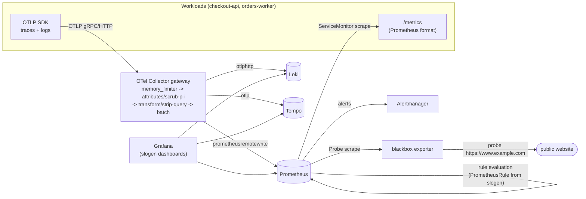
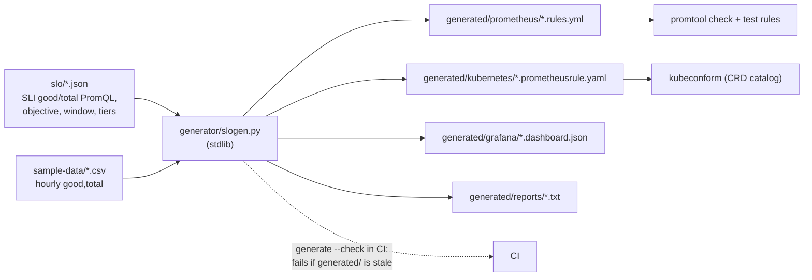
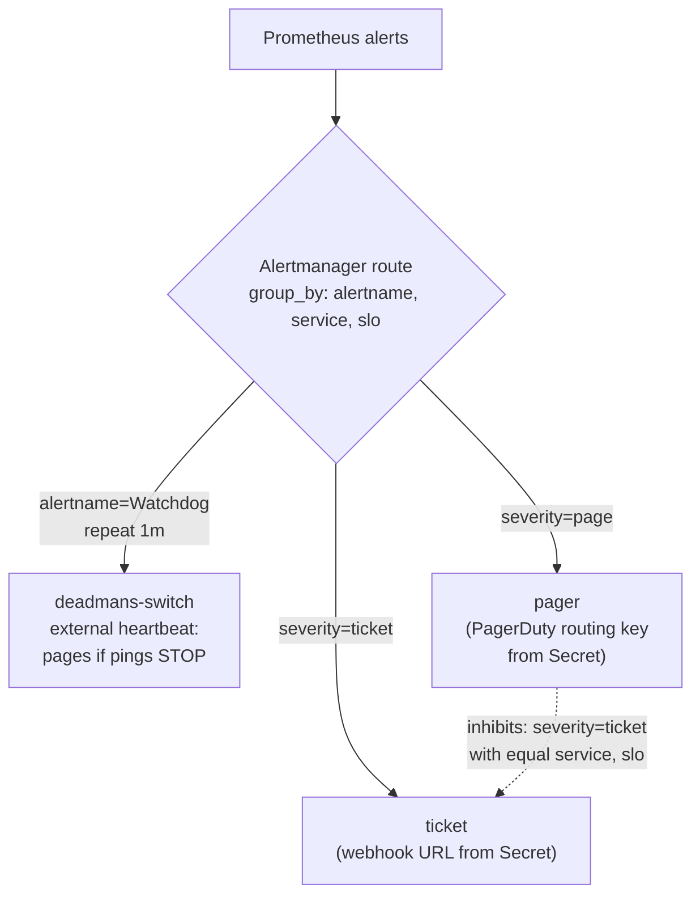

# Architecture

Three views: how telemetry flows, how an SLO file becomes rules and
dashboards, and how alerts are routed. Everything here is a reference design;
no cluster has run it. The rules, the Alertmanager config, the OTel Collector
config and the chart were checked with the real tools (promtool, amtool,
`otelcol-contrib validate`, kubeconform); see the README.

## Telemetry pipeline

Metrics are scraped (ServiceMonitor / Probe), because Prometheus pull gives
`up` and staleness for free. Traces and logs go through the Collector, which
is the single place PII is removed before anything is stored (ADR 0003).
Collector-pushed metrics land through remote write.

## SLO as code

Per SLO the generator emits:

- `slo:sli_error:ratio_rate{5m,30m,1h,2h,6h,1d,3d}`:
  `1 - ((good or vector(0)) / total)` over each window, labelled `service` and `slo`;
- `slo:objective:ratio`, `slo:error_budget:ratio`;
- `slo:sli_error:ratio_rate{28d|30d}`: mean of the 5m ratios over the window;
- `slo:period_error_budget_remaining:ratio`: `1 - period ratio / budget`;
- one alert per enabled tier:

| Tier | Severity | Burn | Long window | Short window | `for` | Budget used per long window (30d) |
|---|---|---|---|---|---|---|
| page-1h | page | 14.4x | 1h | 5m | 2m | 2% |
| page-6h | page | 6x | 6h | 30m | 2m | 5% |
| ticket-1d | ticket | 3x | 1d | 2h | 15m | 10% |
| ticket-3d | ticket | 1x | 3d | 6h | 15m | 10% |

An alert fires when the error ratio exceeds `factor x budget` over **both**
windows: the long window makes it significant, the short window makes it reset
quickly once the problem stops (ADR 0001).

Recording rules and alerts are in separate groups per SLO. A real Prometheus
runs groups on independent timers, so an alert can read a recording rule up to
one evaluation interval old; the promtool tests pin the order instead.

## Alert routing

- **Watchdog** is matched first. It always fires; the heartbeat service pages
  when it stops hearing it (runbooks/watchdog.md).
- **Inhibition:** while a page fires for an SLO, that SLO's tickets are
  muted. Same incident, already being handled.
- **Cluster vs local:** in the cluster the routing is an `AlertmanagerConfig`
  (chart) referenced as the Alertmanager's global config, with receivers
  reading credentials from an external Secret. Locally it is the native
  `local/alertmanager/alertmanager.yml` with every receiver pointing at the
  demo app's webhook sink. Tests assert both have the same structure.

## Error-budget report

`slogen.py report` replays the tiers over hourly `good,total` counts: burn per
window (traffic-weighted over the hours in the window), when each tier would
have fired and resolved, and the budget consumed as the sum of hourly burn
rates x 1h / SLO window. Hourly data can't resolve the 5m and 30m windows, so
those use the latest hour, and `for:` is not modelled. It answers "would our
alerting have caught last week's incident, and how much budget did it cost"
without a Prometheus.
